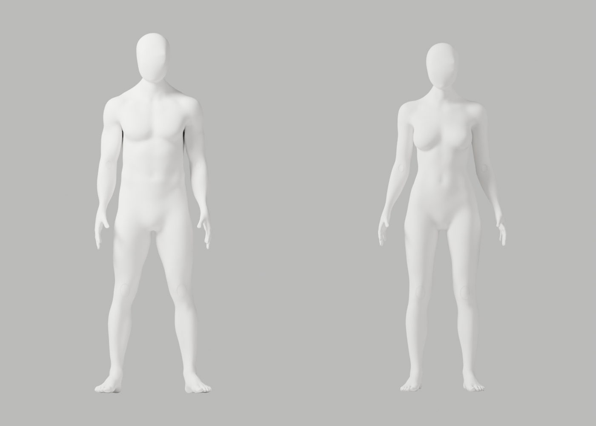
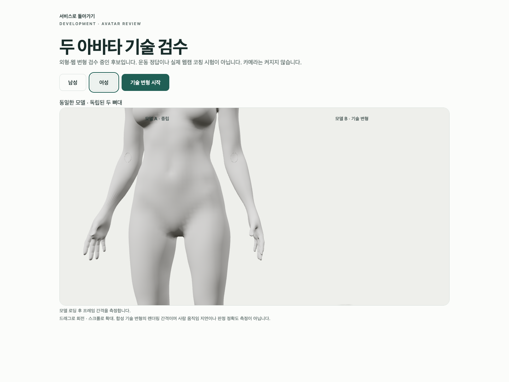

# A100 — 기존 손목 경계 대응·실제 검수

**외형 미통과·미채택**이다. 원본과 GLB 재수입의 전체 변형·실제 Chrome 검수는 완료했지만 Chrome 확대의 전완/손목 잔줄무늬와 뒤 목 P2가 남는다. 최신 사진의 얼굴–앞목 연결, 남녀 무의상 통일 백색·자연 곡선/필요 관절·리깅 정확도, 기존 원본/증거·개발 A37·Draft PR #9 미병합·전체1~6/승인 기준은 유지한다.

## 실제 변경·보존

[A99 대조](../candidate-a99-diagnosis/README.md)의 재절단 없는 경로를 별도 후보로 저장했다. A97의 이미 있는 손목 경계를 다시 자르지 않고 native subdivision으로 전완42점과 손96/94점의 수를 대응한 뒤 기존 SURFACE bridge를 재사용했다. 새 body/primitive/전체 remesh·머리 교체·강도 반복·좌표/skin 복원·검사 guard 완화는 없다. native operator 뒤 식별 tag만 연결하며 원래 source 점의 skin은 exact로 검사한다. 실행 파일의 ‘memory only’ docstring은 이전 진단에서 남은 표현이며 실제 후보 저장·4컷 생성은 파일/QA로 별도 확인했다.

국소 좁은 면 남212/여231→각0·긴 접힘80/47→9/11이다. 면과 연결이 바뀐 진단값으로, 고정 edge 개선률/해부학 정확도/외형 합격이 아니다. 독립 저장 재열기에서 영역 밖 남140155/여137978점의 좌표와 named skin, 보호 손50689/50673점, group 이름·각163 rest bone head/tail/행렬·신체/리그 행렬을 정확 보존했다. 손목 국소 위상은 바뀌었으며 전체 위상 보존을 주장하지 않는다.

## 실제 검증

| 검사 | 결과 |
|---|---|
| 원본 전체 QA | 121행/118변형·실패0·34PNG·최악ratio2.943930367 |
| GLB 재수입 전체 QA | 121행/118변형·실패0·34PNG·최악ratio2.947679803 |
| 구조 | 남녀 각163 bones·연결 성분1·nonmanifold0·정규화 오류0·통일 백색 |
| 실제 Chrome | 4개 통과·50.747034초·skipped/unexpected/flaky0·웹캠 요청0 |
| 보존 | 새 원본1/GLB2·90사본/5gzip·76실제PNG·byte/SHA256 대조 |
| 직접 열람 | 초회4+원본6+재수입8+Chrome4=22. 나머지54PNG는 생성·보존했으나 직접 열람하지 않음 |

Chrome154.0.8037.93/macOS15.6/24G84 버전을 다시 확인했다. M4/Mac16,12/16GiB는 이전 A94 장치 기록을 재사용했고 이번 sysctl 조회는 sandbox에서 exit1이다. headless1440×1080(default DPR1), 외부 연결 차단 하네스에서 두 독립 복제본·각8가중치 body2개·실제 WebGL loss/retry를 검사했다. 180 RAF는 남녀mean16.672/16.670ms·p95 17.300/17.400ms이며 GPU 처리시간/웹캠 코칭 지연이 아니다. 목20° 등 합성 스트레스는 올바른 운동 시범이나 전문가/임상 검증이 아니다.

GLB export의 geometry_deformation_pending과 producer/preservation의 full_deformation_qa=false는 **각 최초 생성 시점 기록**이다. 이후 실제 전체 QA는 별도 source/roundtrip 보고서로 확인한다. native 원본141691/139482점과 웹 파생141685/139474점은 구분한다. 기존 웹 fin repair6/8·weight limiting297351/293403·8가중치 제한·ratio1 및 기존 변형 guard3을 유지했다.

재수입 QA 첫 실행은 모델 읽기/Python 전에 Metal 초기화에서 exit139였다. crash backtrace를 보존하고 종료 확인 후 네이티브 Metal 접근으로 실제 전체 QA를 완료했다. 일부 stdout은 잘렸으며 전체 stdout 보존을 주장하지 않는다. armature-parent 경고5개·NO_COLOR/FORCE_COLOR·THREE.Clock·의도적 guest401/model503/error boundary·WebGL 정리 경고도 발생했다.

생산자 Ruff는 현재 기본/isolated 모두 S102(exec 사용)로 **exit1**이다. 실행한 코드/경고를 지우지 않으며 전체 style 통과라고 표시하지 않는다. trusted repository 함수2개만 AST로 읽는 offline 보완 스크립트이고 사용자 업로드/API 실행 경로는 아니다. preservation Ruff0·두 파일 isolated88 format0·copier syntax0·임시/복구 후 TypeScript/Biome0이다. 실제로 실행한 두 임시 browser 파일은 gzip 보존 후 본문/파일을 복구·제거해 기존 spec SHA와 diff0을 확인했고 새 tsbuildinfo만 제거했다. 향후 공용 native helper 직접 재사용 시 동적 실행 경로를 정리한다.

## 원본·증거·다음 작업

[별도 원본](../../bodyguard_avatar_candidate_a100_unapproved.blend): 29659162bytes/SHA abdb8ef2e2a09a0c3601b77e09b0393e590aa704d7f242cbf2f457b4bd2259b6.
[남성 GLB](bodyguard-male-candidate.glb):12622128bytes/SHA 7db7dc4b7dacdc97d0769378a5d09e7f54068394dc783e26e13e37b760188e50.
[여성 GLB](bodyguard-female-candidate.glb):12427736bytes/SHA d10caee92be45899abcc4d4091ae8fff3a1ca9bc8533135841260160a5e06e79.

[native 밀도](native-density.json), [독립 보존](saved-preservation.json), [원본 QA](source-deformation.json), [재수입 QA](roundtrip-deformation.json), [GLB 왕복](glb-roundtrip.json), [실제 Chrome](browser-report.json), [startup crash](native-startup.crash.txt), [명령/session/exit/미실행](execution-record.json), [사본 byte/SHA](copy-manifest.json)을 보존한다. 기존8파일과 A97/source maker SHA는 불변이다. 일회용 exclusive copier는 재실행하지 않는다.

```sh
node bodyguard/assets/blender/review/candidate-a100-review/evidence-check.cjs
```

실제 사람/웹캠·좌표 수집/저장/업로드·실제 시범/사용자 retarget·통합 지연·계정/API/DB/SMTP/OAuth 회귀·외부 Gmail/Google 연결·전문가 검토·시크릿/운영 DB/배포/출시는 이번에 미실행이다. 다음은 수치 통과에도 Chrome에 남은 국소 표면/법선과 뒤 목의 원인 분리다. 얼굴/필요 신체 구조 삭제, 조명/흐림으로 결함 은폐, 검사 기준 완화로 통과시키지 않는다.

## 실제 미리보기





[실제 뒤 목](import/faceless-body-back-male.png)도 미통과 근거로 보존한다.
