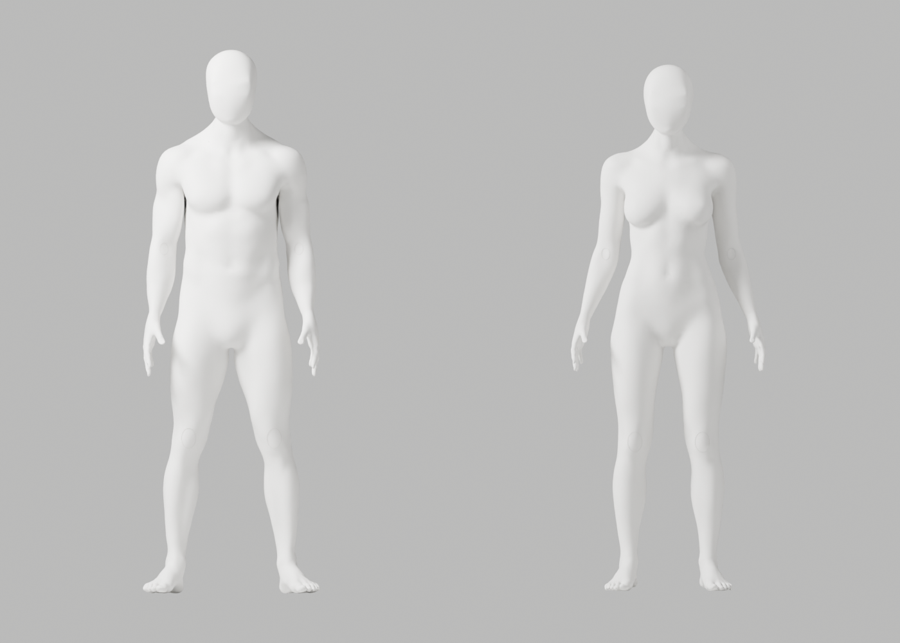
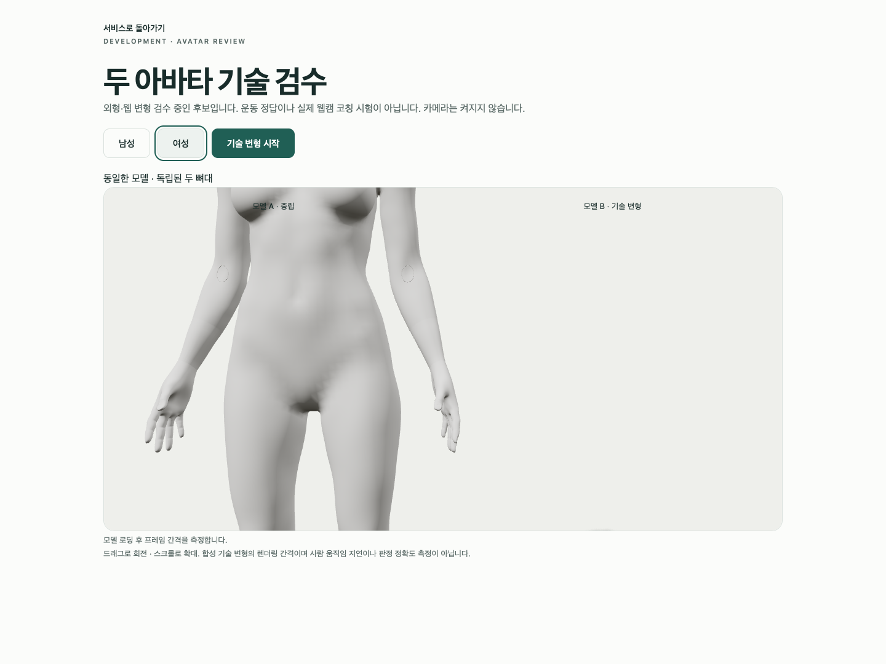

# A103 — native 손목 보간 수정·실제 재검수

**전체 외형 미통과·미채택**이다. 실제 Chrome 동일 확대에서 A100의 급격한 전완 잔줄무늬는 완화됐지만 넓은 손목 연결 음영·뒤 목·전체 참조/웹 마감 검수는 남는다. 최신 CEO 사진의 얼굴–목–어깨·무의상 남녀 동일 백색 표면과 필요한 신체/리깅 정확도, 이전 원본/증거·개발 A37·Draft PR #9 미병합·전체1~6 완료/승인 기준을 유지한다.

## 수정 근거와 보호 범위

설치 Blender5.1.1의 native Bridge Edge Loops는 PATH가 기본이고 기존 maker는 SURFACE를 명시했다. A102에서 같은 A100 원본·이미 대응된 남96/여94점 경계·6분할·smoothness1과 보호 guard로 SURFACE/PATH만 메모리 대조했다. 재절단/재분할·의상 제작·maker 전체 실행·동적 exec는 없다. SURFACE는 기존 통계와 같고 PATH는 국소 긴 접힘9/11→각0·좁은 면각0, 최대 기하 면각1.794349/2.510674→0.444922/0.368367rad였다. 이는 **author rest 연결 진단**, 사용자 각도/임상 효과·판정 정확도·외형 PASS가 아니다. 메모리 시험은 source를 저장하지 않았으며 별도 A103을 실제 저장한 뒤 재검증했다.

독립 저장 재열기에서 손목 영역 밖 남140155/여137978점의 좌표/named skin과 남200169/여196172면의 연결/winding, 보호 손50689/50673점, 그룹 이름·각163개 rest bones/head/tail/행렬·body/rig 행렬을 정확 보존했다. 앞목/얼굴도 영역 밖이다. 손목 bridge의 새 점은 native로 보간했으므로 전체 좌표/위상이 같다고 주장하지 않는다. 몸 전체 remesh·head graft·임의 인체/loft·좌표/skin 사후 복원·guard 완화는 하지 않았다.

## 실제 실행

| 검사 | 실제 결과 |
|---|---|
| 원본 전체 변형·재질/구조 | 121행/118변형·실패0·34PNG·최대ratio2.943930 |
| GLB 재수입 전체 변형·재질/구조 | 121행/118변형·실패0·34PNG·최대ratio2.947680 |
| 남녀 구조 | 각163bones·연결 성분1·nonmanifold0·정규화 오류0·무의상 통일 백색 |
| 실제 Chrome | 4개 통과·53.416116초·skipped/unexpected/flaky0·웹캠 요청0 |
| 보존 | 99사본/14gzip·76실제PNG·byte/decoded SHA 검증 |
| 직접 열람 | 대조4+원본9+재수입12+Chrome4=29. 나머지47PNG는 직접 열람하지 않음 |

기존 A100 Chrome 남녀 확대2장을 다시 열어 비교했으며 새로운 PNG 수/새 브라우저 실행으로 합산하지 않았다. 모든 authored SkinnedMesh10개는 확대에서도 보이며 camera만 변경했다. 외부 요청 차단·실제 GLB 두 독립 뼈대/추가8가중치·model503 retry·native WebGL context-loss/retry를 검사했다. 실제 승인 시범·사람 retarget/통합 코칭 시험이 아니다.

macOS15.6/24G84와 Chrome154.0.8037.93을 다시 읽었다. Mac16,12/M4/16GiB는 이전 A94 실제 측정을 재사용한다. headless1440×1080/DPR1의 180RAF는 남mean16.666667/p9517.5ms·여mean16.667778/p9517.4ms다. GPU 처리시간·실제 웹캠 인식/피드백 지연이 아니다. 목20° 등의 변형은 기술 stress이며 올바른 운동 처방/의학·해부학 승인이 아니다.

원본은141691/139482점, 웹은141685/139474점이다. 기존 exporter ratio1·fin repair6/8·native weight limiting297351/293403과8가중치 제한·1µm/3mm/.1mm/변형ratio3 기준을 그대로 적용했다. export 보고서의 deformation pending은 당시 상태이고 후속 실제 QA를 별도 보고서로 보존했다.

새 Python3개의 Ruff/default·isolated 검사와 isolated88 format, 임시/복원 TypeScript·Biome, copier 구문 검사는0이다. preservation 첫 format check1은 실행 전에 수정하고0으로 재검사했다. 임시 확대 testcase/client는 실행 byte를 gzip 보존한 뒤 원래 spec SHA/diff0으로 복원했고, 이번 tsc가 만든 untracked tsbuildinfo만 삭제했다. 이전 A100의 실행된 생산자 S102 기록을 이번 새 static 코드의 통과로 소급 해결하지 않는다. exporter 남성 armature-parent 경고5와 Chrome NO_COLOR/FORCE_COLOR·THREE.Clock·의도적 guest401/model503/error boundary·WebGL 정리 경고가 발생했다.

실제 사람/웹캠/pose 수집·저장·업로드0. 승인된 시범/user retarget·실제 웹캠 정확도/통합 지연·사람/전문가 practical test·API/auth/SQL/SMTP/Google 회귀·실제 외부 계정/시크릿/운영 migration/배포/출시는 이번에 미실행이다.

## 파일·반복 검사

- [별도 미채택 원본](../../bodyguard_avatar_candidate_a103_unapproved.blend): 29660726bytes / SHA25656766af46c8c5a1330d0d0c22c56ea9f287a9d871d8068afa0812a56e1fb9820.
- [남성 GLB](bodyguard-male-candidate.glb): 12622128bytes / SHA25649ce9e3e6221e9469f44793417c5bf5c896a5b61c1e9612d2abe266f0217060a.
- [여성 GLB](bodyguard-female-candidate.glb): 12427736bytes / SHA25690dc826e323802e4da4d930f7c45d9be31f3a3773d19767d251d2a5ed441779f.

[동일 윤곽 대조](interpolation-comparison.json), [native 저장](native-path.json), [독립 보존](saved-preservation.json), [원본 변형](source-deformation.json), [재수입 변형](roundtrip-deformation.json), [왕복](glb-roundtrip.json), [실제 Chrome](browser-report.json), [사본 manifest](copy-manifest.json), [명령/session/exit/환경/미실행](execution-record.json)을 보존했다. 전문 Blender 원본은 별도 파일이고 원본·GLB2와 모든 실제PNG는 독립 byte로 보존했다. native API preflight는 이전 연속 작업의 실제 session93529 결과를 재사용했다. gzip14에는 실제 코드6개와 tool 관측 출력8개가 있다. 모든 process stdout 보존을 주장하지 않는다. 임시 웹/왕복 .blend2개는 이 아카이브에 복제하지 않으며 재생성 경로는 실행 기록에 있다.

```sh
node bodyguard/assets/blender/review/candidate-a103-review/evidence-check.cjs
```

반복 가능한 것은 위 읽기 전용 검사다. 일회용 exclusive copier는 재실행하지 않는다. 새 native 재현은 이전 출력에 덮어쓰지 않는 새 경로에서만 한다.

다음은 개선된 손목 후보를 보존하면서 참조형 머리/앞목을 지킨 **뒤 목 국소 연결 원인 진단**이다. 실제 geometry/보호 영역을 확인한 뒤 한 번의 근거 있는 수정으로 진행하며 강도/전체 머리 교체 반복이나 guard 완화로 통과시키지 않는다.

## 실제 미리보기




