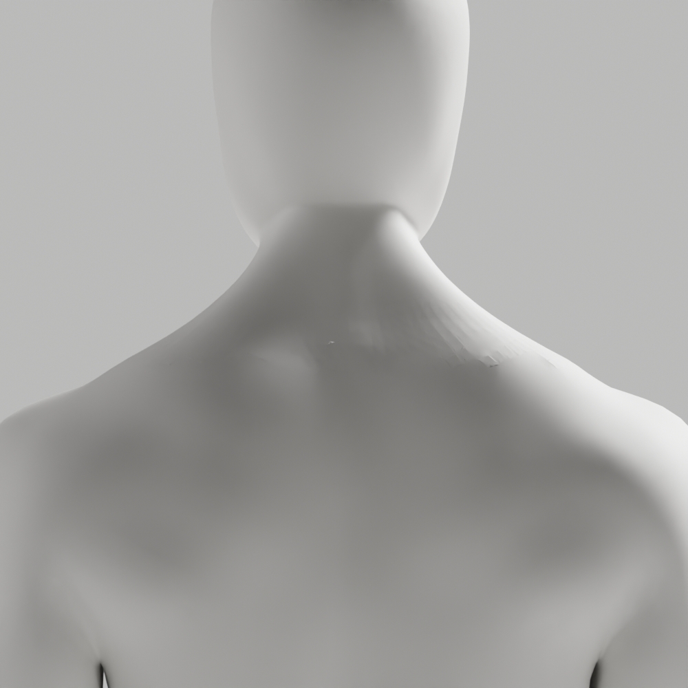
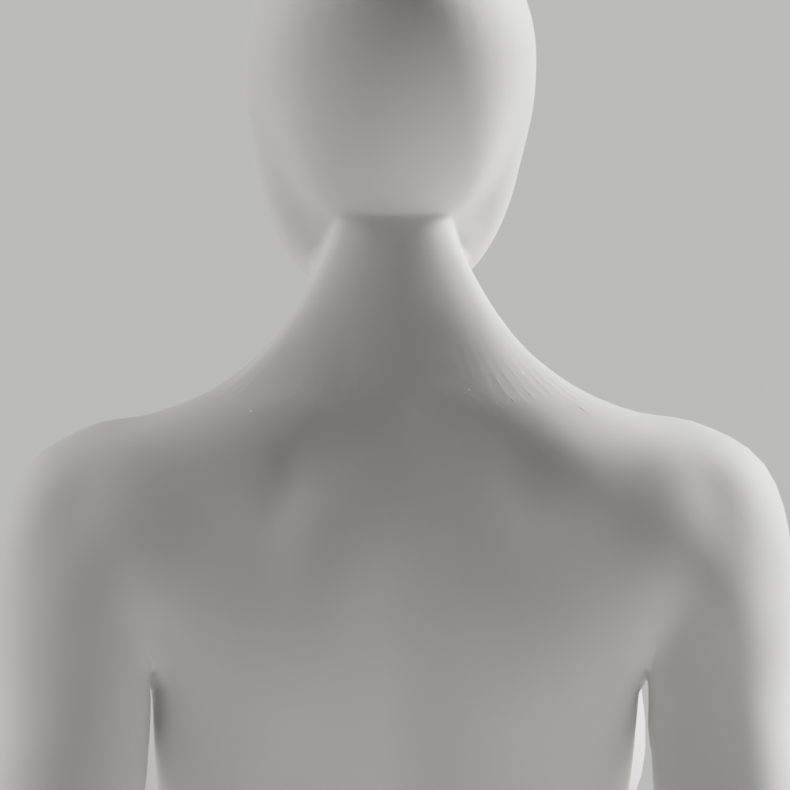

# A104·A105 — 뒤 목 교차 진단·품질 제한 면 연결 대조

**외형 미통과·미채택**이다. A103의 손목 개선과 최신 CEO 사진의 얼굴/앞목·무의상 남녀 통일 백색·필요 구조/리깅 정확도를 유지했다. 뒤 목의 급접힘을 진단하고 작은 native 패치에서 개선되는 연결만 메모리 대조했지만 실제 확대의 거친 면이 남아 있다. 새 원본/GLB를 저장하지 않았으며 개발 A37·이전 파일/검증·Draft PR #9 미병합·전체1~6단계/승인 기준은 그대로다.

## 실제 결과와 한계

| 실제 검사 | 남성 | 여성 |
|---|---:|---:|
| A104 국소 rest 삼각면 | 39,991 | 38,042 |
| 공유 정점 없는 BVH 후보 쌍 | 14 | 29 |
| 엄격한 native 선분 교차 검출 | 0 | 0 |
| 국소 1mm 초과/90° 초과 접힘 | 26 | 24 |
| 1e-10m² 미만 작은 면 | 1 | 2 |
| A105 선택한 native 면 연결 회전 | 10 | 4 |
| A105 메모리 대조 후 접힘 | 10 | 18 |

A104는 기존 뒤 목 영역 `y>0, abs(x/height)<.12, .79<z/height<.87`에 닿는 rest 삼각면만 조사했다. BVH 후보를 바로 침투로 기록하지 않고 공유 정점/동일 면을 제외한 뒤 native ray–triangle 교차로 검사했다. 정상 교차/미접촉/동일 평면 자체 검사도 실행했다. **공유 정점·거의 같은 평면의 겹침 및 0.1µm 이하 교차는 이 검사의 범위 밖**이다. 검출0은 전신/인접 면의 침투 없음이나 해부학 통과가 아니다.

A105는 원래 급접힘 edge 목록을 한 번만 순회했다. 각 native 회전을 먼저 작은 면 패치에서 시험하고 `긴 급접힘 수 감소 + 최대 기하 면각 감소 + 교체 면 최소 면적 악화 없음`을 모두 충족한 연결만 메모리 장면에 반영했다. 불리한 36개는 적용하지 않았다. 전체 좌표/skin·그룹 이름·각163개 rest 행렬·body/rig 행렬, 정점/edge/face 수·영역 밖 면/winding, nonmanifold0 guard를 실제 확인했다. 전체 위상 동일은 아니다. 얼굴/앞목/개선된 손목·손은 움직이지 않았다. 같은 카메라/1000×1000/32samples로 전후 남녀 **4실제PNG를 만들고 모두 직접 열람**했다.

이는 연결의 일부 결함을 분리한 결과이지 참조 외형 개선율·올바른 자세·의학·해부학·리타게팅 검증이 아니다. 실제 확대의 뒤 목과 머리 접점/표면 마감은 아직 부족해 이 메모리 장면을 후보 파일로 저장/채택하지 않는다. 같은 edge를 무조건 재회전하거나 조명/흐림/강도 반복으로 통과시키지 않는다.

native Blender5.1.1 두 프로세스 session54358/85918은 종료0을 확인한 뒤 다음 작업을 진행했다. 최초 default Ruff가 E501을 각각3/1개 보고했으며 실행 전 format/줄바꿈·시험 삼각면을 수정하고 최종 default/isolated/88 format을0으로 검사했다. command group의 마지막 종료0을 초기 개별 검사 통과라고 해석하지 않는다. 실행한 Python byte는 이후 바꾸지 않았다. 새 copier 구문/실행0, A103의 기존99사본 검사는 실제0이다. 이전 A100의 실행된 생산자 S102 기록을 소급 해결하지 않는다.

리뷰의 첫 읽기 전용 node scope scan은 닫는 괄호 오류로 실제 exit1/검사 전 중단됐다. 명령 구문만 수정한 재검사0에서 새 아카이브 text/gzip11파일의 제한된 시크릿 패턴 발견0·trace50행을 확인했다. 이는 전체 보안 감사가 아니다. 새 진단 논리의 P1/P2는 발견하지 않았지만 기존 A-02/A-08 외형 P2는 남는다.

실제 사람/웹캠/pose 수집0. **새 원본 저장·GLB 내보내기/재수입·118변형·Chrome·실제 코칭/성능은 이번에 미실행**이다. 이전 A103의 통과를 새 시험의 통과로 세지 않는다. 외부 계정/시크릿·운영 migration·배포/출시도 하지 않았다.

## 보존과 반복 검사

[국소 교차 보고서](posterior-intersections.json), [품질 제한 대조/거절 trace](merit-topology.json), [명령·session·exit·미실행](execution-record.json), [11사본/5gzip SHA manifest](copy-manifest.json)를 보존했다. gzip은 실제 Python2·copier1·tool 관측 로그2이며 전체 process stdout 보존을 주장하지 않는다. 새 PNG4는 실제 독립 byte다. A103 원본/GLB2·기존99사본 byte를 다시 대조했고 이전 증거를 덮어쓰지 않았다.

```sh
node bodyguard/assets/blender/review/candidate-a104-a105-diagnosis/evidence-check.cjs
```

이는 반복 가능한 읽기 전용 검사다. exclusive copier는 재실행하지 않는다. native 재현은 새 임시 출력에서만 한다. 다음은 남은 공유 정점/거의 평면 겹침과 실제 접선 배열을 확인한 뒤, 보호 범위/변형 기준을 유지하는 국소 geometry 수정이다. 수정 원본을 저장할 때 원본·GLB·전체 변형·실제 Chrome·외형을 다시 검수한다.

## 실제 확대

[남성 전](comparison/male-before-posterior.png) / [남성 후](comparison/male-after-posterior.png), [여성 전](comparison/female-before-posterior.png) / [여성 후](comparison/female-after-posterior.png). 미완성 면을 감추지 않았다.




