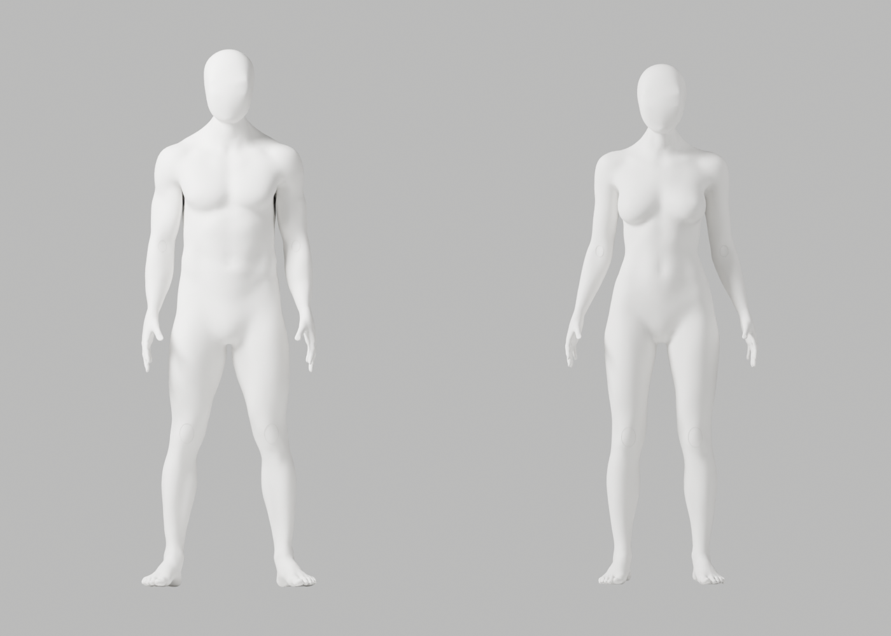
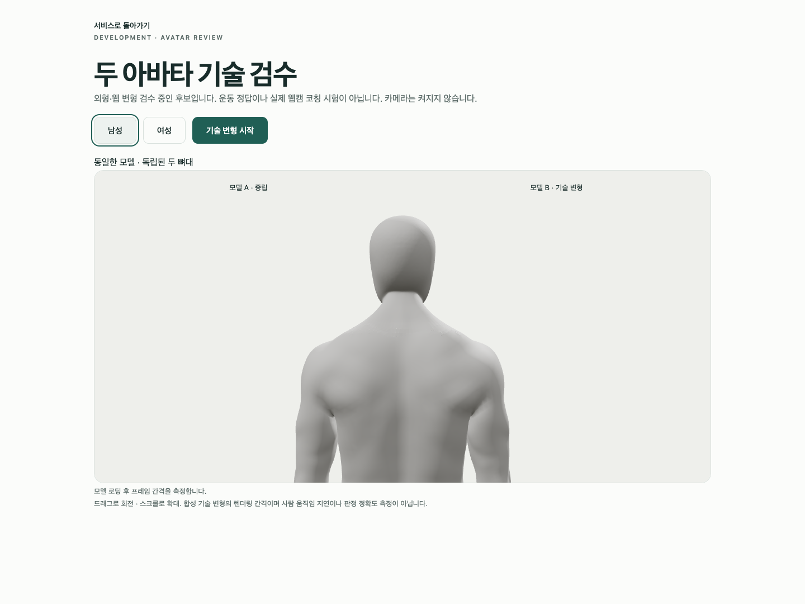
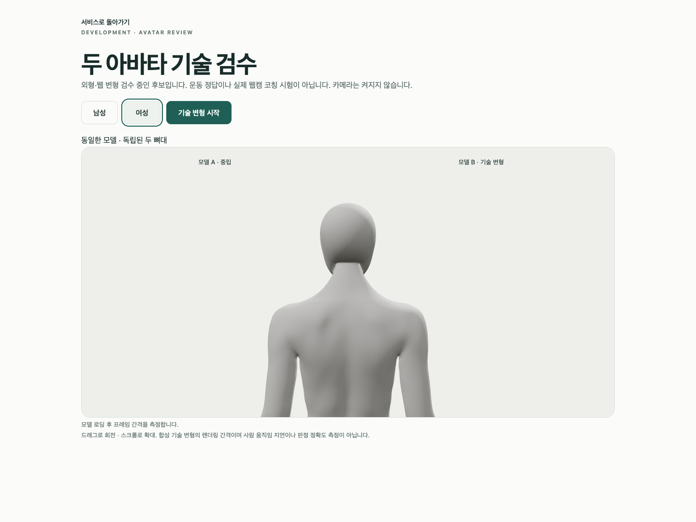

# A106 — 뒤 목 국소 정제·실제 원본/GLB/브라우저 재검수

**외형 미통과·미채택**이다. 최신 CEO 사진의 얼굴·앞목과 무의상 남녀 통일 백색 표면은 보호했다. 기존 전문 원본에서 진단한 뒤 목 접힘만 Blender native로 정제하고 별도 후보를 저장했다. 원본/GLB 재수입·기술 변형·Chrome은 실제 재검사했지만 뒤 목의 거친 면/후두부 연결·웹 마감이 아직 사진 기준에 못 미친다. 개발 A37·기존 파일/증거·Draft PR #9 미병합·전체1~6단계/승인 규칙은 그대로다.

## 변경과 실제 결과

A105의 **동일한 고정 byte**를 재사용해 유리한 국소 native 연결만 회전했다. 남26→10/여24→18 접힘을 재현한 뒤, 남은 접힘에 닿는 정점과 두 graph ring에만 고정 falloff를 적용했다. `CORRECTIVE_SMOOTH / LENGTH_WEIGHTED / only_smooth / factor.5 / iterations4` 한 번으로 남10→8/여18→16을 확인했다. 전체 목 smoothing·강도 반복·머리 교체·손목 재절단·조명 우회가 아니다.

| 실제 저장본 보존 검사 | 남성 | 여성 |
|---|---:|---:|
| 움직인 정점 | 458 | 598 |
| 최대 이동 | 1.113mm | 3.062mm |
| 영역 밖 좌표 정확 보존 | 141,233 | 138,884 |
| 보호 손 정점 정확 보존 | 50,689 | 50,673 |
| 보호 면/winding 정확 보존 | 163,585 | 161,793 |
| 교체 전/후 국소 면 | 20/20 | 8/8 |

별도 Blender 프로세스로 이전 A103과 새 저장본을 다시 열어 **전체 named skin·그룹 이름·각163 bones/head/tail/parent/rest 행렬·body/rig world 행렬**을 실제 비교했다. 얼굴/앞목/머리·손목/손의 좌표는 그대로다. 기존 6mm artist envelope와 nonmanifold0/tiny면 악화 없음 guard를 유지했다. 연결을 회전했으므로 **전체 위상 동일은 아니다**. 보호/진단 수치를 해부학·올바른 운동·미용 효과 승인으로 해석하지 않는다.

원본과 실제 GLB 재수입본 각각 **118개 기술 변형·121행·34실제PNG**, 실패0/최대 edge ratio **2.943930 / 2.947680 (<기존3)**를 확인했다. GLB는 각5mesh/163bones·native8weights, 이미지/운동clip0, ratio1이다. native fin repair 남6/여9·재수입 정점141685/139473을 구분한다. 원본/GLB 두 파이프라인에서 가중치가 byte 동일하다는 주장은 하지 않는다.

실제 Chrome154.0.8037.93/macOS15.6(24G84)/1440×1080에서 **4개44.874초**, skipped/unexpected/flaky0·웹캠 요청0을 확인했다. baseline3검사와 임시 카메라-only 뒤 목 확대1검사다. 두 뼈대의 독립성·8weights·GLB 실패/실제 WebGL 연결 상실 복구·native 외부 연결 차단을 검사했고, 확대에서도 **신체/관절 경계10mesh 모두 표시**했다. 180RAF 평균 남16.662/여16.667ms, p95 남17.4/여17.3ms는 합성 기술 변형의 프레임 간격이다. 실제 웹캠 지연/GPU 완료 시간/다른 노트북 성능이 아니다. OS/Chrome만 이번에 재측정했고 이전 하드웨어/RAM 측정을 새 측정으로 표시하지 않는다.

실제 PNG78 중 **직접 열람29**(원본14/재수입9/fairing2/Chrome4), 나머지49는 미열람이다. 임시 frontend37행과 카메라 client33행은 실제 byte로 gzip 보존한 뒤 원래 spec SHA와 개발 코드를 복원했고 typecheck/Biome0을 재확인했다. 초기 Biome1은 screenshot-call format1건으로 **실행 전 보완/0**했다. 새 Python2의 default·isolated Ruff/88 format0과 역사 A100 S102 미해결 기록은 구분한다. 잘못 짐작한 Story 파일명/기존 임시 경로의 읽기 실패는 실제 제작/변형 실패가 아니다.

native Blender5개와 실제 Chrome1개가 각각 종료0을 확인한 뒤 다음 actor를 실행했다. Blender export의 male parent 경고5개·Chrome NO_COLOR/FORCE_COLOR/THREE.Clock·의도된401/503·context-loss cleanup 경고가 있었으며 warning-free라고 주장하지 않는다. 전신/인접/평면 침투, 실제 사람/코칭/리타게팅·승인 동작·회원/운영/HTTPS 검사는 이번에 미실행이다.

## 보존·재현

[수정 가능한 별도 원본](../../bodyguard_avatar_candidate_a106_unapproved.blend), [남성GLB](bodyguard-male-candidate.glb), [여성GLB](bodyguard-female-candidate.glb), [저장본 독립 보존](saved-preservation.json), [원본변형](source-deformation-report.json), [GLB변형](roundtrip-deformation-report.json), [실제Chrome](browser-report.json), [명령/session/exit/열람·미실행](execution-record.json), [101사본/12gzip SHA](copy-manifest.json)를 보존했다. 새 web/재수입 blend도 별도 사본으로 보존한다. 로그는 tool 관측 chunk이며 전체 stdout 보존을 보장하지 않고 export의 중간 출력 일부는 저장되지 않았다. A103의99사본과 A104/A105의11사본·이전 원본/GLB·helper·개발 A37 byte는 다시 검사하며 이전 증거를 덮어쓰지 않았다.

```sh
node bodyguard/assets/blender/review/candidate-a106-review/evidence-check.cjs
```

반복 가능한 읽기 전용 검사를 실제 종료0으로 실행했다. 새 text/gzip19개의 제한된 시크릿 패턴 검사도0/발견0이며 전체 보안 감사가 아니다. exclusive copier는 재실행하지 않는다. 실제 native 명령은 execution record에 있으며 반드시 새 출력 경로에서 재현한다. 문서화·코드 리뷰 스킬로 증거/보존/미실행을 점검했지만 기존 **A-02/A-08 외형 P2는 남아 PR #9를 병합할 수 없다**. 다음은 남은 뒤 목 접선/연결을 보존 범위 내 국소 패치로 수정하는 작업이다. 합성 검사 통과를 S2.4/1~6단계 완료로 바꾸지 않는다.

## 실제 미리보기 — 완성판 아님






