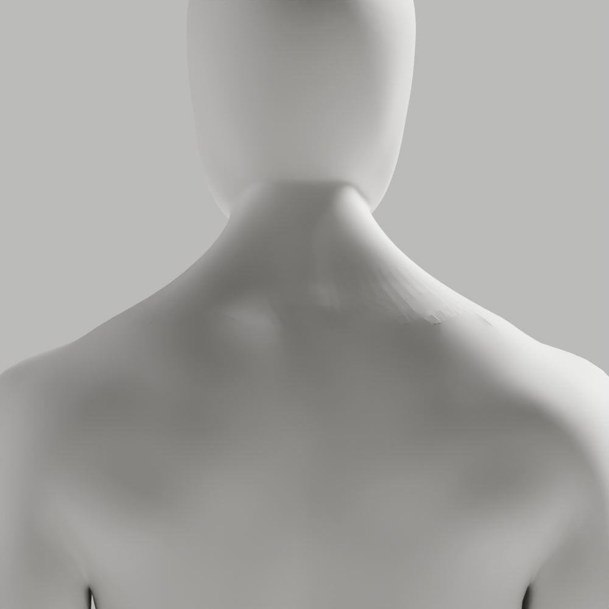
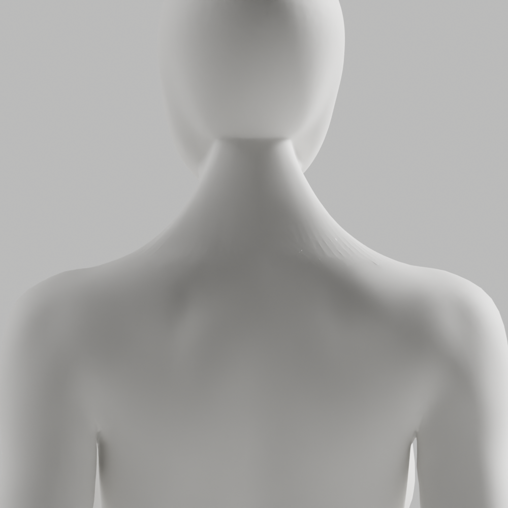

# A107–A109 — 뒤 목 패치·법선 원인 분리

**외형 미통과·새 원본/GLB 저장 없음**이다. Blender 메모리에서 작은 결함 패치를 재연결해 큰 접힘은 줄었지만, 실제 확대의 거친 띠는 남았다. 법선만 바꾼 대조도 채택하지 않았다. 최신 CEO 사진의 얼굴/앞목·남녀 무의상 통일 백색·필요 구조/리깅 정확도·이전 원본/증거·개발 A37·Draft PR #9 미병합·전체1~6/승인 기준은 유지한다.

## 실제 대조

A107은 A106 입력을 읽기만 해 남8/여16 접힘을 조사했다. 모든 해당 두 면은 삼각형이며 일부 면 법선은 거의 반대 방향, 정점에 연결된 edge는 최대23개였다. 이는 실제 기하 연결 문제이며 단순 flat flag 누락으로 취급하지 않는다.

A108은 접힘 정점의 한 번 정해진 인접 면만 선택했다. 단일 경계·degree2·Euler1인 닫힌 디스크5개씩을 Blender native `holes_fill → triangulate/BEAUTY`로 대조했다. 여성의 닫힌 디스크가 아닌2구간은 건드리지 않았다. 유지 정점의 좌표/skin·보호 손·각163rest bones/행렬·변경 밖 면/winding을 메모리에서 정확 비교했다.

| 실제 국소 메시 검사 | 남성 | 여성 |
|---|---:|---:|
| 큰 접힘 전→후 | 8→1 | 16→7 |
| 교체한 원래 면→새 삼각면 | 123→83 | 156→111 |
| 제거된 패치 내부 정점 | 20 | 29 |
| 양방향 표본 표면 거리 최대 | 0.027mm | 0.178mm |
| global nonmanifold / winding 불일치 | 0 / 0 | 0 / 0 |

전체 위상은 동일하지 않다. 표면 거리는 **표본 비교**이며 전신/인접/평면 충돌·필요 구조/해부학·변형/임상 검증이 아니다. 작은 면 수는1/2로 악화하지 않았으나 이미지의 거친 띠는 거의 그대로다. 재연결 원인은 확인했지만 외형 해결로 확대하지 않는다.

A109는 **동일한 고정 A108 실행 코드**를 재사용한 뒤 신체 좌표/연결/skin/그룹명을 유지하고 뒤 목 정점19795/18813개에 native `WEIGHTED_NORMAL / FACE_AREA_WITH_ANGLE / keep_sharp / default weight`를 한 번 대조했다. [Blender5.1 공식 설명](https://docs.blender.org/manual/pt/5.1/modeling/modifiers/normals/weighted_normal.html)은 면적·모서리 각도를 곱한 법선과 vertex group 범위를 설명한다. 실제 남성의 거친 띠가 남아 **법선 변경 미채택**이다. 이 결과는 법선의 영향 전부를 배제하거나 유일한 원인을 증명한 것이 아니다. 보고서의 `outside_exact_normal_count`는 `acos(clamped dot)==0` 개수일 뿐 byte/vector 동일 검사가 아니다. float 길이가 angle에 영향을 줄 수 있어 영역 밖 법선 정확 보존이라고 주장하지 않는다.

native3회 모두 실제 종료0을 확인한 뒤 다음 actor를 실행했다. 실제1000×1000 PNG10개를 만들고 **전부 직접 열람**했다. 새 source/GLB·118변형·Chrome·웹캠/사람·운영/배포는 이번에0/미실행이다. [이전 A106의 원본/GLB/118/Chrome](../candidate-a106-review/README.md)을 이번 대조의 통과로 재사용하지 않는다.

## 보존·반복 검사

[입력/명령/session/exit·검사 한계](execution-record.json), [접힘24곳](remaining-fold-patches.json), [패치 대조](patch/patch-trial.json), [법선 대조](normal/normal-trial.json), [25사본/7gzip SHA](copy-manifest.json)를 보존했다. 코드는 실제 실행 byte의 gzip이며 기존101사본/원본/GLB는 변경하지 않았다. 로그는 관측 chunk로 A107은 truncation, A109는 최종 chunk만 있어 전체 stdout 보존이라고 표시하지 않는다.

```sh
node bodyguard/assets/blender/review/candidate-a107-a109-diagnosis/evidence-check.cjs
node bodyguard/assets/blender/review/candidate-a106-review/evidence-check.cjs
```

초기 A107 format1·A108 B0233건은 native 실행 전 수정했다. 최종 Python3개 default/isolated Ruff·88format0을 실제 확인했고 이전 A100 S102와 구분한다. 문서화/코드 리뷰에서 법선 angle-count의 한계를 확인해 명시했다. **A-02/A-08 P2는 남아 병합 금지**다. 다음은 측정한 정점 fan/경계를 근거로 뒤 목 연결을 국소 보완한다. 조명·법선 우회나 smoothing 강도 반복으로 통과시키지 않는다.




