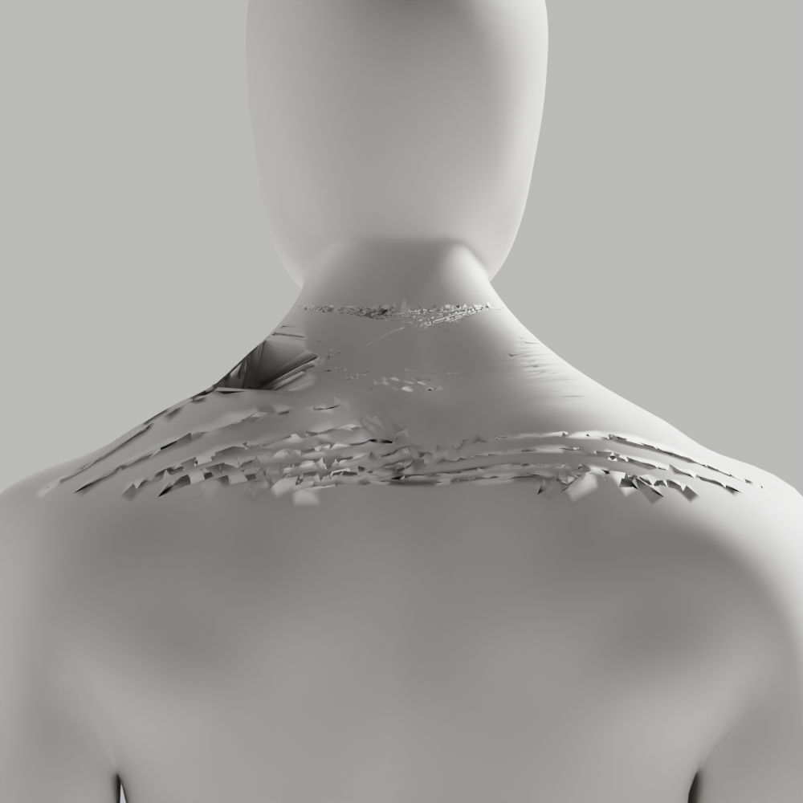
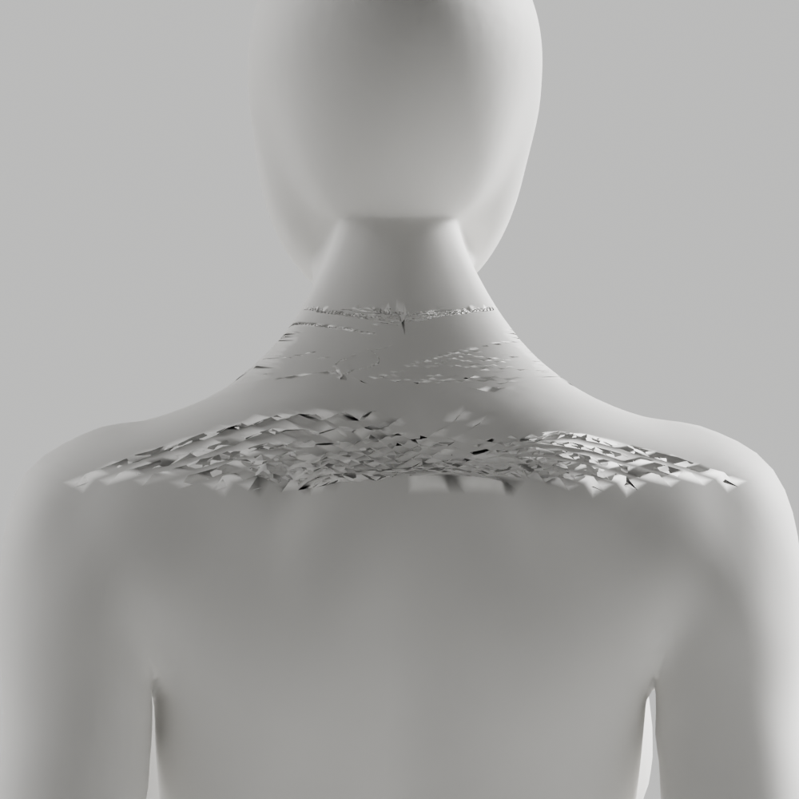

# A110–A114 — 재연결 후 정제·자동 격자 대조

**모든 수정 대조 미채택·새 원본/GLB 저장 없음.** 최신 CEO 참조의 얼굴/목/연속 연결, 남녀 무의상 중성 백색·자연 곡선/관절·필요 구조/리깅 정확도, 이전 원본/증거·개발 A37·전체1~6/승인 기준은 유지한다. A-02/A-08 P2가 남아 Draft PR #9 병합 금지다.

## 실제 결과

A110은 동일한 고정 A108 닫힌 디스크 재연결 뒤 **고정 A89 mask/factor.6/32회**를 한 번 적용했다. 접힘 남1→6/여7→16으로 악화하여 실패했다. 최대 이동2.270/4.294mm·손/skin/rest/영역 밖 보존만으로 통과시키지 않는다.

A111 읽기 전용 native RNA/경계 조사에서 같은 정해진 뒤 목 범위의 남성은 degree2 단일 경계374/Euler1, 여성은 경계367/degree4 한 점을 확인했다. A112에서 가장 큰 face-edge 연결 성분을 사용하니 여성 경계363이 홀수여서 **수정 전 guard 종료1**이었다. 남성 곡면 Grid Fill은 접힘8→3503/표본 거리 최대48.559mm로 실패했다.

A113은 여성이 원래 경계 삼각면 하나를 **제거하지 않고 유지**해 경계364를 만들었다. native simple grid 후 새 점만 원래 전문 입력 표면에 `SHRINKWRAP/NEAREST_SURFACEPOINT/ON_SURFACE/offset0`로 맞췄다. A114는 여기에 기존 경계의 시작점과 폭93/91을 명시했다. [Blender5.1 Grid Fill 공식 설명](https://docs.blender.org/manual/ja/5.1/modeling/meshes/editing/face/grid_fill.html)은 마주 보는 정점 수/격자 폭/시작점/simple interpolation을 설명한다. **설정 조정으로 경계 대응이 보장되지는 않았다.**

| 실제 대조 | 남성 | 여성 |
|---|---:|---:|
| A113 새 점 | 6006 | 179 |
| A113 접힘 전→후 | 8→1498 | 16→119 |
| A113 양방향 표본 거리 최대 | 19.285mm | 20.433mm |
| A114 새 점 | 8556 | 8100 |
| A114 접힘 전→후 | 8→2370 | 16→2352 |
| A114 양방향 표본 거리 최대 | 25.739mm | 1.591mm |

A114 여성 거리만 기존6mm 기준 이내지만 접힘2352로 **불합격**이다. 전부 nonmanifold/winding0·새 skin 정규화 오류0이어도 실제 외형은 거친 접힘/띠가 남았다. 유지 정점/skin·보호 손·각163rest/행렬·변경 밖 면/winding의 메모리 정확 보존을 확인했으나 내부 정점을 제거/생성하므로 전체 위상 동일이 아니다. 표본 거리는 전수 표면·해부학·충돌·임상/변형 검증이 아니다.

native 실행은 A110/111/113/114 종료0, A112 종료1을 각각 실제 확인했다. 새1000×1000 PNG17개 중 **11개 직접 열람**, 미열람6개는 before 이미지이며 별도로 기록했다. 이번 새원본/GLB/118변형/Chrome/사람/웹캠/운영/배포는0/미실행이다. 이전 [A106 검수](../candidate-a106-review/README.md)를 새 대조의 통과로 대신하지 않는다.

## 보존과 다음 조치

[42사본/11gzip SHA](copy-manifest.json), [명령/session/종료/열람 범위·한계](execution-record.json), [읽기 전용 경계](boundary-probe.json), [fairing](fairing/repaired-surface-trial.json), [실패/부분 Grid Fill](curved-grid/grid-trial.json), [simple](simple-grid/grid-trial.json), [explicit](explicit-grid/grid-trial.json)을 보존했다. 기존 A106/A107–A109 원본·증거는 변경하지 않았다. 로그는 관측 chunk이며 완전 stdout 보존이라고 주장하지 않는다.

```sh
node bodyguard/assets/blender/review/candidate-a110-a114-diagnosis/evidence-check.cjs
node bodyguard/assets/blender/review/candidate-a107-a109-diagnosis/evidence-check.cjs
node bodyguard/assets/blender/review/candidate-a106-review/evidence-check.cjs
```

새 Python5개 default/isolated E4/E7/E9/F/I/B/88format 실제0, 실행 전 formatting·bound lambda 보완과 역사 A100 S102 미해결을 구분한다. 문서화·코드 리뷰는 **exit0≠품질 통과**, 부분 실행/미열람/표본 검사의 한계를 명세에 반영했다. 다음은 이 넓은 bbox 자동 격자 방식을 중단하고 실제 순서화 경계의 해부학적 대응/quad flow를 조사하는 것이다. 임의 span/corner·smoothing 강도·법선/조명으로 결함을 숨기지 않는다.




