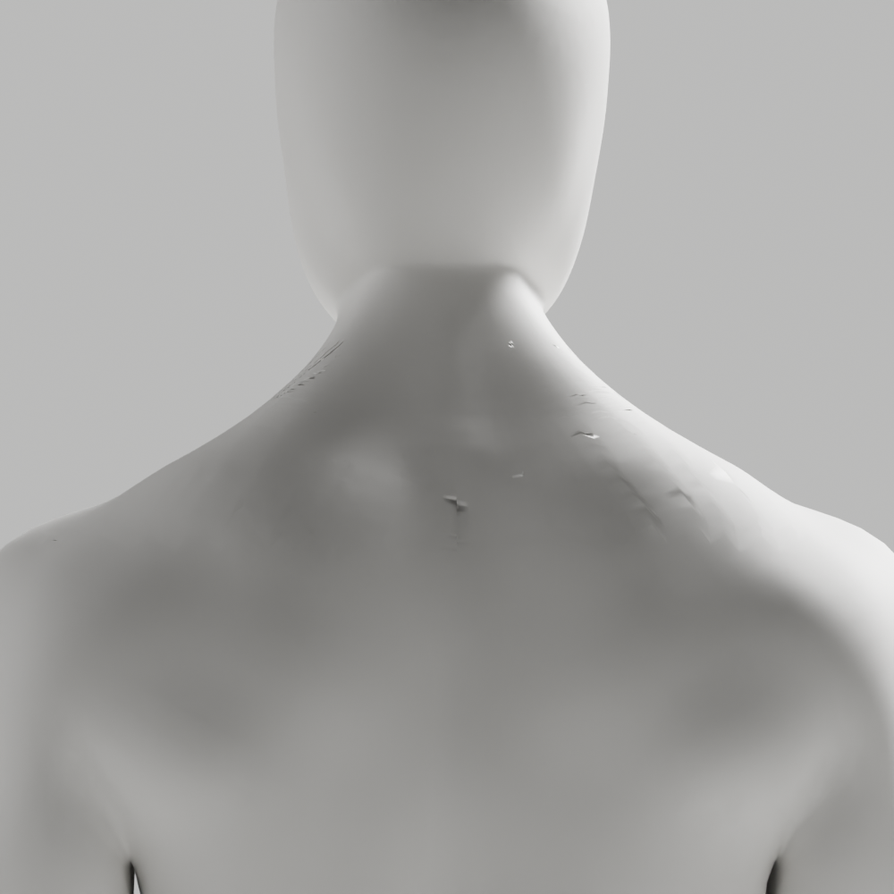
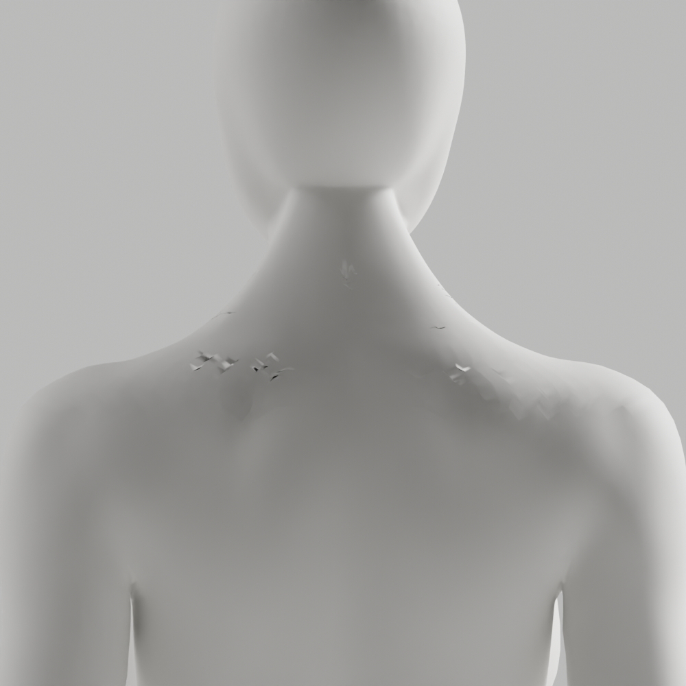

# A116–A118 — 실측 두 경계·작업 대상 보완·국소 삼각면 대조

**전체 외형/기하 미통과·미채택·새 원본/GLB 저장 없음.** [A115 실측 경계](../candidate-a115-diagnosis/README.md)의 실제 위/아래 열린 edge chain을 native 기능에 직접 제공했다. 임의 span/corner·면 선택 split/prepare·여성 parity 삼각면 수정은 없다. [설치 build와 같은 Blender 공식 소스](https://github.com/blender/blender/blob/b70da489d7f4/source/blender/bmesh/operators/bmo_fill_grid.cc#L592)의 두 열린 경계·rail·점 수 확장/후속 collapse 경로를 실제 읽었고, 제품 코드에 복사하지 않았다.

## 원인과 실제 보완

A116에서 editor 선택 경로를 제거하면서 Blender **active body 지정도 빠졌다**. 남성의 표면 맞춤 성공/남은 modifier 검사를 하지 않았으므로 보고서의 `native_conformance`는 요청 설정일 뿐 실제 성공 증거가 아니다. 남성의 raw/after 접힘197 동일·표본 거리26.372mm를 성공한 맞춤으로 비교하지 않는다.

A117은 같은 두 경계/단순 보간/원래 표면 맞춤을 유지하면서 신체 각각의 active 대상을 지정하고 modifier 두 연산의 **FINISHED·원래 리그 modifier 하나만 남음**을 assert했다. 실제 시작 active는 여성, 그 뒤 남성→여성 지정이 확인됐다. 원래 신체 형상에 더 가까워졌지만 작은 핀칭/접힘은 남았다. 디버깅·코드 리뷰는 native 종료0과 실제 적용 성공을 구분하도록 이 가드를 추가했다.

| 실제 후면 국소 검사 | A116 남/여 | A117 남/여 | A118 남/여 |
|---|---|---|---|
| 접힘 전→후 | 8→197 / 16→235 | 8→594 / 16→235 | 8→671 / 16→293 |
| 작은 면 전→후 | 1→0 / 2→4 | 1→10 / 2→4 | 1→17 / 2→9 |
| 양방향 표본 거리 최대 | 26.372 / 0.799mm | 0.848 / 0.799mm | 0.848 / 0.727mm |
| 기하 guard | 실패/실패 | 실패/실패 | 실패/실패 |

A118은 실제 웹 삼각면 변환을 비교하려고 새 연결 면만 native `triangulate/BEAUTY` 했다. 변환 전후 **전체 좌표/skin 정확 동일**을 assert했고 영역 밖 면/winding도 보존했다. 접힘·작은 면은 악화하여 삼각분할만으로 해결되지 않는다. 이 작업은 국소 변환 대조이지 GLB 내보내기/전체 웹 검증 완료가 아니다.

남/여 원래 내부19291/18293점이 교체되고 새10918/9760점이 생성됐다. 유지 점 좌표/skin·보호 손·각163rest bones/행렬·영역 밖 면/winding은 메모리에서 정확 비교했고 nonmanifold/winding0·새 skin 정규화 오류0이다. **전체 위상 동일·해부학/변형/임상 통과는 아니다.** 표본 거리<1mm도 접힘/외형 불합격을 덮지 않는다.

## 보존과 검증

native sessions25397/1450/9486 실제 종료0을 각각 확인한 뒤 다음 actor를 실행했다. 실제1000×1000 PNG12개 중 after6개 직접 열람, before6개 미열람을 구분했다. [29사본/7gzip SHA](copy-manifest.json), [명령/종료/검사 한계](execution-record.json), [초기 대상 미확인](unverified-context/grid-trial.json), [실제 대상 확인](verified-context/grid-trial.json), [국소 삼각면](web-triangles/grid-trial.json)을 보존했다. 실행 후 producer byte는 수정하지 않았다.

```sh
node bodyguard/assets/blender/review/candidate-a116-a118-diagnosis/evidence-check.cjs
node bodyguard/assets/blender/review/candidate-a115-diagnosis/evidence-check.cjs
node bodyguard/assets/blender/review/candidate-a110-a114-diagnosis/evidence-check.cjs
```

새 Python3개 default/isolated/88format 실제0이다. 이전 원본/GLB/증거는 보존하며 새 source/GLB/118변형/Chrome/실제 사람·웹캠/운영/배포는0/미실행이다. A106의 이전 전체 검수로 대체하지 않는다.

다음은 실제 접힘의 새 면 배치와 표면 맞춤 전후 이동을 조사한 후 국소 연결을 보완한다. 설정 강도·조명/법선 우회·guard 완화·좌표/skin 복원으로 실패를 숨기지 않는다. 최신 CEO 얼굴/목 연속 연결·무의상 남녀 백색/곡선/관절·필요 구조/리깅 정확도·개발 A37·A-02/A-08 P2/Draft PR #9 미병합·전체1~6/승인 기준은 유지한다.




