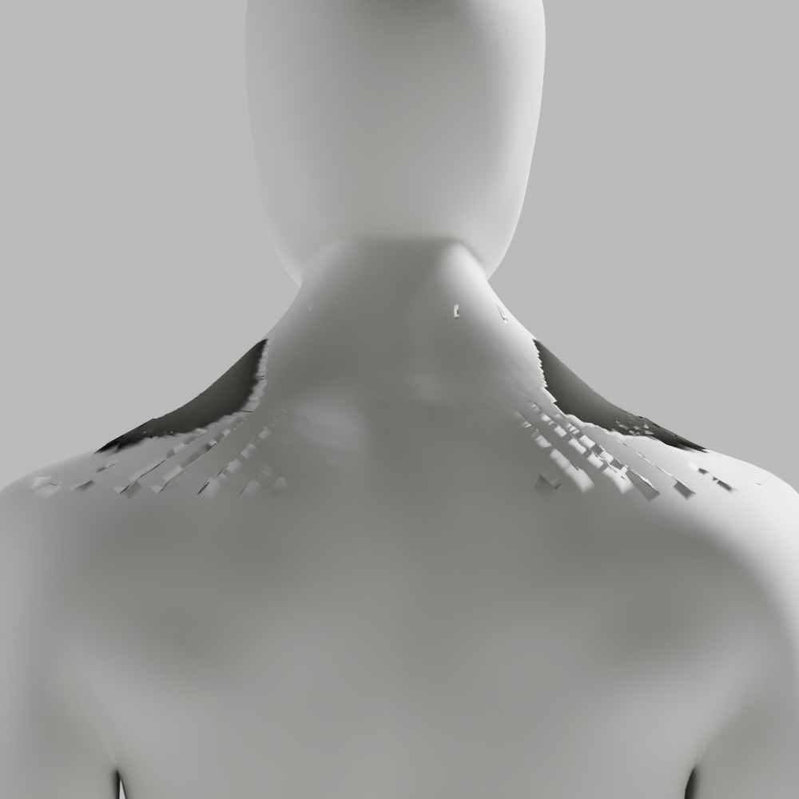
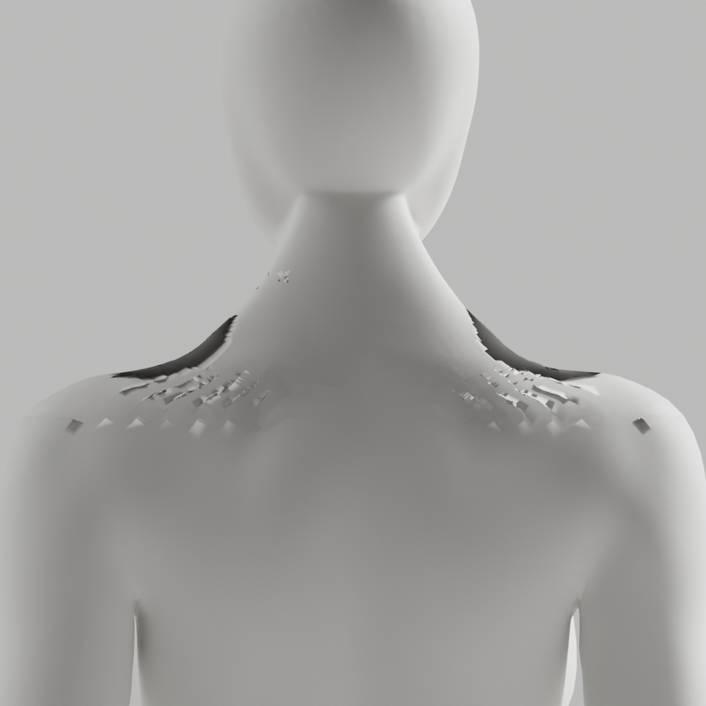

# A119–A120 — 목 표면 맞춤의 실제 면 배치 추적

**기하·외형 불합격, 미채택, 새 원본/GLB 저장 없음.** [A117–A118](../candidate-a116-a118-diagnosis/README.md)의 같은 전문 원본·실측 두 열린 경계·native 단순 격자를 재사용했다. 맞춤 전후 고유 authored point ID·전체 skin·면 ring/winding을 대조해 좌표 이동과 XZ 투영 방향 변화를 추적했다. 임의 span/corner·여성 parity 편집·원래 좌표/skin 사후 복원은 없다.

| 실제 남/여 검사 | A119 최근접 표면 맞춤 | A120 깊이(Y축)만 맞춤 |
|---|---|---|
| XZ 투영 방향 뒤집힘 | 3995 / 2065 | 0 / 0 |
| 투영 뒤집힘 중 국소 긴 접힘에 인접한 삼각면 | 559 / 209 | 0 / 0 |
| 긴 접힘 원래→후 | 8→671 / 16→293 | 8→679 / 16→445 |
| 작은 면 원래→후 | 1→17 / 2→9 | 1→0 / 2→0 |
| 원래 표면과 양방향 표본 거리 최대 | 0.848 / 0.727mm | 21.382 / 12.988mm |
| 전체 기하 guard | 실패 / 실패 | 실패 / 실패 |

A119는 맞춤 과정에서 X/Z도 최대 남12.338/21.752mm·여8.088/14.588mm 이동함을 확인했다. **생성된 raw 격자 전후 이동**이지 원래 신체의 이동/사용자 측정 오차가 아니다. 원래 표면에 가깝다는 표본 거리만으로 면 배치/외형 통과를 판단할 수 없다.

A120은 [설치 build와 같은 Blender 공식 RNA](https://github.com/blender/blender/blob/b70da489d7f4/source/blender/makesrna/intern/rna_modifier.cc)의 PROJECT 축·양방향 속성을 실제 읽고, native PROJECT/Y only/양방향/cull OFF/offset0을 적용했다. 전체 X/Z 이동은 정확히0, 투영 방향 뒤집힘0이지만 실제 목–어깨에 깊은 홈/핀칭이 생겼다. 기존6mm 표본 거리와 접힘 guard를 모두 실패해 **깊이 투영은 해결책이 아니다**. 문서/API web 열기3회는402 실패여서 그 페이지 내용에 근거한 주장은 없다. 공식 코드 구현을 제품에 복사하지 않았다.

## 확인된 것과 한계

맞춤 전부터 격자의 긴 접힘197/106이 있다. 각 실행의 최종 native BEAUTY 삼각면을 같은 point ID로 전후 대조했고 raw XZ 부호도 혼재했다. A119/A120의 BEAUTY 대각선 선택은 서로 다를 수 있으므로 실행 간 raw 삼각면 부호 개수의 차이를 같은 면 비교로 주장하지 않는다. 수치 분류 epsilon1e-12 m²는 차트 진단용이며 품질 기준을 완화한 것이 아니다. **XZ 부호 변화는 전체3D 충돌·해부학·임상 증거가 아니다.**

유지된 원래 좌표/skin·손·각163rest 행렬/world·영역 밖 면/winding, 맞춤 전후 전체 skin/면 ring 동일을 메모리에서 assert했다. native 적용 대상/FINISHED/원래 rig modifier만 남음·새 skin 정규화 오류0·nonmanifold/winding0도 확인했다. 내부 원래19291/18293점 교체·새10918/9760점 생성으로 **전체 위상은 다르며**, 리깅 정확도/118변형 통과를 의미하지 않는다.

## 보존·재검사

native sessions24406/27886 실제 종료0을 순차 확인했다. [14사본/5gzip·137기존 파일 SHA 보존](copy-manifest.json), [실행 명령·실패/미실행](execution-record.json), [A119 측정](nearest/grid-trial.json), [A120 측정](directional/grid-trial.json)을 남겼다. A119 중간 stdout chunk999331은 대화에서 확인했지만 로그에는 초기/최종 chunk만 보존했고, 실제 생성 JSON의 전체 측정값과 구분한다. A120도 독립 stdout 캡처가 아닌 관측된 tool chunk이다.

실제 A120 PNG2개 모두 직접 열람·반려했다. producer2개 default Ruff/isolated E4,E7,E9,F,I,B/88format은 실행 전 실제0, 실행 후 producer 편집은 없다. 새원본/GLB/전체118변형/Chrome/사람·웹캠/운영 migration/배포는 미실행이다. 이전 A106 전체 QA를 새 진단의 완료로 대체하지 않는다.

```sh
node bodyguard/assets/blender/review/candidate-a119-a120-diagnosis/evidence-check.cjs
node bodyguard/assets/blender/review/candidate-a116-a118-diagnosis/evidence-check.cjs
```

다음은 **raw 격자의 뒤집힌 투영 면이 native 확장/collapse rail·경계 fan 중 어디에 모이는지** 좁혀 국소 연결을 보완한다. 넓은 격자/강도 설정 반복·조명/법선 우회·guard 완화로 통과시키지 않는다. 최신 CEO 얼굴/목 연속 참조·남녀 무의상 통일 백색/자연 곡선·관절/필요 구조·리깅 정확도·개발A37·이전 파일/증거·A-02/A-08 P2/Draft PR #9 미병합·전체1~6/승인 기준은 그대로다.




