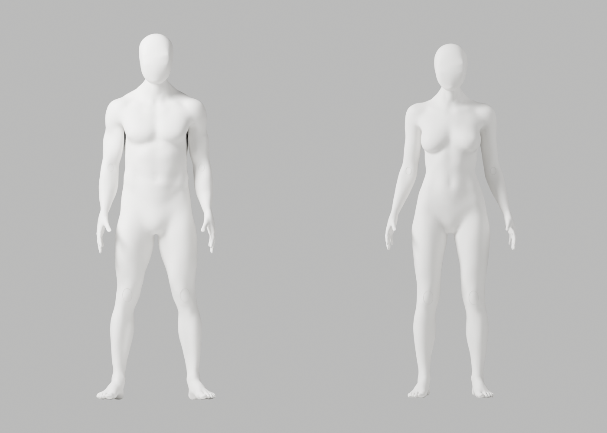
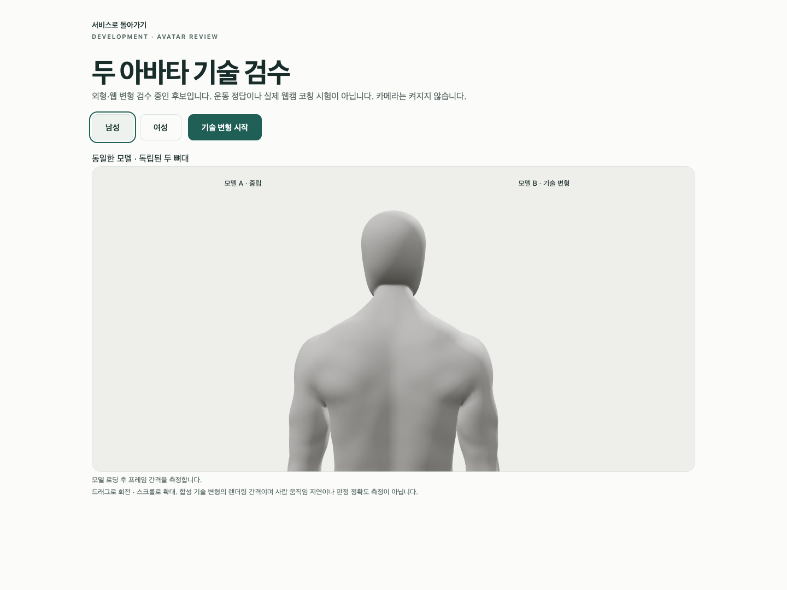
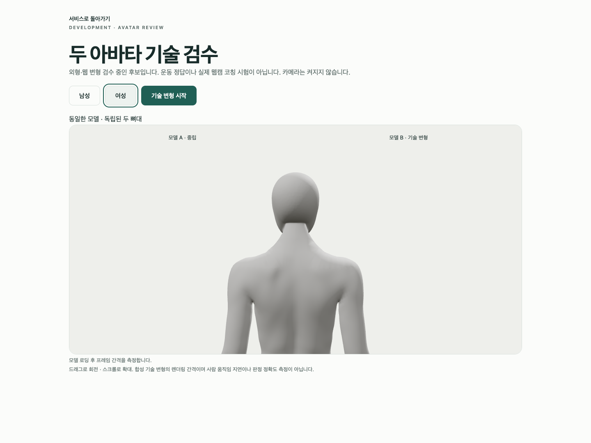

# A121–A123 — 뒤 목 경계 재연결·실제 원본/GLB/웹 검수

**외형 미통과·미채택**이다. CEO 최신 사진의 얼굴·앞목, 남녀 무의상 중성 백색 표면·자연 곡선·관절/리깅 정확도를 유지했다. 뒤 목의 큰 접힘은 줄었지만 측면 경계·후두부 연결과 웹의 팔/관절 표면 마감이 아직 부족하다. 개발 A37·기존 파일/증거·Draft PR #9 미병합·전체1~6 완료 기준/승인 규칙은 그대로다.

## 원인 확인과 수정

A121의 실제 raw native 격자는 quad 접힘 남197/여106, 삼각분할 뒤201/108이었다. XZ 투영 소수 방향 면372/245 중 경계에서 세 graph hop 이상 떨어진 면이282/203이었다. **문제가 경계 fan에만 국한되지 않는다는 근거**로 경계 edge 수만 맞추는 수정은 선택하지 않았다. 투영 방향의 부호나 이 hop 수를 3D 충돌·해부학·임상 통과로 해석하지 않는다.

같은 Blender build의 [공식 grid-fill 소스](https://github.com/blender/blender/blob/b70da489d7f4/source/blender/bmesh/operators/bmo_fill_grid.cc)와 [native operator 정의](https://github.com/blender/blender/blob/b70da489d7f4/source/blender/bmesh/intern/bmesh_opdefines.cc)를 실제 읽었다. 기존 A108의 닫힌 경계 재연결 패턴을 재사용했다. A122는 .81..87 뒤 목의 가장 큰 국소 디스크만 native holes_fill → BEAUTY 삼각분할 → 내부 edge cuts3 → 기존 전문 표면 맞춤으로 처리했다. **기존 경계는 세분화하지 않았고 원래 좌표/skin을 사후 복원하지 않았다.** 전체 인체 remesh·단순 도형 생성·새 의존성/에셋·guard 완화는 없다. A123은 같은 방법을 별도 원본에 저장한 후보다.

| 실제 국소 결과 | 남성 | 여성 |
|---|---:|---:|
| 원래 → 수정 뒤 긴 접힘 | 8 → 1 | 16 → 0 |
| 새 국소 삼각형 | 2,598 | 2,521 |
| 새 native 보간 정점 | 1,113 | 1,080 |
| 양방향 표본 거리 최대 | 4.350mm | 3.061mm |
| tiny 면 / global nonmanifold / winding 오류 | 0 / 0 / 0 | 0 / 0 / 0 |

기존6mm 표본 envelope guard를 통과했지만 **전체 표면 Hausdorff 거리나 사용자 신체 오차가 아니다**. 새 면 연결로 전체 위상은 바뀌었다. JSON의 역사적 이름 `grid-trial.json`·`measured_two_loop_grid_before_conformance`는 실행 byte를 보존한 것으로, A122/A123에서는 **닫힌 cap**의 측정값이며 two-loop grid 성공이 아니다.

## 실제 저장·변형·브라우저

별도 프로세스에서 A106과 A123 저장 파일을 다시 열어 남122,400/여121,189개의 유지 원래 정점 좌표·named skin, 보호 손50,689/50,673, 영역 밖 면/winding163,732/161,968과 각163 bones의 head/tail/parent/rest·body/rig world를 정확 비교했다. 제거한 원래19,291/18,293점은 지정 국소 영역 안이고 새 점의 가중치도 정규화됐다. 비교용 original-id ledger는 authored mesh용이며 인간 관절 좌표가 아니다. GLB는 extras=false로 내보냈다. 원본 좌표와 GLB의8가중치가 byte 동일하다고 주장하지 않는다.

| 실제 재실행 | 결과 |
|---|---|
| 독립 저장 재열기 | 보존 PASS, 원래 A106 미저장/불변 |
| 원본 기술 변형 | 118개 / 121행 / 실제34PNG / 실패0 / 최대 edge ratio2.943930 |
| GLB 실제 재수입 변형 | 118개 / 121행 / 실제34PNG / 실패0 / 최대2.947680 |
| native GLB | 각5mesh·163bones·8weights / 남11,022,816·여10,913,520bytes / 이미지·운동 clip0 |
| 실제 Chrome | 4개 / 45.746초 / skipped·unexpected·flaky0 / 카메라 요청0 |

Blender7개 native actor가 각각 종료0을 확인한 뒤 다음 actor를 시작했고, 그 뒤 Chrome을 실행했다. ratio1·fin repair 남2/여2·재수입 신체 정점123,511/122,267이다. Chrome154.0.8037.93/macOS15.6(24G84)/1440×1080에서 외부 proxy 차단, 독립 두 뼈대·native8weights, GLB503·실제 WebGL loss/재시도와 뒤 목 확대를 검사했다. 확대는 기존 A106 camera-only client를 재사용했고 **신체/관절 경계10mesh 모두 표시**했다. 남녀180RAF 평균16.664/16.667ms·p95각16.9ms는 합성 변형 프레임 간격이지 GPU 완료 시간/실제 웹캠 지연이 아니다. OS/Chrome은 이번에 읽었지만 장치/RAM은 새 측정하지 않았다.

## 증거·한계·다음 작업

[수정 가능한 원본](artist-candidate.blend), [web 원본](web-candidate.blend), [GLB 재수입 원본](web-roundtrip.blend), [남성GLB](bodyguard-male-candidate.glb)·[여성GLB](bodyguard-female-candidate.glb), [독립 보존](saved-preservation.json), [원본 변형](source-deformation-report.json)·[GLB 변형](roundtrip-deformation-report.json), [실제 Chrome](browser-report.json), [실행/열람/미실행](execution-record.json), [110사본/17gzip SHA](copy-manifest.json)를 보존했다.

74실제PNG 중 **직접 열람32**(원본14/재수입12/cap2/Chrome4), 나머지42는 미열람이다. 실행한 임시 spec/client를 exclusive copy로 보존한 뒤 개발 파일을 정확 복원/자체 client만 제거하고 typecheck/Biome0·baseline SHA를 재확인했다. Python4개의 default·isolated Ruff/88 format0, copier/checker Node syntax0을 확인했다. 코드 리뷰에서 Path 변수의 BVHTree shadowing을 **native 실행 전에** 찾아 수정했으며 실행된 producer byte는 이후 편집하지 않았다. 잘못된 읽기 경로/defaults domain lookup은 제작 실패가 아니고 plutil 버전 읽기는 성공했다. 역사 A100 S102 등 이전 실패를 해결했다고 표시하지 않는다.

반복 읽기 전용 검사는 이전 checker/137항목 SHA 장부를 재사용하고 그14사본·4control과 A37/기존 helper·개발 코드9개의 hash를 연결해 **164개 이전 파일 불변**을 확인한다. 새로운 SHA/자체 무결성 검사는 형상 승인의 대체물이 아니다.

```sh
node bodyguard/assets/blender/review/candidate-a121-a123-review/evidence-check.cjs
```

복사기는 단 한 번 실행하며 재실행하지 않는다. native 재현 명령은 execution record에 있고 기존 입력을 보존한 새 출력 경로에서 실행한다. 로그는 관측 tool chunk이며 전체 stdout은 보장하지 않는다. 저장 보존의 중간 chunk1d33fe는 로그 사본에 없지만 실제 JSON 측정값은 보존했다. native male export parent 경고5개, Chrome NO_COLOR/FORCE_COLOR/THREE.Clock, 의도된401/503·context-loss cleanup 경고가 있어 warning-free가 아니다. 제한된 시크릿 패턴 확인은 전체 보안 감사가 아니다.

debug·코드 리뷰·문서화 스킬로 원인/실행 전 변수 충돌·보존/미실행 경계를 확인했다. **A-02/A-08 외형 P2는 남아 병합하지 않는다.** 다음은 개선된 cap을 유지한 측면 경계 접선·후두부 접점의 국소 원인 대조/수정이다. 전신/인접/평면 침투, 전문가 승인 동작·실제 수행자/리타게팅/웹캠 정확도·다른 장치/사용성·운영/HTTPS 배포·출시는 이번에 미실행이다. S2.4나2단계/전체1~6 통과로 기록하지 않는다.

## 실제 미리보기 — 완성판 아님






