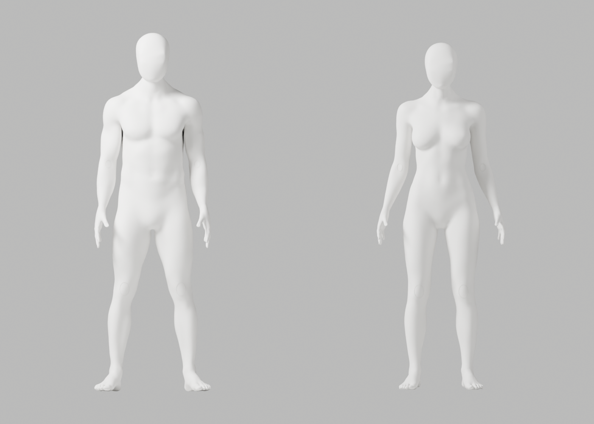
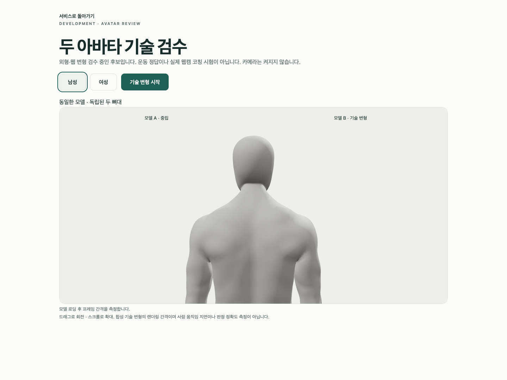
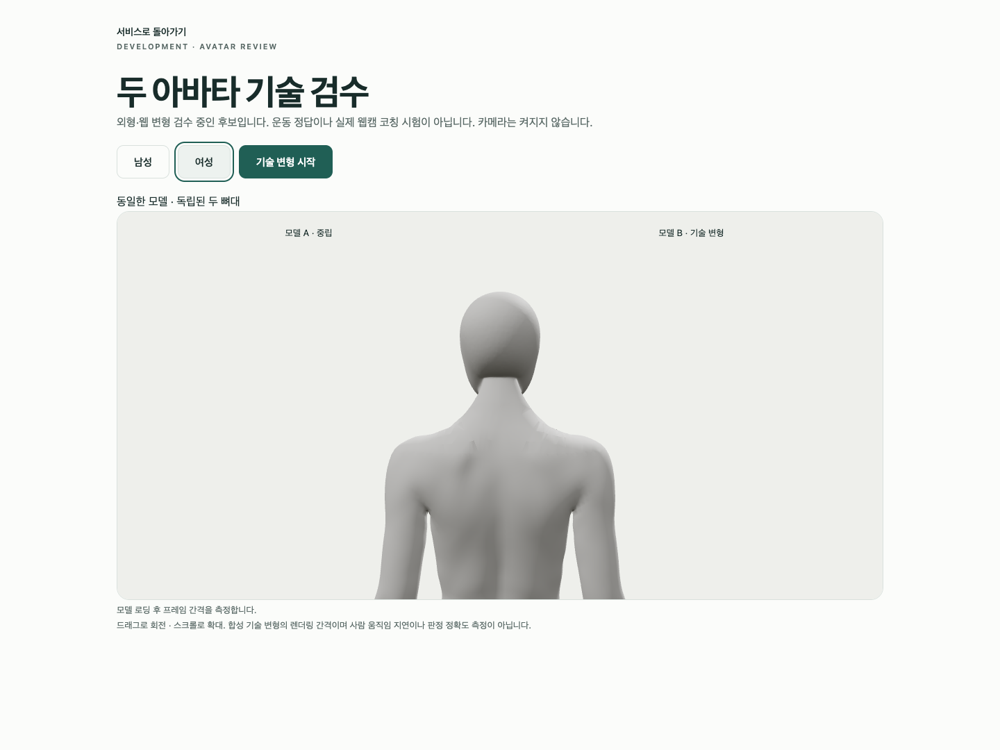

# A130–A135 — 삼각분할 원인 분리·기존 cap 연결 정제와 실제 재검수

**외형 P2 미해결·미채택**이다. 최신 CEO 사진의 얼굴·목, 남녀 통일 무의상 중성 백색 표면·신체 구조/리깅 정확도를 유지한다. 별도 A135는 원본/GLB 기술 변형과 실제 Chrome 검사를 완료했지만 뒤 목 경계·후두부 연결·웹 관절/팔 마감이 부족하다. 개발 A37·기존 원본/증거·Draft PR #9 미병합·전체1~6 완료/승인 기준은 그대로다.

## 원인과 선택한 수정

A130은 A129와 같은 native 경로를 단계별로 실제 측정했다. 세분화 뒤 tiny/nonmanifold는 남녀 모두0이고 **삼각분할에서 tiny 남27/여33·남성 nonmanifold1**이 생겼다. 남성 edge는 열린 경계가 아니라 **같은 edge에4면이 연결된 상태**다. 이전 A129의 ‘열린 edge’ 표현은 해당 진단 이전의 포괄 표현이며, 이번 측정으로 구체화한다. 표면 맞춤은 이 결함을 없애지 못했다.

| 실제 native 대조 | 결과 / 선택 |
|---|---|
| A131 EAR_CLIP | 삼각분할 후 접힘1016/1083·tiny4269/4248·nonmanifold613/570, 미채택 |
| A132 native grid refinement | 세분화부터tiny32/32, 맞춤 후 접힘5/0, 미채택 |
| A133 밀도 증가 뒤 AREA 연결 정제 | 맞춤 후 접힘5/5·tiny18/24·남성nonmanifold1, 미채택 |
| A134 기존 A123 cap의 AREA 연결만 정제 | 밀도/좌표/skin 변경 없이 국소 형상 guard 통과, 실제PNG4 |
| A135 같은 수정 별도 저장 | 독립 재열기·원본/GLB/Chrome 실제 검수, 외형은 미통과 |

Blender 동일 build의 [native 삼각분할 operator](https://github.com/blender/blender/blob/b70da489d7f4/source/blender/bmesh/operators/bmo_triangulate.cc)와 [중복 면 mapping 구현](https://github.com/blender/blender/blob/b70da489d7f4/source/blender/bmesh/tools/bmesh_triangulate.cc)을 실제 읽었다. 공식 API web fetch402와 성공한 읽기 전용 curl0을 구분한다. 소스 읽기가 이 후보의 형상 통과를 증명하지 않는다.

기존 A97의 native `beautify_fill(method="AREA")` 패턴을 재사용했다. **추가 밀도·표면 재투영 없이 기존 cap 내부 연결만 정리**했고 전체 remesh·도형 인체·좌표/skin 사후 복원·새 의존성·guard 완화는 없다. cap 내부/경계의 긴 접힘 수0→0은 이전 bbox의1/0과 측정 영역이 달라 마지막 bbox 접힘을 해결한 증거가 아니다.

독립 저장 재열기에서 모든 A123 점 남123,513/여122,269의 좌표·named skin, 보호 손50,689/50,673·original-id ledger·그룹·각163rest bones/head/tail/parent·body/rig world/material 이름을 정확 비교했다. cap 경계374/363, 변경 밖 면/winding163,732/161,970은 그대로다. native 변경 요소1747/1949는 새 정점 수가 아니다. 양방향 표본 envelope 최대0.786/1.353mm로 기존6mm guard를 통과했지만 전체 Hausdorff/신체 정확도/임상 통과는 아니다.

## 실제 원본·GLB·브라우저

| 실제 재실행 | 결과 |
|---|---|
| 독립 저장 재열기 | 모든 A123 좌표/skin·리그·변경 밖 면 보존 PASS |
| 원본 변형 | 118개 / 121행 / 34PNG / 실패0 / 최대edge ratio2.943930 |
| GLB 실제 재수입 변형 | 118개 / 121행 / 34PNG / 실패0 / 최대2.947680 |
| 남녀 GLB | 각5mesh·163bones·8weights / 11,022,816·10,913,520bytes / 이미지·운동clip0 |
| 실제 Chrome | 4개 / 44.625초 / skipped·unexpected·flaky0 / 웹캠 요청0 |

Blender10개 actor의 종료0을 각각 확인한 뒤 다음 actor, 마지막으로 Chrome을 실행했다. **진단 exit0은 geometry/appearance PASS가 아니다.** ratio1·fin repair2/2·재수입 body123,511/122,267점이다. Chrome154.0.8037.93/macOS15.6(24G84)/1440×1080을 실제 확인하고 외부 proxy 차단·두 뼈대 독립·native8weights·GLB503/실제 context-loss 복구·뒤 목 확대를 검사했다. camera-only 확대에서도10mesh를 모두 표시했다. 남녀180RAF 평균16.666/16.664ms·p95각18.2ms는 합성 프레임 간격이며 GPU 완료 시간/실제 웹캠 지연이 아니다. 장치/RAM은 새로 측정하지 않았다.

[artist 원본](artist-candidate.blend)·[web 원본](web-candidate.blend)·[GLB 재수입 원본](web-roundtrip.blend), [남성GLB](bodyguard-male-candidate.glb)·[여성GLB](bodyguard-female-candidate.glb), [보존](saved-preservation.json)·[원본 변형](source-deformation-report.json)·[재수입 변형](roundtrip-deformation-report.json)·[실제 Chrome](browser-report.json)·[실행 기록](execution-record.json)·[116사본 SHA 장부](copy-manifest.json)를 보존한다. **76실제PNG 중 직접 열람34**(cap4/원본14/재수입12/Chrome4), 미열람42다. 이전302파일/control SHA 보존을 검사한다.

```sh
node bodyguard/assets/blender/review/candidate-a130-a135-review/evidence-check.cjs
```

## 코드 리뷰·한계·다음

검수 spec/client를 exclusive copy로 보존한 뒤 개발 spec을 byte 동일하게 복원하고 이 작업의 임시 client만 제거했다. 복원 후 typecheck/Biome0이며 개발 A37/서비스 파일은 바꾸지 않았다. Python7개의 default·isolated Ruff/format0을 확인했다. **실제 실행된 저장 producer의 미사용 `Vector` import F4011은 원래 byte로 보존**한다. 제거한 별도 재현용 producer의 초기 format1→수정0을 구분하고, 그 재현용 코드는 native 미실행이다. 실제 후보가 수정 재현용 코드로 제작됐다고 표시하지 않는다. 잘못된 두 임시 읽기 경로는 제작 실패와 구분한다. 제한 시크릿 패턴 확인은 전체 보안 감사가 아니다.

native 남성 export parent 경고5개와 Chrome NO_COLOR/FORCE_COLOR/THREE.Clock·의도된503/401·context-loss cleanup 경고가 있어 warning-free가 아니다. 이 단위 하네스는 전체 인접/평면/전신 침투, 해부학·올바른 운동 예시, 실제 수행자/사용자 리타게팅/웹캠 정확도, 다른 장치/사용성·운영/HTTPS·출시 검증을 대체하지 않는다.

debug·코드 리뷰·문서화 스킬로 단계별 원인과 보존/미실행을 분리했다. **A-02/A-08 외형 P2가 남아 PR #9를 병합하지 않는다.** 다음은 sound cap 연결을 유지한 후두부–목 경계 접선의 국소 조형/정제다. 수정 후보는 독립 저장 재열기·원본/GLB 변형·실제 브라우저/외형을 다시 검증한다. 밀도 증가나 weaker guard로 완료 처리하지 않는다. S2.4·2단계·전체1~6은 진행 중이다.

## 실제 미리보기 — 완성판 아님






