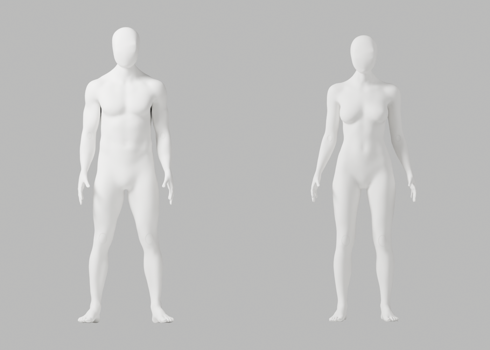
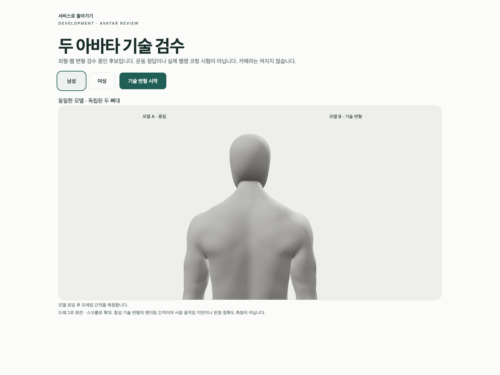
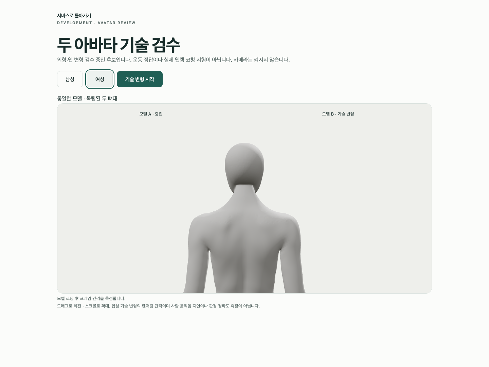

# A136–A146 — 머리 아래 경계·국소 밀도 정제와 실제 재검수

상태: **외형 미통과 / 미채택 / Draft PR #9 미병합**. S2.4 A-02/A-08 P2는 남아 있다.
이 기록은 최신 CEO 사진의 얼굴–목 연결, 남녀 통일 무의상 백색 표면, 필요한 신체 구조와 리깅 정확도를 유지하면서 진행한 실제 Blender 작업이다. 전체 1~6단계 완료·출시·전문가 승인이 아니다.

## 실제 결과

| 구간 | 실제 결과 | 채택 여부 |
| --- | --- | --- |
| A136 | 같은 A106/A135에서 cap 경계374/363과 후두부 면/좌표를 읽기 전용 대조. z0.87–0.94의 머리 아래 면은 원래 그대로임을 확인 | 진단만 |
| A137/A139 | 기존 LENGTH_WEIGHTED 국소 fairing을 각각 실제 실행·4PNG 생성. 보호 구조는 유지해도 목 아래 경계/거친 띠가 남음 | 원본 저장·채택 안 함 |
| A138 | 강한 fairing 여성 최대7.377mm로 기존6mm guard 불합격, 실제 exit1 | 저장 전 중단 |
| A140/A141 | native 중복 면 map 해석·정제 후 삼각 면 가정에서 각각 실제 exit1 | 실패 코드/로그 보존 |
| A142 | native duplicate/degenerate 정리 후 재삼각화 actual exit0, tiny18/30으로 형상 guard 불합격 | 진단만 |
| A143/A144 | 새 점만100μm 병합하더라도 보호 원래 점의 면 연결을 잃어 실제 exit1 | guard를 낮추지 않고 중단 |
| A145/A146 | 원래 coarse cap 내부 edge만 선택적으로 native 세분화. tiny/nonmanifold/winding0을 유지한 별도 A146 저장 | 기술 후보만 |
| 독립 재열기·원본·GLB·Chrome | 보존 대조, 각118변형/34PNG, 남녀 GLB export/실제 import, Chrome4개 통과 | 외형 PASS와 별개 |

기존 전체 cap 세분화가 아주 작은 삼각 면까지 쪼갠 것이 tiny 면 증가의 원인이다. 기존 native subdivision/conformance를 재사용하고, edge>1mm와 양쪽 면>1e-8m²인 coarse 내부만 정제했다. 이 값은 아티스트 작업 선택 범위이며 의료 각도나 새 출시 수용 기준이 아니다. 별도 A146에 새 점6117/6120을 추가했지만 넓은 bbox의 긴 접힘 남1/여0은 **그대로**다. 전체 신체 remesh·관절 단순화·좌표/skin 사후 복원·guard 완화는 없다.

머리 아래 lip은 A135 cap에서 새로 생긴 것으로 확인되지 않았다. A136의 실제 대조에서 해당 상부 띠의 원래 면/점은 A106과 같았다. A139의 p95 면각은 내려가도 최대 면각은 남12.369→13.309°/여22.889→25.255°로 악화했으므로 평균만으로 외형 통과라 하지 않았다. 다음은 자동 밀도 증대 반복이 아니라 머리 아래 윤곽/접선의 국소 native 조형이다.

A140의 잘못된 map 가정은 같은 Blender build의 [공식 triangulation 구현](https://github.com/blender/blender/blob/b70da489d7f4/source/blender/bmesh/tools/bmesh_triangulate.cc)에서 값이 원래 polygon임을 확인하고, 실제 중복 면의 vertex-set을 검사하도록 A141에서 보완했다. [공식 degenerate 구현](https://github.com/blender/blender/blob/b70da489d7f4/source/blender/bmesh/operators/bmo_dissolve.cc)은 도구의 동작 이해에만 사용했다. 소스 읽기/HTTP 성공은 실제 후보의 검수 통과가 아니다. 공식 bmesh 문서 도구 조회402·처음 읽은 무관한 source 구간도 로그에서 구분했다.

## 보존과 실제 검증

- 입력 A106 SHA `9191a2c1…937b661`, A135 SHA `7108ceeb…4d4828` 불변. 이전 증거422개를 기존 checker로 다시 확인하고 새 사본137개를 exclusive 저장했다.
- 별도 `artist-candidate.blend`를 독립 재열어 A135 원래 모든 점123513/122269의 좌표/named skin, 손50689/50673, 각163 rest bone·행렬·group/material 이름, 변경 밖 면163732/161970의 winding을 대조했다.
- A123 원래 ID ledger의 **기존 entries**는 그대로이며 새 점은0으로 연장했다. 새 parent-ID ledger는 원래 점의 bijection 검사에만 사용한다. 배열 전체 byte가 같다는 뜻이나 원래 topology 전체가 같다는 뜻이 아니다.
- source 점129630/128389 → export helper의 기존 fin repair2/2 → 실제 재수입129628/128387. 기존 helper 그대로 ratio1/8skin/extra metadata 없이 내보냈다.
- source/실제 GLB 재수입 각각121행, 그중118개 기술 변형, 실패0·34actual PNG. 최대 edge ratio2.943930/2.947680. 20° neck stress는 하네스 시험값이며 스트레칭 처방이 아니다.
- 새 `.blend`3개/남녀 GLB2개. GLB 각5mesh/163bone/animation0/image0, export transform guard 통과. 남성 parent 경고5개는 남아 있으며 경고 없는 실행으로 보고하지 않는다.
- 실제 Chrome154.0.8037.93/macOS15.6(24G84), viewport1440×1080, 4개45.449s 통과·skip/flaky/fail0. 외부 proxy 차단·getUserMedia0·auth API/메일/SQL 연결 없음. 같은 GLB SHA를 실제 test attachment와 대조했다.
- 두 복제 skeleton의 독립성, native8skin, 의도된503·WebGL 상실/재시도, 중립/기술 움직임을 검사했다. 뒤쪽 확대는 camera만 바꾸고 신체/관절 경계 **10mesh 모두 visible**을 유지한다.
- 180 synthetic RAF의 남 mean16.674/p95 18.5ms·여 mean16.657/p95 18.1ms는 합성 렌더 interval이다. GPU 완료 시간·실제 웹캠 지연·정확도·목표 기기 전체 성능 검증이 아니다. 장비 RAM 재측정도 하지 않았다.
- 실제 PNG84개 중 **직접 열람42개 / 미열람42개**. A1374+A1394+cap4 전부, source14(front/quarter/upper sides/back/hands/knees/neck4), roundtrip12(front/quarter/upper sides/back/hands/neck4), browser4 전부를 열람했다. 그 밖의 PNG는 존재만 확인했다.
- Python12개 실제 default/isolated Ruff·format0. A137 첫 format1은 실행 전 보완했다. 임시 frontend tsc/Biome2 통과 후 실행 spec/client를 증거로 보존하고 tracked spec은 HEAD byteexact 복원·자체 client만 제거, 복원 후 tsc/Biome1·diff check0. 이 변경에서 전체 build/backend suite는 재실행하지 않았다.
- native15회 실제 종료0/0/1/0/1/1/0/1/1/0/0/0/0/0/0. A136 마지막 stdout 전체는 저장하지 못해 **관찰된 terminal metadata만** 남겼다. 나머지는 실제 출력 chunks이며 누락 stdout을 재구성하지 않았다.
- A140/A141/A143/A144는 final JSON/PNG/asset을 생성하기 전에 중단했다. A142 exit0 역시 형상 불합격이다. 진단/candidate/export JSON의 QA pending/false는 당시 phase snapshot이며 이후 완료를 덮어쓰지 않았다.
- NO_COLOR/FORCE_COLOR·THREE.Clock deprecation·의도401/503·context loss cleanup 경고를 보존했다. actor는 native끼리/Chrome과 순차 실행하며 기존 GUI 작업을 변경하지 않았다.

`scripts/`와 `logs/`의 gzip은 실제 실행 코드/관찰 출력이다. 새 사본137개(33gzip/84PNG), control4개를 보존하고 checksum 검사를 반복할 수 있다. checksum 자체는 외형·임상·전체 보안 승인 증거가 아니다. primary 읽기 및 초기 frontend static의 일부는 metadata-only로 명시했다. 실행 전 JS 구성 SyntaxError/marker missing은 native 실행/파일 생성 전 실패이며 성공한 native 실행으로 세지 않았다.

## 실제 미리보기 — 아직 승인하지 않은 후보







전면의 neutral faceless 형태/통일 백색은 유지되지만 뒤쪽 머리 아래 경계, 목 표면의 거친 연결 및 웹 관절 마감은 사진의 목표 품질에 못 미친다. **기술 검수 통과를 외형 승인으로 바꾸지 않는다.** 개발 A37 모델·기존 원본/GLB/증거는 그대로며 새 후보를 서비스에 연결하거나 PR을 병합하지 않았다.

## 반복 확인

```bash
node bodyguard/assets/blender/review/candidate-a136-a146-review/evidence-check.cjs
```

기존 QA/helper/Node stdlib를 재사용했다. 새 런타임·패키지·비용·계정·시크릿·운영 DB migration·배포·릴리스 작업은 없으며 전체 1~6단계 완료/승인 기준은 그대로다.
