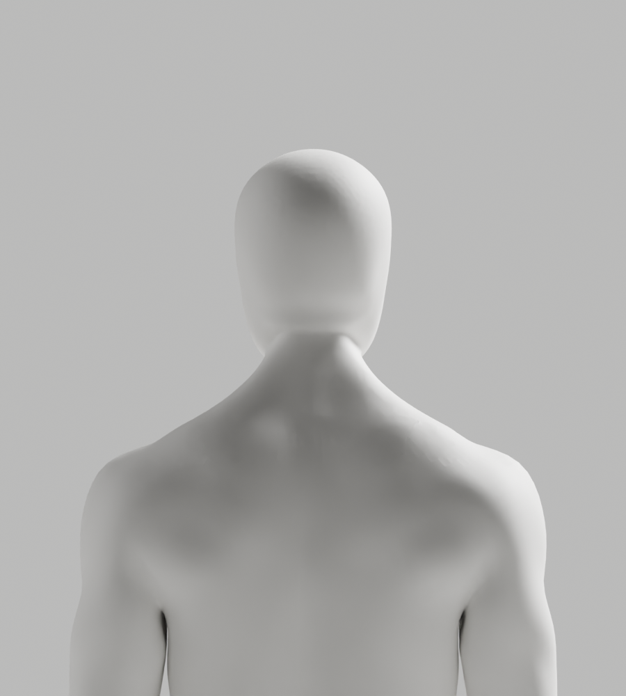
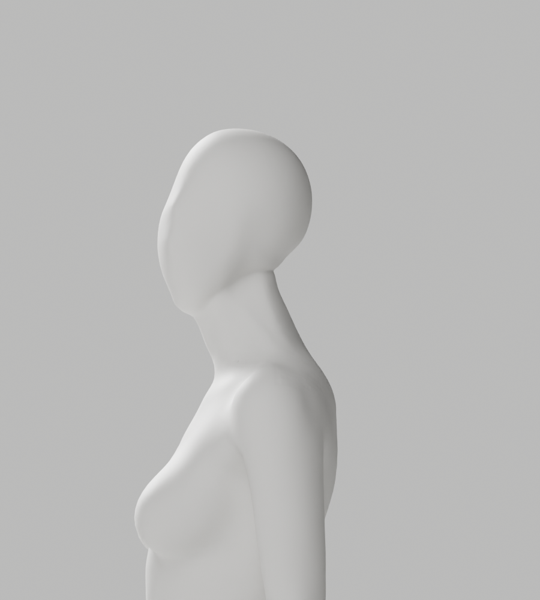

# A147–A154 — 실제 머리·목 단면과 국소 조형 대조

상태: **외형 미통과 / 미채택 / Draft PR #9 미병합**. S2.4 A-02/A-08 P2는 남아 있다.
최신 CEO 사진의 얼굴·목·연속 연결, 남녀 통일 무의상 백색 표면, 필요한 신체 구조와 리깅 정확도 및 전체 1~6단계 완료 기준은 유지한다.

## 실제 결과

| 구간 | 실제 결과 | 판단 |
| --- | --- | --- |
| A147 / clean | 32개 높이 밴드의 원래 정점을 읽기 전용 측정. clean 코드도 실제 실행하고 원래 JSON과 byte 동일 확인 | 정점 표본은 정확한 단면이 아님 |
| A148 | detached BMesh의 native bisect로 동일 높이 중앙 단면을 확인. 원래 좌표/skin/input 불변 | 급한 후두부 전환 형태 확인 |
| A149 | 기존 native SMOOTH를 Y축만 적용, 실제 4PNG | p95/max 면각 모두 악화·연결부 미달, 반려 |
| A150 | 실제 오목한 구간에 native Y DISPLACE, 실제 4PNG | 단순히 들어 올려도 V형 윤곽은 충분히 개선 안 됨, 반려 |
| A151 | 같은 구간의 아래 목 push / 아래 머리 pull, 실제 4PNG | 남성 max는 개선되어도 여성 max·양쪽 p95 악화, 뒤쪽 띠가 남아 반려 |
| A152 | 조형 뒤 국소 LENGTH_WEIGHTED 3D fairing | 이동6.691/6.485mm·긴 접힘1→14/0→3, 기존 guard 실패/exit1 |
| A153 | 같은 실패를 실제 점·면 ID로 추적 | 새 접힘13/3의 모든 점이 z<0.875. guard 실패/exit1 유지 |
| A154 | 확인한 아래 cap를 XYZ fairing에서 보호 | 새 접힘 회귀는 해결(1/0), 그러나 여성 이동6.074mm로 guard 실패/exit1 |

A148의 동일 높이 최대 후면 Y 변화는 남8.637mm/높이8.423mm, 여12.677mm/높이8.194mm였다. 이는 **아바타 원본 형상**의 단면이지 사용자 몸·의학적 범위·웹캠 정확도의 측정이 아니다. 최근 cap 밀도만 늘려 해결되는 문제가 아니라 머리 아래 윤곽과 접선의 문제다. A153의 실제 ID 진단으로 평활화가 아래 cap를 손상시킨 위치를 분리하고 A154에서 그 회귀를 제거했다. 이를 전체 형상·외형 통과로 확대하지 않는다.

## 보존·검증과 한계

- 입력 A146 `artist-candidate.blend` SHA `602de735…e1f9` 불변. 이전 보호 대상 증거563개를 기존 checker로 다시 확인하고 새 사본43개(22gzip/12PNG)를 exclusive 저장했다. 원래 파일·리그·GUI는 변경하지 않았다.
- A149–A154는 실제 전체 skin/group-index·위상·손·각163 rest bone·행렬·그룹 이름과 선택 범위 밖 좌표를 검사했다. A149–A151은 모든 X/Z도 동일하다. A152–A154의 XYZ fairing은 **선택 범위 안의 X/Z를 바꿨으며** 전체 X/Z 동일이라고 하지 않는다.
- A154의 fairing 선택은 남5076/여4606점, 두 native 조형의 합집합 선택은8023/6668점, 영역 밖121607/121721점이다. 남성 최대 이동4.134mm·여성6.074mm. 기존6mm/접힘/tiny/nonmanifold/winding guard를 낮추거나 좌표·skin을 사후 복원하지 않았다.
- A152/A153/A154 JSON의 `mask_normalized_z`는 push/pull 조형 범위다. 별도 `fairing_mask_normalized_z`가 평활화 범위이며 합집합 밖 좌표를 정확 비교했다.
- native 9회 실제 종료0/0/0/0/0/0/1/1/1, 마지막3개는 저장·렌더 전에 guard 실패로 중단했다. **새 원본/GLB0, 새118변형0, 새Chrome0**. 이전 A146의 원본/GLB118개·Chrome4개를 이번 조형의 통과 실적으로 재사용하지 않는다.
- 실제 PNG12개 전부 직접 열람했다(A149/A150/A151 각각 남녀 측면·뒤쪽). A152–A154 PNG는 없다. 입체 생성 대신 AI 이미지, 흐림·과노출·관절 숨김으로 외형을 통과시키지 않았다.
- A147은 첫 RUF007 실패 뒤 실행된 진단 코드도 byte 보존했다. raw의 default/isolated Ruff·format check는 모두 exit1이다. pairwise/format 보완한 clean 코드는 실제 재실행·JSON byte 동일이며 clean+새 Python8개는 default/isolated Ruff·format check0이다.
- A153의 초기 unused Vector F401는 native 시작 전에 보완했다. 초기 metadata와 보완 후 실제 검사를 구분한다. 읽기 전용 Node 요약의 SyntaxError1도 수정한 실행과 구분하며 모델/파일 변경은 없었다. 일부 초기 static의 stdout은 metadata-only이고 미보존 stdout을 재구성하지 않았다.
- 실행 코드·기존 ramp helper·ordered boundary 입력·실제 stdout chunks·정적 검사와 copy SHA를 보존했다. 이 checker는 증거 정합성 검사이며 독립 외형/해부학/임상/전체 보안 승인이 아니다. 전체 frontend build/backend suite는 이번에 재실행하지 않았다.

## 실제 미리보기 — 채택하지 않은 A151 조형





이것은 A154의 렌더나 출시 아바타가 아니다. 개발 기본 A37은 그대로다. 다음은 여성의 머리 아래 국소 이동 한계와 남은 띠/윤곽을 실제 점·면으로 좁혀 구조를 보존하는 조형이며, 자동 평활화 강도만 반복해 통과 처리하지 않는다.

## 반복 확인

```bash
node bodyguard/assets/blender/review/candidate-a147-a154-diagnosis/evidence-check.cjs
```

기존 native Blender·QA 패턴·Node stdlib·설치된 Ruff를 재사용했다. 새 패키지·비용·계정·시크릿·운영 DB migration·배포·릴리스 작업은 없다. 실제 사람/웹캠 시험과 외부 로그인 연결 대기 중에도 승인된 독립 작업은 진행하지만 미충족 완료 기준을 건너뛰지 않는다.
