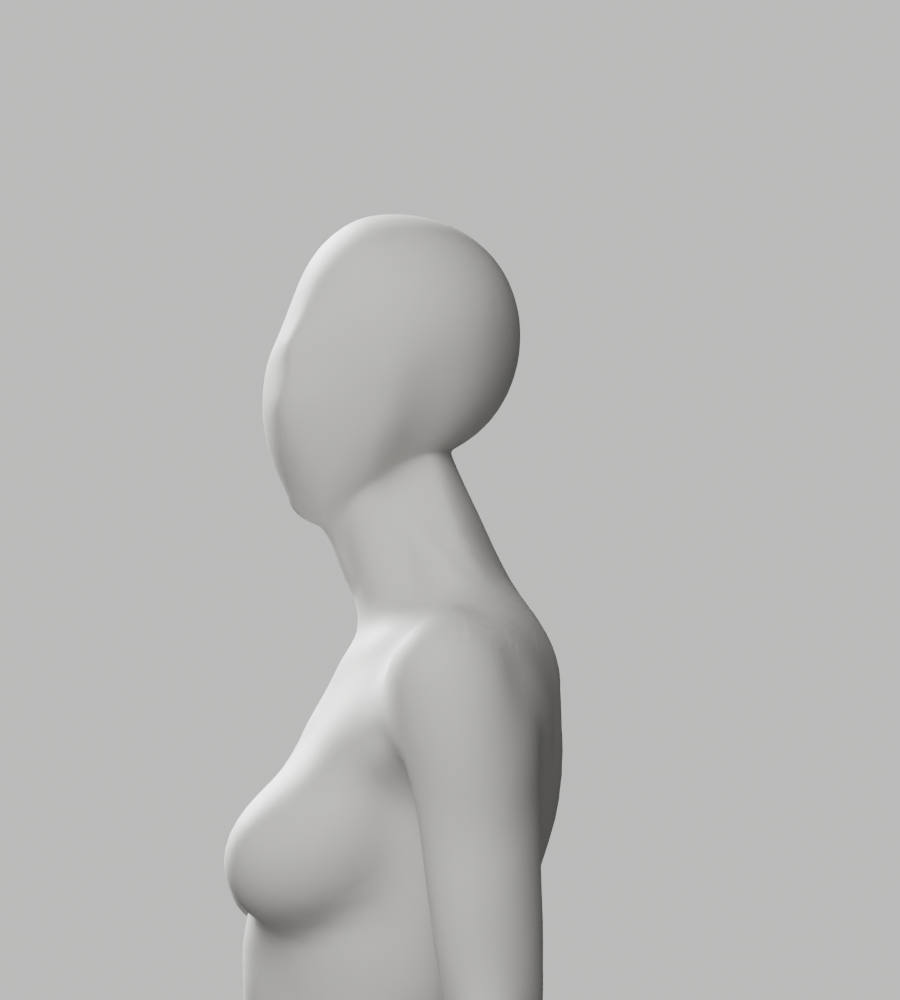
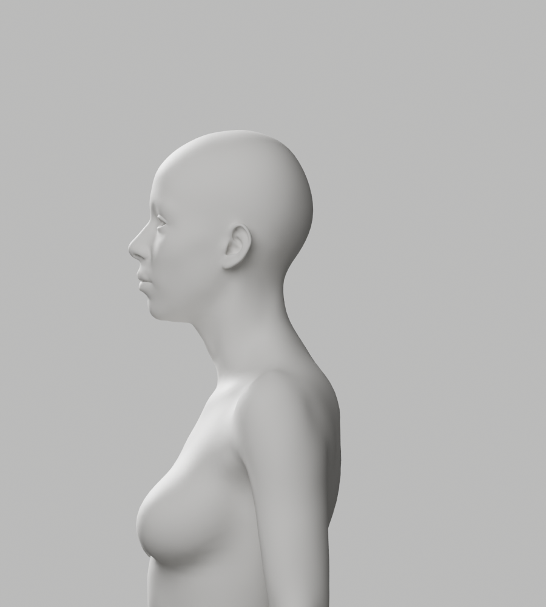

# A155–A158 — 머리·목 최대 이동 원인과 연속 전문 원본 대조

상태: **외형 미통과 / 미채택 / Draft PR #9 미병합**. S2.4 A-02/A-08 P2는 남아 있다.
최신 CEO 사진의 얼굴·목·연속 연결, 남녀 통일 무의상 백색 표면, 필요한 신체 구조와 리깅 정확도 및 전체 1~6단계 완료 기준을 유지한다.

## 실제 결과

| 구간 | 실제 결과 | 판단 |
| --- | --- | --- |
| A155 | A154와 같은 native 조형/평활화를 단계별로 측정. 여성 최대점96276에서 controls 이동2.566mm 후 fairing Z−4.629mm, 총6.074mm | 목02 가중치0.534인 지점의 높이 변화가 기존6mm guard 실패에 기여. exit1·저장/렌더 없음 |
| A156 | native SMOOTH XY, 원래 Z 전부 보존. 이동4.118/3.936mm·guard 통과·실제4PNG | 양쪽 p95/max 면각 악화·머리 아래 꺾임/거친 연결이 남아 반려 |
| A157 | 기존 head skin 비중으로 native fairing **mask만** 보호. 이동3.784/3.662mm·guard 통과·실제4PNG | skin 편집 없음. 남성 max 개선에도 양쪽 p95·여성 max 악화, 외형 반려 |
| A158 | 같은 CC0 전문 연속 body를 읽기 전용으로 불러와 동일 높이 중앙 단면·남녀 측면/뒤쪽 현재/원본8PNG 비교 | 전문 원본의 뒤목 곡선은 더 연속적. 기존 연결부 평활화만 반복하지 않고 원본 연속 곡면을 살리는 국소 재조형으로 이어감 |

A155 controls-only 최대 이동은 양쪽3.775mm였다. 여성 peak에서 단계별 control Y+2.566mm·fairing Y+1.367/Z−4.629mm를 분리했으며, max 총6.074mm는 길이의 단순 합이 아니라 실제 점의 최종 이동이다. A156은 모든 원래 Z가 정확히 같지만 X는 선택 영역에서 달라졌다. A157은 XYZ가 선택 영역 안에서 달라졌고 원래 skin은 보존했다.

A158 현재 뒤쪽 단면의 급한 변화는 남8.637mm/높이8.423mm·여12.677mm/높이8.194mm다. **같은 로컬 축과 높이의 균일 배율만 맞춘 대조**이며 해부학적 등록·좌표별 대응·사용자 몸의 측정이 아니다. 전문 원본은 얼굴 요소가 있고 팔 자세도 다르다. 그 자체를 새 faceless 아바타나 출시 후보로 채택하지 않았다. 실제 이미지/단면과 제작 이력을 함께 보면 머리·목 연결 구간의 형태를 다시 조형해야 한다는 판단을 뒷받침하지만, 어느 과거 편집 하나가 유일한 원인이라고 단정하지 않는다.

## 보존·검증과 한계

- 입력 A146 SHA `602de735…e1f9`와 전문 bundle SHA `3c121505…c137` 불변. 기존 공식 zip SHA도 다시 확인했다. 이전 증거610개를 기존 checker로 재확인하고 새 사본32개(12gzip/16PNG)를 exclusive 저장했다. 원본·리그·GUI·개발 A37은 변경하지 않았다.
- A155–A157은 실제 전체 skin/group-index·위상·손·각163 rest bone·행렬·그룹 이름과 선택 합집합 밖 좌표를 검사했다. A156/A157의 긴 접힘 남1/여0·tiny/nonmanifold/winding0은 **기존과 같은 기술 guard**이지 전체 충돌·해부학·외형 승인과 다르다. guard 완화·좌표/skin 사후 복원 없음.
- A158 detached BMesh 단면은 원래 신체를 바꾸지 않았다. 현재 좌표/skin/각163 rest bone와 두 입력 파일의 SHA를 실제 재확인했다. 전문 원본의 42,342점 각각을 새 리그에 바인딩한 시험은 아니다.
- native4회 실제 종료1/0/0/0. A156/A157은 실제 렌더까지 끝났지만 채택할 외형이 아니어서 새 원본/GLB 저장을 하지 않았다. A158은 읽기 전용 진단이다.
- 실제 PNG16개 전부 직접 열람했다. **새 원본/GLB0, 새118변형0, 새Chrome0**. 이전 A146 QA를 이번 조형의 통과 실적으로 재사용하지 않는다. 새 후보 저장 시 원본·GLB·전체 변형·실제 브라우저·외형을 다시 실행한다.
- 실제 실행 코드4개·기존 ramp helper·ordered boundary·실제 stdout chunks·4파일 default/isolated Ruff·format check0과 copy SHA를 보존했다. A155–A157의 lower-cap 입력은 [이미 보존된 A153 보고서](../candidate-a147-a154-diagnosis/a153-report.json)를 그대로 사용했다.
- checker는 증거 정합성 검사다. 전체 보안 검사·독립 외형/임상 승인·실제 사람/웹캠/로그인 연결/서비스 완성 검증은 아니다. 이번에 frontend build/backend 전체 suite는 재실행하지 않았다.
- 단순 도형 인체 생성·전신 remesh·AI 이미지로 대체·흐림/과노출로 외형 결함 숨김·새 패키지/비용/계정/시크릿/운영 DB migration/배포/출시는 없다.

## 실제 미리보기

아래 두 이미지는 **A158 읽기 전용 대조**다. 첫 장의 현재 연결부는 미통과이고 둘째 장은 얼굴 요소가 남은 기존 전문 원본이다. 승인된 새 아바타를 뜻하지 않는다.





다음은 승인된 동일 Story 안의 국소 native 재조형이다. 필요한 구조·리깅/변형 정확도, 기존 보호 기준과 A-02/A-08 완료 게이트를 유지한다. 단순한 평활화 강도 반복이나 원본 교체의 자동 통과로 이어가지 않는다.

## 반복 확인과 재현 입력

```bash
node bodyguard/assets/blender/review/candidate-a155-a158-diagnosis/evidence-check.cjs
```

native 재현에는 기존 A146 원본과 설치된 Blender, 기록한 동일 전문 bundle 및 **새 출력 경로**가 필요하다. `scripts/*.py.txt.gz`를 새 임시 파일로 풀고, 코드에 있는 ramp/ordered-boundary 경로와 A153 보고서 입력을 기록된 SHA의 사본으로 연결한다. 입력을 임의 변경하거나 기존 출력을 덮지 않는다. A155의 exit1은 기존 guard에서 실패한 결과이며 성공 재현으로 바꾸지 않는다. 재현용 stdout을 실제 이전 stdout처럼 기록하지 않는다.
