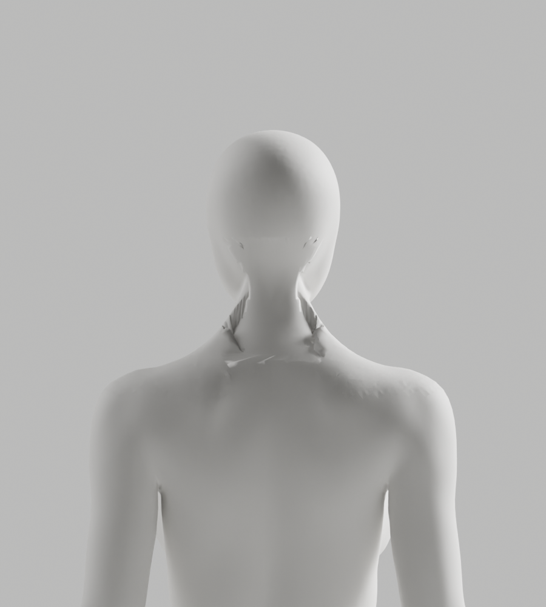
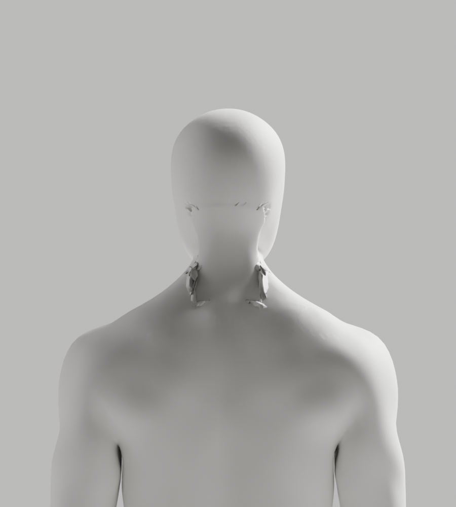

# A159–A162 — 전문 뒤목 패치·실제 경계 대응과 보간 대조

상태: **연결/외형 실패·미채택 / Draft PR #9 미병합 / S2.4 A-02/A-08 P2 남음**.
CEO의 최신 얼굴·목 사진, 남녀 통일 무의상 백색 중성 표면, 필요한 신체 구조·리깅/변형 정확도와 전체 1~6단계 기준을 유지한다.

## 실제 결과

| 구간 | 실제 수행·관측 | 판단 |
| --- | --- | --- |
| A159 | 현재 뒤목과 기존 CC0 전문 표면을 detached BMesh에서 조사. 닫힌 경계 남341/98·여355/100, 각각 한 디스크 | native 연결의 전제만 확인. 실제 bridge/저장/렌더 없음 |
| A160 | 전문 패치 경계만 native 세분화해 점 수를 맞춘 후 SURFACE/cuts6 연결. 영역 밖 원래 면·좌표/skin·손·각163 rest bones/행렬 보존, 실제4PNG | 국소 긴 접힘 남1→804·여0→785, bridge–전문 표면 최대18.686/13.927mm. guard 실패·저장 없음 |
| A161 | 동일 SURFACE 연결의 8개 위상 레이어와 실제 끝점 대응/경로를 추적 | male 최소 거리 조합과 정확히 일치, female 비용 비율1.0082. 단순 twist 오차만으로 설명되지 않음 |
| A162 | 경계·리그·cuts·skin·보호 기준을 그대로 두고 LINEAR만 변경. 실제4PNG | 접힘554/407·표면 거리16.150/12.359mm로 감소했어도 여전히 실패. 보간 설정만 바꿔 채택하지 않음 |

A161의 실제 연결 경로를 다시 읽은 XZ 투영 분석에서 원본 패치 경계점 남56/여66개가 현재 구멍의 투영 영역 밖이다. 두 경계 각각의 투영 자기교차는0이지만 끝점 연결선 사이의 엄격 교차는1017/510개다. SURFACE 경로에는 끝점 진행 방향과 반대로 가는 구간이57/42개 있고, 길이/끝점 직선 거리 p95는1.412/1.403배다. **투영 및 실제 저작 기하 경로 진단**이며 전신 3D 충돌·해부학적 등록·인체/카메라 측정/의학적 정확도 검사가 아니다. 최소 거리 비용이 좋아도 안전한 연결이라는 뜻은 아니다.

따라서 점 수 일치만으로 연결하는 방식과 보간 설정 반복은 중단한다. 다음 국소 연결 전에 실제 구멍에 포함되는 전문 표면 경계와 기하적 구간 대응을 먼저 확인한다. native 닫힘/exit0으로 외형을 통과시키지 않는다.

## 보존과 검증 한계

- 기존 A146 입력 SHA `602de735…e1f9`, 전문 bundle SHA `3c121505…c137`, 기존 native helper SHA `774b34a1…f7d0` 불변. 이전 증거646개와 control을 checker로 확인한 뒤 사본25개(12gzip/8PNG)를 exclusive 저장했다. 기존 파일·개발 A37·사용자 Blender GUI는 변경하지 않았다.
- A160–A162는 실패한 구멍 내부의 원래점 남4910/여4168개를 **메모리에서 제거**하고 전문 표면을 넣었다. 유지 원래점124720/124221개와 named group-index skin·보호 손·각163 rest bone/행렬·영역 밖 원래 면/winding이 정확히 같다. 모든 원래 신체 좌표/skin·전체 위상 동일이라고 주장하지 않는다.
- 전문 저작점460/431개는 좌표/skin을 native 밀도 정제와 연결 후 정확히 대조했다. 새 경계점243/255·bridge점2046/2130개는 새 native skin이어서 전체 변형 QA가 필요하다. 원본 패치 uniform-height 대조는 해부학적 등록이 아니다.
- 좌표/skin 사후 복원 없음. native가 바꾼 auxiliary 원래점 ID만 정확 좌표+skin으로 추적 복구했다. 기존 보호 guard를 완화하지 않았다. bridge–전문 표면6mm는 **추가 조형 overshoot guard**이며 원래 제거 영역의 변위나 임상 허용 오차가 아니다.
- native4회 실제 종료0/1/0/1. A159/A161 exit0는 진단 완료이지 외형 승인/새 파일 제작 완료가 아니다. A160/A162는 실패 JSON과 실제4컷씩 렌더한 뒤 exit1로 끝났다.
- 실제 PNG8개 전부 직접 열람했다. **새 원본/GLB0·새118변형0·새Chrome0·사람/웹캠0**. 이전 A146 변형·Chrome 결과를 이번 새 표면의 통과 실적으로 사용하지 않는다. 새 후보 저장 시 원본·GLB·전체 변형·브라우저·외형을 실제로 다시 검증한다.
- 실행 Python5개에 default Ruff·isolated E9/F63/F7/F82·format 검사15회 모두0. 초기 A160 S102/C402 및 selector F401 실패는 보존하고 native 시작 전 수정했다. 초기 진단 파일 작성 JS `.index` 오류도 native 미실행 상태에서 `.indexOf`로 보완했다.
- 실제 terminal stdout chunks·코드·JSON·사본 해시를 보존했다. integrity checker는 증거 정합성 검사일 뿐 외형/임상/전체 보안 승인과 다르다. 이번 frontend build/backend 전체 suite는 재실행하지 않았다.
- archive는29파일/최대870,985bytes다. decoded text21개에 한정한 시크릿 패턴 검색0건이며 전체 보안 검사로 확대하지 않는다. 최초 검색 command의 여분 brace 구문 오류/exit1은 수정 후 실제0과 구분해 execution record에 보존했다.
- 새 패키지·외부 에셋 다운로드/계정·비용·시크릿·운영 DB migration·배포/출시·GUI 조형·단순 도형 인체·AI 이미지 대체·전신 remesh·흐림/과노출로 결함 숨김 없음.

## 실제 미리보기 — 실패한 진단이며 채택 아바타가 아님





## 반복 확인

```bash
node bodyguard/assets/blender/review/candidate-a159-a162-diagnosis/evidence-check.cjs
```

native 재현은 기록한 같은 A146/전문 bundle/Blender build와 **새 출력 경로**가 필요하다. `scripts/*.py.txt.gz`를 임시 파일로 풀고, selector·A159 JSON 입력 경로를 사본의 실제 SHA와 연결한다. 원본/기존 출력은 덮지 않는다. A160/A162의 최종 exit1이 정상적인 실패 보존 결과이며 성공으로 바꾸지 않는다. `a161-strip-metrics.cjs`는 실제 A161 보고서를 입력으로 같은 투영/경로 계산을 다시 수행하는 별도 읽기 전용 검사다.
