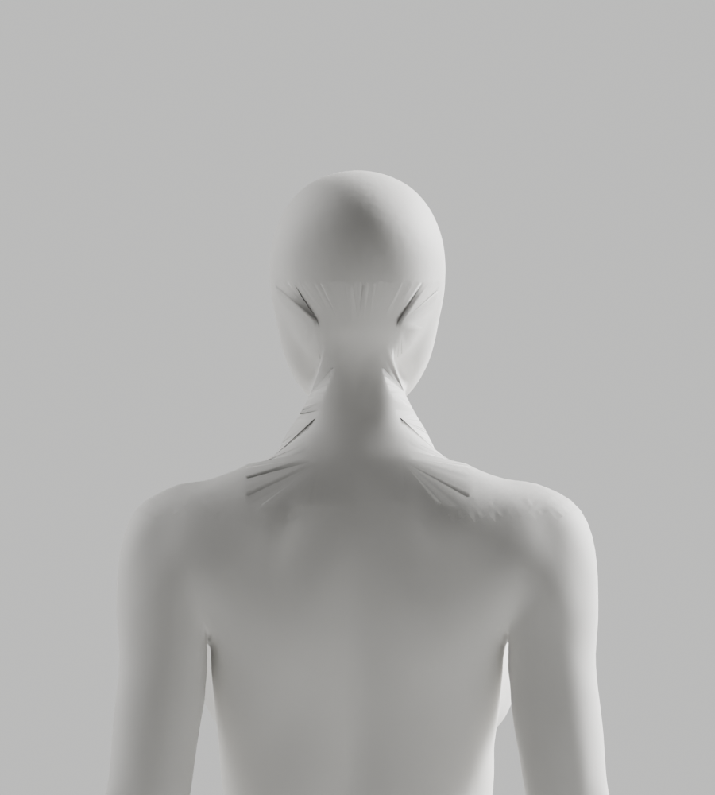

# A163–A166 — 전문 뒤목 패치 포함·투영 경계·3D 연결 대조

상태: **외형 미통과·미채택 / S2.4 A-02/A-08 P2 유지 / Draft PR #9 미병합**.
CEO 최신 사진의 얼굴–목–어깨 연속 연결, 남녀 동일한 무의상 백색 중성 표면과 신체 구조·리깅 정확도, 전체 1~6단계 기준을 유지한다.

## 실제 결과

| 구간 | 실제 관측 | 판단 |
| --- | --- | --- |
| A163 | 원래 뒤목 범위·기존8mm 전환 간격에서 전문 패치 포함 조사. 남234면 한 조각, 여218면이178/40으로 분리 | 여성 일부를 버리고 연속 패치라고 주장하지 않음. 연결·저장·렌더 없음 |
| A164 | 범위만 뒤·옆목으로 확대. 남344/여339면 각각 한 조각·최소 투영 간격8.036/8.539mm | 실제 경계의 XZ 자기교차22/8개. 투영 연결 전제 실패·Node exit1 |
| A165 | 같은 확대 범위에서 음수Y 옆목 확장만 제거 | 자기교차5/6개가 남고 여성 선택이 원본13835/21/3면·전문211/42면으로 분리. 단순 옆목 확장만 원인이라는 가설로 끝내지 않음 |
| A166 | 별도 **3D native 불균등 경계 연결** 대조. 정점 수 일치용 세분화·중간점 없음, 실제4PNG | 국소 긴 접힘1→91/0→58·실제 면 중심/새 edge 중점의 전문 표면 거리11.916/9.772mm. 기존 접힘/추가6mm guard 실패·exit1 |

A164/A165의 투영 실패를 A166이 해결했다고 주장하지 않는다. A166은 평면 대응과 다른 Blender native 3D 연결을 **메모리에서만** 비교한 실험이다. 경계 수649/114·634/108을 그대로 연결해 새 면763/742개를 만들었지만 실제 뒤목·머리 아래에는 팬 형태의 주름과 돌출이 남았다. 점 수 일치나 native 연산 종료만으로 안전한 형상이 되지 않음을 확인했다.

다음은 범위·보간·twist 값 반복이 아니라 **실제 연속 목 형상의 대응과 연결 띠의 국소 위상**을 수정한다. 형상과 리그를 보존한 새 후보가 준비되면 원본·GLB·전체118변형·브라우저·외형을 새로 실행한다. 이번 결과로 이를 대체하지 않는다.

## 보존·검증과 한계

- A163–A165는 detached native 조사다. 현재 전체 좌표/skin·각163 rest bones/행렬과 전문 원본 입력 SHA를 실제 대조했다. 원본은 모두 불변이다.
- A166은 메모리에서 내부 원래점12590/14096개를 제거하고 전문 저작점402/394개를 넣었다. 유지점117040/114293개 좌표/group-index skin·보호 손·각163 rest bones/행렬·영역 밖 원래 면은 정확히 보존했다. **전체 원래 신체 좌표·위상·skin 동일이라는 주장이 아니다.**
- 전문 원본은 동일 축·균일 높이 배율만 맞췄으며 해부학적 등록이 아니다. 새 패치 skin은 기존 native 이름 대응 전송이며 전체 변형 검증이 남았다.
- 새 bridge 정점0개여서 거리 검사를 빈 집합의0으로 통과시키지 않았다. 실제 면 중심/새 edge 중점1526/1484개를 검사했다. 모든 표면·전신3D 충돌·임상 정확도를 검증한 것은 아니다.
- native4회 실제 종료0/0/0/1. Python4개 default/isolated/format12검사0, 초기 A163 F401은 native 전에 보완했다. 실제 stdout chunks와 초기/최종 결과를 보존했다. A164 작성 anchor 오류는 실행 전 오류이며 복원한 stdout인 것처럼 꾸미지 않았다.
- 실제 PNG4개 모두 직접 열람했다. **새 원본/GLB0·새118변형0·새Chrome0·사람/웹캠0**. 개발 A37·GUI·production 코드는 변경하지 않았다.
- 이전675파일/controls 불변을 기존 checker로 대조하고23사본(13gzip/4PNG)을 exclusive 보존했다. integrity 통과는 증거 정합성이지 외형 승인·전체 보안 통과가 아니다.
- 새 패키지·전신 remesh·단순 도형 인체·AI 사진 대체·흐림/과노출로 결함 숨김·좌표/skin 사후 복원·guard 완화·외부 계정/비용/시크릿·운영 DB·배포/출시 없음.
- 프런트 빌드·백엔드 전체 suite는 이번 증거/문서 변경에서 재실행하지 않았다.

## 실제 미리보기 — 실패한 대조, 채택 아바타 아님



## 반복 확인

```bash
node bodyguard/assets/blender/review/candidate-a163-a166-diagnosis/evidence-check.cjs
```

native 재현에는 같은 A146/CC0 bundle·Blender5.1.1/buildb70da489d7f4와 **새 출력 경로**가 필요하다.
압축 실행 코드를 임시 파일로 풀고 기록한 selector·helper·A164 JSON 입력 경로/SHA를 연결한다. 기존 출력은 덮지 않는다.
A166의 exit1과 투영 Node의 exit1은 실제 실패 보존 결과이며 성공으로 바꾸지 않는다.
