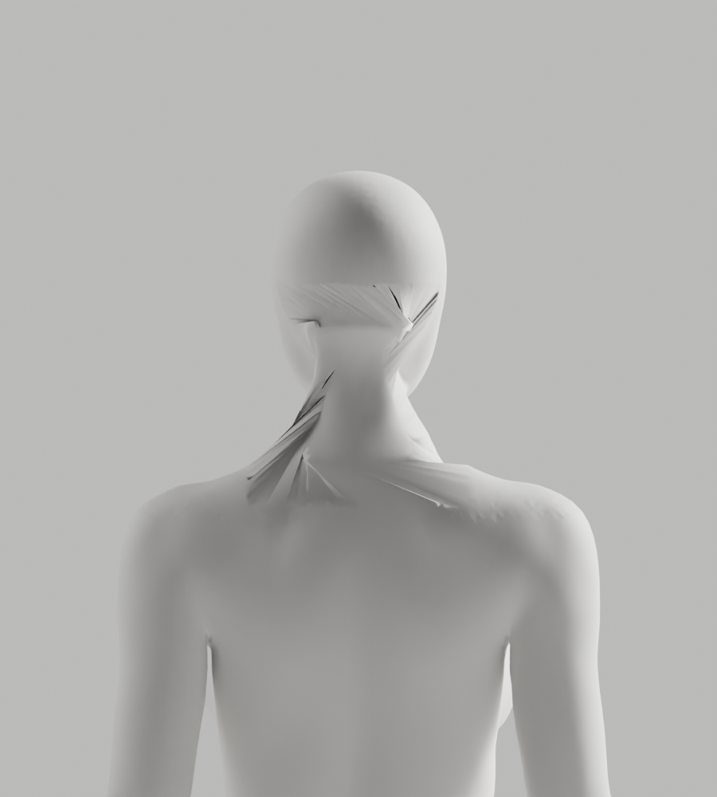

# A167–A172 — 목 경계의 실제 대응·열린 연결·전문 표면 범위 진단

상태: **외형 미통과·미채택 / S2.4 A-02/A-08 P2 유지 / Draft PR #9 미병합**.
최신 얼굴–목–어깨 참조, 남녀 무의상 통일 백색 표면, 필요한 구조·리깅 정확도와 전체1~6단계/승인 기준은 유지한다. 개발 기본 A37과 기존 원본·GLB는 변경하지 않았다.

## 실제 관측과 다음 작업

| 구간 | 실제 관측 | 판단 |
| --- | --- | --- |
| A167 | 기존 unequal bridge 접힘91/58개를 실제 edge 역할별 분리. 전문 점 하나에 최대61/84면·원래60/83점이 연결되고 높이52.871/57.783mm를 묶음 | 새 연결선의 넓은 fan과 구간 대응 문제. exit0은 진단 종료이지 형상 통과가 아님 |
| A168 | 전체 경계의 3D 누적 길이로101쌍을 나눠 native open-interval bridge | 남성 닫힘 guard에서 exit1. 여성·최종 형상 검수·보고서·저장·렌더는 미실행 |
| A169 | 같은 guard 직전 실제 열린 경계·끝점 조사 | 열린144 edge 전부 새 connector. 의도한101연결 중82개만 존재. 남성 보고서만 보존하고 같은 guard에서 exit1. 끝점 방향만 유일한 원인이라는 주장이 아님 |
| A170 | 끝점 연결선을 contextual_create로 고정 후 edgenet_fill·triangulate | 실제 닫힘/nonmanifold·winding·tiny0. 그러나 접힘1→144/0→93·실제 전문 표면 거리17.362/14.077mm로 기존 guard 실패·exit1. 실제4PNG 미채택 |
| A171 | 실제 전체 경계649/114·634/108을 읽어 전체 비율 대응과 상·하·좌·우 네 영역 대응 비교 | 전체 대응의 반대X 쌍18/15개를 재현. 네 영역은4/1개로 줄지만 연결 길이 최대98.005/87.466mm. 기하 극점은 해부학적 등록/연결 성공 증거가 아님 |
| A172 | A171의 범위 차이에 따라 현재 구멍의 실제 선택 범위를 전문 원본에도 적용하고 **기존8mm 간격은 유지** | 전문506/509면·경계140/154점 각각 한 디스크, 실제 최소 간격8.036/8.158mm. 네 영역 연결 길이61.969/63.189mm가 남음. 연결·저장·렌더 없이 종료0 |

단순 점 수·twist·전체 둘레 비율이나 한 번의 닫힘만으로 참조 목이 만들어지지 않았다. A171/A172는 기존 cropped 전문 패치와 현재 목 구멍 사이의 **실제 기하 대응/표면 범위 차이**를 보여 준다. 영역 대응의 일부 반대X는 중심선 주변 매우 작은 X 좌표이며, 이 개수만으로 잘못된 해부학·침투 여부를 판단하지 않는다. 연결 길이 역시 표면 오차·임상 안전 기준이 아니다.

다음은 이 실제 경계 데이터를 바탕으로 전문 목 곡면을 현재 머리–목 연결에 맞추는 **국소 피팅과 영역별 전환 띠**를 준비한다. 동일 키 배율만을 해부학적 등록이라고 주장하지 않으며, 피팅으로 전문 원본 좌표가 바뀌면 정확히 구분한다. A164/A165 투영 실패·기존6mm 조형 guard·원본/GLB118변형·실제 브라우저·외형 통과 조건을 낮추지 않는다. 새 후보가 형상을 통과하면 저장/독립 재열기부터 전체 검증을 실제 다시 실행한다.

## 보존·실행 범위

- 실제 native6회 종료 **0/1/1/1/0/0**. A168/A169는 남성 닫힘 실패에서 중단됐으므로 여성이나 그 뒤 원래 면/리그 검사를 완료했다고 쓰지 않는다. A169 `outside_original_faces_check_executed:false`를 보존한다.
- A167/A170은 메모리 내 연결 대조다. 원래 내부12590/14096점은 제거됐고 전문402/394점이 들어갔다. 유지117040/114293점의 좌표/group-index skin·손·각163rest bones/행렬·영역 밖 실제 원래 면은 정확하다. **전체 원래 신체 좌표·위상 동일이 아니다.** A170은 새 면에 원래 점만 포함되는 경우도 있어 실제 원래 면 handle/vertex ring으로 별도 보존을 확인했다.
- A171/A172는 detached native 조사만 한다. 현재 전체 좌표/skin/면/그룹·각163rest bones/행렬·입력 파일 SHA를 실제 대조했다. 전문 원본은 동일 축·균일 키 배율뿐이고 등록/변형 검증 전이다.
- A170 새 정점0, 실제 면 중심·새 edge 중점1526/1484개 거리 검사. 빈 집합0을 성공으로 쓰지 않았으며 모든 표면·전신3D 충돌·임상 정확도 검증으로 확대하지 않는다.
- Python6개 default/isolated/format **18검사0**. A168 실행 전 RUF007 세 곳을 stdlib pairwise로 수정한 초기 검사와 최종 검사를 모두 보존했다. A171 helper는 실제 detached 경계가 필요한 것을 실행 전 리뷰에서 보완했다.
- 실제 PNG4개 전부 직접 열람. **새 원본/GLB0·새118변형0·새Chrome0·사람/웹캠0**. 프런트 build·백엔드 전체 suite는 증거/문서만 바뀐 이번 보완에서 재실행하지 않았다.
- 이전702파일/controls와 입력 불변을 기존 checker로 확인하고23사본(14gzip/4PNG)을 exclusive 보존했다. integrity 통과는 증거 정합성이고 외형·전체 보안 통과가 아니다.
- 새 dependency/framework·전신 remesh·도형 인체·AI 이미지 대체·guard 완화·좌표/skin 사후 복원·기존 파일 덮기·외부 계정/비용/시크릿·운영 DB·배포/출시 없음. 사용자 Blender GUI도 변경하지 않았다.

## 실제 미리보기 — 실패한 A170 대조, 반영 완료 아바타 아님



## 반복 확인

```bash
node bodyguard/assets/blender/review/candidate-a167-a172-diagnosis/evidence-check.cjs
```

native 재현에는 기록한 A146/CC0 원본·Blender5.1.1/buildb70da489d7f4와 **새 출력 경로**가 필요하다. 압축 코드를 임시 파일로 풀고 이전 A163–A166 archive의 selector와 A164 JSON 입력을 기록된 경로에 연결한다. helper/input SHA를 검사하며 기존 출력은 덮지 않는다. A168/A169/A170 exit1은 실제 실패 결과이고 임계값이나 stdout을 바꿔 성공으로 만들지 않는다.
