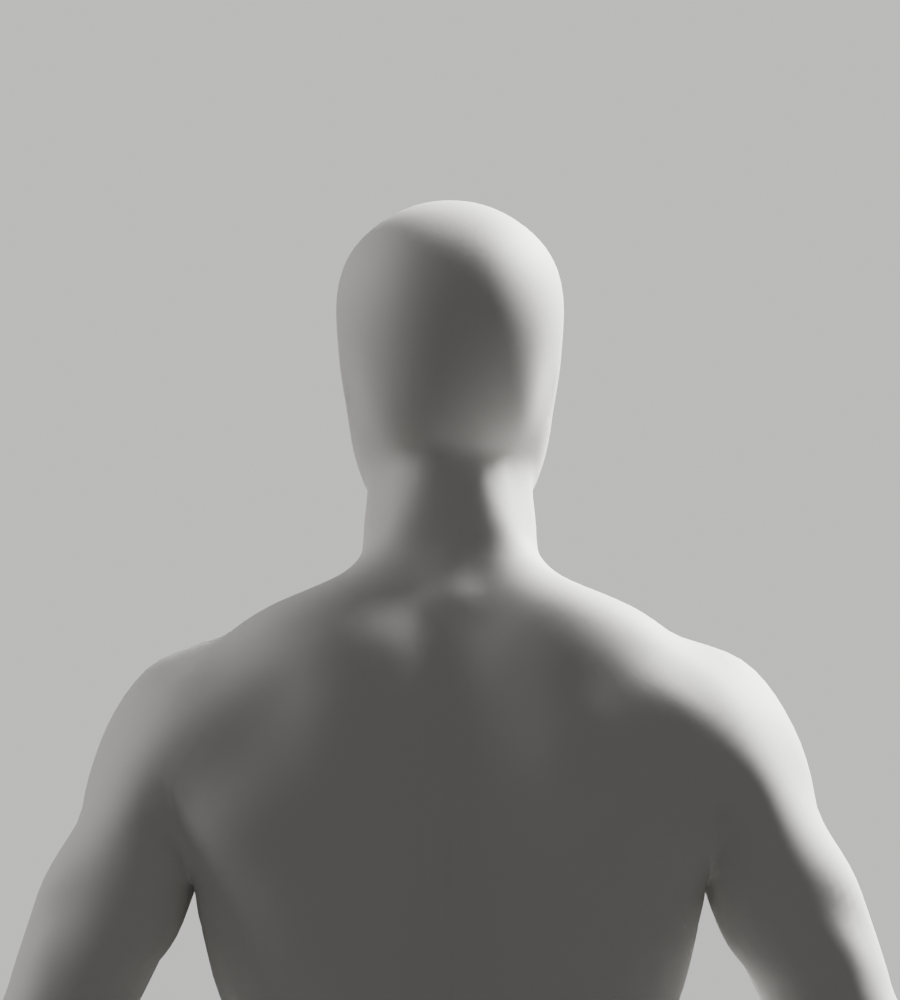
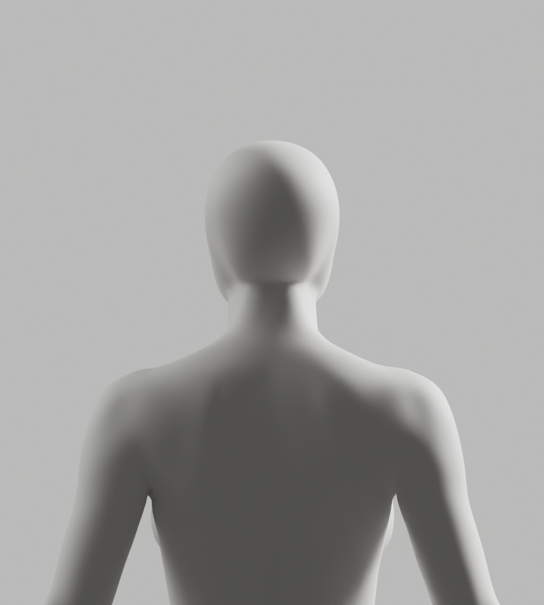

# A173–A178 — 실제 표면 간격·정밀 뒤목 절단·얼굴 마스크 원인 대조

2026-10-03 · S2.4 진행 중 · FR-A-02/03/08 · **새 출시 아바타가 아닌 원인 진단**이다. 개발 A37, A-02/A-08 외형 P2와 Draft PR #9 미병합을 유지한다. CEO 최신 사진의 얼굴·목·어깨 연속 연결, 남녀 무의상 통일 백색 중성 표면, 필요 구조·리깅 정확도, 전체 1~6단계와 승인 규칙을 바꾸지 않았다.

## 실제 결과

| 실행 | 실제 종료 | 확인한 결과 | 남은 한계 |
|---|---|---|---|
| A173 | native exit0 | 기존 실제 경계에서 전문 전신 표면까지 최대 거리 남17.447/여14.202mm, 기존 추가6mm보다 큰 점106/123개. 반대 방향 최대16.131/10.683mm | 동일 축·균일 높이만 맞춘 비교다. 해부학적 등록이나 연결 제작이 아님 |
| A174 | native exit0 / 투영 검사 exit1 | 복사 BMesh를 native 평면 절단해 두 표면 모두 연결 디스크·경계 한 개·국소 긴 접힘0. XZ 자기교차0/0이어도 상호 교차4/4개·전문 경계점10/12개가 현재 경계 밖 | 경계가 서로 포함되지 않는다. 정밀 절단 뒤 현재 경계→전문 표면 최대18.733/14.071mm. 단순 crop·twist·점 수 맞춤으로 진행하지 않음 |
| A175 | native exit1 | 머리 로컬 좌표를 원래 배치 없이 사용해 기존 높이 guard 실패 | 출력 폴더 비어 있음. 비교/렌더/완료 snapshot 미실행 |
| A176 | native exit1 | 부모가 scene에 연결·평가되지 않아 읽은 world matrix가 identity였음을 실제 남성 정렬 JSON으로 기록. 높이 guard 유지/실패 | identity를 원작 배치라고 주장하지 않음. 여성/마스크/렌더/완료 snapshot 미실행 |
| A177 | native exit1 | 실제 부모 체인 평가 후 독립 행렬 계산이 일치, 남성 head min/height0.868417. 마스크 제거에서 UnicodeDecodeError 발생 | 남성 정렬 JSON만 있음. 전체 terminal stdout은 구조화 사본으로 유지되지 않아 metadata·실제 예외 발췌만 기록. 렌더/완료 snapshot 미실행 |
| A178 | native exit0 | modifier 적용 후 마스크 이름으로 새 RNA를 조회해 제거. 남녀·두 마스크·정면/측면/뒤쪽 실제12PNG와 전체 현재 원본 snapshot 불변 확인 | A-pose 전문 복사본의 마스크 단독 대조다. 서비스 리그·국소 cleanup·연결 제작·GLB·전체118변형·Chrome·사람 시험 아님 |

A174 XZ 검사는 별도 경로로 **실제 재실행했고 여전히 exit1**이다. 최초/재실행 JSON은 보존하며 검사 통과로 바꾸지 않았다. A173의 기존 양의 Y 경계 표본은6mm 이하였지만 A174의 새 정밀 절단점에서는 양의 Y 중간 목에도 큰 간격이 있다. “문제는 앞목뿐”이라고 일반화하지 않는다.

## A178에서 확인한 마스크 영향

전문 body 42,342점·전문 blank-head 67,586점, native SHRINKWRAP NEAREST_SURFACEPOINT를 사용했다. 전문 에셋 이름의 primitive는 원작 파일의 이름이며 코드로 인체 primitive를 생성하지 않았다. 머리 타깃에는 기존 depth-only native smoothing18회와 subdivision4를 적용했다. **몸 전체 remesh, 몸의 추가 smoothing, rig 전송, bridge는 하지 않았다.**

| 턱 하단보다 아래 구간(.82×height → 실제 head min) | 남성 | 여성 |
|---|---|---|
| 기존 마스크 수식: head min−45mm에서 시작/55mm ramp | 1,873점 중1,217점 변경, 최대47.509mm 이동/가로 반경14.559mm 감소 | 1,335점 중896점 변경, 최대52.233mm 이동/가로 반경18.567mm 감소 |
| 얼굴 전용 시작: 실제 head min/같은55mm ramp | 같은1,873점 좌표 정확히 동일/이동0 | 같은1,335점 좌표 정확히 동일/이동0 |

두 방식은 부모 변환을 정확히 반영한 **동일 타깃/동일 입력의 마스크 수식만** 바꾼 비교다. 과거 전체 제작 파이프라인을 byte-identical하게 재현한 것은 아니다. 당시의 배치·추가 smoothing·국소 remesh·boolean·skin까지 원인을 확정했다고 주장하지 않는다. 원본 refine_avatar_studio.py와 기존 파일은 변경하지 않았다.

실제12PNG 전부 직접 열람했다. 얼굴 전용 마스크는 뒤 목의 급한 꺾임을 줄이지만 눈·입·귀 잔여와 턱 형태가 남아 사진의 faceless 외형 기준에 미달한다. 두 비교 모두 채택하지 않는다. A178의 낮은 목 좌표 불변은 수정 안 한 구간의 성질이지 전체 아바타 외형/리깅 정확도 승인도 아니다.

다음 구현 방향은 **전문 원본의 연속 목을 유지하는 얼굴 국소 cleanup**과 현재 신체 하부에 대한 국소 연결이다. 머리 아래 형상·턱/후두부를 먼저 확인하고, 새 후보가 저장되면 독립 재열기·유지 신체/named skin/손/각163rest bones/행렬·원본과GLB 각각118변형·실제 브라우저·다각도 외형 검증을 새로 실행한다. 과거 후보의 검증 결과로 대체하지 않는다.

## 보존·검증

- 실행 기록: [execution-record.json](execution-record.json), SHA/decoded SHA: [copy-manifest.json](copy-manifest.json), 실제 반복 검사: [evidence-check.cjs](evidence-check.cjs).
- 배타적 복사37개/25gzip/12PNG, 이전729개 파일 불변. 큰 보고서·스크립트·로그는 gzip으로 보존했으며 decoded SHA를 검사한다. 기존 원본·GLB·검증 증거를 덮어쓰거나 삭제하지 않았다.
- Python6개 static18검사 exit0: A173–177 각 default/isolated Ruff·format, A178 Ruff·isolated AST·format. 이는 native 형상·변형·브라우저 성공과 다르다.
- native6회 실제 exit0/0/1/1/1/0. A177 terminal 전체 stdout 사본 부재는 제한으로 명시하고 예외를 다시 구성하지 않았다. 해당 실제 예외 발췌와 정렬 JSON을 별도 보존한다.
- 새 blend/GLB0, 새 원본/GLB 전체118변형0, 실제Chrome0, 웹캠/사람 시험0. A173/A174/A178의 현재 원본 전체 좌표·skin·면·그룹·각163rest bones/행렬 snapshot 불변만 실제 완료했다. 실패한 A175–177의 마지막 snapshot 완료로 확대하지 않는다.
- 로컬 자료와 설치된 Blender/stdlib/기존 검사만 사용했다. 외부 서비스·유료 에셋·새 계정/시크릿·운영DB·배포/출시를 실행하지 않았다.

실제 비교 미리보기(서비스 아바타가 아님):

