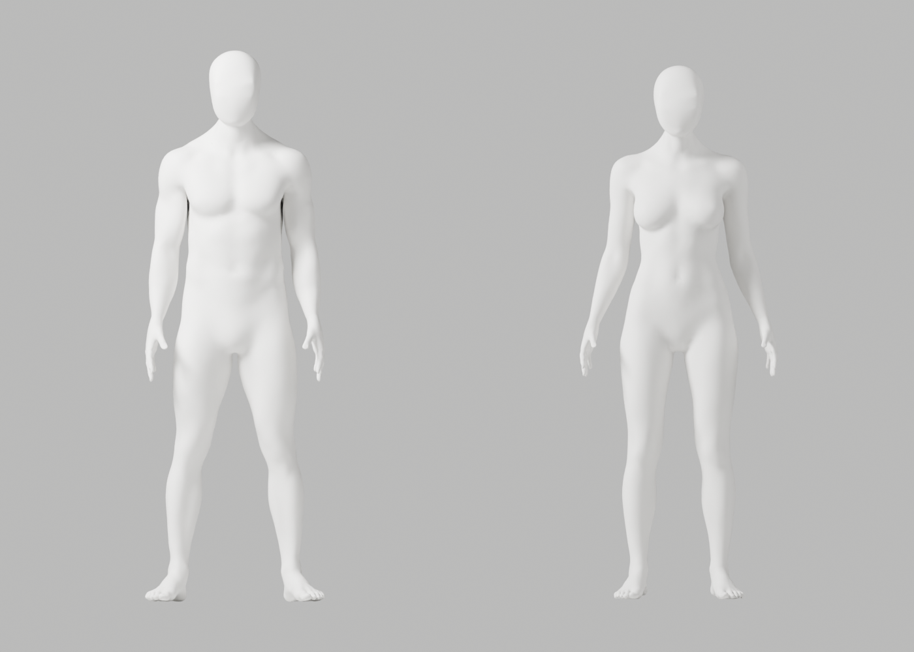
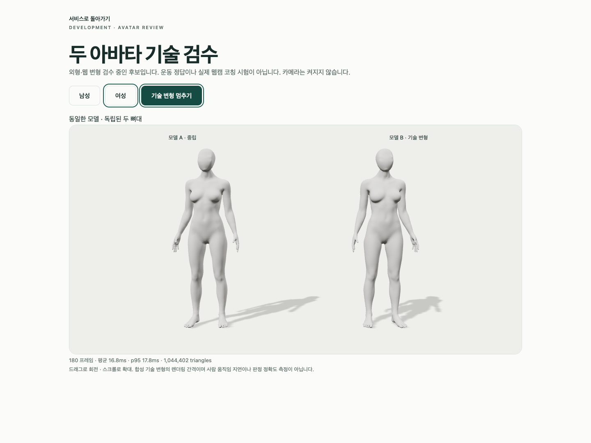

# A214–A216 — 관절 장식 원인 분리·신체 보존 후보

2026-10-03 · S2.4 · **기술 재검증 완료, 외형 미승인·미채택**. 개발 기본 A37, A-02/A-08 P2, Draft PR #9 병합 보류와 전체 1~6단계 완료 기준을 유지한다.

최신 CEO 사진의 얼굴·목·끊김 없는 연결과 남녀 무의상 중립 백색·통일 마감 요구는 그대로다. 이번 수정은 해당 사진의 얼굴·목을 완성한 작업이 아니라 관절 주변의 웹 표면 결함 보완이다.

## 원인과 기술 결정

이전 A211 GLB의 신체·법선·가중치·재질 bytes를 그대로 유지한 채 별도 관절 장식의 장면 연결만 끊은 대조 모델을 실제 Chrome에서 열었다. 팔꿈치·무릎의 점 흔적이 사라졌다. 중립 남성의 native 교차는0이므로 모든 점 흔적을 신체 침투나 z-fighting이라고 단정하지 않는다.

Native Blender 대조에서는 팔꿈치 굽힘4조건의 장식/신체 교차를 실제 확인했다(남142/136, 여132/150 triangle pairs). 중립 여성 오른쪽 무릎도8쌍 교차했다. 굽힘 각도는 기존 기술 스트레스 시험값이지 사용자 목표나 의학적 정확도 기준이 아니다.

CTO 권장안은 **신체 밖에 얹은 별도 장식8개만 제거**하는 것이다. 원래 신체의 자연스러운 팔꿈치·무릎 형태와 모든 좌표·가중치·면·group·재질·배치·남녀 각각163개 뼈대는 유지한다. 장식의 원형 선은 새 후보에서 제거되며, 이를 해부학적 관절 삭제로 처리하지 않는다. 기존 원본에서 장식을 복구할 수 있다. 전체 신체/목 remesh, 검사 기준 완화, 변경 뒤 좌표/skin 복구는 없다.

## 실제 실행 결과

- 별도 [원본 후보](artist-candidate.blend) 저장, 독립 재열기 신체/163개 rest rig/재질 정확 보존 검사 통과.
- 이전 A211 대비 실제 새 GLB의 POSITION·NORMAL·JOINTS_0/1·WEIGHTS_0/1, index·inverse bind accessor bytes 정확 보존. 뼈 변환 수치·이름 기준 계층·신체 재질 의미도 동일하다. 전체 GLB/JSON bytes 동일을 주장하지 않는다.
- 원본·웹 원본·GLB 재수입본 각각118개 기술 변형/121행·실패0, 각각34개 실제 PNG. 각각의 native actor가 terminal exit0으로 끝났다.
- GLB raw 검사에서 면적0·invalid normal·뒤 목 tiny 남녀0/0. 기존 남성 비영 면적 tiny1개는 그대로이며 모든 작은 면을 제거했다고 말하지 않는다.
- 실제 Chrome의 장식 유무 대조3개/40.790279초 통과. 외부 연결 차단·카메라0, 실제 사람/코칭 시험이 아니다.
- 결과·보고서 경로 충돌3개와 기존 파일 덮어쓰기1개를 저장 전 거부하는 native 음성 시험 및 보존 회귀 통과. 제작 당시 helper와 경로 가드 보강 후 helper를 구분한다.
- 최종 새 GLB의 실제 Chrome3개/100.161632초 통과. 독립 복제본·남녀 전환·fixture503 복구·실제 `WEBGL_lose_context` 주입을 검사했다. cleanup의 extension 경고는 로그에 남아 있으며 실제 GPU 드라이버 장애 시험이 아니다.
- synthetic180프레임 남/여 p95는19.400/17.800ms, draw calls5/5였다. 카메라 측정 지연·대표 노트북 성능·정확한 스트레칭 애니메이션 검증으로 표시하지 않는다. 내보낸 animation clip은0이다.
- Blender native8회·실패0, Chrome2회/총6개 통과. 실행 전에 잘못된 상대 Python 경로(exit127, 브라우저 미실행)와 Ruff FURB192(exit1)가 있었고 수정 뒤 실제 재실행했다. 모든 준비 명령이 처음부터 성공했다고 주장하지 않는다.
- 실행 시점 creator helper의 SHA는 `ca43353a00306593651d6fcfc8e33e6a168ba2b177289139401c54c137ab7684`, 경로 가드 보강 후 helper는 `3ec184f33465467c8c43c5899bf7d1a143e27e8791cde2b87edd28121b556552`이다. 기존 후보를 덮어쓰거나 final helper로 생성했다고 바꾸지 않았다. final helper로 독립 보존 회귀를 실제 다시 실행했다.
- 남성 armature-parent 내보내기 경고1개와 기존 남성 tiny1개를 보존했다. 기술 통과만으로 의학적 동작·전체 외형을 승인하지 않는다.

## 실제 미리보기와 미해결 외형






머리 아래/뒤 목의 단단한 경계와 얼굴의 곡면 마감이 남아 전체 외형은 미통과다. 여성 native 목 근접 렌더의 낮은 대비로 결함이 덜 보이는 것을 품질 통과 근거로 삼지 않는다. 실제 Chrome의 머리 윤곽도 확인했다. 이 후보를 출시 아바타나 전체 단계 완료로 채택하지 않는다. 다음 작업은 현재 보존된 해부학·리깅을 바탕으로 얼굴–목의 국소 접선·곡률·edge flow를 개선하는 것이다. 실제 사람 동작 검증/리타게팅·외부 인증 연결·운영/배포/출시는 이번 범위가 아니다.

## 보존과 재현

[실행 기록](execution-record.json), [138개 사본 manifest](copy-manifest.json), [증거 검사](evidence-check.cjs)에 실제 결과와 미실행 항목을 구분했다. 사본138개(23gzip·106PNG·3blend·4GLB, 별도 roundtrip JSON 포함)를 원래 결과 bytes와 SHA로 대조했다. 직접 열람한 이미지는25장으로106장 전부를 읽었다고 말하지 않는다. 원래 A195 원본 SHA `aba63129842e2bacbbe4cb8f9554ccf9bf123de2d1d6a152e3a2439fdd45618b`는 그대로다. [이전 A196–A213 증거](../candidate-a196-a213-review/README.md)의 versioned 검사도 다시 실행했다. 이전 원본·GLB·보고서는 수정하지 않는다.

- [남성 새 GLB](glb/bodyguard-male-candidate.glb): SHA `205310a5f015394455b3ca4c6cd6a3905c3b1516843600d9bc1f2bead358e87f`, 11638276 bytes.
- [여성 새 GLB](glb/bodyguard-female-candidate.glb): SHA `dddd3e483b1f487e0978245764b0b847f02e3633220952cf1ed0745305b4592f`, 11542408 bytes.
- [웹 원본](web-candidate.blend), [실제 GLB 재수입 원본](web-candidate-roundtrip.blend), [관절 장식 제거 helper](../../remove_joint_overlays.py), [native 회귀](../../test_removed_joint_overlays.py).

```bash
node bodyguard/assets/blender/review/candidate-a214-a216-review/evidence-check.cjs
node bodyguard/assets/blender/review/candidate-a196-a213-review/evidence-check.cjs
```

이번 리뷰에서 후보/보고서 경로 중첩 위험은 저장 전 거부로 보완하고 native4음성 시험을 실제 실행했다. 전체 PR 리뷰 결론은 A-02/A-08 외형 P2가 남은 **Request changes**다. 카메라0·유료/계정/시크릿/운영 DB/배포/출시0, 보안은 제한된 credential-pattern 검사만 했으며 전체 보안 검사 완료가 아니다.
