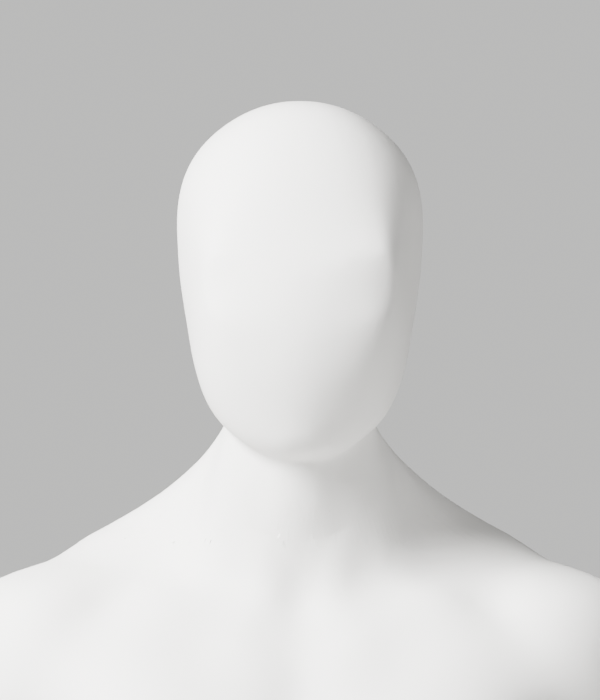
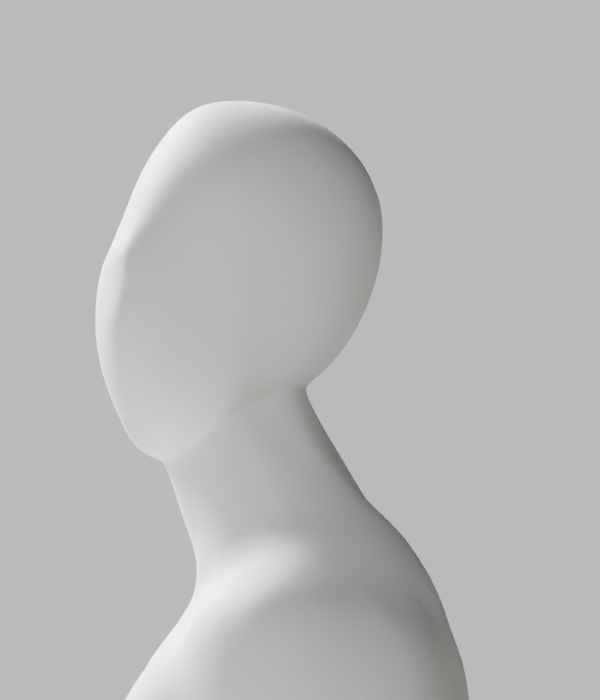
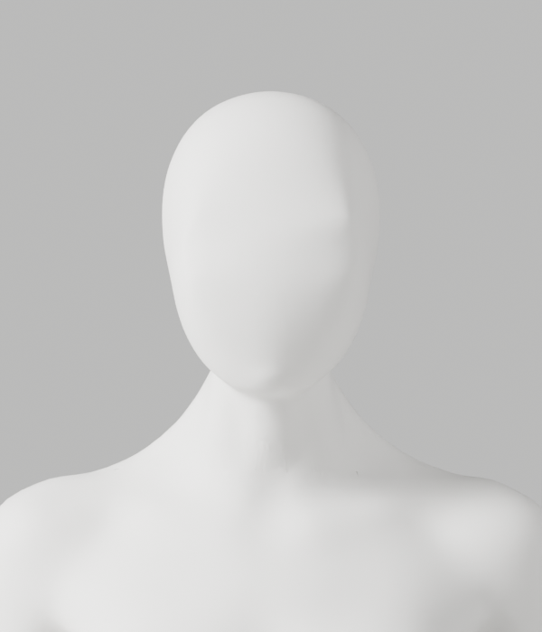
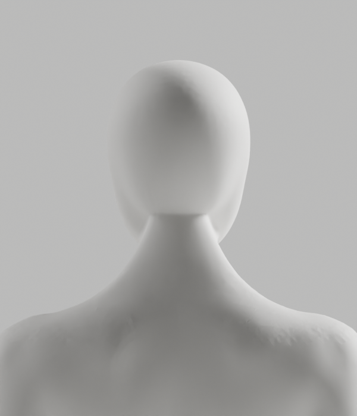

# A217–A227 — 실제 머리·목 형상/리깅 회귀 원인 분리

2026-10-03 · S2.4 · **외형 미승인·후보 미채택**. A218은 외형, A225는 외형과 개별 음수 skin coefficient 때문에 반려한다. 개발 기본 A37·A-02/A-08 P2·Draft PR #9 미병합·전체 1~6단계 미완료를 유지한다.

최신 CEO 사진의 얼굴·목·끊김 없는 연결, 남녀 무의상 중립 백색/통일 마감과 필요한 신체 구조·리깅 정확도 요구는 그대로다. 단순 코드 인체/전체 신체·목 remesh/조명으로 결함 감추기/검사 완화/변경 뒤 원래 좌표·skin 복원은 하지 않았다.

## 실제 원인과 보완

A217이 A216 전문 조형 원본을 읽었다. 남녀 모두 custom normals=false, sharp edge flags=0, flat faces=0이었다. 평면 셰이딩이나 강제 법선이 아니라 현재 형상의 접선·곡률이 원인이다. 단순 smooth shading으로 해결됐다고 주장하지 않는다.

A219/A220의 최초 skin guard는 native bevel이 **0인 항목만 생략**한 것을 실제 가중치 변화로 잘못 취급했다. A220의 원래 필드 `numeric_skin_changed=288`은 오해를 부르는 이름이지만 보고서 bytes를 바꾸지 않았다. 288행 모두 좌표 변화/제거0·모든 실제 계수의 최대 차이0이었다. 남성 진단 뒤 assert로 종료해 A220 여성은 미실행이다.

[새 수치 비교 helper](../../skin_coefficients.py)는 group palette를 확인하고 생략된0과 명시된0을 같은 값으로 읽는다. **양수에 epsilon을 적용하거나 작은 양수를 버리지 않는다.** 입력을 정규화·변경·복원하지 않는다. 잘못된 group은0이어도 거부하고, 음수·비유한 값·1초과 계수는 거부한다. [실제 단위 테스트11개](../../test_skin_coefficients.py)에는 tiny positive/float32 1ULP 변화와 실제 발견된 작은 음수 두 값도 포함한다. A224/A225/A227 native에서도 이 helper를 실제 불러 사용했다. raw sparse dictionary/GLB 전체 bytes 동일이라는 주장은 아니다.

| 시도 | 실제 결과 | 판정 |
| --- | --- | --- |
| A218 국소 corrective smooth | 최대 이동 남1.013/여0.781mm, 독립 저장파일 재열기 보존 통과·실제6PNG | 머리/목의 단단한 경계가 남아 외형 반려 |
| A221 native .5mm/3segment bevel | 유지점 좌표·실제 계수/rig 보존, tiny 면 남2→3/여0→1·실제6PNG | 기존 작은 면 증가 기준에서 차단 |
| A222 ARC miter | tiny 남2→91/여0→263·실제6PNG | 더 나빠져 반려 |
| A223 새 bevel 면만 dissolve | 정리 대상0·tiny3/1 그대로·실제6PNG | 정리 성공이 아님, 기존 guard 실패 |
| A224 read-only 실제 면 추적 | 문제 면은 새 면이나 bevel 반환 `faces`에는 없음. 짧은 모서리 남52.527/여22.137nm | 면 목록 선택 오류를 분리한 진단, 새 원본/렌더0 |
| A225 새 점만 native weld | 작은 면2/0·긴 접힘76/107 그대로·실제6PNG·별도 원본 저장 | 이후 개별 가중치 검사에서 실패, 채택 불가 |

A225는 native bevel의 새 연결점만 정리했다. weld가 삭제한 기존 source point는0이나, 그 전에 bevel 자체가 선택된 원래 점 남116/여200을 새 점으로 교체했다. 따라서 **전체 위상/전체 원래 점 동일**이라고 말하지 않는다. 남녀 각각 유지 원래점131529/130354 좌표·실제 계수, 손50689/50673, 보호 면180791/178918과163개 rest bone/group/배치/finish의 보존은 A227이 저장파일 재열기로 독립 확인했다. 새 점은687/1049개다. 새 점/기존 표면 최대 거리는 남20.462/여58.617µm이며 이는 조형 guard이지 의학 기준이 아니다.

## 개별 가중치 실패 — 합계 검사 통과는 충분하지 않다

A225 producer는 합계 기준 `skin_bad=0`과 geometry guard로 저장했다. 독립 재열기(A225)는 새 helper에서 실패했다. A226이 실제 전체 원본/후보 계수를 읽었고 A227이 유지 원래점/면/손/rig 보존과 개별 계수를 함께 검사해 **exit1**을 유지했다.

- 원래 A216 남녀 개별 비정상 가중치0. A225 새 점에서 남녀 각각1개.
- 남성 새 vertex132069 / clavicle.L: **−5.466188923719528e−8**.
- 여성 새 vertex131265 / spine01: **−1.748251654554167e−9**.
- 둘 다 parent ID0(새 점), 합계 기준 위반0이다. 합계가1 부근이라는 이유로 음수를 승인하거나 정규화해 통과시키지 않았다.
- A225 producer terminal0은 전체 리깅 검사 통과가 아니다. [A227 실패/독립 보존 보고서](diagnosis/a227-independent-saved.json.txt.gz)를 그대로 보존했다.

## 실제 미리보기

아래는 **반려 후보 A225의 실제 Blender 렌더**이며 출시/참조 외형 완성본이 아니다. 정면만 볼 때보다 측면/후면에서 머리 하부의 단단한 경계가 명확하다.









A218/A221/A222/A223/A225에서 실제 PNG30개를 생성했다. 직접 열람한 것은 A218/A221/A225의 남녀 정면·측면·후면 **18개**다. A222/A223의12개를 전부 열람했다고 말하지 않는다. 여성의 낮은 대비/부드러운 조명이 결함을 덜 드러내는 것은 통과 근거가 아니다.

## 실제 실행·미실행·보존

[실행 기록](execution-record.json), [74개 사본 manifest](copy-manifest.json), [증거 검사](evidence-check.cjs)에 exact 명령·stdout chunk·exit·snapshot을 기록했다. 실제 Python native13회/exit1 8회다. 그 밖에 A224 첫 sandbox 호출은 Metal 초기화에서 exit139로 종료했고 **Python/원본 로딩은 미실행**이었다. crash log를 보존했고 승인된 native 재호출은 exit0으로 종료했다. 사용자 Blender GUI는 건드리지 않았다.

A217 당시 실행한 helper snapshot과 이후 style 수정본을 구분한다. 당시 B023 lint 실패와 이후 바인딩 보완을 숨기지 않는다. 새 계수 helper TRY004와 A224 I001/B023·재열기 helper I001은 native/단위 시험 전에 고쳐 실제 다시 검사했다. Archive에는 보유한 실행 로그만 저장하며 없는 초기 lint 전체 stdout을 있었다고 주장하지 않는다.

- 사본74개:42gzip·30PNG·2blend·새 GLB0. A218과 A225 원본은 별도 저장한 **반려 후보**다.
- 이전 A214–A216/A196–A213 archive와 두 live helper의331파일 SHA를 대조한다. 두 이전 evidence checker도 실제 재실행했다. 더 오래된 입력의 versioned exporter snapshot 구분은 이전 검사에 따른다.
- 입력 A216 SHA `1bdb837b608b1a2994f26e0fa827c9a57065353d2d242a2efbb6363f45d32000` 유지.
- [A218 원본](a218/artist-candidate.blend): SHA `77968702d9d521aeb09fa8880fd0bf07dc997ca5554a15860088cb1fe43e9c20`.
- [A225 원본](a225/artist-candidate.blend): SHA `da4bbef09054cadf880960c582b44848f323545941e27f29c8f765b793bde537`.
- 새 후보의 전체118변형·GLB 내보내기/왕복·Chrome은 **미실행**이다. 외형/개별 계수의 선행 탈락으로 전체 재검수 대상에 채택하지 않았다. A216의 과거 검증을 이번 후보 통과로 재사용하지 않는다.
- 사람 촬영/카메라0·외부 인증 연결/계정/비용/시크릿/운영 DB/배포/출시0. 제한된 credential-pattern 검사만 수행하며 전체 보안 감사 완료는 아니다.

```bash
bodyguard/backend/.venv/bin/python bodyguard/assets/blender/test_skin_coefficients.py -v
node bodyguard/assets/blender/review/candidate-a217-a227-diagnosis/evidence-check.cjs
node bodyguard/assets/blender/review/candidate-a214-a216-review/evidence-check.cjs
node bodyguard/assets/blender/review/candidate-a196-a213-review/evidence-check.cjs
```

## 다음 안전한 작업

Bevel의 cap interpolation 경로는 새 음수 계수를 만들었고 좁은 모서리 정리 자체가 넓은 얼굴–목 접선 문제를 해결하지 않았다. 같은 bevel 강도/단순 smoothing 반복으로 완료하지 않는다. 전문 원본의 연속 곡면과 현재 국소 연결 영역의 대응을 다시 설계하고, **저장 전 모든 개별 계수**를 검사하는 국소 조형 경로를 선택한다. 유지 신체/손/rig/finish와 기존 조형 기준은 그대로 보호한다. 새 채택 후보가 준비되면 독립 원본·전체 변형·GLB/왕복·실제 브라우저·다각도 외형을 모두 실제 재실행한다.

리뷰 결론은 **Request changes**. A-02/A-08 외형 P2와 이번 새 후보 skin 실패는 미해결이며 병합 게이트를 건너뛰지 않는다.
