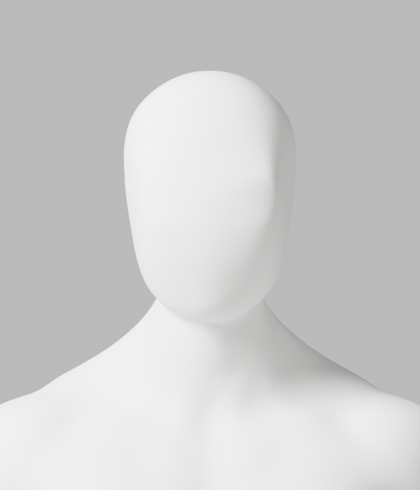
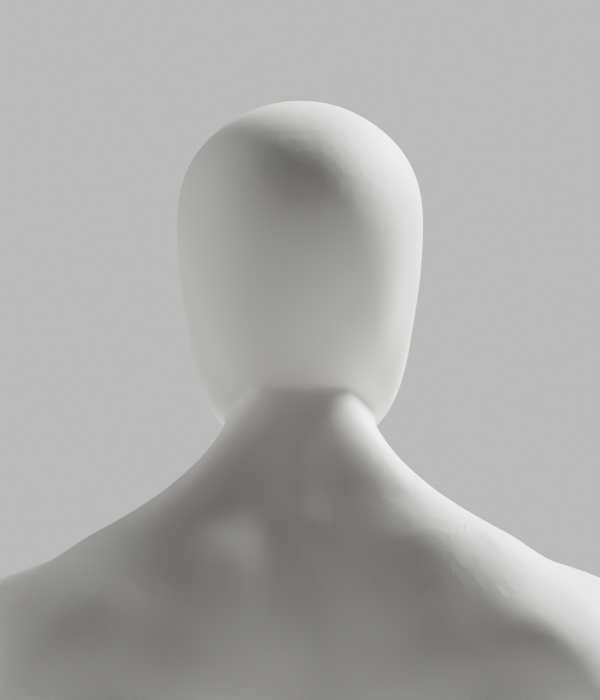
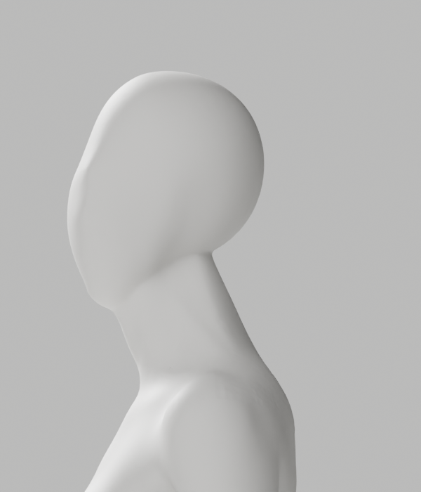
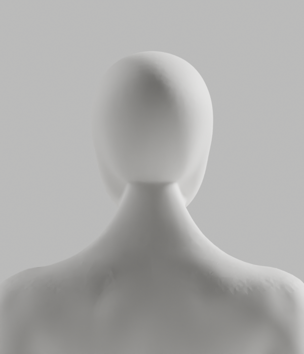

# A228–A236 — 저장 전 skin 검사와 native 곡면 단위 진단

**미채택. S2.4a~c, 외형 A-02/A-08 P2, Draft PR #9 및 전체 1~6단계는 여전히 미완료다.**
새로운 3개 원본은 A229 국소 정제, A231 변화 없는 대조, A235 국소 단위 변환 후보다.
개발 기본 A37을 교체하지 않았다. CEO 최신 사진의 얼굴·목·연속 연결과 남녀 통일 무의상 백색, 자연 구조·리깅 정확도 기준을 유지한다.

## 이번에 달라진 것

- [저장 전 검사](../../avatar_skin_guard.py)는 기존 exact numeric helper를 사용해 모든 점의 개별 계수와 합을 확인한다. 음수·비유한 값·1 초과·알 수 없는 그룹은 아주 작아도 거부한다. 생략된 0만 명시적 0과 같고, 작은 양수는 삭제하지 않는다.
- 실제 A216 원본 남 131645/여 130554점을 통과시켰고, 이전 A225 저장파일은 남 132069/여 131265점의 음수 계수에서 실제 exit1로 거부했다. 수정·정규화·복원·에셋 저장은 하지 않았다.
- 새 제작기 A229/A235는 편집 전 및 저장 전 이 검사를 실제 호출했다. 기존 SHA 보호 exporter/변형 하네스는 그대로이며 전체 파이프라인 통합 완료라고 주장하지 않는다.
- 순수 검사 9개와 기존 exact coefficient 11개 테스트, format/default Ruff/isolated Ruff를 실제 재실행했다. writer stub은 합성 단위시험이지 실제 저장 통합시험이 아니다.

## 국소 곡면 처리의 실제 원인 분리

| 실행 | 실제 결과 | 판단 |
|---|---|---|
| A229 | artist support 하부를 포함한 native Corrective Smooth, 최대 이동 남 0.675/여 1.051mm; 독립 저장 재열기 보존 통과; 6PNG | 남성 최대 면각과 일부 p95 악화. 뒤 목 경계·곡면 외형 미달 |
| A230 | 설치된 Blender의 RNA 및 원본 lineage 읽기 전용 조사 | 진단이며 제작/외형 승인이 아님 |
| A231 | 같은 mask의 Laplacian Smooth, 실제 이동 남녀 0; 6PNG·별도 원본 저장 | 변화 없는 후보. 기존 producer가 0 이동을 허용한 한계까지 보존 |
| A232 | factory startup Cube의 무 mask/전체/부분 mask 대조에서 실제 이동 8/8/4점 | 도구 작동의 기술 대조용. 인체 제작·대체 아바타·사용자 시험이 아님 |
| A233 | 실제 authored 국소 영역 복사본에서도 이동 0; 원본으로 전송 0 | 경계 밖 좌표 보존만 확인. 개선 아님 |
| A234 | 동일 복사본에서만 단위를 128배로 변환. 원래 모든 mask점이 fixed cutoff 대상, 변환 후 0점. 실제 이동 남 3118/여 4809점; 최대 0.380/0.562mm | 실제 no-op 원인 대조. 원본으로 전송하지 않음 |
| A235 | 검증된 국소 복사본의 nonzero support 좌표 편집만 원래 authored 신체에 전달. 전체 원래 skin/면/그룹·손·163 rest bones·마감·경계 밖 좌표 보존; 6PNG | 별도 원본 후보. 외형 미달로 미채택 |
| A236 | A235 저장파일을 독립 재열기하여 두 원본의 raw skin/위상·163개 숫자 rest bone·행렬·마감·편집 밖 좌표를 실제 대조 | 변경점 3118/4809, 최대 0.380/0.562mm. 국소 보존 통과일 뿐 전체 변형 승인이 아님 |

설치 버전은 Blender 5.1.1, commit `b70da489d7f4`다. [같은 커밋의 공식 소스](https://github.com/blender/blender/blob/b70da489d7f4/source/blender/modifiers/intern/MOD_laplaciansmooth.cc)를 실제 읽었다.
이 수정자는 `min_area=0.00001f`를 사용하는 고정 검사로 작은 edge/인접 삼각 면의 점을 건너뛴다.
원래 metre-scale 고밀도 복사본의 전체 mask점이 이 조건에 걸렸다는 계산과, 단위만 바꾼 실제 native 동작을 함께 보존했다.
이 원인 설명을 모든 Blender 수정자나 과거 모든 실패의 원인으로 일반화하지 않는다.

공식 소스 진단 사본의 SPDX/copyright를 보존하고 [Blender GPL 라이선스 원문](official-source/GPL-license.txt)을 함께 둔다. 이 사본은 GPL-2.0-or-later인 공식 소스이며 프로젝트 자체 파일의 라이선스를 변경하지 않는다. 라이선스 출처는 같은 커밋의 `doc/license/GPL-license.txt`다.

단위 변환은 원본이 아닌 실제 전문 제작 메시의 국소 복사본에만 수행한 2의 거듭제곱 변환이다.
변환된 공간에서도 zero-support 경계 좌표가 **정확히 같은지 먼저** 검사하고, 검증된 support 안의 native 편집만 전달했다.
실패한 outside 좌표/가중치를 사후 복원하지 않았고 whole-neck remesh, primitive 인체, 새로운 skin interpolation을 사용하지 않았다.
A235는 실제 이동이 0이면 저장하지 않는 assertion을 추가했다.

artist band 0.865~0.94, half-width 0.055, seed 0.885~0.915, 20mm geodesic 및 5°는 메시 선택값이다.
기존 6mm 한계와 skin sum 0.01은 기술 보호 기준이며 사용자 측정 정확도·임상 판정 각도·효과 수치가 아니다.
A235 최대 국소 면각은 남 14.255→12.956°, 여 24.257→23.876°지만 일부 p95/median은 개선되지 않았다. 수치 개선만으로 사진 외형을 통과시키지 않는다.

## 실제 미리보기

A235 정면·측면·후면은 6컷 모두 직접 열람했다. 아래는 AI 생성 예시가 아니라 실제 Blender 렌더다.
뒤 목의 경계, 후두부/얼굴 곡면 및 표면 흔적은 아직 미흡하다.

## 증거와 한계

- [실행 기록](execution-record.json): native Python 11회, 실제 exit0 10회와 음수 계수 대조의 예상 exit1 1회. 모두 순차 완료했다.
- [사본/보호 manifest](copy-manifest.json): 61사본, 40gzip, 실제 18PNG/직접열람14, 3blend/0GLB. 이전 411개 보호 파일은 SHA 그대로다.
- [검사기](evidence-check.cjs)는 보존·해시·실행 의미를 확인할 뿐 외형/출시 승인 장치가 아니다.
- A234의 실제 중간 stdout chunk `a4451a`는 읽었으나 별도 사본을 보존하지 못했다. 나머지 실제 stdout과 native JSON 진단은 보존하며 누락을 재구성하지 않는다.
- A233 report의 border.01 문구는 실제 실행 코드의 border0과 다르다. 실행 helper를 보존하고 이 오류를 기록했다.
- A235 마지막 출력에 A231 문구가 남아 있다. 실제 경로·제작 helper·저장 hash는 A235이며 잘못된 banner는 과거 실행 증거로 보존했다.
- 새 후보들의 전체 118변형·GLB·왕복·Chrome·실제 사용자/노트북 통합·최종 외형 승인 **미실행**. 선행 외형 탈락 뒤 이전 A216 결과를 새 후보 결과로 대신하지 않는다.
- 실제 사람·웹캠 입력·영상/관절 업로드, 배포·DB·시크릿·비용 작업 **0**.

## 다음 안전한 작업

진단된 no-op 경로를 반복하거나 강도만 높이지 않는다.
실제 뒤 목 경계와 후두부 전환의 geometry/edge flow를 좁혀 국소 조형한다.
외형이 충족될 후보에서 원본·GLB·전체 변형·브라우저·선명한 다방향 외형 검증을 새로 실행하고, 미충족 게이트를 건너뛰지 않는다.
[Story](../../../../docs/stories/stage2-avatar-candidate.md) 및 [제작 계약](../../../../docs/avatar-production.md)의 완료 기준과 CEO 승인 규칙은 그대로다.
