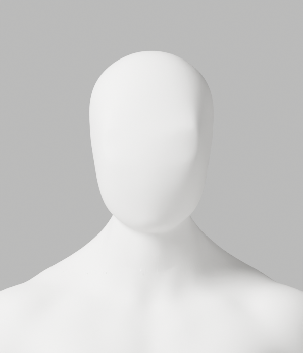
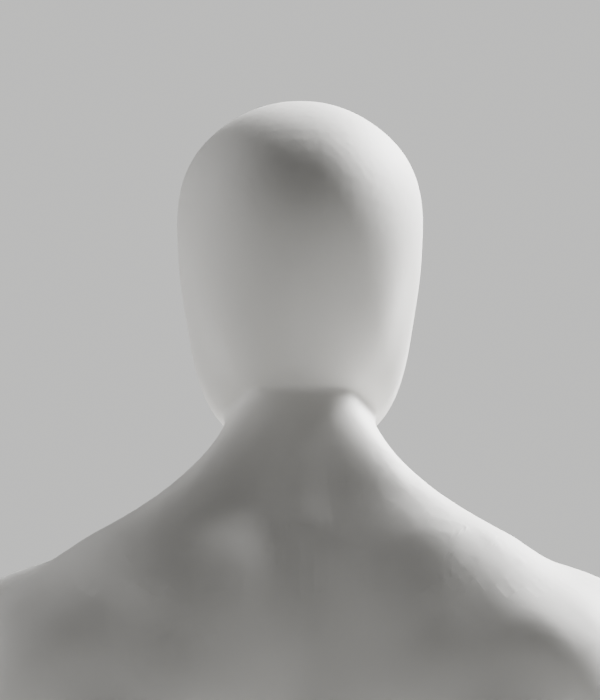
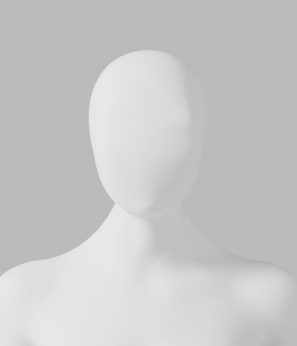
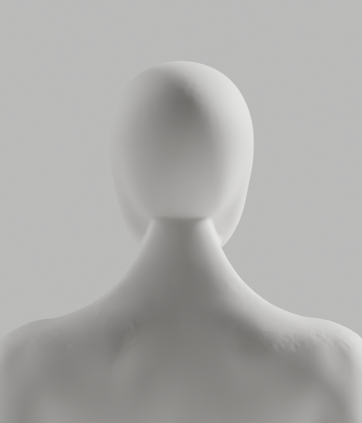

# A237–A242 — 뒤 머리·목 연결의 실제 위상 대조

**외형 미달로 미채택. S2.4a~c, A-02/A-08 P2, Draft PR #9 및 전체 1~6단계는 아직 미완료다.**
개발 기본 A37과 이전 원본·증거를 교체하지 않았다. CEO 최신 사진의 매끈한 얼굴–목 연결, 남녀 공통 무의상 백색 표면, 필요한 구조·리깅 정확도 기준을 유지한다.

## 실제 변경과 결과

| 실행 | 한 일과 실제 결과 | 판단 |
|---|---|---|
| A237 | A235 뒤쪽 edge/면/원래점 ledger를 읽기 전용 조사. 5° 초과 edge 남516/여459개 중 1mm 미만114/108개 확인 | 이전 long-edge 지표만으로 경계 전체를 설명할 수 없음. 선택 수치이며 임상 각도가 아님 |
| A238 | 세 원래점 ledger가 모두0인 두 갈래 후처리 점만 native BMesh 메모리에서 dissolve. 남0/여6개, 유지 좌표·계수 정확 보존, 실제 원본 저장0 | 위상 대조일 뿐 출시 에셋 아님 |
| A239 | 같은 여성 생성점6개만 별도 후보에서 정제. 남성은 변경 없는 대조. 유지점 좌표·수치 skin·그룹·손·각163 rest bones·마감 보존, 새 점/skin interpolation0 | 원본 후보와 실제6PNG 저장. 여성 위상은 달라졌으며 외형 미달 |
| A240 | A235와 A239 저장파일 독립 재열기. 제거점의 세 ledger0, 유지 좌표·skin, 손과 리그 보존 확인. 영향 밖 원래 면 남181201/여179426개 정확 보존 | 여성12개 영향 면을 전체 위상 동일로 표시하지 않음 |
| A241 | A239에서 앞면과 전체X를 고정한 posterior-only native Smooth YZ. 실제 변경 남895/여787점, 최대0.369/0.516mm. 원래 skin/면·리그 보존, 실제6PNG 저장 | 남성 최대 국소 면각 악화·양쪽 median/p95 악화. 외형 미달로 미채택 |
| A242 | A239와 A241 저장파일 독립 재열기. 전체 raw skin/면·그룹·손·각163 rest bones·행렬·PBR·세 점 ledger/추가 parent attribute 정확 보존. 전체X/앞면/편집 밖 좌표 보존 | 국소 보존 확인일 뿐 전체 변형·운동·외형 승인이 아님 |

A239 여성 제거점은 A235 index `128463,128483,128516,128547,128583,130549`다.
이는 생성점 provenance와 두 갈래 연결을 기준으로 정제한 것이며, 의학적 해부학 검토를 대신하지 않는다.
남성131645점은 그대로이고 여성130554→130548점, 면 수는181201/179438로 같다. 면 수가 같아도 여성12개 면의 연결은 달라졌다.
재색인한 세 ledger와 보호 손 목록을 실제 재열기에서 검증했다. 기존 원래점·가중치를 사후 복원하지 않았다.

A239의 각도 비교는 `.885~.915, Y>0` 안의 모든 길이 edge다. 최대 남12.956→12.956°, 여23.876→23.304°였다.
A241은 `.875~.94, Y>0, 길이>1mm`의 **다른 측정 영역**이다. 같은 A241 전후에서 남 최대12.956→16.243°, 여23.304→20.564°지만 양쪽 median/p95는 악화됐다.
서로 다른 영역의 통계를 한 연속 개선 수치로 연결하지 않는다. 20mm geodesic/5°/6mm 조형 한계는 기술 선택·보호값이며 사용자 측정 정확도나 운동 정답이 아니다.
이전 하부 cap 회귀가 있었던 영역을 무작정 확장하거나 whole-neck remesh·단순 도형 인체를 사용하지 않았다.

## 실제 외형 미리보기

두 후보의 정면·측면·후면 총12PNG를 모두 직접 열람했다. 아래는 실제 Blender 렌더이며 생성 예시 이미지가 아니다.
정면의 얼굴·목은 이어지지만, 후면 연결 띠와 후두부 곡면·표면 흔적은 참조 품질에 못 미친다.
원본 보존 통과와 별개로 **외형 반려**를 유지한다.

## 검증 기록과 미실행

- [실행 기록](execution-record.json): native8회 실제 exit0. 최초6회와 정적 검사 보완본의 실제 재실행2회를 구분한다. 출력 사본을 재구성하지 않았다.
- 최초 프로젝트 문맥 정적 검사에서 `C400`/`I001` 두 오류를 발견했다. 여러 셸 명령의 마지막 exit0은 전체 통과가 아니었다. 실제 오류 stdout와 원래 실행 helper를 보존한다.
- 별도 review-clean helper2개를 만들고 6개 최종 helper의 format/default Ruff/isolated E9,F를 `set -e`로 재실행해 통과했다. 수정본을 native로 실제 재실행한 A238/A240 JSON은 첫 결과와 정확히 같다. 원래 실행 source를 수정본으로 바꾸어 기록하지 않는다.
- 저장 전 검사9개와 exact coefficient11개, 합계20개 순수 단위시험을 실제 재실행했다. 합성 writer stub은 실제 저장 통합시험이나 사람 코칭 시험이 아니다.
- [사본·보호 manifest](copy-manifest.json): 43사본/29gzip, 실제12PNG/전부 직접열람, 2blend/0GLB. 이전479개 파일 SHA 불변을 확인했다.
- [증거 검사기](evidence-check.cjs)는 해시·보존·실행 의미를 검사한다. 외형/임상/보안 전체 감사/출시 승인 장치가 아니다.
- 새 후보의 전체118변형·GLB 내보내기/왕복·Chrome·실제 사람/다양한 노트북 통합 검증은 **미실행**이다. 선행 외형 탈락으로 진행하지 않았으며, 이전 A216 결과를 새 후보 결과로 대신하지 않는다.
- 실제 사람·웹캠 입력·영상/관절 업로드, 운영 DB·배포·시크릿·비용 작업 **0**. 개발A37·Draft PR #9 미병합·전체1~6단계/별도 승인 기준은 그대로다.

## 다음 안전한 작업

후처리 두 갈래 점 정제만으로 뒤 목 연결이 해결되지 않음을 확인했다. 앞 얼굴과 목 폭을 보존한 단순 native YZ 평활화도 전체 개선이 아니므로 강도만 높이지 않는다.
다음은 실제 남성 상부 경계 `.89~.892`, 여성 `.897~.900`의 면 연결·접선 전환을 국소 대조하는 작업이다. A237의 하부 cap 최대각을 상부 경계와 섞어 해결했다고 주장하지 않는다.
외형이 충족될 후보에서 원본·새GLB·전체 변형·실제 브라우저·선명한 다방향 외형을 새로 재검증하고, 미충족 게이트를 건너뛰지 않는다.
[기존 Story](../../../../docs/stories/stage2-avatar-candidate.md)와 [아바타 제작 계약](../../../../docs/avatar-production.md)의 완료 기준을 유지한다.
