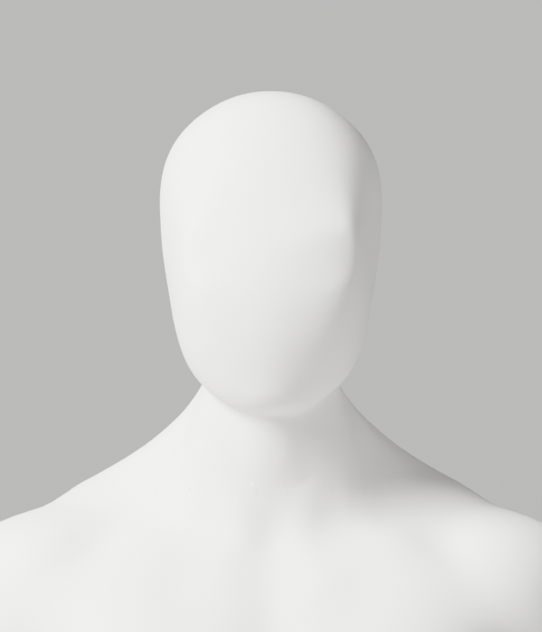
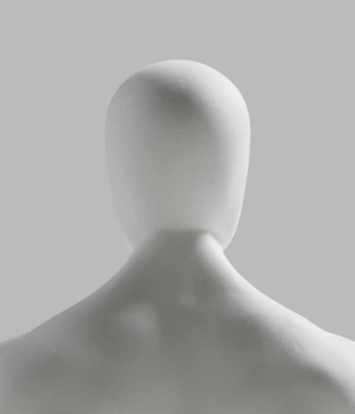
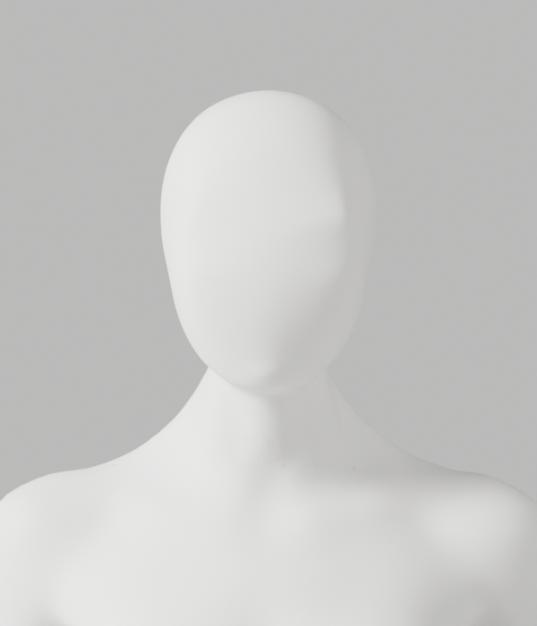
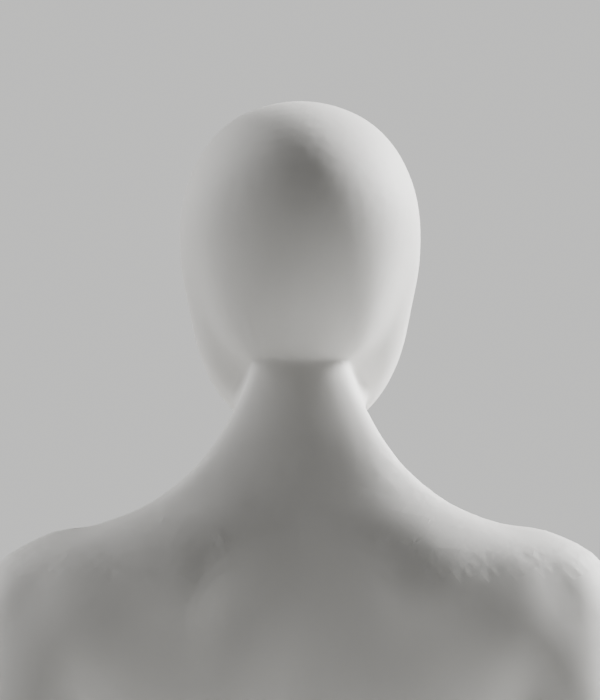

# A243–A251 — 뒤 머리·목의 선택 기준과 native 투영 검증

**두 렌더 후보 모두 외형 미달로 미채택이다. A-02/A-08 P2, Draft PR #9, S2.4 및 전체 1~6단계는 미완료다.**
개발 기본 A37과 이전 원본·검증 증거를 교체하지 않았다. 최신 CEO 참조의 얼굴–목 연속 연결, 남녀 공통 무의상 백색 마네킹 표면, 필요한 구조·리깅 정확도를 유지한다.

## 확인한 원인과 실제 변경

뒤쪽을 mesh 원점의 `Y>0`으로 고르던 방식은 실제 표면의 앞뒤를 제대로 구분하지 못했다.
A243의 원래 면 법선 기준 대조에서 5° 초과 뒤쪽 edge 남550/여707개가 기존 위치-Y 선택에서 제외됨을 확인했다.
이는 이번 국소 조형의 선택 오류이며, 전체 서비스 측정 오류나 모든 외형 결함의 원인이 확인됐다는 뜻은 아니다.

| 실행 | 실제 결과 | 판단 |
|---|---|---|
| A243 | A239 원본의 면 법선·위치-Y를 읽기 전용 대조. 좁은 띠에서 뒤쪽 edge 남8849/여9089개, 5° 초과743/836개 확인 | 위치-Y 대신 원래 표면 방향을 기준으로 선택해야 함 |
| A244 | 원래 vertex normal Y>.25 기준의 국소 Smooth YZ. 실제2475/3101점 변경, 최대0.421/0.814mm, 6PNG 저장 | 양쪽 고정 edge의 median/p95/최대 면각 악화. 외형 반려 |
| A245 | A244 저장파일을 독립 재열어 raw skin·면·그룹·손·각163 rest bones·행렬·PBR·점 ledger와 편집 밖 좌표 보존 확인 | 전체 변형/GLB/브라우저/외형 승인 아님 |
| native API 대조 | 설치된 BMesh triangulate/beautify 함수 서명을 실제 읽음. 아바타 변경/저장 없음 | 외부 API 문서 요청402를 근거로 사용하지 않음 |
| A246 | 남녀 각각 BEAUTY, BEAUTY+AREA, FIXED+AREA의 메모리 면 연결 대조. 원래 좌표·skin·영역 밖 면 보존, 새 점0 | 전체 개선 아님. 후보 저장/렌더0 |
| A247 | 기존 전문 메시의 임시 subdivision 표면에 국소 Y 투영. 분수 마스크에서 exact-X 검사 exit1 | 실패 보존. 원본 후보/보고서/렌더 생성0 |
| A248 | 저장 재열기 helper 준비·정적 검사만 수행 | A247 후보가 없어 native 실행하지 않음 |
| A249 | 같은 투영의 unsaved trial에서 X/Z 차이 실제 측정. X 최대 남3.725nm/여7.451nm, Z 최대119.209nm | 작아도 exact 축 보존 실패. 좌표/skin 사후 복원·검사 완화 없음 |
| A250 | 동일 양수 마스크 범위를 0/1 native 계수로 투영. 실제2499/3150점 변경, 최대0.081/0.122mm. 전체X/Z·raw skin/위상·손·리그 보존, 6PNG 저장 | 수치 개선은 있지만 뒤 목 경계·후두부 표면 외형 미달. 미채택 |
| A251 | A250 저장파일 독립 재열기에서 전체X/Z·raw skin/위상·손·각163 rest bones·행렬·PBR·ledger 보존 재확인 | 저장된 국소 변경의 보존 검증만 통과 |

A249는 **원본 파일 SHA는 그대로지만 메모리의 신체 좌표는 바뀐 진단**이다. 메모리까지 읽기 전용이라고 표시하지 않는다.
A250은 새로운 코드 인체를 만든 것이 아니라 이미 사용 중인 전문 조형 메시의 임시 native Catmull–Clark 1단계 표면을 투영 대상으로 썼다.
원래 신체의 점·면·skin은 그대로이며 임시 대상과 마스크를 저장 전에 제거했다. whole-neck remesh를 하지 않았다.
0/1 대조는 분수 마스크의 수치 차이를 피하면서 기존 exact 검사 자체를 유지한 것이지 허용 오차를 늘린 것이 아니다.

## 같은 표본의 수치와 한계

A244/A249/A250은 수정 전의 같은 edge 쌍 남15780/여15444개를 고정해 비교했다.
A250 p95는 남5.723→5.639°, 여5.397→5.228°, 최대는 남17.789→17.688°, 여23.304→19.409°다.
그러나 최대 이동은0.081/0.122mm로 작으며, 실제 렌더의 거시적 뒤 목 경계를 해결하지 못했다.
**수치 개선을 참조 외형 완성으로 표시하지 않는다.**

A243은 인접 면 법선·더 좁은 높이 띠, A244/A250은 원래 vertex normal·더 넓은 띠를 쓴다.
A246은 면 연결과 edge 수 자체가 바뀌므로 이 고정 표본 통계에 이어 붙이지 않는다.
5° 선택, 20mm geodesic, 높이 비율 `.875~.94`, 6mm 이동 보호값은 제작·검사 값이며 운동 목표 각도나 임상 정확도 기준이 아니다.
기존 global tiny face 남2/여0, long fold76/107은 그대로다. 새 국소 회귀가 없다는 결과를 전신 결함0으로 확대하지 않는다.

## 실제 미리보기 — 아직 미채택

두 후보의 정면·측면·후면 총12PNG를 **모두 직접 열람**했다. 아래는 실제 Blender 렌더이며 생성 예시 이미지가 아니다.
정면의 얼굴–목은 이어지지만 뒤쪽 수평 연결 경계·후두부 잔여 면 흔적은 최신 참조 품질에 미달한다.

## 검증과 보존

- [실행 기록](execution-record.json): native9회 실제 종료, 8회 exit0/1회 exit1. 설치 API 대조1회와 실제 아바타 관련8회를 구분한다. A248은 미실행이다.
- Python9개 format/default Ruff/isolated E9,F를 실제 실행해 통과했다. 9개에는 native 미실행 A248 helper가 포함되므로 정적 통과를 native 통과로 세지 않는다.
- 개별 skin guard9개+exact coefficient11개, 순수20시험을 실제 재실행했다. writer stub은 합성 시험이며 A245/A251의 실제 저장 재열기와 구분한다.
- [사본·보호 manifest](copy-manifest.json):44사본/30gzip, 실제12PNG/전부 열람, 2blend/0GLB. 이전526개 파일 SHA 불변을 확인했다.
- [증거 검사기](evidence-check.cjs)는 hash·보존·실행 의미만 검증한다. 제한된 gzip secret-pattern 검사는 전체 보안 감사가 아니다.
- 새 후보의 전체118변형, 새GLB 내보내기/왕복, 실제 브라우저는 **외형 선행 탈락으로 미실행**이다. 이전 후보 결과로 대체하지 않는다.
- 사람·웹캠·영상/관절 업로드, 운영 DB·배포·시크릿·비용 작업0. PR 병합0, 개발A37·전체1~6/승인 기준 유지.

## 다음 안전한 작업

같은 국소 smoothing 강도를 높이거나 작은 면각 개선을 반복해 완성으로 세지 않는다.
다음은 현재 저장된 전문 메시의 **뒤 머리–목 실루엣·원래 접합 띠의 거시적 접선 전환**을 읽기 전용으로 분리하는 작업이다.
앞 얼굴, 필요한 목·어깨 구조, 영역 밖 신체·skin·손·리그를 보호한 조형 후보에서 실제 외형이 충족될 때 원본·GLB·전체 변형·브라우저를 새로 재검증한다.
[기존 Story](../../../../docs/stories/stage2-avatar-candidate.md)와 [제작 계약](../../../../docs/avatar-production.md)의 완료 기준은 그대로다.
