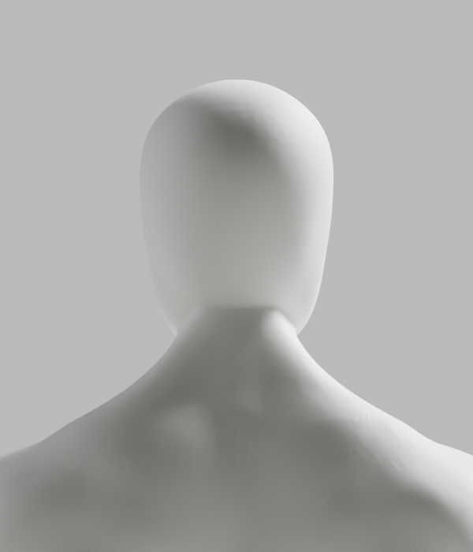
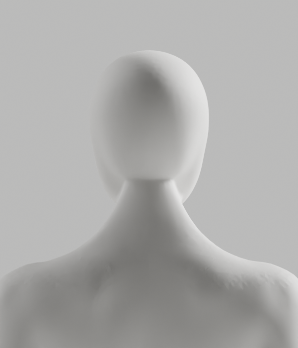

# A252–A256 — 거시적 머리·목 전환과 깊이축 조형 대조

**외형 미달로 미채택이다. A-02/A-08 P2·Draft PR #9·S2.4 및 전체1~6단계는 미완료다.**
개발A37·최신 얼굴–목 연속 연결/남녀 공통 무의상 백색·필요 구조/리깅·이전 파일과 승인 기준을 유지한다.

## 실제 작업

| 실행 | 실제 결과 | 판단 |
|---|---|---|
| A252 | A250 전문 메시의 후두부·목·접합 띠와 중앙 단면을 읽기 전용 조사. 세밀 단면의 큰 접선 전환은 남성 높이0.890~0.892, 여성0.898~0.900에 집중 | 작은 면각만이 아닌 거시적 윤곽 전환을 확인. 사진의 측면·후면과 수치 등록한 것은 아님 |
| A253 | 기존 전문 메시의 임시 native DECIMATE .05 + SUBSURF1 표면에 같은 국소 Y 투영. 실제 본체 점·면·raw skin·전체X/Z·손·각163rest 보존. 최대1.051/1.560mm | 여성 long fold107→137 회귀. exit1, 후보 원본 저장0. 실제6PNG 외형도 반려 |
| A254 | A253 저장 재열기 helper 준비·정적 검사만 수행 | A253 원본 후보가 없어 native 미실행 |
| A255 | 동일 임시 전문 표면을 native BVH로 질의하고 부드러운 선택 경계로 기존 점의 Y 성분만 편집. 실제2487/3093점 변경, 최대0.722/0.873mm,6PNG와 별도 원본 저장 | 새 접힘 회귀 없이 보존 검사 통과. 그러나 국소 p95/최대 면각 악화·뒤 목/후두부 외형 미달이라 미채택 |
| A256 | A250와 A255 저장파일을 독립 재열기. 전체 raw skin/위상·그룹·손·각163 rest bones·행렬·PBR·ledger·전체X/Z·앞 방향/영역 밖 좌표 exact | 저장된 국소 변경의 보존 검증만 통과. 전체 변형/GLB/브라우저/외형 승인 아님 |

A255는 3D 결과를 적용하고 X/Z를 사후 복원한 방식이 아니다. **처음부터 원래 점의 Y 성분만 썼고 X/Z에는 쓰지 않았다.**
native BVH는 기존 전문 메시 복사본의 표면을 질의하며, 같은 local 행렬을 확인한 뒤6mm 안의 Y-ray hit와 미리 계산한 연속 mask를 쓴다.
임시 대상만 DECIMATE/SUBSURF를 사용했다. 실제 신체의 위상·skin은 그대로이며 임시 대상·mask를 저장 전에 제거했다. 단순 도형 인체·whole-neck remesh·검사 완화는 없다.

A252의 중앙선 chord 방향 변화는 남성 최대18.125°, 여성26.719°였다. 이것은 조형 단면의 급한 전환이며 **운동 각도·질환 판정·의학 기준이 아니다.**
A253/A255는 A250 원본의 같은 edge 쌍 남15792/여15476개를 고정했다. 앞 A244/A250의 A239 표본 남15780/여15444개와 달라 별도의 비교다.
A255 p95는 남5.639→5.821°, 여5.259→5.649°, 최대는17.688→28.004°,19.409→38.910°로 악화했다. median 일부 개선만으로 전체 개선이라고 하지 않는다.
global tiny face2/0, long fold76/107은 기존 값 그대로다. 국소 회귀 없음은 전신 결함0이라는 뜻이 아니다.

## 실제 미리보기 — 검수 중, 미채택

A253/A255 정면·측면·후면 총12PNG를 모두 직접 열람했다. 아래는 실제 Blender 렌더다.
A253의 측면 주름은 부드러운 mask 대조에서 줄었으나 후면의 수평 연결 경계·후두부 면 흔적은 여전히 참조 품질에 못 미친다.

## 실행·보존·미실행

- [실행 기록](execution-record.json): native4회 실제 종료 `0/1/0/0`. A254 native 미실행을 구분한다. stdout 사본을 재구성하지 않았다.
- Python5helper format/default Ruff/isolated E9,F 실제 통과. native 미실행 A254도 포함돼 정적 통과를 실행 통과로 세지 않는다. A255 편집의 최초 context mismatch는 native 실행 전에 바로잡았다.
- skin guard9개+exact coefficient11개, 순수20시험 실제 재실행. 합성 writer stub과 실제 A256 저장 재열기를 구분한다.
- [사본·보호 manifest](copy-manifest.json):31사본/18gzip,12PNG 전부 열람,1blend/0GLB. 이전574개 파일 SHA 불변 확인.
- [증거 검사기](evidence-check.cjs)는 보존·실행 의미만 검사하며 외형/임상/출시 승인이나 전체 보안 감사가 아니다.
- 새후보의118변형·새GLB 내보내기/왕복·브라우저는 **선행 외형 탈락으로 미실행**이다. 이전 후보 결과로 대체하지 않는다.
- 사람/웹캠/영상·관절 업로드, 운영 DB·배포·시크릿·비용 작업0. PR 병합0,개발A37·전체1~6/승인 기준 그대로.

## 다음 안전한 조형

coarse 표면의 비율이나 blind smoothing 강도를 반복하지 않는다. 다음은 현재 전문 메시의 실제 접선에 맞춘 **머리–목 연결 띠의 국소 전환 조형**이다.
필요 구조·앞 얼굴·영역 밖 신체·raw skin·손·rest rig와 기존 변형 보호 기준을 유지한다. 좋은 정답 동작의 의학 기준과 분리한 외형 작업이다.
실제 외형이 충족될 후보에서 원본·GLB·전체 변형·브라우저를 새로 재검증한다.
[Story](../../../../docs/stories/stage2-avatar-candidate.md)와 [제작 계약](../../../../docs/avatar-production.md)의 완료 기준을 유지한다.
