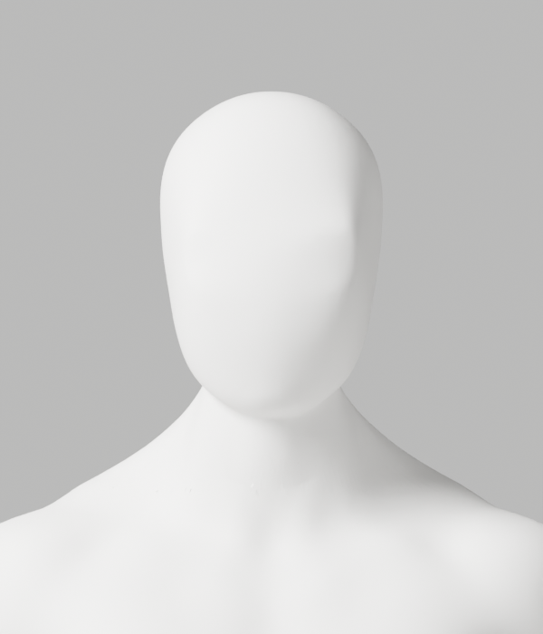
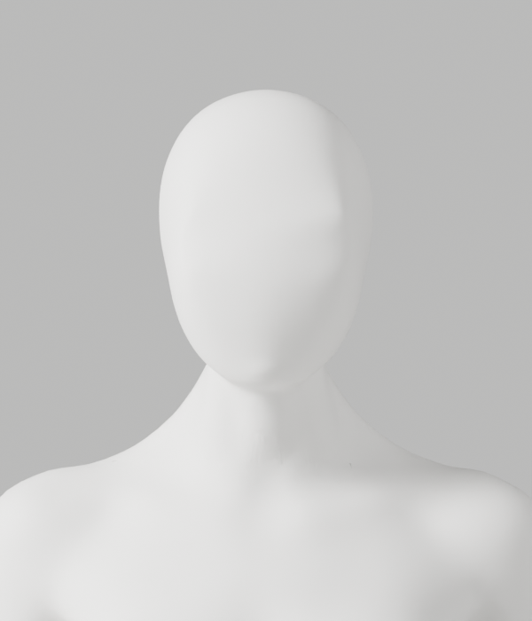
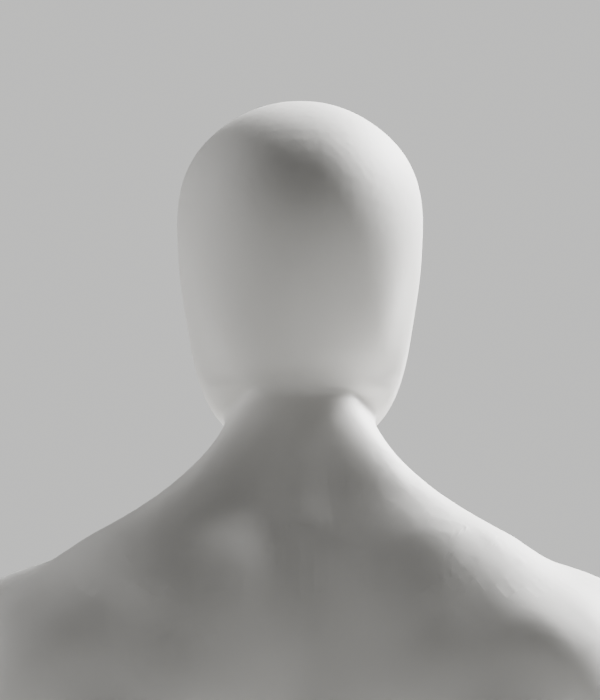
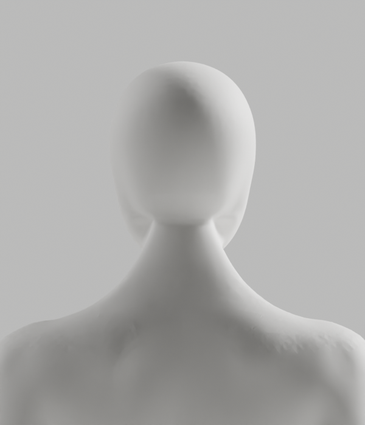

# A257–A259 — 머리·목 접선 조형과 좌우 단면 대조

**외형 미달로 미채택이다. A-02/A-08 P2, Draft PR #9, S2.4와 전체1~6단계는 미완료다.**
최신 사진의 얼굴–목 연속 연결, 남녀 공통 무의상 백색, 필요한 신체 구조·리깅, 개발A37과 기존 승인 기준을 유지한다.

## 실제 작업과 판단

| 실행 | 실제 결과 | 판단 |
|---|---|---|
| A257 | A250 전문 메시의 실제 중앙 단면 접선을 읽어 국소 Y-only 조형. 남녀 실제2504/2742점 변경, 최대1.600/3.125mm. 전체X/Z·raw skin·위상·손·각163 rest와 기존 접힘/미소면 보호값 보존. 원본 후보1개·8PNG 저장 | 중앙 윤곽 일부 개선만으로 채택하지 않음. 여성 뒤 목의 좌우 주름과 잔여 연결 경계·후두부 면 흔적이 외형 미달 |
| A258 | 저장된 A250/A257 원본을 독립 재열기하여 좌표·skin·면·그룹·손·rest/pose·행렬·재질·point ledger 보존을 확인 | 국소 편집의 저장 보존 통과. 전체 변형·GLB·브라우저·출시 승인 아님 |
| A259 | 원본/후보·남녀·좌우11위치의 native 단면44개를 읽기 전용 대조. 중앙 앵커에서 좌우 형상이 다름을 확인 | 중앙 곡선을 좌우에 공통 적용하는 방식은 반려. 단면이 없는 위치를 채우거나 각도를 의학 기준으로 사용하지 않음 |

[사전 조형 계약](contracts/tangent-contract.md.txt.gz)은 실제 제작 전에 작성했다. 남성 높이 비율.886~.907, 여성.893~.916의 앵커와 원래 단면 접선을 사용했다.
기존 전문 신체의 점에 **Y 성분만 썼으며 X/Z에는 쓰지 않았다.** 단순 도형 인체·whole-neck remesh·신체 decimate·skin 보간·사후 좌표/skin 복원·보호 기준 완화는 없다.
목표 cubic의 끝값/접선 검사는 실제 메시의 접선 연속·외형·임상적 정확도를 증명하지 않는다.

고정한 A250 edge 쌍 남15792/여15476개에서 p95는 남5.639→5.318°, 여5.259→6.243°이고 최대는17.688→18.321°,19.409→43.398°다. 따라서 전체 개선으로 표시하지 않는다.
global tiny face2/0, long fold76/107은 원래 값 그대로다. 회귀 없음이 전신 결함0이라는 뜻은 아니다.
A259의 여성 좌우 X 비율±.02 단면에서는 같은 앵커의 목표 깊이 차이가 약11.031/15.497mm였다. 이것은 **미적용 목표의 표본값**이지 실제 이동이나6mm 보호 통과가 아니다.
좌우±.04 일부 높이와±.05 전체에서 단면이 없음을 그대로 기록했다. 중앙 앵커를 전체 폭에 적용하지 않을 근거이며, 촬영 참조 등록·운동 각도·질환 기준은 아니다.

## 실제 Blender 미리보기 — 미채택

정면·측면·후면·3/4의 남녀8PNG를 모두 직접 열람했다. 아래는 새 후보의 실제 렌더이며 제품 적용 화면이 아니다.

## 실행·보존·미실행

- [실행 기록](execution-record.json): native3회 실제 종료0/0/0, 실제8PNG. native 실패0은 외형 통과라는 뜻이 아니다.
- 최초 순수 helper 정적 검사의 TRY004 실패를 보존했고, 타입 예외를 수정한 뒤9개 계산 시험을 실행했다. 마지막5helper format/default Ruff/isolated E9,F와 skin20+곡선9의 **29개 순수 시험**을 실제 재실행했다. 합성 계산/writer stub을 실제 아바타 검증으로 세지 않는다.
- 사본 도구의 최초 확장자 정규식 오류는 복사 전 실패였으며 빈 출력 폴더에서 수정 후 재실행했다. 초기 helper는 임시 폴더에 보존했고 원래 tool stdout은 이 사본에 포함하지 않았다. native 실패로 세거나 숨겨진 통과로 바꾸지 않는다.
- 최초 증거 검사는 파생 JSON의 잘못된 줄 종료 문자로 실패했다. 원래 파생 파일을 임시 폴더에 byte 그대로 보존하고 종료 문자·검사기 정규식 이스케이프를 수정한 후 실제 재실행했다. native stdout 객체·후보·보고서·PNG·원본 helper는 변경하지 않았다.
- [사본·보호 manifest](copy-manifest.json):28사본/19gzip,8PNG/1blend/0GLB. 이전609개 파일 SHA 불변을 확인했다.
- [증거 검사기](evidence-check.cjs)는 사본·보존·실행 의미의 검사다. 외형·임상·출시 승인이나 전체 보안 감사가 아니다.
- 새후보의118변형·새GLB 내보내기/왕복·브라우저는 **선행 외형 탈락으로 미실행**이다. 이전 후보의 결과로 대체하지 않는다.
- 사람/웹캠/영상·관절 업로드, 운영 DB·배포·시크릿·비용 작업0, PR 병합0이다. 기존 파일·증거·1~6단계 완료 기준과 승인 경계를 유지한다.

## 다음 안전한 작업

중앙 곡선이나 smoothing 강도를 반복 적용하지 않는다. 먼저 원래 전문 메시의 **뒤 목 연결 경계의 좌우 edge flow·단면 경계**를 조사해 중앙/측면을 한 곡선으로 취급하지 않는 국소 조형 범위를 정한다.
앞 얼굴·필요 구조·raw skin·손·rest rig와 기존6mm/변형 보호 기준은 유지한다. 외형이 실제 충족되는 후보에서 원본·GLB·전체 변형·브라우저를 새로 검증한다.
[Story](../../../../docs/stories/stage2-avatar-candidate.md)와 [제작 계약](../../../../docs/avatar-production.md)의 완료 기준은 바꾸지 않는다. 기존 goal은 계속 진행한다.
