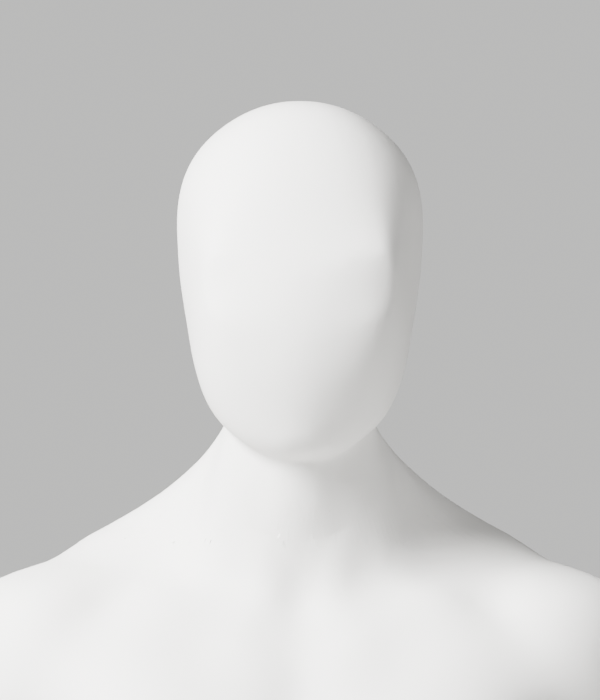
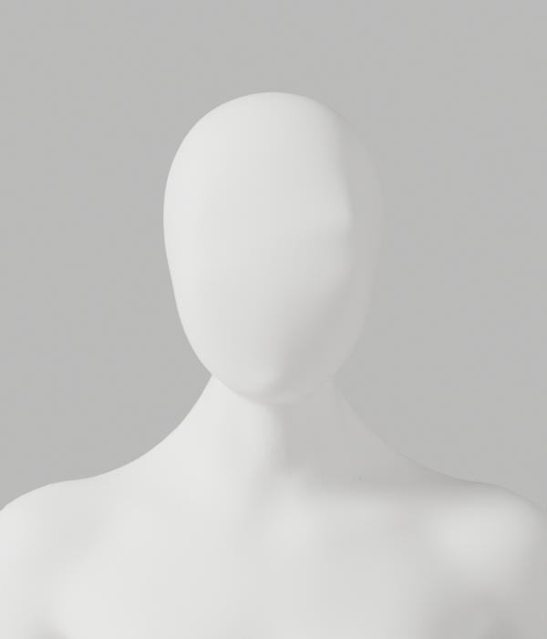
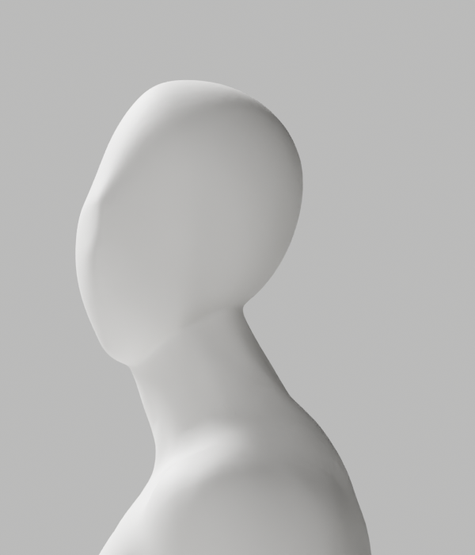
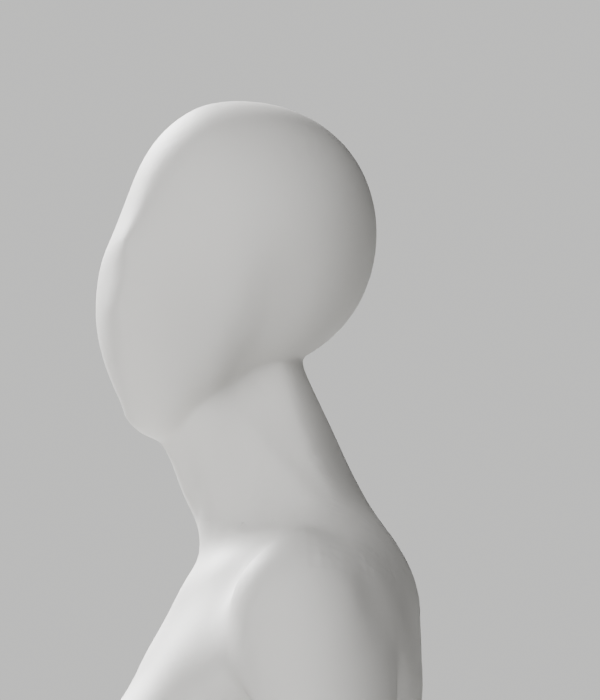
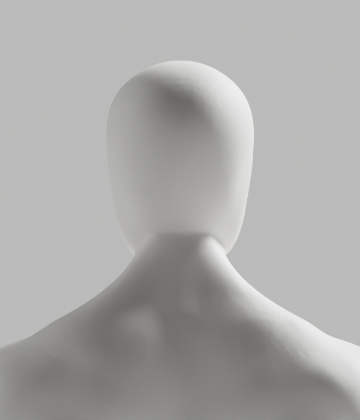
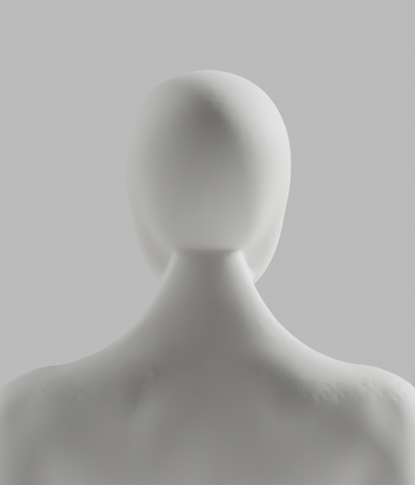

# A260–A265 — 좌우 연결부 정제와 정확한 좌표 비교

**외형 미달로 미채택이다. A-02/A-08 P2, Draft PR #9, S2.4와 전체 1~6단계는 미완료다.**
최신 사진의 얼굴–목 연속 연결, 남녀 공통 무의상 백색 중성 표면, 필요한 구조·리깅과 개발 A37을 유지한다.

## 실제 결과

| 실행 | 실제 확인 | 판단 |
|---|---|---|
| A260 | A250/A257의 같은 원래 edge 쌍을 중앙·내측·외측으로 읽기 전용 비교. 여성 내측 최대 면각 18.466→43.398°와 인접점 이동차를 확인 | 중앙 목표 곡선을 좌우에 공통 적용하는 방식 반려 |
| A261 | 전문 메시의 원래 이웃을 이용한 국소 Y-only native fairing. 1blend·8PNG 저장 | 기술 보호값 통과. 뒤 목 경계·후두부 흔적이 남아 외형 미달 |
| A262 | 별도 프로세스에서 A250/A261 저장파일을 숫자 튜플로 대조. 실제 변경 남2408/여2901점·최대0.249/0.378mm | 저장 보존 확인. 전체 변형/GLB/브라우저/출시 통과 아님 |
| A263 | 여성35881번의 Y가 3.725290298461914e-9m 변했으나 Blender Vector 비교가 같다고 판단하는 실제 사례 확인 | 이전 제작 로그의 변경수 2408/2900을 보존. 정확한 저장 검사 2408/2901과 차이를 숨기지 않음 |
| A264 | 같은 원본·연산·범위로, 제작 단계의 좌표 보호·변경수까지 숫자 튜플 비교로 강화 후 실제 재실행. 1blend·새8PNG 저장 | 원래 X/Z·zero-mask·손·skin·위상·각163 rest/pose·세계 행렬·마감 보호. 외형은 여전히 미달 |
| A265 | 새 저장파일 독립 재열기, 숫자 튜플/skin/위상/리깅/재질/point ledger 대조 | 실제2408/2901점 및 보호 구조 보존 확인. 외형 승인 아님 |

[조형 사전 계약](contracts/native-depth-contract.md.txt.gz)과 [정확한 좌표 비교 보완 계약](contracts/strict-coordinate-contract.md.txt.gz)을 실행 전에 작성했다.
원래 연결 edge의 geodesic 영향권과 고정 경계 taper를 사용했다. native LAPLACIANSMOOTH의 Y축만 활성화하고 실제 body에는 Y만 썼다.
임시 전문 메시 복사본의 power-of-two128 단위 변환·lambda.35/16회는 조형 설정이며 의학적 각도/시간 기준이 아니다.
단순 인체·whole-neck remesh·신체 decimate·skin/좌표 사후 복원·6mm 등 보호 기준 완화는 없다.

A261의 Vector 비교로 작성된 “exact” 필드는 엄밀한 숫자 비교의 증거로 재해석하지 않는다.
해당 원래 helper·보고서·저장파일은 보존했고 A262에서 정확한 저장 비교를 별도로 수행했다.
A264는 제작 단계도 정확한 숫자 튜플로 검사하며 A265에서 독립 확인했다. 아주 작은 차이를 허용 오차로 지우지 않았다.

두 제작 후보의 원래 고정 edge 남15792/여15476개에서 최대 면각은 17.688→17.553°,19.409→17.877°로 감소했지만
p95는 5.639→6.363°,5.259→6.182°로 악화했다. 전체 외형 개선/결함0으로 표시하지 않는다.
global tiny face2/0·long fold76/107은 원래 값 그대로다.

## 실제 Blender 미리보기 — 제품 미적용

A261과 A264 각각 남녀 정면·측면·후면·3/4 **총16PNG를 모두 직접 열람**했다.
아래는 정확한 좌표 보호로 재실행한 A264의 실제 렌더다. 사진에 없는 후면까지 일치한다고 주장하지 않는다.

## 실행·보존·미실행

- [실행 기록](execution-record.json): native6회 실제 종료0. 좌우 조사/제작/저장 확인/Vector 진단/강화 제작/강화 저장 확인을 구분한다.
- 마지막8helper format/default Ruff/isolated E9,F와 skin20+geodesic9의 **순수29시험**을 실제 실행했다. 합성 계산/writer stub은 실제 아바타·임상 검증이 아니다.
- 새 exact helper 준비 중 apply_patch 문맥 불일치는 native 실행 전에 발생했다. 실제 문맥으로 보완 후 정적 검사와 A264/A265를 실행했다. 원래 실행 helper/증거는 변경하지 않았다.
- [사본·보호 manifest](copy-manifest.json):45사본/27gzip,16PNG/2blend/0GLB. 이전641개 파일 SHA 불변을 확인했다.
- [증거 검사기](evidence-check.cjs)는 사본·기록 의미·보호값을 검사한다. 외형/임상/전체 보안/출시 승인이 아니다.
- 새118변형·새GLB 내보내기/왕복·브라우저는 **선행 외형 탈락으로 미실행**이다. 이전 후보 결과로 대체하지 않는다.
- 사람/웹캠/영상·관절 업로드, 운영 DB·배포·시크릿·비용·PR 병합0이다.

## 다음 작업과 유지 기준

같은 smoothing 강도나 중앙 목표를 반복 탐색하지 않는다. 잔여 상부 경계와 후두부 형상은 구조적 조형 과제로 남긴다.
외형이 실제 충족된 후보에서 전체 원본·변형·GLB·브라우저 검증을 다시 수행한다.
동작 목록·상세 안내·직접 선택 같은 독립적인 웹 흐름은 별도 Story/최신 main 브랜치에서 진행하되 검증 전 코칭은 열지 않는다.
[Story](../../../../docs/stories/stage2-avatar-candidate.md)·[제작 계약](../../../../docs/avatar-production.md)·1~6단계 완료 기준/승인 경계를 그대로 유지하며 기존 goal은 계속 진행한다.
