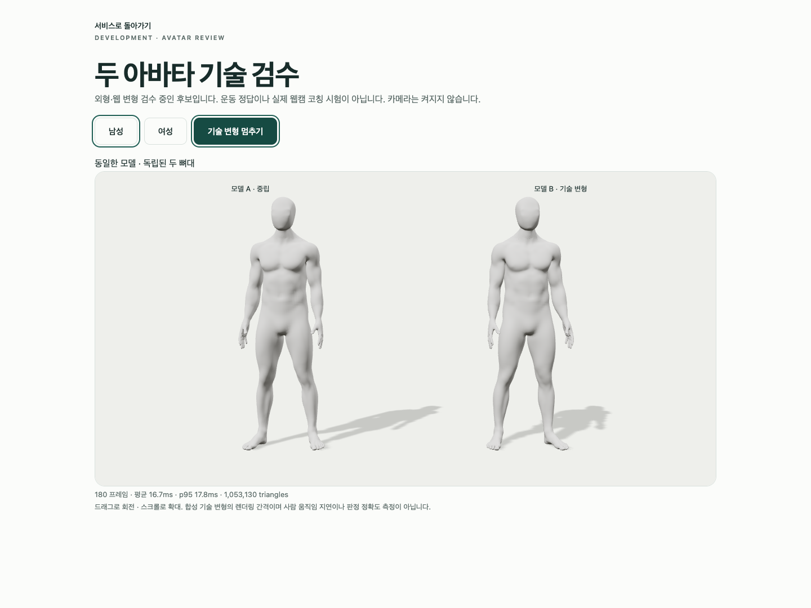
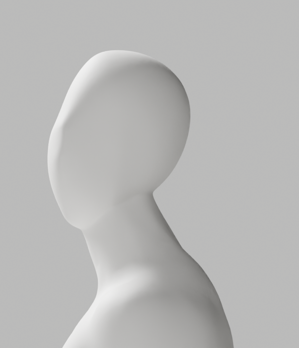
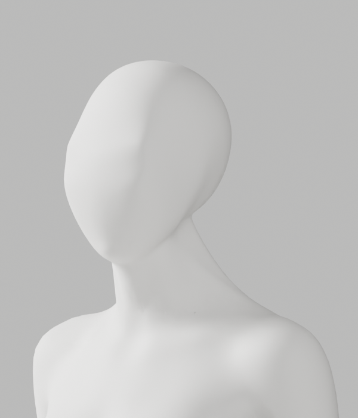
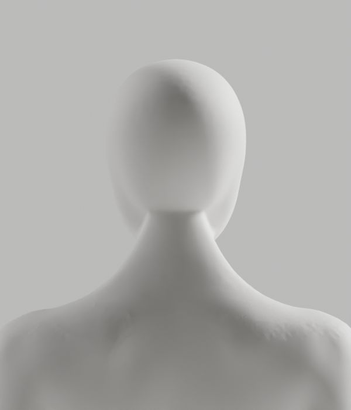

# A268–A273 — 최신 얼굴·목 참조의 국소 제작과 실제 후속 검증

2026-10-04, S2.4 / FR-A-02/03/04/07/08. **미채택 · 외형 P2 미해결 · PR9 미병합 · 2단계/출시 미완료.**

CEO가 지정한 얼굴/목 사진의 파일 SHA256은 기존 [보존 참조](../candidate-a88-review/ceo-reference.png)와 동일한 `45b313912dee5ae2218b1fe76086abb35a9b948fab9e877f1a9d2b05f832de62`다. 이전 여성 의상 요구를 대체하는 매끈한 무의상 남녀 백색 중성 마네킹·연속 얼굴–목 연결, 필요한 구조/리깅 정확도 보존 요구를 유지한다. 새 사진의 흐림/과노출을 외형 목표로 사용하지 않는다.

전문 A250 원본을 보존하고 별도 Blender 후보를 제작했다. A268/A270의 단면 보간은 실제 변위/면 접힘 보호 검사에 실패해 저장 전에 중단했다. guard를 완화하지 않았다. 이후 같은 원본의 실제 뒤 목–하부 뒤통수 연속 표면에 native Corrective Smooth를 적용한 A271을 별도 저장하고, A272 독립 재열기와 A273 전체 원본/GLB/브라우저 QA를 실행했다.

## 실제 실행과 결과

| 검사 | 실제 결과 |
|---|---|
| A268 단면 Hermite | 남 최대4.747mm/fold76→80, 여10.923mm/107→117. 둘 다 guard 실패/exit1. 모델·렌더 저장 없음 |
| A270 slope-limited/원래 graph 경계 taper | 남6.140mm/fold76→78, 여6.656mm/107→117. guard 실패/exit1. 모델·렌더 저장 없음 |
| A271 native 연속 표면 | 남7894/여7536점 실제 변경, 최대2.135/4.817mm. non-manifold/winding0, tiny2/0·fold76/107 baseline 그대로. 각 원래 frozen edge22510/21609개 전후 대조. 별도 후보·실제8PNG, exit0 |
| A272 저장 파일 독립 대조 | 남123751/여123012점 불변, 선택 밖·앞면·손·raw skin/그룹 순서/위상/PBR·각163rest bones/pose/world·point ledger/원래 source-id attribute 정확한 값 동일. 새로운 임시 선택 그룹 없음, skin 개별값/합 검사 통과, exit0 |
| A273 원본 전체 기술 변형 | **118개·121행 PASS**, 기존 하네스/기준 그대로, exit0. qc-only여서 전체34컷 미생성 |
| 실제 GLB export/import | ratio1.0, 기존 원래 삼각형 수리·8-influence 정책. 남11,638,276/여11,541,880bytes·각1mesh, image/animation0, 배율/위치 대조 통과. source는 저장하지 않음, exit0 |
| GLB 왕복 전체 기술 변형 | **118개·121행 PASS**, 기존 하네스/기준 그대로, exit0. qc-only여서 전체34컷 미생성 |
| 실제 Chrome | 기존3개 **PASS/48.5s**, 남녀 새 GLB SHA·JOINTS_1/WEIGHTS_1 실파일 확인. 실제 두 복제본 WebGL/독립 뼈대·오류/재시도 검사, 실제2PNG |
| 실제 렌더 간격 | 같은 설치 Chrome154.0.8037.93/1440×1080, 각180frames. 남 mean16.67/p9517.8ms, 여16.67/p9517.6ms. 합성 3D 변형 렌더 간격이며 웹캠 인식·사람 지연/정확도 시험 아님 |
| 코드/보간 검사 | Ruff check/format8helpers·Node syntax2runners 통과, 순수 보간10개 PASS. 초기7개와 첫 E731 실패/def 보완도 기록 |
| 증거 | **38 exact copies =23gzip·10PNG·3blend·2GLB**, 기존708파일 SHA 불변. 실제10PNG 모두 직접 열람 |

Native 7회 중5회exit0/2회guard exit1을 그대로 보존했다. Chrome은 closed-port proxy로 외부 연결을 차단했으며 API401/의도503 실패만 모의다. 새 GLB와 WebGL·렌더·복제 뼈대는 실제다. 로그의 NO_COLOR/THREE.Clock·WebGL extension 경고와 의도적인503/error boundary 출력도 보존했다. 기존 e2e assertion이나 임계값은 바꾸지 않았다.

A271은 **국소 XYZ native 편집**이다. 앞 실패 후보의 Y-only/all-XZ-exact 성공으로 표시하지 않는다. 선택 밖 모든 좌표 보존, 기존6mm·위상·fold guard는 그대로다. 임시 그룹을 제거했을 뿐 원래 좌표/skin을 사후 복구하지 않았다. GLB는 기존 export 정책에 따른8개 영향/정규화·삼각화/fin 수리가 있으므로 원본 raw skin/위상과 숫자가 전부 같다고 주장하지 않는다. 정확한 원본 보존과 새 GLB의 실제 변형 검증을 별도로 구분한다.

제작 단계 profile-report의 full-QA:false는 당시 후속 실행 전 상태를 보존한 것이다. 이후 결과는 source/roundtrip-deformation-report·browser-report·execution-record를 근거로 확인하며 과거 보고서를 소급 덮어쓰지 않았다. 공통 artist_profile.py의 최초3함수는 A268 후 변경되지 않았고, 보존본에는 A270 전 추가한 monotone_slopes가 함께 있다. 이를 A268 실행 당시 전체 파일 hash라고 주장하지 않는다.

## 실제 외형 판정과 다음 작업

전후 같은 frozen edge에서 꺾임 수치는 일부 감소했지만 **뒤통수의 패치처럼 보이는 마감, 측면/특히 여성3/4의 얼굴–목 연결선**이 남아 있다. 정면은 faceless 중성 백색 표현을 유지하나 전체 참조 품질을 충족했다고 판단하지 않는다. **A-02/A-08은 미통과**이며 새 후보를 개발 기본값으로 채택하지 않는다.

다음 조형은 단면 Hermite·slope/강도 반복 대신 원래 뒤통수 하부와 목 측면 접합 표면의 곡면 대응을 다룬다. 이 후보의 새 native 연속 영역/실제 변형 결과를 출발점으로, 원래 skin/리그와 보호 검사·이전 증거를 유지한다. 정적 소수 각도·기술118개를 실제 올바른 시범/리타게팅의 근거로 사용하지 않는다.

이번 원본/왕복 각34컷, GLB 재수입 렌더34컷, 실제 사람/카메라/올바른 시범·사용자 리타게팅·복합 자세·다장치/조명/체형/촬영 범위 시험은 **미실행**이다. 새로운 최종 채택 형상에서는 필요한 전체 QA를 다시 실행해야 한다. S2.3b/S2.4c·서비스 전체2단계 및1–6단계 목표는 계속 진행 중이다. 별도 사람/외부 연결/시크릿/운영 DB/배포/비용 승인 경계는 그대로이며 이번에 해당 작업은 없다.

## 실제 미리보기

실제 모델은 [조형 원본](native/artist-candidate.blend)·[웹 원본](native/web-candidate.blend)·[GLB 왕복 원본](native/web-candidate-roundtrip.blend), [남성 GLB](export/bodyguard-male-candidate.glb)·[여성 GLB](export/bodyguard-female-candidate.glb)다. 모두 새 미채택 파일이며 A37 기본 모델과 기존 원본을 덮어쓰지 않았다.

명세/코드/보고서/전체 stdout은 gzip 사본, 해시는 copy-manifest.json에 있다. integrity 재확인은 `node bodyguard/assets/blender/review/candidate-a268-a273-review/evidence-check.cjs`. 해시/수치/코드 검사 통과는 외형·의학/웹캠 정확도·출시 승인과 다르다.

## 로컬 회귀와 PR 확인

2026-10-04 최신 origin/main은4a00bb2이며 현재 avatar HEAD8aca20a가 이미 포함한다. 실제 frontend151개/16파일3.34s·Biome65파일·TypeScript noEmit을 다시 실행해 통과했다. 이번 변경은 새 미채택 에셋/증거와3개 상태 문서뿐이고 frontend/runtime/기본A37·계정/운영 설정은 바꾸지 않았다. PR9는 OPEN/Draft/CLEAN/MERGEABLE·**체크 없음**으로 읽었지만 A-02/A-08 P2가 미해결이라 병합하지 않는다. 이 검사는 새로운 실제 사람/계정 공급자·전체 서비스/출시 검증이 아니다.
