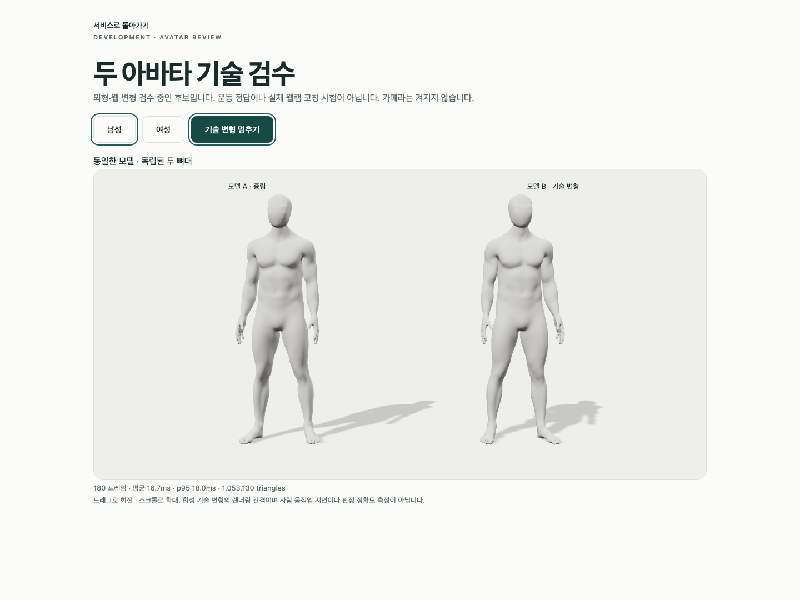
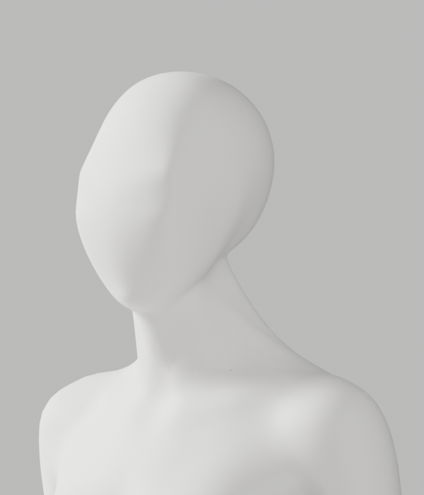
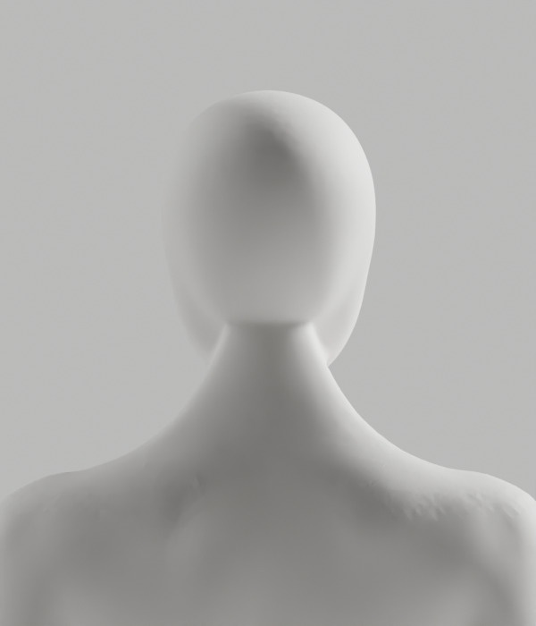

# A274–A278 — 목 측후면 연결부 조형과 실제 후속 검증

2026-10-04 · S2.4 / FR-A-02/03/04/07/08. **미채택 · 외형 P2 미해결 · PR9 미병합 · 2단계/출시 미완료.**

최신 [CEO 얼굴·목 참조](../candidate-a88-review/ceo-reference.png)의 SHA256 `45b313912dee5ae2218b1fe76086abb35a9b948fab9e877f1a9d2b05f832de62`와 남녀 무의상 백색 중성 마네킹·연속 얼굴–목 연결·필요한 구조/리깅 정확도 보존 요구를 유지한다. 이전 여성 의상 요구는 대체됐고, 사진의 흐림/과노출은 품질 목표가 아니다. 전문 A250 원본과 이전 제작/검증 증거는 보존한다.

## 실제 실행

| 검사 | 실제 결과 |
|---|---|
| A274 원래 표면 둘레 방향 대응 | 원래 단면 ray miss 남녀0/0. 최종 남5.020mm/guard PASS, 여6.702mm/guard FAIL로 **전체 저장 전 중단·exit1**. 기존6mm 보호를 완화하지 않음 |
| A275 저장 재열기 | A274 파일이 저장되지 않아 **미실행**. 준비 코드만 보존하며 성공 검사로 세지 않음 |
| A276 native 측후면 정제 | 원래 전문 표면의 국소 XYZ 편집. 남9759/여9679점 실제 변경·최대2.135/4.817mm. 별도 저장/실제8PNG·exit0 |
| A277 독립 저장 파일 대조 | 남121886/여120869점 불변. 범위 밖/앞면/손·raw skin/면/그룹 순서·각163rest bones+부모/pose/world/PBR·point ledger/source-id attribute 정확한 값 보존·exit0 |
| A278 원본 기술 변형 | 기존 하네스·기준 그대로 **118개·121행 PASS**, 실패0·exit0. qc-only여서 전체34컷 미생성 |
| 실제 GLB 내보내기/재수입 | 기존 ratio1.0·삼각형/fin 수리·8-influence 정책, 각1mesh·images/animation0·배율/위치 대조 PASS·exit0. artist source SHA 불변 |
| GLB 왕복 기술 변형 | 기존 하네스·기준 그대로 **118개·121행 PASS**, 실패0·exit0. 전체34컷 미생성 |
| 실제 설치 Chrome154.0.8037.93 | 기존3개 **PASS/33.091755s**, 새 남녀 실제 GLB hash/JOINTS_1·WEIGHTS_1 확인. 두 복제본 WebGL/독립 뼈대·오류/재시도 검사·실제2PNG |
| 실제 렌더 간격 | 각180frames·mean16.67/p9518.0ms. 한 설치 Chrome/1440×1080의 합성 기술 변형 렌더 간격이며 실제 웹캠 지연/판정 정확도 시험 아님 |
| 정적/순수 시험 | Ruff check/format9helpers·순수 보간17개/.002s·Node runner/archive/checker syntax 통과. A275 코드는 정적 검사만 했으며 native 미실행 |
| 보존 | **37 exact copies =22gzip·10PNG·3blend·2GLB**, 기존749파일 SHA 불변. 실제10PNG 모두 직접 열람 |

Native6회 중5회exit0/1회guard exit1의 전체 stdout/정확한 명령과 terminal exit를 보존했다. API401·의도적인503만 모의이고 GLB/WebGL/뼈대/프레임은 실제다. 외부 연결은 owned closed-port proxy로 차단했으며 카메라 요청0이다. NO_COLOR/THREE.Clock·WEBGL_lose_context 경고와 의도적인503/error boundary 출력도 보존했다. 기존 e2e assertion·임계값/기본 모델은 바꾸지 않았다.

## 조형 범위와 보존 경계

A276은 별도 사전 계약에서 원래 normalY>.25로 빠졌던 **0<normalY≤.25 측후면**을 native 원래 표면 정제에 포함했다. 해당 구간의 실제 변경은 남1638/여1839점이다. 높이 .875–.975·반폭 .060, graph8mm/Z10mm/X.04–.06/normalY0–.60 taper로 경계를 보존했고 기존 Corrective Smooth/LENGTH_WEIGHTED/only-smooth/factor.6/32회를 사용했다. 새 보간 target나 강도 증가가 아니다.

**원래 front normalY≤0·범위 밖 모든 좌표를 정확히 보존**했다. 이전 >.25 선택 후보의 “normalY≤.25 전부 불변” 계약으로 이 후보를 통과시켰다고 표시하지 않는다. 원래 고정 edge 남27741/여27366개 전후 p95는4.147→4.021/4.299→4.212도, 최대17.688→13.946/19.409→18.354도다. 선택 영역이 다른 이전 후보와 같은 측정 모집단이라고 비교하지 않는다. non-manifold/winding0, tiny2/0·fold76/107은 원래 baseline 그대로다.

6mm·위상/fold·skin/rest/손 보호 기준은 유지하며 A274의 실패 허용치를 늘린 변경이 아니다. 순수 전문 메시 편집으로 새 인체/primitive/전체 목 remesh를 만들지 않았다. 사후 좌표/skin 복구도 없다. 원본 raw 보존과, 기존 export 정책으로 정규화/8개 영향·삼각화/fin 수리된 **새 GLB의 실제 별도 변형 검사**는 구분한다. 원본/GLB raw 수치 전부 동일을 주장하지 않는다.

Producer-time profile/independent 보고서의 full-QA:false는 당시 후속 실행 전 상태 그대로 보존했다. 실제 이후 결과는 별도 source/roundtrip-deformation-report·browser-report·execution-record를 근거로 확인한다.

## 외형 판정과 다음 작업

정면은 남녀 동일 백색·얼굴 요소 없는 마네킹 표현을 유지하나 **여성3/4 목의 사선 경계, 뒤통수의 패치처럼 보이는 표면 흔적**이 남는다. 수치 개선/118개 통과만으로 사진 수준의 연속 연결을 충족했다고 표시하지 않는다. **A-02/A-08 P2 미해결·미채택**이며 A37 개발 기본값/PR9 Draft 미병합을 유지한다.

다음은 실제 잔여 선의 위치·원래 표면 법선·현재 선택 경계의 대조로, 어떤 접합 띠가 남았는지 확인한 뒤 해당 원래 전문 곡면의 연결만 조형한다. 이미 반려된 radial/단면 보간이나 smoothing 강도 반복·6mm 보호 완화로 완료하지 않는다.

원본/왕복 각34컷·GLB 재수입 전체34렌더, 실제 사람/카메라·올바른 시범·사용자 리타게팅/복합 자세·다장치/조명/체형/촬영 범위 시험은 **미실행**이다. 최종 채택 형상에서는 필요한 전체 QA를 새로 실행해야 한다. 전체1–6단계와 별도 사람/외부 연결/시크릿/운영 DB/배포/비용 승인 경계는 그대로다.

## 실제 미리보기와 파일

[별도 조형 원본](native/artist-candidate.blend)·[웹 원본](native/web-candidate.blend)·[GLB 재수입 원본](native/web-candidate-roundtrip.blend), [남성 GLB](export/bodyguard-male-candidate.glb)·[여성 GLB](export/bodyguard-female-candidate.glb)를 보존했다. 코드/사전 계약/전체 실행/보고서는 gzip 사본과 copy-manifest.json에 있다. `node bodyguard/assets/blender/review/candidate-a274-a278-review/evidence-check.cjs`로 실제 사본/이전 SHA·118개/Chrome 보고서와 실파일을 대조한다. integrity PASS는 외형·의학/웹캠 정확도·출시 PASS가 아니다.

## 로컬 회귀와 PR 경계

2026-10-04 실제 frontend **151개/16파일 PASS·2.40s**, Biome65파일·TypeScript noEmit·변경4문서235개 로컬 링크·새/이전 evidence checker와 `git diff --check`를 실행해 통과했다. 이번 frontend build·서버/운영/사람 시험은 미실행이며 회귀 검사를 해당 검증으로 확대하지 않는다. 최신 origin/main4a00bb2는 avatar HEAD5663485에 이미 포함돼 있다. PR9는 OPEN/Draft/CLEAN/MERGEABLE·**체크 없음**으로 실제 읽었지만 A-02/A-08 P2가 남아 병합하지 않는다. 변경은 미채택 아바타/검증 증거와3개 상태 문서이며 frontend/runtime/기본A37·계정/운영 설정은 변경하지 않았다.
