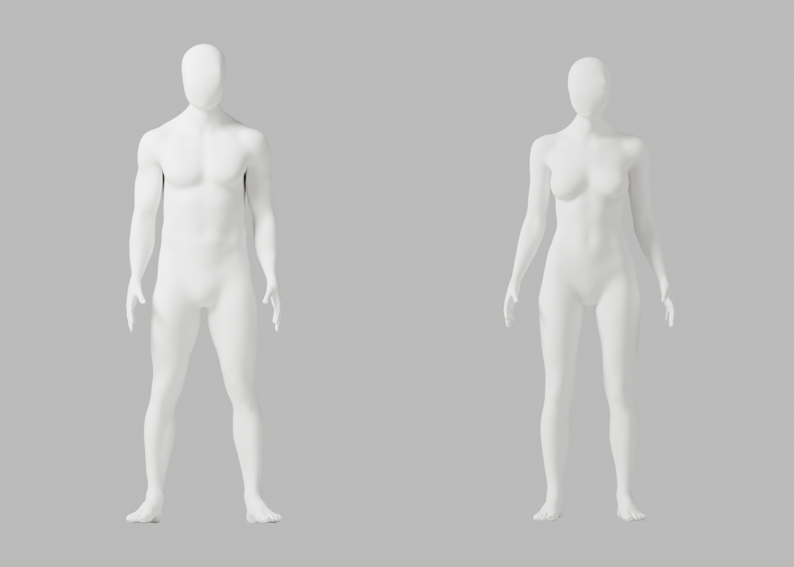
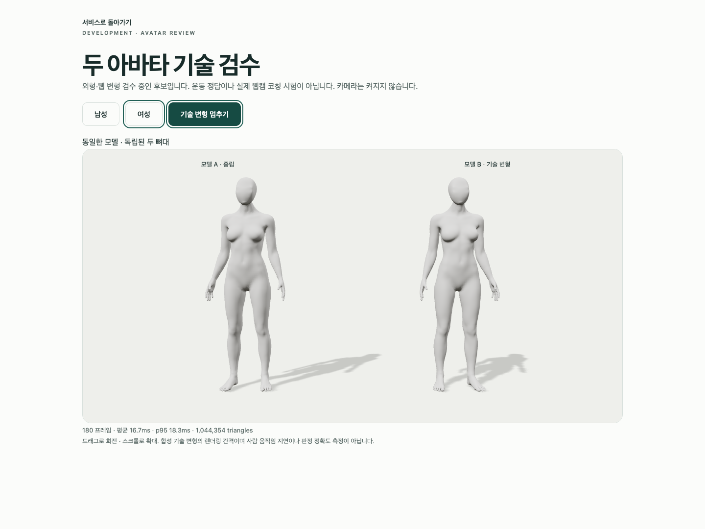

# A316–A322 — 원래 다각형 곡면 조형과 실제 원본·웹 재검증

새 전문 Blender 후보 A318을 저장했고, 원본과 GLB 재수입본 각각 **118개 기술 변형·121행·34장 렌더**, 실제 Chrome 3개를 실행해 통과했다. 이것은 출시 외형 승인·올바른 운동 시범·사람 코칭 검증이 아니다. 뒤통수와 목 측면의 국소 마감 및 일부 손 변형 마감은 A-02/A-08 P2로 남아 **미채택**, 개발 기본 A37와 Draft PR #9 미병합을 유지한다.

## 최신 외형 요구와 제작 범위

CEO의 최신 사진은 [보존 참조](../candidate-a88-review/ceo-reference.png) SHA256 `45b313912dee5ae2218b1fe76086abb35a9b948fab9e877f1a9d2b05f832de62`다. 남녀 모두 중성 무의상 백색 마네킹, 세부 얼굴 표현 없는 머리, 자연스러운 얼굴–목–어깨 연결, 공통 재질·마감을 따른다. 이전 여성 의상 요구는 대체되었다. 신체 구조나 리깅 정확도를 줄여 매끈한 외형을 만드는 것은 금지한다. 참조의 흐림·과노출을 목표 품질로 삼지 않는다.

전문 원본 A250의 원래 혼합 다각형에서 인접 법선 차를 함께 다루는 조형장을 계산하고 **Blender native Y-only DISPLACE**로 국소 전달했다. 몸체 좌표 직접 덮기, 사후 좌표·skin 복구, 전체 목 remesh, 보호/검사 영역 축소, 강도·횟수 반복으로 통과시키기는 하지 않았다. 이전 제작물을 지우거나 기본 웹 에셋을 바꾸지 않았다.

## 실제 실행과 실패

| 실행 | 실제 결과 |
|---|---|
| A316 원래 면 미분 대조 | native exit0. A315 실패를 정확히 재현; tri/quad/5각형 전체 미분과 실제 float32 중앙차분을 대조. double 법선과 native 법선의 미세 차이는 보고서에 남김 |
| A317 반복 선형 풀이 | exit1. 사전 지정 256회에서 잔차 0.007779로 미수렴. 남성 몸체 전달·여성 풀이·원본 저장 전 중단. 가상 계산장을 새 아바타로 세지 않음 |
| A318 직접 선형 풀이·native 조형 | exit0. 같은 식·ridge 0.01·잔차 기준 1e-8; actual relative residual 남1.716e-14/여1.412e-14. 저장 원본 1개·실제 PNG 8장 |
| A319 독립 재열기 | exit1. 속성의 `repr(IDPropertyGroup)`에 들어 있는 프로세스 메모리 주소 비교에서 실패. 원본 코드·전체 출력 보존; 보고서 파일 없음. 정리본 A319B는 정적 검사만 하고 native 미실행 |
| A320 읽기 전용 실패 원인 대조 | exit0. 남녀 각5개 속성 group의 repr 주소만 다름. 실제 raw 속성 타입·값과 모든 다른 비좌표 필드 정확히 동일 |
| A321 새 타입·값 비교 재열기 | exit0. 속성을 누락하지 않고 중첩 타입·실제 값으로 비교. 알 수 없는 타입은 실패. raw skin·139그룹·각163 rest·flags·모든 비좌표 정보 보존 확인 |
| A322 원본 변형·export·GLB 왕복 변형 | 각각 exit0. 원본118개/121행, GLB118개/121행, 실제34PNG씩. export-time `geometry_deformation_pending:true`는 보존하며 후속 전체 왕복 보고서로 완료를 증명 |
| A322 실제 Chrome | exit0. 3개 expected·skipped/flaky/unexpected0, 33.581s. 외부 차단·독립 두 skeleton·8 weights·정적/동적 변형·503/context-loss 복구 검증 |

Chrome의 계정 API는401 모의 응답이고 모델은 검수용 route로만 교체했다. 실제 카메라 호출은0, 사용자/코칭 동작 시험은 없다. 180프레임의 남녀 render 평균16.659/16.666ms·p9518.400/18.300ms는 **이번 합성 기술 검수의 렌더 간격**이지 웹캠 인식 지연이나 목표 노트북 독점 성능 승인으로 표시하지 않는다.

## 변경량과 보호

| 동일 원래 검사 | 남성 | 여성 |
|---|---:|---:|
| 원래 점 / raw 그룹 / rest bone | 131645 /139 /163 | 130548 /139 /163 |
| 동일 원래 전체 QA 간선 | 27741 | 27366 |
| 수정 실제 점 / 최대 이동 | 9698 /2.161mm | 9609 /2.520mm |
| 동일 간선 p95 전→후 | 4.146824→3.227500° | 4.298759→3.599420° |
| 동일 간선 최대 전→후 | 17.687757→11.574486° | 19.409159→11.598168° |
| 전체 원래 점의 float32 native Y mismatch | 0 | 0 |

원본 전체 X/Z·front·손·지원 범위 밖·경계, raw 각 skin 계수와 합·139그룹 순서·각163 rest/flags/pose/world·원래 면·point ledger·속성 실제 값/타입·PBR·modifier를 보존했다. tiny2/0·fold76/107·non-manifold/winding0 그대로다. 새 원본 SHA256 `2eb274cfce046848eced56c12646869908259b2e6a04c6e188597959f7c48fff`.

웹 복사본의 triangulate·중복/fins 정리·최대8가중치 export는 원본 편집과 구별한다. 웹 점131643/130546·triangles263282/261088, GLB11,638,276/11,541,880 bytes, 각 mesh1·animations/images0이다. 손·리깅 보존은 독립 원본 비교와 새 GLB/브라우저 변형 증거로 구별해 확인했다. 기술 단일 관절 검사만으로 실제 시범·복합 코칭의 정확성을 승인하지 않는다.

## 실제 미리보기와 외형 판정





78PNG = native8 + 원본34 + 왕복34 + Chrome2. 직접 열람한24개만 [실행 기록](execution-record.json.txt.gz)의 `actual_viewed_files`에 명시했다. 렌더 생성78개를 전부 육안 검수했다고 쓰지 않는다. 전면 얼굴/목과 통일 표면은 유지했으나 뒤 목 상부의 패치 같은 마감, 측면 접합부, 일부 손 변형 마감은 추가 정제가 필요하다. **A-02/A-08 미해결**, 기본 교체·PR 병합·단계 통과가 아니다.

## 정적·회귀와 재현 도구

23개 순수 시험, 17개 helper의 Ruff E/F/I·format, frontend151개/16파일·Biome65파일·TypeScript·production build를 실제 실행했다. 실패한 A319 원본은 E501과 native failure를 보존하고 정적17개에서 제외했다고 명시한다. 동일 파일은 다시 쓰지 않았다. 디렉터리 정적 검사의 첫 모듈 분류 차이는 모든 로컬 모듈을 명시해 해결했고 최초 실패도 실행 기록에 남았다. Git temp cwd·잘못 추측한 읽기 경로·Node quoting·A317 초기 정적 오류는 기록하며 검증 통과로 바꾸지 않는다.

SciPy1.16.2 BSD wheel은 공식 [PyPI](https://pypi.org/project/scipy/1.16.2/)에서 **task 임시 target만** 설치했다. Blender Python3.13.9·기존 NumPy2.3.4를 사용; 프로젝트/전역 패키지·lock·계정·비용 변경0. 실제 LICENSE/METADATA/WHEEL/INSTALLER 사본을 `runtime-license/`에 보존했다. [공식 spsolve API](https://docs.scipy.org/doc/scipy/reference/generated/scipy.sparse.linalg.spsolve.html)는 API 근거이며 최신 문서 버전을 실행1.16.2와 같다고 주장하지 않는다. 설치 초기 chunk와 실제 terminal0 관측을 기록하나 설치 전체 stdout 보존은 주장하지 않는다.

바이트 보존과 보고서 검사는 저장소 루트에서 실행한다:

```bash
node bodyguard/assets/blender/review/candidate-a316-a322-review/evidence-check.cjs
```

제작 재실행은 별도 새 임시 디렉터리에 `scripts/*.txt.gz`를 원래 이름으로 풀고, 기록된 공식 SciPy pin/Blender native 명령의 source/helper/output 절대 경로를 그 디렉터리에 맞춘다. 출력은 반드시 새 경로로 지정하며 원본·현재 evidence를 덮지 않는다. 재현 **방법**이지 다른 환경에서 실제 재실행 완료를 뜻하지 않는다.

## 보존·다음 작업·승인 경계

새 exact copy138개(55gzip·78PNG·3blend·2GLB)와 README/checker/manifest를 추가했고 이전1123개 파일 SHA는 변경 전후 불변이다. A317/A319 실패, A319B 미실행, 모든 native 전체 출력과 기존 모델·검증 증거를 보존했다.

다음 안전 구간은 이 후보의 뒤 머리–목 접합부와 손 변형 마감의 국소 전문 조형 보완이다. 숫자 기준만으로 외형을 승인하거나 같은 강도 sweep을 이어 가지 않는다. 새 조형이면 원본·재열기·GLB·118변형·Chrome·외형 검증을 실제 다시 수행한다. S2.3b 참여자/관찰자 실측 연결은 요청했으나 승인/실행 증거가 없으며, S2.4c 시범·리타게팅·실제 목표 노트북 검증도 남아 있다. 외부 연결을 기다려도 승인 범위의 독립 개발은 계속한다.

전체1~6단계 미완료, stage2 게이트 미통과다. 배포·출시·운영 DB·시크릿·비용·계정·중요 안전/개인정보 변경은 별도 CEO 승인 전 실행하지 않았다.
