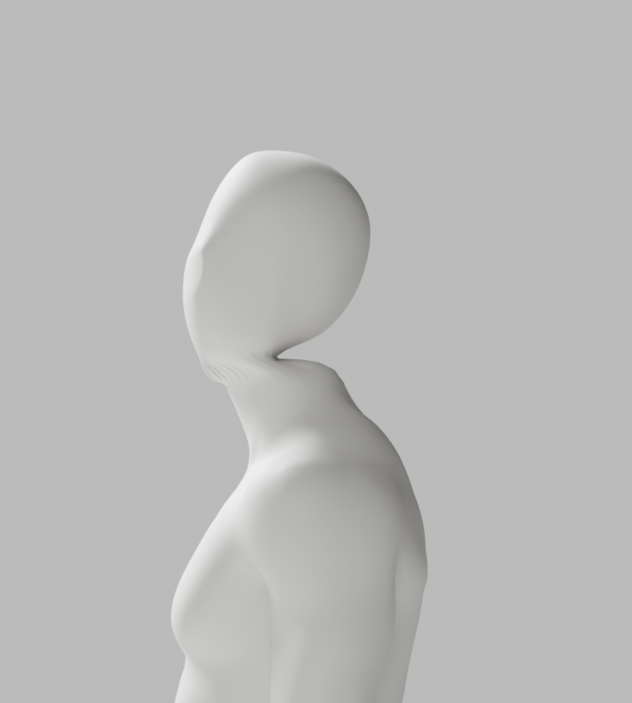
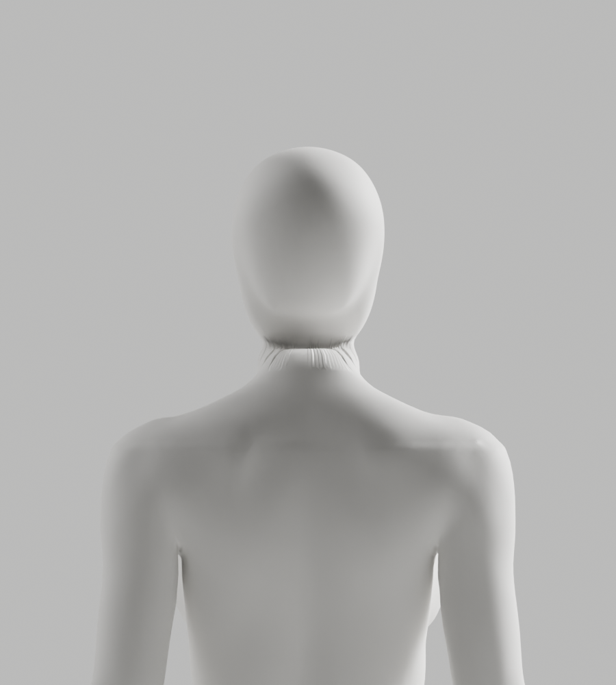

# A50·A51 전문 head 교체 — 실제 초회 검수, 외형 반려

2026-10-02 기록 · Blender 5.1.1 · S2.4 / FR-A-01~04 / A-07. **두 후보 모두 미채택**이다. 각각 원본의 118개 기술 변형·121행 검사와 실제 8PNG를 완료했으나 목의 세로 주름·턱 아래 경계가 남았다. **전체34컷·GLB·왕복·Chrome은 미실행**이며 이전 A49 결과로 대신하지 않는다. 개발 기본 A37·외형 P2·Draft PR #9 병합 보류·1~6단계/승인 규칙은 그대로다.

## 실제 변경과 대조

- A49 원본에서 기존 CC0 전문 head를 다시 가져왔다. head의 parent 포함 실제 world matrix를 평가한 후 신체 좌표계로 bake하고 translation만으로 맞췄다. object.location을 world 위치로 간주하지 않는다. 원본 bundle·A49 파일은 변경하지 않았다.
- 얼굴 앞면의 기존 Y축 정제·native Subdivision4·절단·이름 대응 POLYINTERP_NEAREST skin 전송을 사용했다. 코드 도형 인체 생성·전신 remesh·좌표 clamp/복원·검사 완화는 없다. 교체된 기존 머리 전체의 좌표를 보존했다는 주장은 하지 않는다.
- A50은 경계 점 수만 맞춰 native SURFACE6/smoothness1로 연결했다. A51은 기존 점/skin을 그대로 둔 native edge_split으로 두 단면의 polar 위치도 맞췄다. 연결 범위32mm는 조형용이지 임상/동작 기준이 아니다.
- 생성 시 retained 신체/skin·보호 손·각163bones/rest·행렬·머리 최고점을 검사했다. 여성 자연 곡선·관절과 남녀 무의상/통일 백색 마감을 유지한다. 뼈 개수·정규화·위상 PASS만으로 해부학/외형을 통과시키지 않는다.

| 실제 원본 검사 | A50 | A51 |
|---|---|---|
| 남/여 vertices | 139344 / 140786 | 141912 / 143026 |
| 대응 경계 점 수 남/여 | 488 / 426 | 809 / 706 |
| 기술 변형 / 총 행 / 실패 | 118 / 121 / 0 | 118 / 121 / 0 |
| 최대 edge 변형 비율 | 2.943930367 | 2.943930367 |
| 실제 초회 이미지 | 8PNG | 8PNG |
| 전체34컷·GLB·Chrome | 미실행 | 미실행 |
| 외형 판정 | 반려 | 반려 |

`source-preflight-report.json`의 `rendered:false`는 렌더 생략이다. 별도 `first-*.png` 8개는 source unsaved 조건의 초회 외형 미리보기다. 20°는 네 목 bone의 기술 스트레스 시험이며 올바른 운동/사람 추적/처방 검증이 아니다. native 작업 병행 상태의 시간은 웹 성능으로 사용하지 않는다.

실제 loft-column 대응 진단의 평균/p95/max는 A50 남3.979425/7.409271/7.909273°·여3.143595/9.142266/10.411487°, A51 남0.000001174/0.000003340/0.000008221°·여0.000001434/0.000003906/0.000007132°다. **조형 단면의 polar 대응 수치이지 사용자 관절 정확도나 합격 각도가 아니다.** A51의 대응이 개선돼도 주름이 남아, 단면 대응만이 외형 결함의 원인이라는 가설은 반증됐다. 여성 진단의 upper `counts`에는 평면 근처 비경계2점이 포함된다. 실제 tracing 경계 수는 `paired`426/706이다.

## 검증·재현·보존

[실제 native 회귀 출력](native-regressions.json): 최종 포맷된 A50 CLI 거부7개, A51 synthetic 경계 정상/오류6개를 실제 Blender에서 실행해 exit0로 완료했다. 입력 거부·같은 평면·교차 contour·4096 knot 초과와 원래 점/skin 보존을 검사한다. **synthetic은 실제 사람/카메라 검증이 아니다.** 생성/보고서의 당시 pending 표시는 소급 수정하지 않았다. 초기 Ruff 길이 오류는 문자열 분리 후 check/format과 CLI7개를 재실행했다.

재현에는 [A49 보존 원본](../../bodyguard_avatar_candidate_a49_rejected.blend), [같은 frozen helper](../candidate-a49-rejected/producer-at-generation.py.txt), 기존 공식 bundle이 필요하다. 새 임시 폴더에 helper를 `a49-density-producer.py`, 해당 `producer-at-generation.py.txt`를 `.py`로 **덮어쓰기 없이** 복사한다. Blender `--factory-startup --disable-autoexec -b <A49> --python-exit-code 1 --python <producer> -- <새.blend> <새.json> <기존 bundle>`로 생성한다. QA는 기존 `review_avatar.py -- <새 폴더> --candidate --mannequin --qc-only`, 미리보기는 보존된 `first-preview-at-generation.py.txt`를 `.py`로 복사해 `-- <새 폴더>`로 실행한다. 기존 파일/증거를 덮지 않으며 전체 QA를 수행한 것으로 표시하지 않는다.

| 보존 파일 | bytes | SHA-256 |
|---|---:|---|
| [A50 원본](../../bodyguard_avatar_candidate_a50_rejected.blend) | 26262554 | `5301a4e8484fc7fe3f5fef09f647d629a79003f1399d54b18e22d91023af135e` |
| [A51 원본](../../bodyguard_avatar_candidate_a51_rejected.blend) | 26573159 | `cc12cf838ad31cbcd18a44e626b448bf634e3c9871a461a3f2bead77d34fbd10` |
| [A50 producer](a50/producer-at-generation.py.txt) | 12093 | `5f742b18c87eb778e4139fb39e31e8dda7c96667eb7a647b41f2023bf9f2a9de` |
| [A51 producer](a51/producer-at-generation.py.txt) | 15330 | `7f5961b30cf8d4af9b295f99cf7dc4a42b7bc9ee3d410636f8fcdcc9af966ceb` |
| [초회 미리보기](first-preview-at-generation.py.txt) | 2550 | `bb9a871483d297c7e4b65977c6db0bbe0db49da509de7fde0964c8bfc663c595` |
| [CLI 검사](a50-input-check.py.txt) | 1450 | `170535df74548bbfa06a819240d32474953b5f9887a669f2b56702cd69aa866d` |
| [경계 검사](a51-boundary-check.py.txt) | 2515 | `3b7c0bedd70ede22468d9677dc7aac3784c4dacdc3176b9067c723376302927c` |

[A50 생성](a50/generation-report.json)·[원본 검사](a50/source-preflight-report.json)·[대응 진단](a50/correspondence-diagnostic.json), [A51 생성](a51/generation-report.json)·[원본 검사](a51/source-preflight-report.json)·[대응 진단](a51/correspondence-diagnostic.json)을 별도로 보존한다.

다음은 같은 형상/대응 조건에서 native 보간·경계 접선/법선을 분리 대조한다. 통과 여부는 해당 새 파일의 실제 검수로 판단한다. 사람 촬영/영상·관절 좌표 저장/전송, 비용·새 계정/시크릿·운영 DB·배포·출시는 실행하지 않았다.
