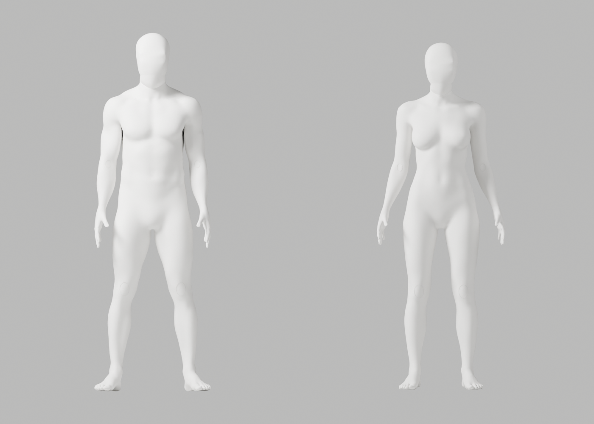
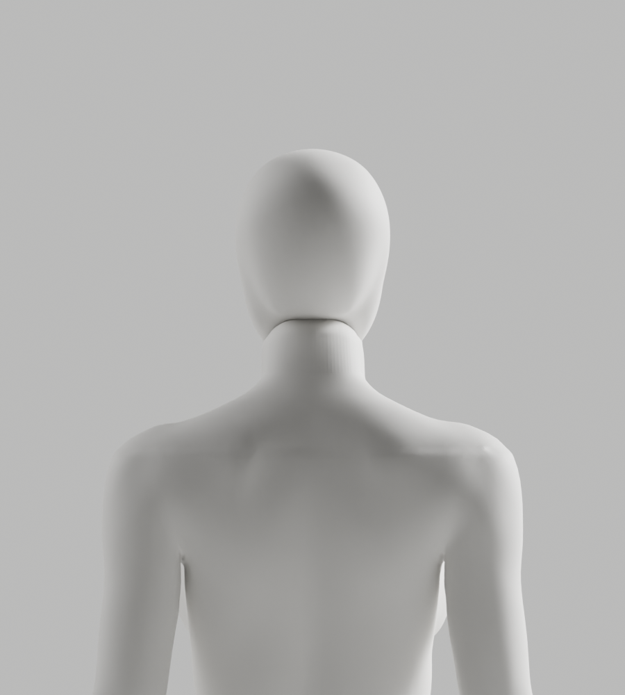

# A52·A53 — PATH/법선 갱신 실제 대조, 외형 미통과

2026-10-02 기록 · Blender5.1.1 · S2.4 / FR-A-01~04 / A-07. 각각 원본118개 기술 변형·121행/실패0과 실제 초회8PNG를 완료했다. PATH에서 세로 주름은 줄었지만 턱 아래/뒤 목 연결선·얼굴의 각진 윤곽이 남아 **둘 다 미채택**이다. **전체34컷·GLB·왕복·Chrome은 미실행**이다. 개발 A37·외형 P2·Draft PR #9 병합 보류·1~6 완료/승인 기준은 유지한다.

## 실행 범위와 결과

- [A50·A51 기록](../candidate-a50-a51-rejected/README.md)의 같은 전문 head·parent 포함 world bake·translation·32mm·경계 polar 대응 조건을 사용했다. A52 producer는 A51 대비 native SURFACE→PATH 두 문자열만 바뀐 것을 실제 byte 비교로 확인했다. 기존 인체를 코드 도형으로 재생성하거나 전신 remesh하지 않았다.
- A53은 A52의 native 연결 직전 `bm.normal_update()`만 추가하고 실제 경계 normal 갱신 차이를 기록했다. 남0.0004939346·여0.0004529965다. [실제 좌표·이름 대응 skin multiset](native-diagnostics.json)에서 A52/A53은 남녀 모두 정확히 같다. **법선 갱신만으로 외형을 고쳤다는 가설은 성립하지 않는다.**
- 여성의 index별 비교는706점/최대0.126810499m 차이를 냈지만 native vertex 순서 차이였다. 좌표/이름 기반 skin multiset은 정확히 같으며, **0.1268m를 실제 신체 변위나 추적 정확도로 해석하지 않는다.** 초기 잘못된 JSON 경로·미평가 matrix·index skin 진단의 실패와 실제 재대조를 분리 기록했다.
- near-plane edge 법선 불연속과1mm 초과 edge의 접힘도 진단했다. 여성 head `count:710`은 평면 근처 manifold edge 수이며 전문 절단 contour706점을 뜻하지 않는다. 이는 아티스트 결함 진단이지 임상 각도/자동 외형 합격 기준이 아니다.

| 실제 결과 | A52 | A53 |
|---|---|---|
| 남/여 vertices | 141912 / 143026 | 141912 / 143026 |
| 대응 contour 남/여 | 809 / 706 | 809 / 706 |
| 기술 변형 / 총 행 / 실패 | 118 / 121 / 0 | 118 / 121 / 0 |
| 실제 초회 렌더 | 8PNG | 8PNG |
| 남녀 무의상·같은 백색 마감 | 실제 원본 검사/렌더 | 실제 원본 검사/렌더 |
| 외형·전체34컷·GLB·Chrome | 외형 미달 / 나머지 미실행 | 외형 미달 / 나머지 미실행 |

`source-preflight-report.json`은 `rendered:false`다. 별도8PNG는 source unsaved 조건의 실제 초회 이미지이며 전체34컷이 아니다. 네 목 bone20°는 기술 시험일 뿐 사람/시범/올바른 운동·성공 타이머 검증이 아니다. 각163bones/rest·retained 신체/skin·보호 손·행렬·crown 보존과 기존 변형/위상 기준은 유지했다. 교체된 기존 머리 전체가 이전과 같은 좌표라는 주장은 하지 않는다.

## 보존·재현

[A52 생성](a52/generation-report.json)·[원본 검사](a52/source-preflight-report.json), [A53 생성](a53/generation-report.json)·[원본 검사](a53/source-preflight-report.json), [진단 결과](native-diagnostics.json)·[실행한 join 진단](join-diagnostic.py.txt)·[실행한 multiset 대조](coordinate-comparison.py.txt)를 보존한다. 진단 코드의 임시 경로는 당시 실제 경로다. 보존 원본을 새 임시 사본으로 복사해 그 경로를 명시적으로 바꾸고 native `--python-exit-code 1 --python`으로 실행한다. 저장/overwrite/threshold 완화는 하지 않는다.

생성/QA/초회 미리보기 재현은 [공통 frozen helper·bundle·명령](../candidate-a50-a51-rejected/README.md)을 따른다. 새 producer도 SHA 검증된 A49 helper를 그대로 import한다. 원본/보고서의 당시 pending 표시를 소급 PASS로 고치지 않았다. A52/A53 Ruff check/format을 실제 통과했다. 새 외부 에셋·라이브 카메라·사람 좌표 저장/전송·계정·비용·시크릿·운영 DB·배포·출시는 실행하지 않았다.

| 보존 파일 | bytes | SHA-256 |
|---|---:|---|
| [A52 원본](../../bodyguard_avatar_candidate_a52_rejected.blend) | 26574074 | `fda0727423dd31bc098469d64d56e4eb96681d21ec21788cc83012038f852e5a` |
| [A53 원본](../../bodyguard_avatar_candidate_a53_rejected.blend) | 26574438 | `5dc24f852acccf4b077a7d4ecccfa3047c1c1992c216bf0c517c20769868fe54` |
| [A52 producer](a52/producer-at-generation.py.txt) | 15324 | `04b35d52991d130a8835b375b2faebb8578fe4a2a538bfeb4b51add6756a962f` |
| [A53 producer](a53/producer-at-generation.py.txt) | 15708 | `02319912e8e8ef88824a919f8b4f612cd339134dd6361dfe804bf88ba9869de8` |

다음은 native 곡면 경로의 overshoot와 기존 목 표면을 분리 대조한다. [A54 국소 정제](../candidate-a54-rejected/README.md)는6mm guard 실패로 저장 전에 중단돼 새 원본/전체 QA가 없다. 별도 후속 후보의 결과는 실제 실행 전 완료로 표시하지 않는다.
