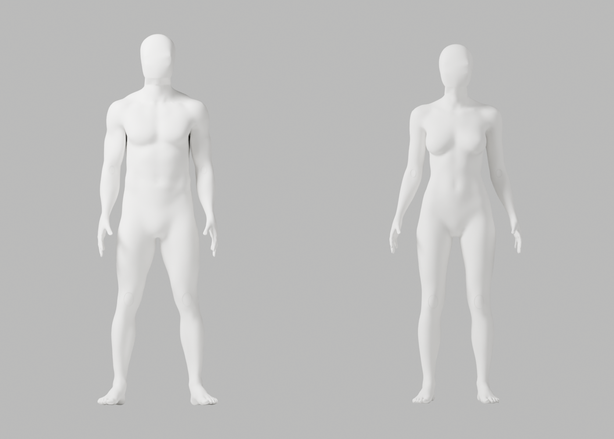
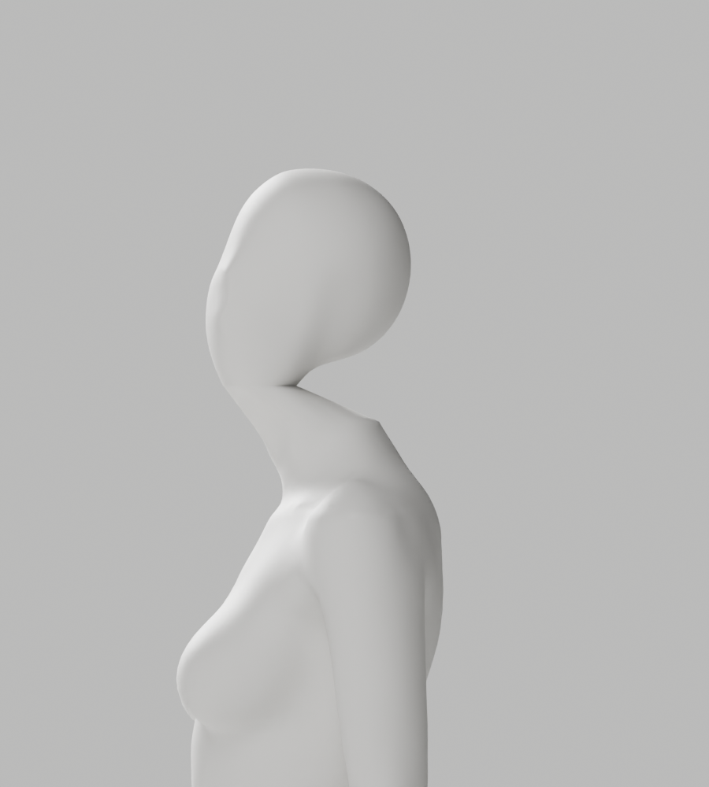

# A55 LINEAR 전문 head 연결 — 실제 초회 검수, 외형 미달

2026-10-02 · Blender5.1.1 · S2.4 / FR-A-01~04 / A-07. 같은 전문 head·parent 포함 world 평가·32mm·polar 경계 대응·normal 갱신 조건에서 native PATH→LINEAR 두 문자열만 바꿨다. **원본118개 기술 변형·121행/실패0와 실제8PNG는 완료, 외형은 미달**이다. 전체34컷·GLB·왕복·Chrome은 미실행이며 다른 후보의 결과로 대신하지 않는다.

남/여141912/143026 vertices·각163bones, native 경계809/706점이다. 생성 시 retained body/skin·손·bones/rest/행렬/crown과 준비한 전문 head 좌표를 보존했다. 여성 무의상·남녀 통일 백색 마감과 자연 곡선/관절은 유지했다. 최대 기존 edge 변형 비율2.943930367, 목 좌/우는 남1.366745/1.222894·여1.190941/1.273733이다. 이 수치와20°는 아티스트 기술 시험이며 올바른 운동/실제 사람/의학·외형 승인이 아니다.

실제 측면에서 뒤 목의 뾰족한 연결·머리의 앞쪽 치우침과 얼굴 윤곽이 남아 **미채택**했다. [원본 검사](source-preflight-report.json)는 `rendered:false`; 별도8PNG는 source unsaved 초회 미리보기다. 해당 native 병행 작업의 시간을 브라우저 코칭 성능으로 쓰지 않는다.

[실제 읽기 전용 정렬 진단](alignment-diagnostic.json)·[실행 코드](alignment-diagnostic.py.txt)에서 head/body 절단면의 y 중심 차이는 남-0.041472474m·여-0.048862438m였다. 같은 z 구간의 cervical/head rig 위치도 함께 읽었다. **이는 모델 조형 좌표이지 사용자 측정값/진단·허용 기준이 아니다.** 여성 head 평면 근처708점에는 비경계2점이 포함되며 실제 contour는706이다. whole-head bbox만 맞추는 경로는 cervical 단면의 정렬을 보장하지 않는다. 다음 수정은 rig/전문 단면을 기준으로 위치를 피팅하고 실제 변형·외형으로 검증하며, 가설을 통과 사실로 표시하지 않는다.

| 보존 파일 | bytes | SHA-256 |
|---|---:|---|
| [별도 원본](../../bodyguard_avatar_candidate_a55_rejected.blend) | 26539681 | `12650fba6bd5a84ce44a33e5256ba3a8665af70916a0c10d809a85b7bcd2c58e` |
| [producer](producer-at-generation.py.txt) | 15712 | `6d50e93b3b1e80dfe605ef36f244773fa8483b57ef1244149bd159a8f6486782` |

[생성 당시 보고서](generation-report.json)를 보존하며 pending 표시를 소급 PASS로 바꾸지 않았다. [공통 frozen helper·bundle·새 경로 재현 명령](../candidate-a50-a51-rejected/README.md)과 같은 QA/초회 preview를 쓴다. A53 대비 두 interpolation 문자열만의 diff와 Ruff check/format을 실제 확인한다. threshold 완화·좌표 clamp/복원·코드 도형 인체·전신 remesh·새 외부 에셋은 없다. 입력 A49·기존 원본/GLB/증거는 변경하지 않았다.

개발 기본 A37·외형 P2·Draft PR #9 병합 보류·1~6단계 완료/승인 규칙은 그대로다. 사람 촬영/좌표 저장·전송·비용·계정·시크릿·운영 DB·배포·출시는 실행하지 않았다.

[실제 증거 파일/해시·PNG·QA·로컬 링크 대조](evidence-audit.json)와 [실행한 Node stdlib 검사](evidence-audit.js.txt)를 보존한다. manifest는 자기 보고서를 제외하며 native/외형/GLB/브라우저 검증의 대체물이 아니다. `node <검사 파일> <저장소 루트> <당시 native 임시 폴더>`로 다시 실행한다.
