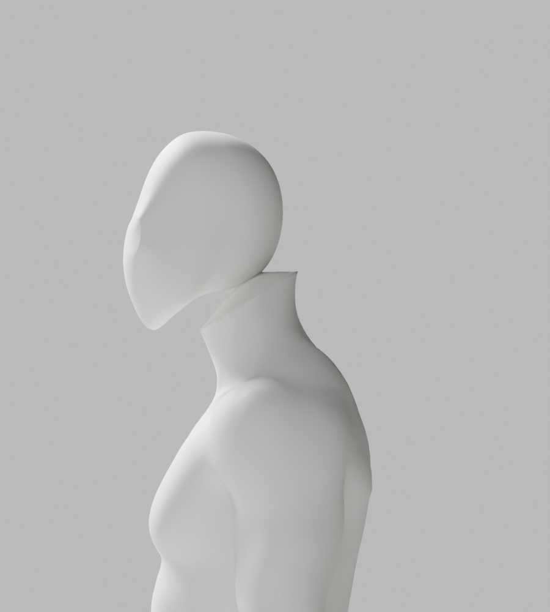
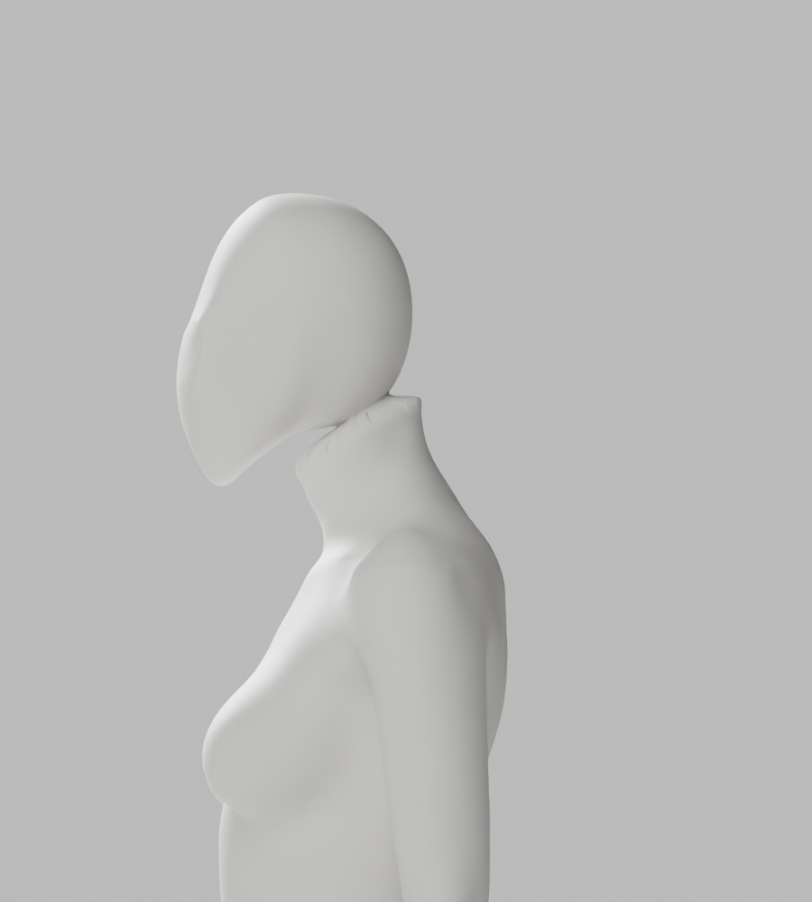
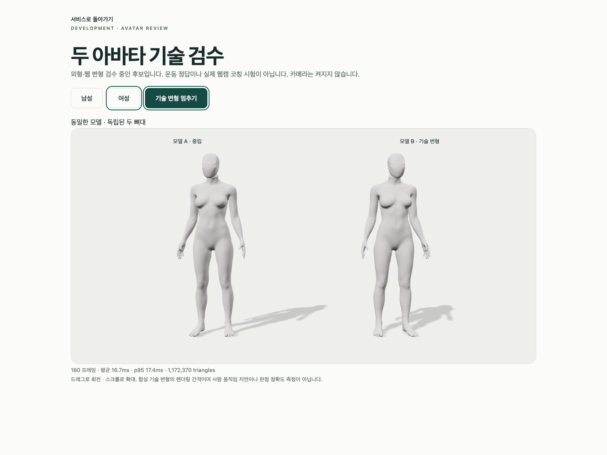

# A70 실패·A70b 고정 경계·A71 곡면 비교 — 실제 검수

2026-10-02 · S2.4 리뷰 보완 · **외형 미달/미채택, 개발 A37 유지, Draft PR #9 미병합**. 여성도 의상 없는 남녀 통일 백색 중성 마네킹으로 제작한다. 자연 곡선·관절/필요한 구조·리깅 정확도, 이전 원본·검증 증거, 전체 1~6단계와 CEO 사전 승인 경계는 유지한다. 전문가 검토만 남은 상태가 아니다.

## 수정·실제 결과

[A69 실제 진단](../candidate-a68-a69-review/registered-seam-diagnostic.json)의 순서 오류를 수정했다. 전문 머리의 초기 절단은 정렬 진단에만 쓰고, 자르지 않은 전체 head에 대응 skin을 먼저 준비한 뒤 정렬/최종 절단한다. XY만 옮기는 A70은 머리 전체가 최종 절단면 위로 이동해 native 경계0/exit1로 저장 전 중단됐다. [실제 실패 진단](a70/boundary-failure-diagnostic.json)·[실패 제작 코드](a70/producer-at-failure.py.txt)·[실행/실패/미실행](execution-record.json)을 보존했다. 진단 코드 사본은 이후 Ruff 정리한 재현용이며 최초 실패 당시 원문 코드 해시로 주장하지 않는다.

A70b는 사선면 안의 강체 정렬로 plane intercept 변화0을 검사하고, 최종 절단을 적용해 **남녀 모두 실제 artist gap24mm/수직면 거리20.580mm**를 유지한다. 머리 crown은 피팅으로 남15.389mm·여16.705mm 낮아졌음을 [생성 보고서](a70b/generation-report.json)에 명시했다. 전체 신체를 축소하거나 원래 신체·손 좌표/skin·각163bones/rest/행렬을 바꾸지 않았고 새 head skin도 강체 정렬/절단/bridge에서 정확히 보존했다. A71은 이 같은 고정 경계에서 native `SURFACE/cuts6/smoothness1`만 비교한다.

| 후보 | 실제 완료 | 외형 판단/미실행 |
|---|---|---|
| A70 | native 경계 회귀13개, 실패 진단 | 제작 exit1/원본 없음. 전체 QA·렌더·GLB·Chrome 미실행 |
| A70b | 원본118개/121행·8PNG·native 회귀13개·실제 경계 진단 | 측면 날카로운 턱/목 연결로 미채택. 전체34컷·GLB/Chrome 미실행 |
| A71 | 원본/GLB 각각118개/121행, 원본34PNG, native 회귀13개, 실제 Chrome3개/42.499s·2PNG | 턱 밑 접힘·뾰족한 실루엣/뒤 목 경계로 미채택. imported GLB34컷·실제 웹캠 코칭 미실행 |

경계 회귀는 기존10개 + 최종 사선면2개/초기 절단 후 이동 오류 재현1개다. 각 코드에 동일13개를 재실행한 것이며 서로 다른39개로 세지 않는다. [A70](a70/native-boundary-check.json)·[A70b](a70b/native-boundary-check.json)·[A71](a71/native-boundary-check.json). 작은 native 표면은 검사 픽스처이며 인체 생성이 아니다. 목/전신 기술 시험20°·edge비율3미만 등 기존 QA를 유지하고 임상 목표/운동 정답으로 확대하지 않는다.

[독립 native 원본 대조](native-authored-comparison.json)는 고정 artist 좌표·skin 남143,493/여142,898개와 전체 skin·보호 손·각163bones/rest/행렬 동일을 통과했다. 새 bridge만 남1,242/여1,602개, 최대23.429/14.126mm 변화했다. 첫 비교는 새 SURFACE 점36개가 절단 밴드 밖으로 나간 것을 ‘기존 신체 변경’으로 오분류해 exit1로 중단됐다. [반려 검사](native-bridge-comparison-rejected.py.txt)·[보완 실행 코드](native-authored-comparison.py.txt)·[초회 성공](first-native-authored-comparison.json)·Ruff 확정 뒤 별도 재실행한 최종 보고서를 모두 보존했다. 허용 오차/원본 좌표를 바꿔 가리지 않았다.

[A70b 경계](a70b/final-seam-diagnostic.json) → [A71 경계](a71/final-seam-diagnostic.json)의 body 경계 p95는 남102.888→33.792°/여83.419→30.189°로 줄었지만 head 경계는 남146.056→162.961°/여133.077→126.088°이고 최대178.692° 접힘이 남았다. 평균 개선은 외형 통과가 아니다. 수치는 artist 면/정렬 진단이지 해부학/운동 각도/웹캠 정확도가 아니다. 다음 보완은 단면 높이/SURFACE 반복이 아니라 **기존 전문 head의 뾰족한 하부 형태와 cervical 경계 조형·접선 대응**이다. 신체 구조·skin/리그·전체 QA를 유지한 별도 후보로 실제 비교한다.

## 원본·GLB·실제 미리보기

수정 가능한 [A70b 원본](../../bodyguard_avatar_candidate_a70b_review.blend) 29,058,002bytes/SHA`d0c55dc6f25a034a9f1fac59e26022841e5598c2948e68947b46df60deb39058`, [A71 원본](../../bodyguard_avatar_candidate_a71_review.blend) 29,057,410bytes/SHA`6383829d3b631bf22c66bbce5472806f7fe9525dd3b6c554ad96ef4be3b5e0a5`는 native 생성 파일과 동일 바이트 사본이다. 남144,735/여144,500vertices·각163bones. [A70b 원본 QA](a70b/source-preflight-report.json), [A71 원본 QA](a71/source/deformation-report.json), [A71 imported GLB QA](a71/glb-deformation-report.json): 실패0/각118개 기술 변형. 최대 원본2.943930/GLB2.947680. 무의상·동일 재질/닫힌 인체·정규화 가중치 검사를 포함하되 최종 외형 승인은 아니다.

[A71 남성 GLB](a71/glb/bodyguard-male-candidate.glb) 12,890,528bytes/SHA`91209d8da5e812468984b23c404f1a52e6a4cdd3d7c84afb8c7b03c94da35da3`, [여성 GLB](a71/glb/bodyguard-female-candidate.glb) 12,870,020bytes/SHA`f7c27426245b1a0ac77afbeaefcd193d16ee61903bdc75e44d7341f5679518d5`. 각5meshes/1skin/163joints·native JOINTS_1/WEIGHTS_1, 이미지/카메라/운동 액션0. [왕복](a71/glb/roundtrip-report.json)의 transforms PASS만으로 변형 통과를 주장하지 않으며 별도 imported QA를 실제 실행했다. ratio1·8가중치·1µm 정리/3mm envelope/0.1mm bounds는 유지했고 fin0/0, parent 경고5·제한 weights남1,125,700/여1,158,939를 기록했다.

[남성 Chrome](a71/browser/male-two-models.png)·[정면](a71/source/faceless-front.png)·[3/4](a71/source/faceless-quarter.png)·[여성 뒤](a71/source/faceless-body-back-female.png)·[목 좌](a71/source/faceless-neck-female-left.png)·[목 우](a71/source/faceless-neck-female-right.png)·[손](a71/source/faceless-hand-female.png)·[무릎](a71/source/faceless-knee-female.png). 총44PNG = A70b8 + A71원본34 + Chrome2. 생성 이미지/시범 정답으로 대체하지 않았다.

## 브라우저 조건·재현·범위

모든 native handle의 terminal 확인 후 기존 격리 `tests.run_browser avatar`를 실행했다. 실제 Mac16,12/Apple M4/16GiB·Chrome154.0.8037.58/headless1440×1080/DPR1. [actual JSON](a71/browser/playwright-report.json)의3개 PASS/skip0/실패0, 각180RAF·mean 남16.668/여16.664ms·p95 남17.5/여17.4ms·draw21·triangles1,174,250/1,172,370·정지각0·독립 skeleton/추가8가중치 mesh2를 확인했다. native byte/SHA attachment도 각3개다. RAF는 GPU timestamp/인식fps/사람 피드백 지연이 아니며 GPU·전원·전체 부하는 미확인이다. 비청취 프록시/A-00 외부 차단, camera0. API401/503/context loss는 fixture, 실제 API/SQL/SMTP/OAuth를 연결하지 않았다. NO_COLOR/FORCE_COLOR·deprecated Clock·의도된503·후속 context-loss extension 경고가 있었으며 실제 시험은 통과했다.

재현은 설치된 Blender5.1.1에서 `--background --factory-startup --disable-autoexec --python-exit-code 1`을 사용한다. 새 임시 디렉터리에 후보 snapshot을 원래 이름 `a70b-in-plane-registered-head.py`/`a71-registered-surface-head.py`로 복사하고 [동결 A49 helper](../candidate-a49-rejected/producer-at-generation.py.txt)를 `a49-density-producer.py`로 둔다. [A66 보존 원본](../../bodyguard_avatar_candidate_a66_review.blend)/SHA`03ac3629b76858ee7f55fc0ffa9e6118c5d64fcbf4ba29100889af1318a8b3b5`를 입력하고 기존 CC0 bundle/SHA`3c121505651140ceb4d69fd1d8923f7788ffadd81672f5be14845a5f2c75c137`와 `-- 새원본.blend 새보고서.json 기존bundle.blend`를 준다. native 경계 회귀에는 [A64 동결 코드](../candidate-a63-a64-review/a64/producer-at-generation.py.txt)를 `a64-continuous-jaw-neutral-head.py`로 같은 폴더에 둔다. 출력은 반드시 새 경로다.

[기존 full QA](../../review_avatar.py) `-- 출력 --candidate --mannequin`, [기존 export](../../export_avatar_candidate.py) `-- 새web.blend 새glb디렉터리`, imported roundtrip full QA는 `--qc-only`로 이번 실행과 같게 재현한다. A70b 첫8컷은 [변경 없는 first helper](../candidate-a65-a67-review/first-preview.py.txt)다. 최종 native 진단/비교 snapshot과 각 CLI positional 인자를 사용해 새 JSON에 실행하며 원본은 저장하지 않는다. 브라우저는 backend에서 absolute `BODYGUARD_AVATAR_QA_DIRECTORY=<새GLB폴더> PLAYWRIGHT_JSON_OUTPUT_NAME=<새JSON> .venv/bin/python -m tests.run_browser avatar`. 설치/의존성/CI를 바꾸지 않았다.

Ruff check·format --check11개와 [증거 auditor](evidence-audit.js.txt)를 실제 실행했다. 최초 auditor는 명시된 미실행 항목7행을8행으로 기대해 exit1로 중단됐으며 행 수 검사만 바로잡고 실제 재실행했다. native 결과를 바꾸거나 통과로 세지 않았다. 초회 실패 진단·반려 비교 코드 사본은 Ruff 정리한 재현본이며 원문 해시로 주장하지 않는다. 최종 진단/보완 비교는 정리된 실행 코드로 새 출력에 실제 재실행했다. `node <auditor.js> <작업트리루트> <native임시폴더>`는44PNG/native byte/전체QA/GLB/Chrome/이전 증거·링크를 검증하고 [실제 실행 결과](evidence-audit.json)를 남긴다. 결과 자신의 재귀 해시는 제외하고 저장 뒤 fresh audit 동일성과 self-link를 별도 확인한다. AGENTS/운영규칙/출시계약/defaultA37/service는 변경하지 않는다.

실제 사람·올바른 시범·리타게팅·웹캠 통합·motion 성공 타이머, 실제 Gmail/Google, 운영 DB migration·서버·배포·비용/계정·시크릿·출시는 하지 않았다. 과거 API/Vitest/build 성공을 이번 아바타 native/Chrome 검증으로 세지 않는다. **A-02 외형 P2 미해결이므로 PR #9는 병합하지 않으며 S2.4/2단계·1~6 완료로 표시하지 않는다.**
