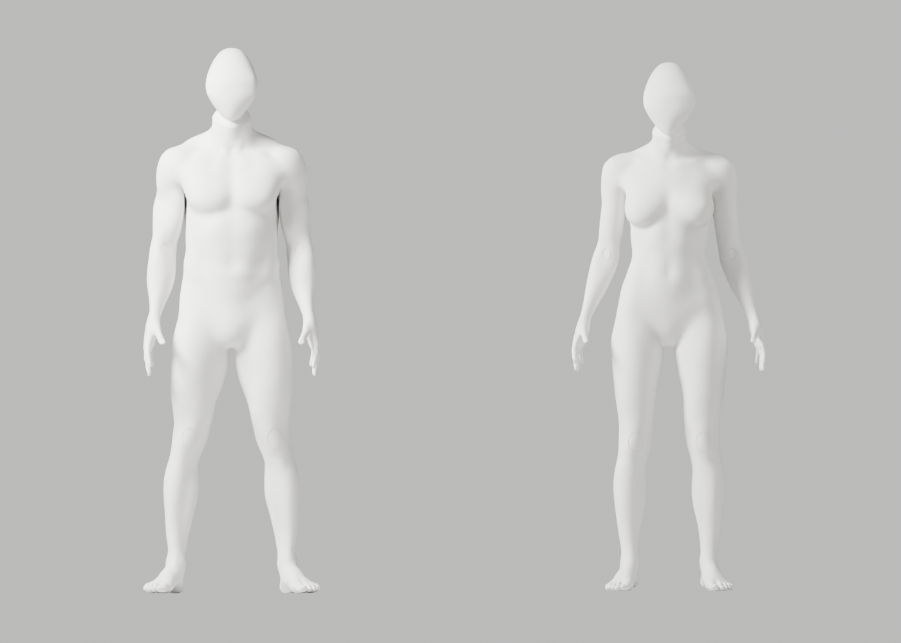

# A73~A73d — 전문 머리 곡면·실제 전체 검수

2026-10-02 · S2.4 리뷰 보완 · **외형 P2 미해결 / 출시 후보 미채택 / Draft PR #9 병합 보류.** 여성 무의상·남녀 같은 백색 중성 마네킹, 자연 곡선/관절·필요한 구조/변형 정확도·이전 파일/증거·개발 기본 A37·전체 1~6단계와 승인 규칙은 유지한다.

## 실제 결과

기존 CC0 전문 `GEO-head_primitve` 266점 cage를 Blender 5.1.1에서 편집했다. 부분-face18회 정제와 새 전 영역 Y-only0/4/8 대조는 평평한 이마/원래 오목한 얼굴 단면을 남겼다. native 정규화 체적 보존20/40/80/100 대조는 경계를 완화했고, 100회 후보만 A73d 전신으로 제작했다. **modifier 단계 체적 비율1.0005099473887173**은 이후 하부 조형/강체 정렬/절단/연결까지 포함한 전체 머리/신체 체적이 정확히 같다는 주장이 아니다.

| 실제 실행 | 결과·범위 |
|---|---|
| 머리 단독 대조7개 | 모두 exit0·각2PNG·source 미저장. 총14PNG. 리그/출시 승인 아님 |
| A73d 원본 | exit0·28,816,624 bytes·남141201/여141167 vertices·각163bones. 원본121행/기술118개 PASS·34PNG |
| 신체 보존·경계 | 독립 native 대조 exit0·남75915/여75865의 원래 body 좌표/named skin·보호 손·163bones/rest/행렬 동일. 최종 gap24mm·native 경계16개 PASS |
| GLB/재가져오기 | 남12,579,536/여12,576,716 bytes·각5mesh/1skin/163joints·8weights. 실제 재가져오기121행/기술118개 PASS·imported34PNG 미실행 |
| 실제 Chrome | 3개 PASS / 41.378s·남녀180 RAF samples·두 복제본 독립·카메라 요청0·egress 거부/GLB 실패/context-loss 복구 |

원본 전체 edge-ratio 최대2.9439303671, GLB2.9476798033으로 기존3미만 기준을 유지했다. 원본 목 남좌/우1.531519509/1.634585230, 여1.226378612/1.209262100; GLB 남1.532536016/1.635315359, 여1.226884962/1.212659476. 원래 신체/손 보존 대조는 **실제 A66 body에서 남은 좌표/named skin**에 한정한다. 수정 머리/새 연결점은 제작 assertion과 전체 변형 하네스로 검사했다. 본 수·기술20°·artist24mm는 올바른 운동/임상 기준이 아니다.

[원본](../../bodyguard_avatar_candidate_a73d_review.blend) · [제작/출처/skin](a73d/generation-report.json) · [원본 변형](a73d/source/deformation-report.json) · [보존 대조](a73d/authored-body-preservation.json) · [경계16개](a73d/native-boundary-regression.json) · [GLB 왕복](a73d/roundtrip-report.json) · [왕복 변형](a73d/roundtrip-deformation-report.json) · [남성 GLB](a73d/bodyguard-male-candidate.glb) · [여성 GLB](a73d/bodyguard-female-candidate.glb)

## 실제 미리보기와 미달



[3/4](a73d/source/faceless-quarter.png) · [남성 측면](a73d/source/faceless-side-male.png) · [여성 측면](a73d/source/faceless-side-female.png) · [여성 뒤](a73d/source/faceless-body-back-female.png) · [여성 목 기술 변형](a73d/source/faceless-neck-female-left.png) · [실제 Chrome 남성](a73d/browser/male-two-models.png) · [실제 Chrome 여성](a73d/browser/female-two-models.png)

실제 원본/Chrome에서 이마 경계는 완화됐으나 **뒤로 기운 머리 실루엣·뾰족한 하부·턱/목 경계·최종 마감은 참조 품질 미달**이다. 개발 기본으로 교체하지 않는다. [실제 단면 법선](a73d/actual-seam-diagnostic.json) p95/max(body→head)은 남39.401/42.640→57.483/65.683°, 여33.340/49.237→45.544/53.901°다. A72c 대비 male body max 외 여러 값이 나빠졌으므로 전반적인 연결 개선/외형 통과로 표시하지 않는다.

다음은 **전문 머리의 실제 중립 방향/실루엣과 cervical 접선 대응**이다. 신체 구조 삭제·skin 복원/clamp·전신 remesh·QA 완화로 우회하지 않는다. 외형 통과와 별개로 정답 시범/실제 사람/리타게팅/웹캠 통합은 S2.3b/S2.4c의 검증이 필요하다.

## 실행 조건·재현

Mac16,12 / Apple M4 / 16GiB / 설치된 Chrome154.0.8037.58 / headless1440×1080 / DPR1 / isolated localhost5182·non-listening native proxy. API/SQL/SMTP/OAuth actor는 시작하지 않았다. 실제180 RAF 평균남녀16.667ms·p95각16.800ms·draw_calls21·triangles남1,145,978/여1,145,706·한쪽만 합성 회전이다. **RAF는 GPU 연산·추론·카메라/사람 지연·정확도 측정이 아니다.** 모든 native actor가 terminal0인 뒤 브라우저를 실행했다. source 렌더 중 다른 native 검사가 함께 실행돼 native 렌더 시간을 독립 성능으로 해석하지 않는다.

[실제 브라우저 JSON](a73d/browser-report.json) · [실행/미실행/경고 기록](execution-record.json) · [실행형 증거 검사](evidence-audit.js.txt) · [실제 증거/해시](evidence-audit.json) · [이전 A72 증거](../candidate-a72-a72c-review/README.md). 첫 sysctl3개는 sandbox exit1, 모델/메모리/CPU 세 항목만 허용된 읽기로 재확인했다. 일련번호/UUID는 읽지 않았다. 잘못 가정한 manifest.json 읽기와 최초 문서 생성 JS parse 실패는 바로잡았으며 제작/검수 실패가 아니다.

[제작 snapshot](a73d/producer-at-generation.py.txt)은 기존 A66·CC0 bundle·A49 경계 helper·[하부 cage](head-lower-cage-sculpt.py.txt)·[체적 helper](head-volume-sculpt.py.txt)를 사용했다. [원본 하네스](review-avatar-at-execution.py.txt)·[export](export-avatar-at-execution.py.txt)·[browser runner](run-browser-at-execution.py.txt)·[spec](avatar-spec-at-execution.ts.txt)·[config](avatar-config-at-execution.ts.txt)도 보존했다. .txt는 증거용이며 같은 디렉터리에 실제 .py 이름으로 배치해 **새 경로**에서 실행한다. 기존 파일은 덮어쓰지 않는다.

제작 snapshot은 `a73d-continuous-volume-head.py`, 체적 helper는 `a73d-head-volume-sculpt.py`, 하부 cage는 `a72-head-cage-sculpt.py`, [기존 A49 경계 helper](../candidate-a49-rejected/producer-at-generation.py.txt)는 `a49-density-producer.py`로 같은 작업 디렉터리에 복사한다. 입력 A66는 저장소의 보존 원본이고 CC0 bundle은 위 generation-report의 SHA가 같은 전문 원본이어야 한다. 머리 단독 Y-only inspector는 별도 `a73-head-depth-sculpt.py` 이름의 depth helper도 필요하다.

```sh
Blender --background --factory-startup --disable-autoexec existing-a66.blend --python-exit-code 1 --python a73d-continuous-volume-head.py -- new-source.blend new-generation.json existing-cc0-bundle.blend
Blender --background --factory-startup --disable-autoexec new-source.blend --python-exit-code 1 --python review_avatar.py -- new-source-review --candidate --mannequin
Blender --background --factory-startup --disable-autoexec new-source.blend --python-exit-code 1 --python export_avatar_candidate.py -- new-web.blend new-glb-directory
Blender --background --factory-startup --disable-autoexec new-web-roundtrip.blend --python-exit-code 1 --python review_avatar.py -- new-roundtrip-review --candidate --mannequin --qc-only
# backend cwd, 절대 경로, native 모두 종료 뒤. 기존 설치만 사용.
BODYGUARD_AVATAR_QA_DIRECTORY=/absolute/new-glb-directory PLAYWRIGHT_JSON_OUTPUT_NAME=/absolute/new-browser.json .venv/bin/python -m tests.run_browser avatar
node bodyguard/assets/blender/review/candidate-a73-a73d-review/evidence-audit.js.txt /absolute/worktree /private/tmp/bodyguard-tailor.6b7Uvu
```

머리 단독 대조 전신/GLB/브라우저, imported34컷, 실제 사람/정답 시범/리타게팅/웹캠 통합·다장치/조명/체형/장시간 전력, API160/Vitest133/build 회귀는 **이번 변경에서 미실행**이다. 연결·시크릿·운영 DB/migration·배포·출시는 실행하지 않았다. 기술 PASS를 외형/Stage2/1~6 완료나 전문가 검토만 남았다는 뜻으로 확대하지 않는다.
