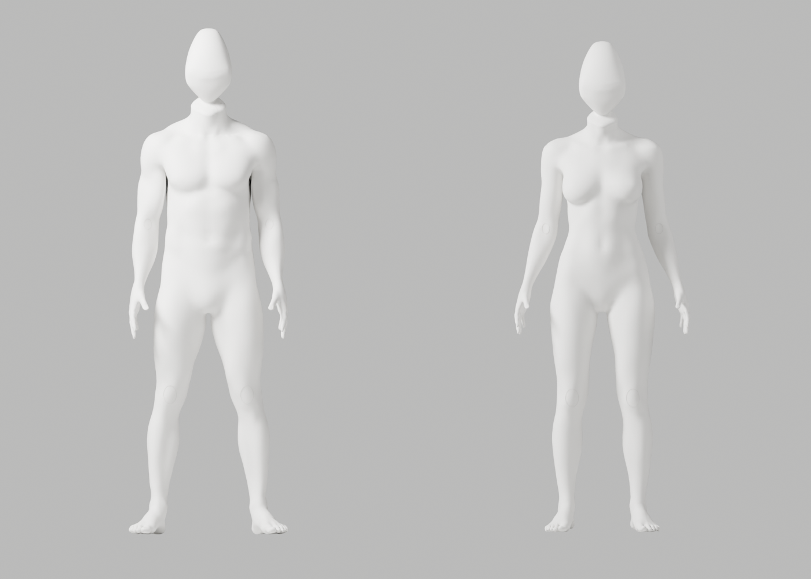
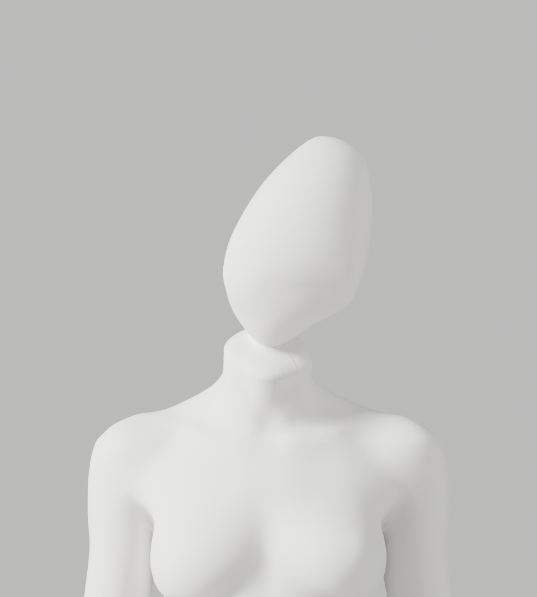
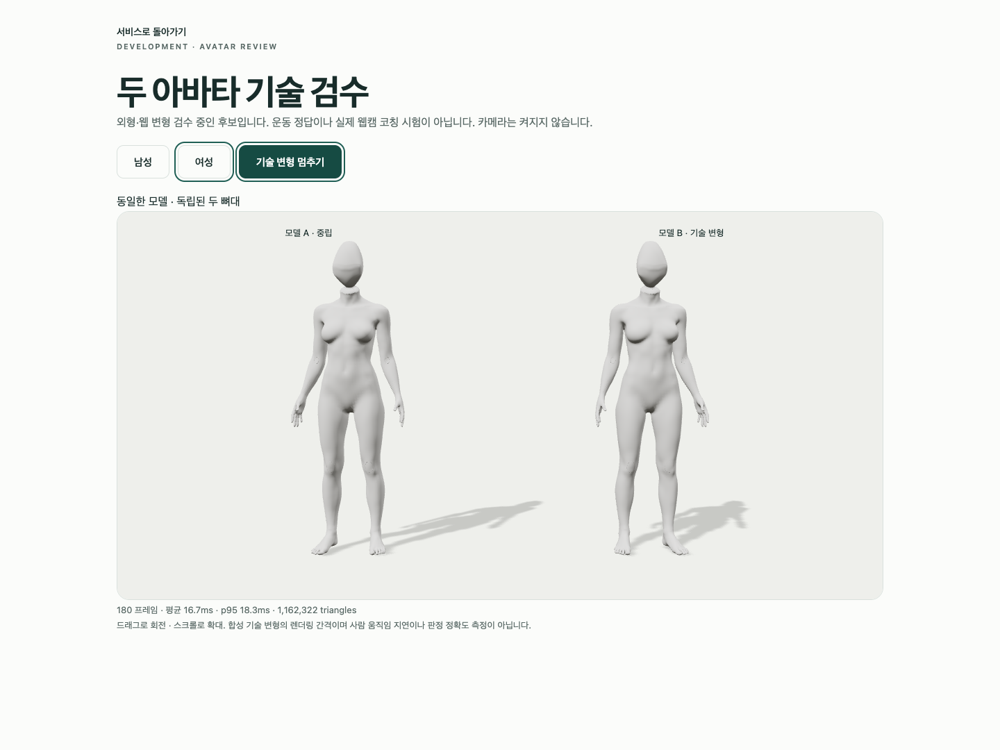

# A74 — 전문 머리 강체 방향 대조·실제 전체 검수

2026-10-02 · S2.4 · FR-A-01~04 / A-07 · **외형 반려·미채택·PR #9 병합 보류**

머리 단독 0°/20°/30° 실제 대조에서는 뒤로 젖혀진 실루엣이 줄었다. 그러나 30°를 전체 모델에 연결하자 목 높이와 옷깃 같은 연결부가 악화됐다. 기술 검사 통과를 외형 승인으로 확대하지 않는다. 여성 무의상·남녀 동일 백색 마네킹·자연 곡선/관절·필요한 구조/변형 정확도·기존 파일/증거·개발 A37·1~6단계/승인 기준은 그대로다.

## 실제 결과와 범위

| 실행 | 실제 결과 | 제한 |
|---|---|---|
| 전문 머리 단독 방향 0°/20°/30° | 각 exit0, 실제 2PNG, 합6PNG | body/rig/GLB/browser 결과가 아님. 0°/20° 전신 검수 미실행 |
| 남녀 전체 A74 제작 | exit0, 남143278/여143244 정점, 각163bones | 모델링 방향30°는 운동 목표 각도 아님 |
| native 경계 회귀 | 19개 PASS/exit0 | 기존16개+잘못된 회전 입력3개, 작은 비인체 시험 메시 |
| 원본 기술 변형 | 121행/118변형 PASS, 실패0, 실제34PNG | 기술 stress. 검증된 시범/실제 사람 아님 |
| GLB export/import | 별도 GLB와 재수입본, ratio1/8weights, fin0/0, 기존 실루엣3mm/bounds0.1mm 검사 PASS | 원본 덮어쓰기·검사 완화 없음 |
| 재수입 기술 변형 | 121행/118변형 PASS, 실패0 | `--qc-only`; 재수입34PNG 미실행 |
| 독립 원본 보존 대조 | 남75915/여75865 원래 body 좌표/named skin, 손·각163bones/rest/행렬 동일 | 수정 head/새 bridge는 이 비교 대상 아님; 제작 assertions와 전체 QA 별도 |
| 실제 Chrome | 3개 PASS/42.117s, 실제2PNG, 카메라 요청0 | 통제된401/503/WebGL loss, 실제 카메라 성능 아님 |

원본 최대 edge ratio2.9439303671, 재수입2.9476798033. 원본 목 좌/우는 남1.799137/1.822857, 여1.498565/1.517416; 재수입 남1.895777/1.882415, 여1.599456/1.590418다. 기존 길이1mm 초과 edge/ratio3미만 기준을 유지했다. A73d 대비 목 ratio도 악화됐으며 통과했다는 이유로 회귀를 숨기지 않는다.

## 실제 연결부·머리 피팅

강체 회전은 기존 전문266점 cage의 topology/edge길이/체적을 유지한다. 기존 native100 체적 보존 정제와 lower12를 재사용한 후 회전했고, 기존 A66 body/rig와 고정 최종 사선 cut/gap24mm를 유지했다. 실제 단면 등록 과정의 머리 추가 높이는 남57.345446mm/여58.749437mm다. 이는 원래 crown 정확 보존이나 해부학/사용자 정확도 주장이 아니다.

| 후보/성별 | body 경계 p95/max(°) | head 경계 p95/max(°) |
|---|---|---|
| A73d 남 |39.400981/42.640314|57.483050/65.683498|
| A74 남 |72.944303/74.635704|93.729498/105.616369|
| A73d 여 |33.340209/49.236713|45.544046/53.901186|
| A74 여 |63.499647/65.216593|81.562806/95.629724|

새 경계는 남359/여361점으로 대응했고 수직 gap24mm·수직거리20.579830mm를 실제 측정했다. 새 bridge만 native 정제한 최대 변위는 남5.938947mm/여4.655857mm로 기존6mm guard는 유지됐다. 경계 수치와 실제 렌더 모두 악화되어 **강체 회전만으로 외형을 해결하는 경로는 채택하지 않는다.** 다음은 얼굴 없는 전문 head 하부의 형태와 head–neck 비율·연속 접선을 함께 피팅하는 수정이다. 동일 각도/bridge 보간 반복으로 완료 처리하지 않는다.

## 원본과 실제 미리보기

- [수정 가능한 별도 A74 원본](../../bodyguard_avatar_candidate_a74_review.blend) · 29,169,593bytes · SHA-256 `76237732c83c24b5d0b5b1c135b1e2fee6473343c573eaab78995262910d9171`
- [남성 GLB](a74/bodyguard-male-candidate.glb) · 12,762,312bytes · `45471c0a79d85fb6214af6751e26451f4be42cb80dcefd97a1f6cab850404243`
- [여성 GLB](a74/bodyguard-female-candidate.glb) · 12,759,492bytes · `88c8d615bc08b481fac73f4ca4ce72a91fd5c7dbc1eba546933aa4397f404901`

[머리0° 정면](head-orientation-0/generic-front.png) · [측면](head-orientation-0/generic-side.png) · [20° 정면](head-orientation-20/generic-front.png) · [측면](head-orientation-20/generic-side.png) · [30° 정면](head-orientation-30/generic-front.png) · [측면](head-orientation-30/generic-side.png). [남성 실제 Chrome](a74/browser/male-two-models.png). PNG는 기존 전문 geometry의 실제 Blender/Chrome 결과이며 생성 이미지가 아니다.

Mac16,12 / Apple M4 / 17,179,869,184bytes RAM / Chrome154.0.8037.58 / headless1440×1080 / DPR1. 명시된4항목만 실제 읽었으며 serial/UUID는 읽지 않았다. 모든 native actor 종료 후 Chrome을 시작했다. 남성180RAF mean16.657778ms/p9517.900000ms/draw21/triangles1162594, 여성 mean16.656111ms/p9518.300000ms/draw21/triangles1162322다. 정지 각 변화0·움직임>0.1rad·독립 skeleton/8weights mesh2를 검사했다. RAF 간격은 GPU 단독/웹캠/추론/사람 지연·정확도·장시간 배터리 수치가 아니다.

## 재현과 실행 기록

[제작 코드](producer-at-generation.py.txt), [강체 helper](head-orientation.py.txt), [머리 inspector](head-orientation-inspection.py.txt), [19개 native 회귀](native-boundary-regression.py.txt), [독립 body 보존](authored-body-preservation.py.txt), [실제 seam 진단](oblique-seam-diagnostic.py.txt)을 보존했다. 기존 [volume helper](../candidate-a73-a73d-review/head-volume-sculpt.py.txt), [lower cage helper](../candidate-a73-a73d-review/head-lower-cage-sculpt.py.txt), [A49 경계 helper](../candidate-a49-rejected/producer-at-generation.py.txt), [A64 prior 회귀](../candidate-a63-a64-review/a64/producer-at-generation.py.txt)를 변경하지 않고 재사용한다. 재현 시 이 사본들을 임시 폴더에 각각 실행 당시 `a74-rigid-artist-head.py`, `a74-head-orientation.py`, `a74-head-orientation-inspection.py`, `a74-native-boundary-regression.py`, `a74-authored-body-preservation.py`, `a74-oblique-seam-diagnostic.py`, `a73d-head-volume-sculpt.py`, `a72-head-cage-sculpt.py`, `a49-density-producer.py`, `a64-continuous-jaw-neutral-head.py`로 배치한다.

Blender5.1.1 `--background --factory-startup --disable-autoexec --python-exit-code 1`로 보존 A66 원본과 기존 CC0 bundle을 열고 producer에 새 원본·새 JSON·bundle 경로를 전달했다. 원본 `review_avatar.py -- <새 폴더> --candidate --mannequin` → `export_avatar_candidate.py -- <새 web.blend> <새 GLB 폴더>` → 재수입 `review_avatar.py -- <새 폴더> --candidate --mannequin --qc-only`를 실행했다. 이전 파일이 존재하면 producer/export는 거부한다. native 관찰은 source unsaved. 실제 브라우저는 backend에서 `BODYGUARD_AVATAR_QA_DIRECTORY=<절대 새 GLB 폴더> PLAYWRIGHT_JSON_OUTPUT_NAME=<새 JSON> .venv/bin/python -m tests.run_browser avatar`로 실행했다. 비청취 프록시의 실제 A-00 외부 거부를 검증했으며 사용자5173 서버를 사용/종료하지 않았다.

[실행 기록·실패/미실행](execution-record.json) · [생성](a74/generation-report.json) · [회귀](a74/native-boundary-regression.json) · [원본](a74/source/deformation-report.json) · [export](a74/roundtrip-report.json) · [재수입](a74/roundtrip-deformation-report.json) · [body 보존](a74/authored-body-preservation.json) · [seam](a74/actual-seam-diagnostic.json) · [Chrome](a74/browser-report.json) · [증거 검사](evidence-audit.js.txt) · [manifest/해시](evidence-audit.json).

첫 Ruff 명령은 공백 경로 인용 누락/exit127로 실행되지 않았고, 경로 인용을 고친 실제 검사 PASS 후 제작했다. 첫 body 비교/seam 진단은 이전 A73d SHA가 남아 exit1로 거부됐다. [실패 body verifier](failed-authored-body-preservation.py.txt)·[실패 seam verifier](failed-oblique-seam-diagnostic.py.txt)와 실제 실패 도구 출력은 기록에 보존했고, 정확한 새 SHA로 수정한 native 재실행은 각각 exit0다. export의 parent5/가중치 제한, Chrome deprecation/색상 경고·주입503·실제 WebGL loss 후 extension 경고를 숨기지 않는다.

첫 staged diff 검사는 새 텍스트2개의 EOF 빈 줄로 exit2였다. 오케스트레이션이 후속 커밋을 차단하지 않아 초기 로컬 커밋 `546aa3a`가 생성됐다. 이 커밋은 보존하고 빈 줄만 제거한 별도 보완 커밋 전 scope/diff/audit를 실제 재실행한다. 실패 상태는 푸시·병합하지 않았다. 반복되는 순차 단계는 검증 exit0/terminal 여부를 확인한 다음 호출한다.

0°/20°의 전신/GLB/Chrome, imported34PNG, 실제 사람/observer/다양한 촬영/시범/리타게팅/통합 지연, API160/Vitest133/build 서비스 회귀의 이번 재실행, 장시간/다기기, 실제 공급자·운영 DB·시크릿·배포·출시는 **미실행**이다. S2.4/2단계/전체1~6은 미완료이며 전문가 검토만 남은 상태가 아니다.

코드/diff 리뷰: 기존 제작 경로에는 회전 helper 호출·해시·보고 필드만 추가했고 body/skin/rig/등록/bridge/QA 한계값은 변경하지 않았다. 실행형 helper invariants와 native19개 회귀로 검증했다. 신규 보안·개인정보/운영 변경은 없고 미해결 **A-02 외형 P2**가 남아 Request Changes다. 커밋은 검증된 실험/반려 기록 보존이지 채택·병합 승인이 아니다. 새 프레임워크/의존성 대신 기존 native producer·QA·export·Chrome 하네스를 재사용했다.
