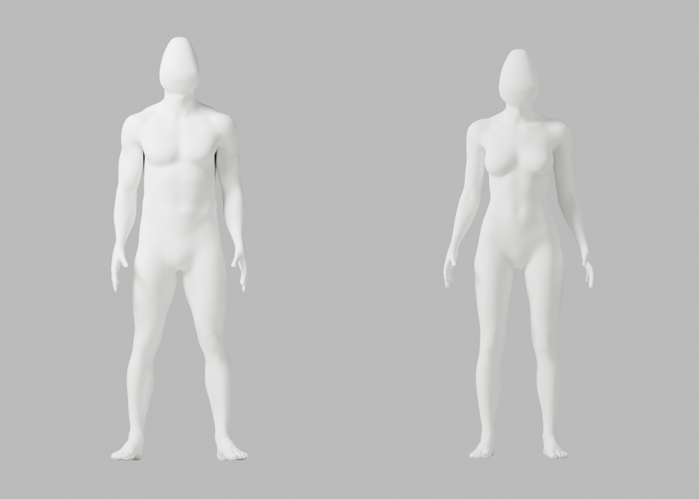
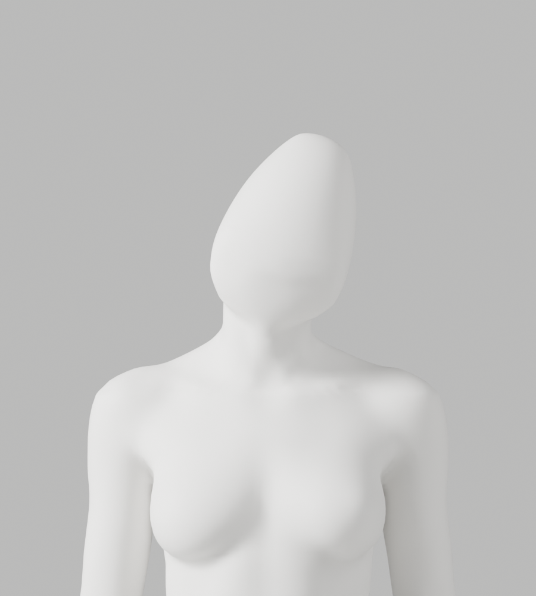
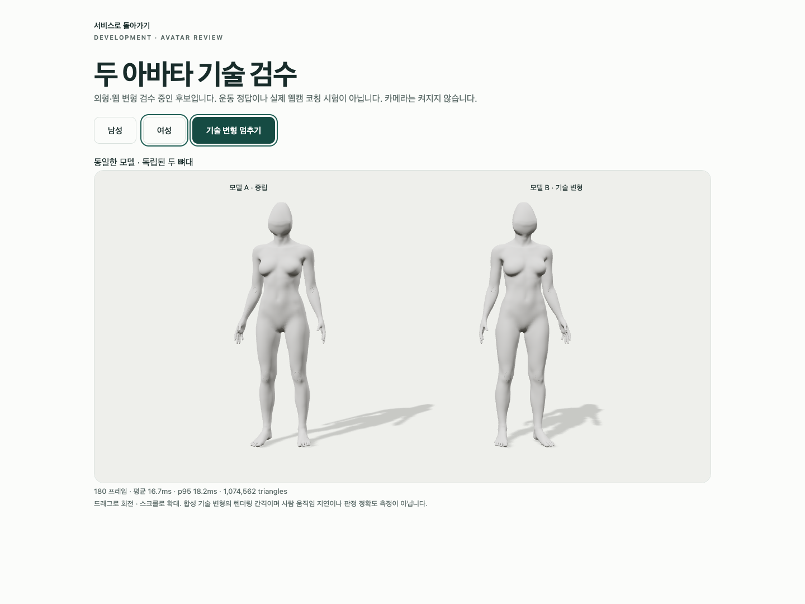

# A75·A75b — 실제 cervical 단면 피팅·제작 경계 검수

2026-10-02 · S2.4 · FR-A-01~04 / A-07 · **외형 보완 중·미채택·Draft PR #9 병합 보류**

A74의 목 돌출은 머리 끝에서 일률적으로12mm 들어간 좁은 단면을 몸체 경계에 대응시킨 것이 원인이었다. 전문 원본의 최종 head_cut에서 단면을 다시 맞췄다. 여성 무의상·남녀 동일 백색 마네킹·자연 곡선/관절·필요한 구조/리깅·기존 원본/증거·1~6단계와 승인 기준은 유지한다. 기술 검사 통과를 참조 외형·올바른 운동·실제 코칭 승인으로 확대하지 않는다.

## 실제 실행

| 실행 | A75 | A75b |
|---|---|---|
| 별도 전문 원본 제작 | exit0, 남133261/여132274점·각163bones | 같은 점수·각163bones, exit0 |
| native 경계 회귀 | 21개 PASS | 같은21개 PASS. 합42개의 서로 다른 시험은 아님 |
| 원본 기술 변형 | 121행/118변형 PASS·실제34PNG | 121행/118변형 PASS·qc-only |
| 별도 초회 렌더 | 없음 | 실제8PNG/exit0. 전체34PNG로 표기하지 않음 |
| 원래 신체·skin/손/rig 대조 | 남75915/여75865 정확 보존 | 독립 native 대조 PASS |
| A75→A75b 동일성 | 해당 없음 | 좌표/named skin·좌표 기반 topology·보호 손·163bone/rest·행렬·5PBR 입력 exact PASS. 정점 순서/법선/GLB byte 동일 주장은 아님 |
| GLB export/import | ratio1/8weights·fin0/0·3mm envelope/0.1mm bounds PASS | 별도 재실행 PASS·fin0/0 |
| 재수입 기술 변형 | **미실행** | 121행/118변형 PASS·qc-only |
| 실제 Chrome | **미실행** | 3개 PASS/40.844s·실제2PNG |

총44PNG = A75 원본34 + A75b 초회8 + A75b Chrome2다. A75b8컷을 A75 전체34컷으로 세거나 A75b 결과를 A75 GLB 검증으로 소급하지 않는다. 원본 최대 edge ratio2.9439303671, A75b 재수입2.9476798033. 원본 목 좌/우는 남1.444768/1.430445·여1.468720/1.470342, 재수입 남1.444303/1.429942·여1.468650/1.470363다. 원래1mm 초과 edge/ratio3미만과 새 bridge6mm guard는 완화하지 않았다.

## 실제 원인과 수정

[A74 단면 진단](a74-contour-size-diagnostic.json)에서 몸체 X폭은 남120.994/여106.362mm, 머리 연결 X폭은 둘 다50.498mm였다. 좁은 머리 끝 단면 등록이 각각50.929/54.818mm의 추가 높이를 만들었다. A75는 `diagnostic_cut=head_cut`으로 실제 기존 최종 cervical 절단면을 사용한다. 동일 전문 cage/체적100/lower12/강체30°·A66 body/rig·고정 gap24mm·원래 skin 준비와 native bridge6/1·새 연결점만8회 정제는 유지했다. 회전30°/모델링 치수는 운동 목표 각도가 아니다.

원본의 추가 crown 높이는 남7.148/여4.942mm로 줄었다. 새 bridge 최대 변위 남0.822456/여1.073341mm. 전체 원래 신체를 매끈하게 덮거나 필요한 구조를 삭제하지 않았다. [실제 제작 경계 진단](a75b/actual-authored-contours.json):

| 성별 | body/head X폭(mm) | body p95/max(°) | head p95/max(°) |
|---|---|---|---|
| 남 |120.994 / 123.270|14.975512 / 42.911299|19.575570 / 20.799707|
| 여 |106.362 / 127.416|19.202151 / 77.359583|11.745052 / 58.191313|

제작 때의 정확한 ring ID는 남567/여587점이다. 남성 head cut에서 같은1µm 근접 검색은571개 edge를 골라 실패했다. A75b는 실제 제작 경계를 원본 custom property로 보존하고 동일1µm·manifold·degree2 조건으로 읽는다. 형상·skin·QA 임계값을 바꾸지 않았고 GLB에는 `export_extras=False`로 이 메타데이터를 보내지 않는다. 경계 평균/p95 개선은 해부학적 정확성이나 최종 외형의 자동 승인 기준이 아니다.

## 실제 원본·미리보기

- [A75 편집 원본](../../bodyguard_avatar_candidate_a75_review.blend) · 27,777,082bytes · `5badc589381a9cf7e881bf8e3cadb331d649efd2d1e283289809568ae12faa1a`
- [A75b 편집 원본](../../bodyguard_avatar_candidate_a75b_review.blend) · 27,784,763bytes · `9131b9cb10661bda844b8377df89e90cd610c63c6783d95f107d9baf01e0732c`
- A75 [남성 GLB](a75/bodyguard-male-candidate.glb) · 11,880,464bytes · `b0e297f6258e5baadda4657e673306df378d2176c0810856e0504111ad937b3e`, [여성 GLB](a75/bodyguard-female-candidate.glb) · 11,794,136bytes · `667ceb5f24743b24eaf55a6ad5e9862239bc78337148da398bb2059d3cec24d2`
- A75b [남성 GLB](a75b/bodyguard-male-candidate.glb) · 11,880,464bytes · `07274537a2b9fb97af96dbfb2adb8a3f42ecf146ada87df58e94a3d919860bd3`, [여성 GLB](a75b/bodyguard-female-candidate.glb) · 11,794,136bytes · 위 여성 SHA와 동일. 여성 byte 동일은 별도 실행을 생략했다는 뜻이 아님.

[남성 Chrome](a75b/browser/male-two-models.png) · [여성 측면](a75b/preview/first-side-female.png) · [여성 뒤 목](a75b/preview/first-back-female.png) · [남성 목](a75b/preview/first-neck-male-left.png). 모두 실제 Blender/Chrome 결과이며 AI 생성 이미지를 결과로 사용하지 않았다.

실제 다각도·확대에서 별도 의상/허리선/옷단이나 유두·생식기 사실적 세부는 없고 자연 여성 곡선·신체/관절이 유지됐다. 그러나 앞/측면의 높은 뾰족한 머리·잔여 얼굴면·뒤 목 striation·최종 재질/실루엣은 참조 품질 미달이다. **A-02 P2 미해결, 개발 A37 유지, PR #9 Request Changes/미병합**이다. 다음은 기존 전문 head 상부/전후 실루엣과 뒤 목 국소 곡면의 조형 정제다.

## 재현·실패·미실행

[A75 producer](a75-producer-at-generation.py.txt)·[A75b producer](a75b-producer-at-generation.py.txt), [21개 native 회귀](native-boundary-regression.py.txt), [정확한 제작 경계 진단](authored-contour-diagnostic.py.txt), [독립 A66 body 보존](authored-body-preservation.py.txt), [A75→A75b native 동일성](native-geometry-equality.py.txt)을 보존했다. 기존 [A49 helper](../candidate-a49-rejected/producer-at-generation.py.txt), [A64 회귀](../candidate-a63-a64-review/a64/producer-at-generation.py.txt), [lower cage](../candidate-a73-a73d-review/head-lower-cage-sculpt.py.txt), [volume](../candidate-a73-a73d-review/head-volume-sculpt.py.txt), [강체 방향](../candidate-a74-review/head-orientation.py.txt), [A50 초회 renderer](../candidate-a50-a51-rejected/first-preview-at-generation.py.txt)를 변경하지 않고 재사용했다. 경로가 실제로 있는지 증거 검사로 확인한다.

재현 시 보존 코드 사본을 제작 당시 이름 `a75-cervical-head-section.py`/`a75b-authored-cervical-rings.py`, `a49-density-producer.py`, `a64-continuous-jaw-neutral-head.py`, `a72-head-cage-sculpt.py`, `a73d-head-volume-sculpt.py`, `a74-head-orientation.py`로 새 임시 폴더에 둔다. 회귀 입력 `a74-generation.json`은 [보존 A74 JSON](../candidate-a74-review/a74/generation-report.json)의 사본이며 실제 사람 좌표가 아니다. Blender5.1.1 `--background --factory-startup --disable-autoexec --python-exit-code 1`로 보존 A66과 CC0 bundle을 열고 producer에 새 원본·새 JSON·bundle 경로를 전달한다. producer/export는 기존 출력 덮어쓰기를 거부한다.

`review_avatar.py -- <새 폴더> --candidate --mannequin`(A75 full34), A75b의 `--qc-only`와 별도 first-preview8 → `export_avatar_candidate.py -- <새 web.blend> <새 GLB 폴더>` → 재수입 같은 QA `--qc-only`를 실제 실행했다. 모든 native actor 종료 후 backend에서 `BODYGUARD_AVATAR_QA_DIRECTORY=<절대 새 GLB 폴더> PLAYWRIGHT_JSON_OUTPUT_NAME=<새 JSON> .venv/bin/python -m tests.run_browser avatar`를 실행했다. 비청취 프록시 A-00 외부 거부 PASS·사용자5173/Blender UI·API/SQL/SMTP/OAuth·카메라 사용 없음.

Mac16,12 / Apple M4 / RAM17,179,869,184bytes / Chrome154.0.8037.58 / headless1440×1080/DPR1, 명시된4항목만 실제 읽었고 serial/UUID는 읽지 않았다. 남180RAF mean16.655ms/p9518.6/draw21/triangles1082426, 여mean16.666667/p9518.2/draw21/triangles1074562. 독립 skeleton/정지 회전0/움직임>0.1rad/8weights mesh2를 검사했다. RAF는 GPU 단독·카메라 추론·실제 사람 지연/정확도·장시간 배터리 수치가 아니다.

[근접 진단 실패 코드](failed-a75-proximity-contour-diagnostic.py.txt), [BMesh lookup 실패 producer](failed-a75b-producer.py.txt)와 실제 nonzero 도구 출력은 [실행 기록](execution-record.json)에 보존했다. 정확한 ring ID/native lookup 보완 후 제작/진단은 실제 exit0다. read-only 잘못된 문서/QA 경로·임시 비Git 경로 명령 실패는 품질 통과로 세지 않았다. export parent5·가중치 제한866905/904643와866921/904643, Chrome deprecation/색상·주입503·실제 WebGL loss 후 extension 경고도 기록했다.

A75 GLB118/Chrome, A75b full34PNG, imported34PNG, 실제 사람/observer/조명·체형·촬영/시범/리타게팅/웹캠 통합, API/Vitest/build 서비스 회귀의 이번 재실행, 다기기·장시간, 공급자·운영 DB·시크릿·배포·출시는 **미실행**이다. S2.4/2단계/전체1~6은 미완료이며 전문가 검토만 남은 상태가 아니다.

[생성 A75](a75/generation-report.json)·[A75b](a75b/generation-report.json) · [A75 원본34](a75/source/deformation-report.json) · [A75b 원본QC](a75b/source-deformation-report.json) · [A75b 왕복](a75b/roundtrip-report.json) · [재수입QA](a75b/roundtrip-deformation-report.json) · [body 보존](a75b/authored-body-preservation.json) · [동일성](a75b/native-geometry-equality.json) · [Chrome](a75b/browser-report.json) · [실행형 증거 검사](evidence-audit.js.txt) · [해시/manifest](evidence-audit.json).

코드/diff 리뷰에서는 잘못된 단면 선택과 exact ring 식별만 보완했다. 필요한 신체·skin·163bone/변형 guard/QA 한계는 유지하고 실제 regression/equality/preservation/source/import/browser로 검증했다. 새로운 안전/개인정보/운영 변경은 없고 외형 P2가 남아 병합하지 않는다. 별도 프레임워크 대신 기존 native 제작·QA·export·Chrome을 재사용했다.
