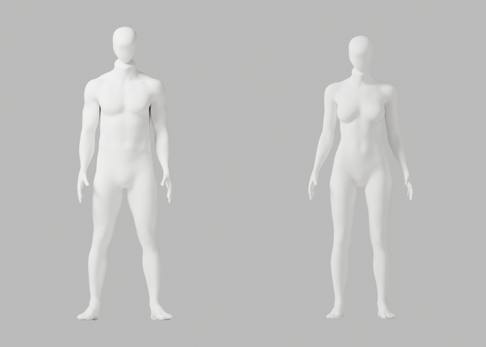
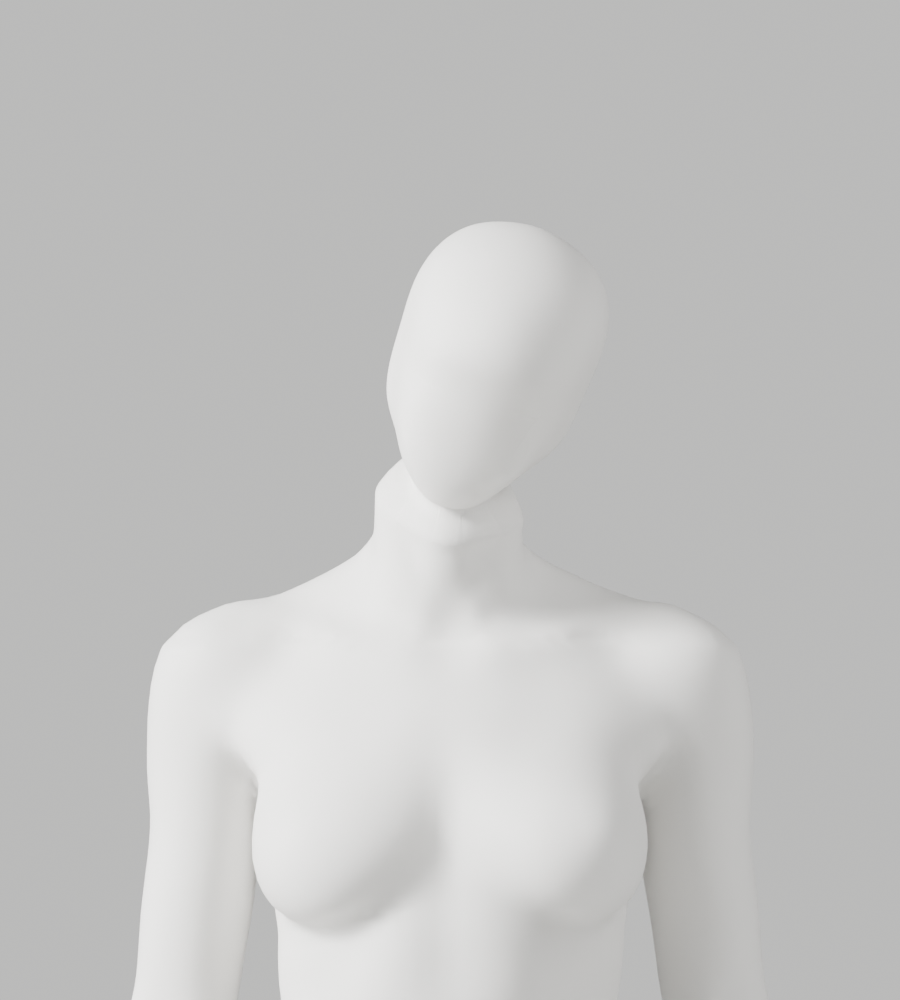
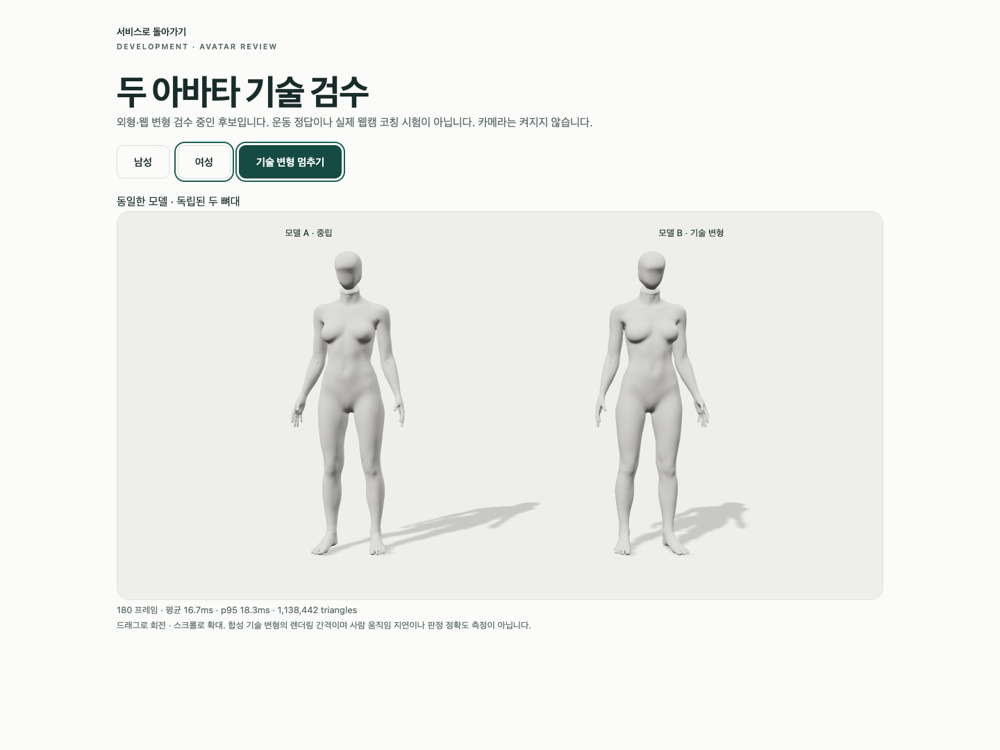

# A76~A77 — 원래 두개골 형상 보존·앞면 국소 정제 실제 검수

2026-10-02 · S2.4 · FR-A-01~04 / A-07 · **외형 보완 중·미채택·Draft PR #9 병합 보류**

CEO의 여성 의상 요구 대체 결정은 유지한다. 남녀 모두 별도 의상 없는 백색 중성 마네킹, 여성 자연 곡선·관절, 유두·생식기의 사실적 세부 없음, 남녀 동일 재질·마감이다. A37에서 반영한 변경을 새 A77에서도 유지했다. 기존 원본·GLB·검증 증거·개발 기본 A37·1~6단계/승인 기준은 바꾸지 않았다. 기술 PASS를 참조 외형·올바른 운동·실제 웹캠 정확도의 통과로 확대하지 않는다.

## 원인 분리와 실제 비교

동일 전문 `GEO-head_primitve` 266점 cage(이름은 기존 에셋명이며 새 도형 생성 아님)의 처리 단계를 분리했다. 실제 Blender5.1.1에서 각각 정면/측면 2PNG, 합10조건·20PNG를 렌더했다. 머리만 보는 비교는 전신·리깅·GLB 검증이 아니다.

| 실제 비교 | 정제 범위 | 확인/선택 |
|---|---|---|
| [원형](head/stage-raw/inspection-report.json) | 전체 volume 정제 없이 강체30°·subsurf4 | 둥근 정수리·후두부 원형, 깊은 얼굴 굴곡 |
| [volume](head/stage-volume/inspection-report.json) / [volume-lower](head/stage-volume-lower/inspection-report.json) | 기존 전체 volume100 / 이후 lower12 | 정수리가 길고 뾰족해짐. 전체 정제가 원인임을 분리 |
| [Y6](head/y6/inspection-report.json) / [Y12](head/y12/inspection-report.json) | 앞면 Y축만, 상부/뒤 원형 보호 | 둥근 상부 유지, 깊은 얼굴 굴곡 잔존 |
| [XYZ6](head/xyz6/inspection-report.json) / [XYZ12](head/xyz12/inspection-report.json) | 앞면 세 축, 상부/뒤 원형 보호 | 얼굴 굴곡 완화, 잔여 면 |
| [XYZ24](head/xyz24/inspection-report.json) / [XYZ36](head/xyz36/inspection-report.json) | 같은 범위 native smooth_vert | 36회 후보를 전신 A77에 연결해 별도 검수 |
| [midface36](head/midface36/inspection-report.json) | 턱 하부도 고정한 중간 앞면만 | 깊은 굴곡·뾰족한 하부가 남아 단독 비교로 반려 |

A77은 전체 volume 정제/lower12를 **적용하지 않는다**. 앞면170점만 native factor0.45/36회로 정제하고 상부·후두부96점/전체 cage 위상을 정확히 유지한다. 원형 체적0.003562389078→0.002957764903으로 변했다. 전체 체적 보존이나 해부학 목표라고 주장하지 않는다. 강체30° 단계의 체적/길이 보존과 구분한다. 머리 단독 높이 하단1.477139/crown1.684627m는 artist 피팅 수치이며 사용자 신체 측정값이 아니다.

A75b의 고정 cervical cut, gap24mm, 실제 절단면 등록, 정렬 전 이름 대응 skin 전송, 원래 몸체·손·각163bones/rest/행렬, 새 연결점만 native8회 정제를 재사용했다. body/head 최종 고정 평면 차이는 남녀0이다. 새 연결점 최대 변위 남5.623225/여3.846035mm이며 기존6mm guard를 유지했다. 원래 신체 남75915/여75865점과 named skin/보호 손·163본·행렬은 [독립 native 대조](a77/authored-body-preservation.json)로 확인했다. 머리 앞면 편집까지 신체 전체 좌표 보존으로 확대하지 않는다.

## 실제 실행 결과

| 실행 | A77 실제 결과 |
|---|---|
| 별도 편집 원본 생성 | exit0 · 남142115/여140259 vertices · 각163bones |
| native 경계·잘못된 정제 입력 회귀 | 서로 다른24개 PASS · 작은 artist fixture, 사람/정답 동작 아님 |
| 원본 변형 | qc-only 및 전체 렌더 각각121행/118기술 변형 PASS. 같은118개 반복 실행이지236개의 서로 다른 동작이 아님 |
| 원본 실제 외형 | 초회8PNG + 전체34PNG 별도 실행 |
| 독립 원래 신체/skin·손·163본 대조 | exit0, 남75915/여75865점 보존 |
| GLB export/import | exit0 · ratio1/native8weights · fin0/0 · 원래3mm envelope/0.1mm bounds 유지 |
| 재수입 GLB 변형 | 121행/118기술 변형 PASS · qc-only. 재수입34PNG는 미실행 |
| 실제 Chrome | 3개 PASS/41.619s · 실제2PNG · 카메라 요청0 |

실제64PNG = 단독 head20 + A77 초회8 + 전체 source34 + Chrome2. 원본 최대 edge ratio2.9439303671, 재수입2.9476798033. 목 좌/우는 원본 남1.512868/1.542056·여1.522933/1.513440, 재수입 남1.588636/1.542046·여1.490739/1.486931이다. 원래 길이1mm 초과 edge/ratio3미만을 유지했다. 20°는 기술 stress test이며 사용자 운동 목표/안전 범위가 아니다.

## 실제 파일·미리보기와 미충족

- [수정 가능한 새 원본](../../bodyguard_avatar_candidate_a77_review.blend): 28,724,972bytes · `5f158d9ad9cbba42e6eaf143eed761d3eabdc3fc46c4f30b860799963999dcf3`
- [남성 GLB](a77/bodyguard-male-candidate.glb): 12,659,968bytes · `823b0d0b0b0bb04118acad947beb0ff09df0030d994468c6b1a7f7ccffea0218`
- [여성 GLB](a77/bodyguard-female-candidate.glb): 12,496,816bytes · `5f406d44a9c161ea56280d01a2279b41802b40319db5d3da852c12ba8b5dc173`

[남성 Chrome](a77/browser/male-two-models.png) · [여성 측면](a77/preview/first-side-female.png) · [여성 뒤 목](a77/preview/first-back-female.png) · [손](a77/source/faceless-hand-female.png) · [무릎](a77/source/faceless-knee-female.png). 모두 실제 Blender/Chrome 결과이며 AI 생성 그림을 제작 결과로 사용하지 않았다.

둥근 상부는 개선됐으나 앞면의 면 경계·턱/목의 옷깃 같은 연결·뒤 목/손목·최종 재질/실루엣은 참조 품질 미달이다. **A-02 P2 미해결, A77 미채택, 개발 A37 유지, PR #9 미병합**이다. 별도 의상/허리선/옷단은 없지만 목의 옷깃 같은 외형 결함을 무의상 기술 검사의 통과로 숨기지 않는다. 다음은 고정 상부 형상을 유지한 전문 턱 하부–목의 실제 곡면/접선 대응이며, smoothing 횟수 반복만으로 완료 처리하지 않는다. 필요한 신체 구조 삭제·전체 remesh·좌표 사후복원·guard 완화는 하지 않았다.

## 재현·보존·범위

[실행 코드](a77-producer-at-generation.py.txt) · [선택한 front helper](a76c-front-surface-sculpt.py.txt) · [24개 회귀](a77-native-boundary-regression.py.txt) · [독립 신체 대조](a77-authored-body-preservation.py.txt)를 보존했다. 이전 [A49 helper](../candidate-a49-rejected/producer-at-generation.py.txt), [A64 회귀 코드](../candidate-a63-a64-review/a64/producer-at-generation.py.txt), [A74 orientation](../candidate-a74-review/head-orientation.py.txt), [A50 초회 renderer](../candidate-a50-a51-rejected/first-preview-at-generation.py.txt), 기존 `review_avatar.py`/`export_avatar_candidate.py`/Chrome 하네스를 재사용했다. 새 의존성/플랫폼은 추가하지 않았다.

새 임시 폴더에 보존 .py.txt 사본을 제작 당시 .py 이름으로 둔다. A49/A64/A74 helper도 원래 이름 `a49-density-producer.py`/`a64-continuous-jaw-neutral-head.py`/`a74-head-orientation.py`로 두고, 회귀의 `a74-generation.json`은 [기존 실제 A74 JSON](../candidate-a74-review/a74/generation-report.json)의 사본을 쓴다. Blender5.1.1 `--background --factory-startup --disable-autoexec --python-exit-code 1`로 보존 A66 원본을 열고 producer에 새 .blend/새 JSON/보존 CC0 bundle 경로를 전달한다. 기존 출력 덮어쓰기는 거부한다.

원본 `review_avatar.py -- <새 폴더> --candidate --mannequin` → 별도 `export_avatar_candidate.py -- <새 web.blend> <새 GLB 폴더>` → 재수입 동일 QA `--qc-only`를 실행했다. 모든 native actor 종료 뒤 backend에서 `BODYGUARD_AVATAR_QA_DIRECTORY=<새 GLB 절대 경로> PLAYWRIGHT_JSON_OUTPUT_NAME=<새 JSON> .venv/bin/python -m tests.run_browser avatar`를 실행했다. 별도5182/비청취 프록시/A-00 실제 외부 차단, 사용자의5173/Blender UI·API/SQL/SMTP/OAuth·카메라 사용 없음.

Mac16,12 / Apple M4 / RAM17,179,869,184bytes / Chrome154.0.8037.58 / headless1440×1080/DPR1. 명시한4항목만 읽었고 serial/UUID는 읽지 않았다. 남180RAF mean16.665ms/p9518/draw21/triangles1153290, 여mean16.661667/p9518.3/draw21/triangles1138442. skeleton independent/정지 회전0/움직임>0.1/8weights mesh2를 확인했다. RAF는 GPU 단독·카메라 추론·사람 정확도/지연·장시간 배터리 시험이 아니다. Chrome503/API401은 모의 오류 주입이고 실제 WebGL loss는 별도 native API로 발생시켰다.

raw-cage 진단의 최초 Ruff 검사만 import 정렬/미사용 Vector로 exit1였고 native는 그 실패 코드에서 실행하지 않았다. mechanical Ruff repair 후 실제 검사/native 실행은 exit0다. native 제작/QA 실패를 PASS로 숨긴 것이 아니다. export parent5개·가중치 제한925269/972046, Chrome deprecation/색상·주입503/WebGL-loss 경고와 실행 범위는 [실행 기록](execution-record.json)에 보존한다.

A76 머리 단독 비교의 전신/GLB/rig, A77 재수입34PNG, 실제 사람/observer·조명/체형/촬영·시범/리타게팅/웹캠 통합, 이번 API/Vitest/build 서비스 회귀·다기기/장시간·공급자 연결·운영 DB·시크릿·배포·출시는 **미실행**이다. S2.4/2단계/1~6 전체는 미완료이며 전문가 최종 검토만 남은 출시 상태가 아니다.

[생성](a77/generation-report.json) · [원본 전체](a77/source/deformation-report.json) · [별도 원본QC](a77/source-qc-report.json) · [왕복 변환](a77/roundtrip-report.json) · [재수입QA](a77/roundtrip-deformation-report.json) · [Chrome](a77/browser-report.json) · [증거 검사 코드](evidence-audit.js.txt) · [실제 해시/manifest](evidence-audit.json). 디버깅·문서화·코드 리뷰 절차로 원인을 분리하고 미충족 외형을 반려했다. 기존 안전·개인정보·운영/승인 범위는 유지한다.
