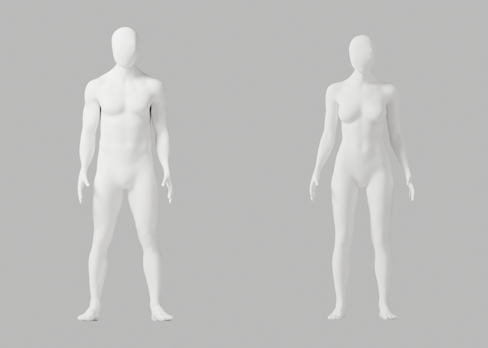
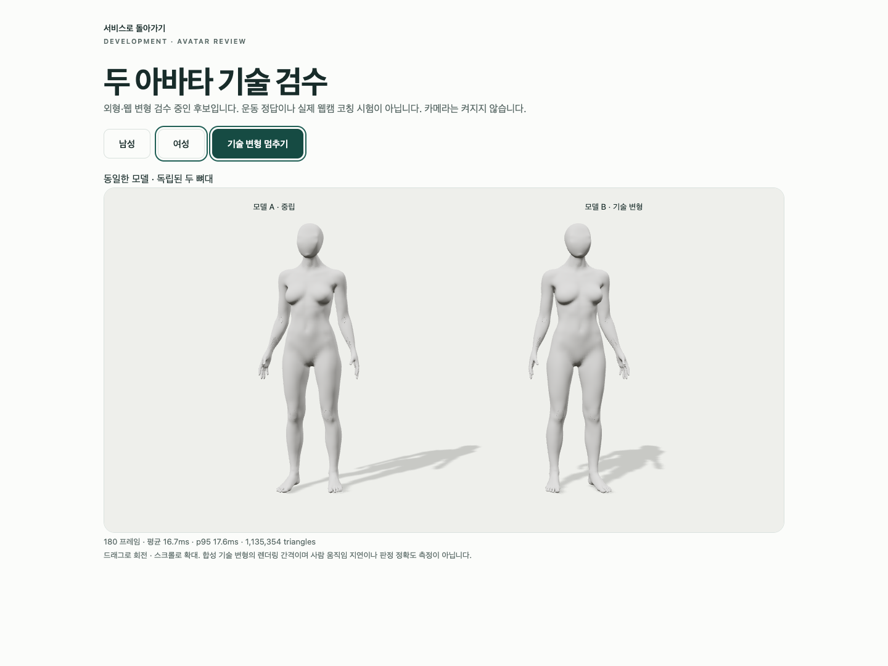
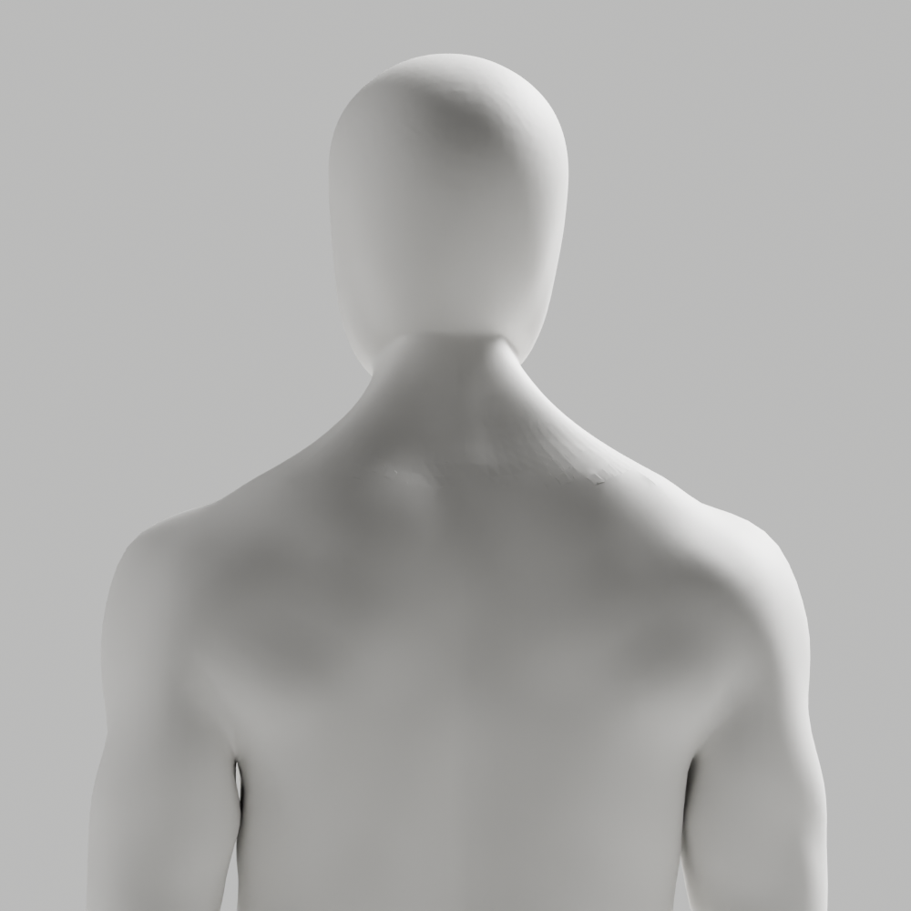

# A90 — 참조형 얼굴·목 보존 / 국소 전문 표면 대조

기술 검수는 통과했지만 **외형은 미통과·미채택**이다. 뒤 목의 접힘과 전완·손목·웹 마감 P2가 남는다. 개발 A37, 이전 원본/검증 증거, Draft PR #9 미병합, 전체 1~6단계 완료·승인 기준은 변경하지 않았다.

## 실제 수정과 판정

- 최신 [CEO 남녀 참조](../candidate-a89-review/ceo-reference.png)의 얼굴/앞목/목 위 머리는 보호했다. 남녀 무의상 백색 중성 표면·자연 곡선·관절, 사실적 유두/생식기 제외는 유지한다.
- A89 원본·웹의 flat face0과 재수입 남2/여20개를 확인했다. 단순 smooth 설정 누락은 원인이 아니다. 기존 전문 CC0 body의 MULTIRES1 표면을 대조하고 뒤 목만 native Shrinkwrap(nearest surface point, on surface, offset0)했다. 새 신체를 코드로 생성하지 않았다.
- 편집 영역은 posterior y>0, abs(x/height)<.12, .79<z/height<.87에 연속 가중치를 적용했다. 저장 재열기로 전체 위상·named skin·손·각163 rest bones/행렬과 영역 밖 남122272/여121040좌표 완전 동일, 최대 이동 남1.736/여1.287mm·기존6mm guard를 확인했다. 좌표 복구/클램프나 guard 완화는 없다.
- 원래 edge ID·원래 길이 분류를 고정한 목 접힘은 남103→104/여85→89다. 이 진단은 전체 QA나 의학적 지표가 아니며 개선됐다고 해석하지 않는다. 기존 참조형 얼굴/앞목을 지키면서 손상 접합부의 위상을 수정하는 것이 다음 작업이다. smoothing 강도·전체 머리 교체·투영 반복은 하지 않는다.

## 실제 검증·미실행 구분

| 검사 | 실제 결과 |
|---|---|
| 원본 전체 QA | 121행/118변형, 실패0, 실제34PNG, 최악 edge ratio2.943930 |
| GLB 재수입 전체 QA | 121행/118변형, 실패0, 실제34PNG, 최악 ratio2.947680 |
| 원본/재수입 구조 | 각163관절, 연결 성분1, nonmanifold0, 정규화 오류0, 동일 백색 재질 |
| 실제 Chrome | 3개 통과, 41.606357초, skipped/unexpected/flaky0 |
| 파일 보존 무결성 | 94사본/6gzip, 실제76PNG, 기존 파일 변경0, byte/SHA256 대조 |
| 직접 이미지 열람 | 초회6 + 원본16 + 재수입16 + 브라우저2 =40. 전체68 QA PNG를 모두 열람했다고 주장하지 않는다 |

Chrome 154.0.8037.93, macOS15.6/24G84, Mac16,12/Apple M4/16GiB, headless1440×1080/DPR1에서 실제 GLB 남녀 각각 두 복제본·독립 뼈대·8가중치 메시2개, 외부 요청 차단, native WebGL loss/retry를 검사했다. 180 RAF의 남 mean16.666/p9517.300ms·여 mean16.671/p9517.600ms는 GPU 처리시간이나 실제 웹캠 코칭 지연이 아니다. 20° 기술 스트레스는 검증된 시범 동작·임상/해부학 검증이 아니다.

실제 사람/카메라/pose 저장·업로드는0이다. 계정/API/PostgreSQL/SMTP/OAuth 회귀, 승인된 운동 시범·실제 retarget, 목표 노트북 웹캠 정확도/지연, 전문가 검수, 실제 Gmail/Google·시크릿·운영 migration·배포·출시는 이번에 실행하지 않았다.

첫 전문 표면 probe는 SUBSURF 가정으로 exit1·JSON/scene 저장0이었다. 실제 MULTIRES 구조를 읽은 별도 v2가 exit0이다. 첫 format 검사1→native 실행 전 포맷→새 Python5파일 전체 Ruff/format0을 구분한다. 최초 sysctl sandbox 거절 후 scoped 읽기 재시도0이다. male exporter의 armature-parent 경고5개와 browser의 NO_COLOR/FORCE_COLOR·THREE.Clock 폐기 경고, 의도적 guest401/model503·WebGL 정리 경고는 발생했다. 경고 없는 실행으로 표시하지 않는다.

## 원본·GLB·재현

- [별도 미채택 원본](../../bodyguard_avatar_candidate_a90_rejected.blend): SHA256 eeae7e32f6607b37009ecdf4e3a5942daa07d8ae598c3a6017e2914a0ffa8c91.
- [남성 GLB](bodyguard-male-candidate.glb): 12656976bytes, SHA256 e1c23c1f3ce9ad6746f9dd27e72162867025a780b626c29f81046dfe8a963e3a.
- [여성 GLB](bodyguard-female-candidate.glb): 12462848bytes, SHA256 7889e4631b271911c1f557a1b4aec2421512cbe6268be0d424dce06df0321f48.

원본 named skin 보존과 웹 파생의8가중치 제한·fin repair(남6/여9)는 별개다. 웹과 재수입은 남142081/여139873점이며 원본은142087/139882점이다. exporter의 ratio1·1µm/3mm/.1mm guard와 full QA의 ratio3을 변경하지 않았다.

[실행 기록](execution-record.json)은 native10개(입력 가정 실패1 포함)·Chrome1개 actor/exit/명령·장비·열람 범위를 기록한다. [사본 manifest](copy-manifest.json)의94개는 원본1·실제PNG76·JSON/GLB11·gzip6이다. [전문 표면 대조](professional-surface-probe.json), [셰이딩 대조](shading-probe.json), [저장 보존 대조](saved-preservation.json), [고정 edge 대조](paired-original-edges.json), [원본 QA](source-deformation.json), [재수입 QA](roundtrip-deformation.json), [export/reimport](glb-roundtrip.json), [Chrome 보고서](browser-report.json)는 실제 출력이다. probe 출력 tool tail 일부만 잘렸으며 전체30행 JSON은 보존했다. 모든 stdout을 보존했다고 주장하지 않는다.

maker/독립 checker/probe와 실패본은 scripts/에 실행 당시 byte 그대로 gzip 보존했다. maker의 오래된 header에 빠진 library 인자도 실제 명령에는 포함되어 있다. maker는 A89원본을 입력으로, script 뒤 '--'에 기존 CC0 library·새 .blend 경로·새 preview 디렉터리를 순서대로 받는다. library SHA256은3c121505651140ceb4d69fd1d8923f7788ffadd81672f5be14845a5f2c75c137이다. 재현은 새 임시 출력 경로에서만 하며 기존 증거에 덮어쓰지 않는다. 공유 diagnose/review/export/browser helper6개를 변경 없이 재사용했다.

읽기 전용 반복 검사:

```sh
node bodyguard/assets/blender/review/candidate-a90-review/evidence-check.cjs
```

scripts/a90-copy-evidence.cjs.txt.gz는 이미 실행된 사본 보존 도구이다. 재실행·기존 경로 덮어쓰기 금지. 위 evidence-check.cjs만 읽기 전용 반복 실행한다. 기술 통과는 외형 통과·출시 승인·전체1~6단계 완료가 아니다.

## 실제 미리보기






