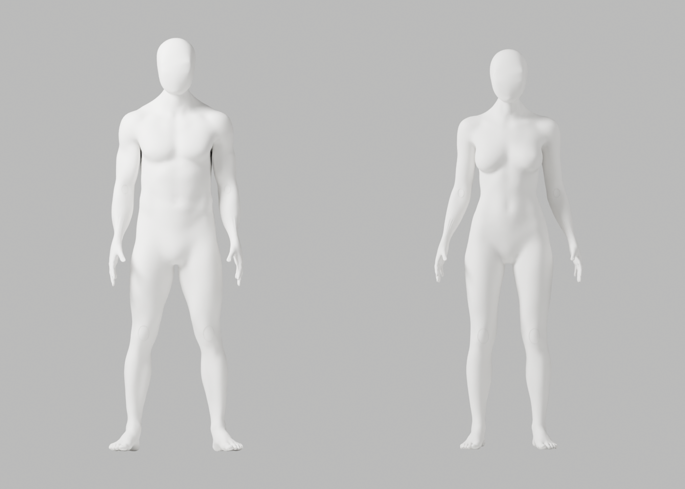
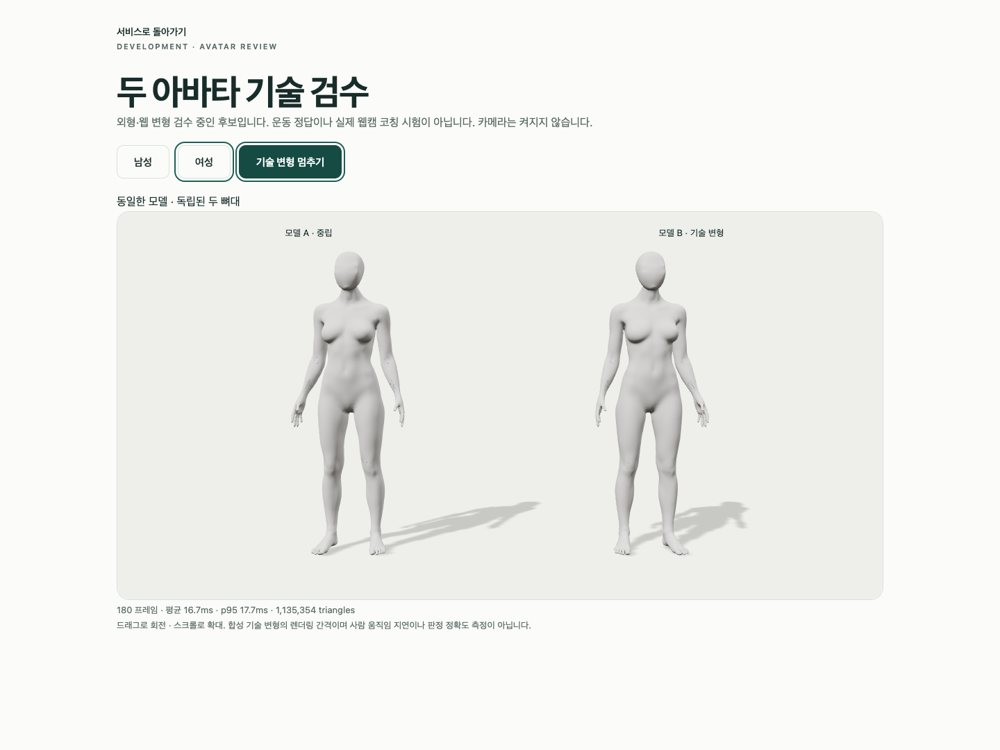
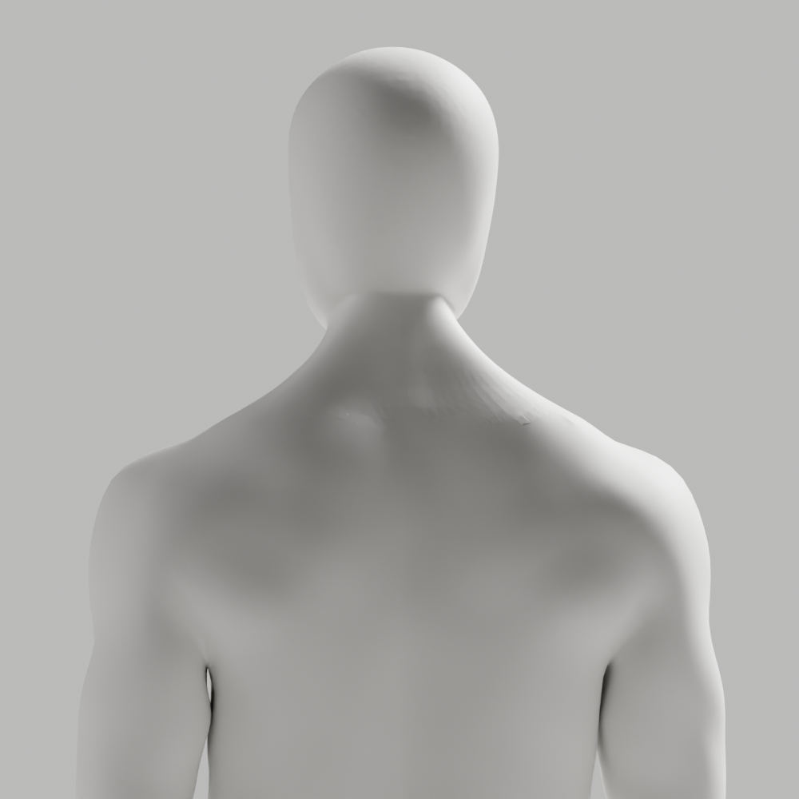

# A91 — 참조형 얼굴·목 보존 / 뒤 목 국소 연결 수정

기술 검수는 통과했지만 **외형 미통과·미채택**이다. 뒤 목의 거친 접힘과 전완·손목·웹 마감 P2가 남는다. 개발 A37, 이전 원본·검증 증거, Draft PR #9 미병합, 전체 1~6단계 완료·승인 기준은 그대로다.

## 수정 결과

- 최신 [CEO 남녀 참조](../candidate-a89-review/ceo-reference.png)의 얼굴·앞목·머리를 보호했다. 남녀 무의상 백색 중성 표면, 자연 곡선·필요한 관절, 사실적 유두·생식기 제외를 유지한다.
- A90의 접힌 뒤 목 면을 남34/여26개 연결 구간으로 좁혔다. native beautify_fill/AREA 대조는 남55→55/여52→52로 개선이 없어 저장하지 않았다.
- 같은 전문 원본의 뒤 목 삼각형에만 native rotate_edges(use_ccw=False)를 적용했다. 두 인접 면이 삼각형이고 모든 정점이 y>0, abs(x/height)<.12, .79<z/height<.87인 경우만 편집했다. 새 신체 생성·투영·smoothing·좌표 클램프/복구는 없다.
- 국소 긴 접힘 edge는 남55→49/여52→50으로 일부 줄었지만 외형은 미달이다. 영역/기하 진단이며 이전 A90의 고정 원래 edge ID 수치103/85와 같은 지표가 아니다. 위상을 바꿨으므로 전체 위상 동일이라고 주장하지 않는다.
- 저장 재열기 독립 대조에서 전체 좌표·named skin·손·각163개의 숫자 rest bones/행렬, 정점/edge/face 수와 영역 밖 face 연결·winding은 정확히 동일했다. 국소 면만 남25/여17개 교체했고 좌표 이동은0이다. 연결 수정이 리깅·변형 정확도 증명의 대체물은 아니다.

## 실제 검증과 한계

| 검사 | 실제 결과 |
|---|---|
| 원본 전체 QA | 121행/118변형, 실패0, 실제34PNG, 최악 edge ratio2.943930 |
| GLB 재수입 전체 QA | 121행/118변형, 실패0, 실제34PNG, 최악 ratio2.947680 |
| 구조 | 남녀 각163관절, 연결 성분1, nonmanifold0, 가중치 정규화 오류0, 통일 백색 재질 |
| 실제 Chrome | 3개 통과, 41.442850초, skipped/unexpected/flaky0 |
| 사본 보존 | 97사본/11gzip, 실제74PNG, 기존 파일 변경0, byte/SHA256 대조 |
| 직접 이미지 열람 | 초회4 + 원본16 + 재수입16 + 브라우저2 =38. 전체68 QA PNG를 모두 열람했다고 주장하지 않는다 |

Chrome154.0.8037.93, macOS15.6/24G84, Mac16,12/Apple M4/16GiB, headless1440×1080/DPR1에서 실제 남녀 GLB 각각 두 복제본, 독립 뼈대·8가중치 메시2개, 외부 연결 차단과 native WebGL loss/retry를 검사했다. 180 RAF의 남 mean16.661ms·여16.656ms/p95각17.700ms는 GPU 처리시간이나 실제 웹캠 지연이 아니다. 20° 스트레스는 임상·해부학 검증이나 올바른 시범 동작이 아니다.

첫 독립 checker는 open_mainfile을 가로질러 mathutils 행 참조를 유지해 뼈 행렬 비교에서 exit1·JSON/scene 저장0이었다. 실패본을 보존했고 별도 v2에서 숫자 nested tuple을 동결해 정확한 동등 비교를 재실행했다. epsilon이나 guard 완화는 없다. 최초 Chrome sandbox 시도는 로컬 proxy bind 거절(exit1)로 브라우저를 실행하지 못했고, 종료 확인 후 scoped 재실행에서 실제3개를 통과했다. 실패를 검사 통과로 바꾸어 쓰지 않는다.

첫 probe B023/format 실패와 세 preformat 실패본을 별도 보존했고 실제 실행 전 정리했다. 최종 새 Python6파일 전체 Ruff/format과 JS copier 구문 검사는0이다. 남성 exporter의 armature-parent 경고5개, NO_COLOR/FORCE_COLOR·THREE.Clock 경고, 의도적 guest401/model503·WebGL 정리 경고는 발생했다. 경고 없는 실행으로 표시하지 않는다.

실제 사람·카메라·pose 저장/업로드는0이다. 계정/API/PostgreSQL/SMTP/OAuth 회귀, 승인된 운동 시범·실제 retarget·목표 노트북 웹캠 정확도/지연, 전문가 검수, 실제 Gmail/Google·시크릿·운영 migration·배포·출시는 이번에 실행하지 않았다.

## 원본·증거·재현

- [별도 미채택 원본](../../bodyguard_avatar_candidate_a91_rejected.blend): SHA256 8424a1306b91e36b7db024987667ca4068a035bc11fe0abe78357216c34bbe9c.
- [남성 GLB](bodyguard-male-candidate.glb): 12656888bytes, SHA256 f3340c4ffbf6ef1faa24f85b8f04261996bfe81fd6d9f487250b23fa2be25c86.
- [여성 GLB](bodyguard-female-candidate.glb): 12462848bytes, SHA256 d323d7a5b4de983bc8acca20c0b276757988bd75401916b6d6c2b8c511b41710.

원본142087/139882점의 named skin 보존과 웹 파생142080/139873점의8가중치 제한·fin repair(남7/여9)는 별개다. exporter의 ratio1·1µm/3mm/.1mm guard와 전체 변형 ratio3을 변경하지 않았다.

[실행 기록](execution-record.json)은 native9회(독립 checker 실패1 포함)·Chrome 시도2회(실행 전 sandbox 거절1 포함)의 actor/exit/실제 명령·장비·열람 범위를 남긴다. [manifest](copy-manifest.json)의97사본은 원본1·PNG74·JSON/GLB11·gzip11이다. [연결 구간 진단](posterior-connectivity-probe.json), [AREA 대조](native-beautify-dryrun.json), [edge 회전 대조](native-edge-rotation-dryrun.json), [실제 수정](native-connectivity.json), [저장 보존 대조](saved-preservation.json), [원본 QA](source-deformation.json), [재수입 QA](roundtrip-deformation.json), [export/reimport](glb-roundtrip.json), [Chrome 보고서](browser-report.json)는 실제 출력이다. 일부 tool stdout tail이 잘렸으며 모든 stdout을 보존했다고 주장하지 않는다. native-connectivity.json의 QA pending 값은 최초 저장 당시 상태이며 이후 검수는 각 보고서·실행 기록에 있다.

실행 당시6개 Python·copier JS와 초기 style 실패4본을 byte 그대로 gzip 보존했다. maker는 SHA256 eeae7e32f6607b37009ecdf4e3a5942daa07d8ae598c3a6017e2914a0ffa8c91인 A90 원본을 읽고 script 뒤 '--'에 새 .blend·새 preview 경로를 받는다. 재현은 새 임시 출력에서만 한다. 기존 review/export/browser helper5개를 변경 없이 재사용했다.

읽기 전용 반복 검사:

```sh
node bodyguard/assets/blender/review/candidate-a91-review/evidence-check.cjs
```

scripts/a91-copy-evidence.cjs.txt.gz는 이미 실행된 일회용 보존 도구다. 재실행·기존 증거 덮어쓰기는 금지한다. 위 evidence-check.cjs만 반복 실행한다. 다음은 남은 연결 접힘 구간을 먼저 조사해 국소 위상을 수정하는 작업이며 전체 머리 교체·투영·강도 반복이 아니다.

## 실제 미리보기






