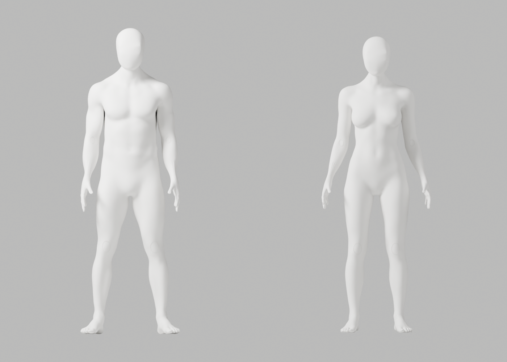
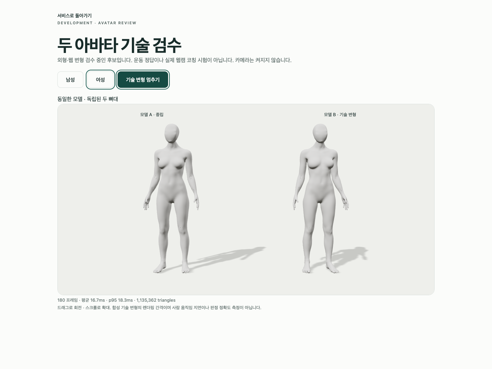
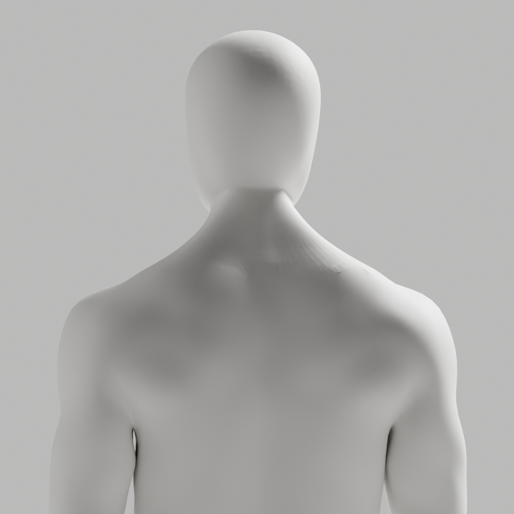

# A93 — 점유 대각선을 피한 뒤 목 연결 수정

**외형 미통과·미채택**이다. 최신 얼굴–앞목 연결과 남녀 통일 백색 표면·자연 곡선·관절을 유지했지만 뒤 목의 거친 면, 전완·손목·웹 마감 P2는 남는다. 개발 A37, 이전 파일·증거, Draft PR #9 미병합과 전체 1~6단계 완료·승인 기준은 그대로다.

## 실제 수정

[A92 진단](../candidate-a92-diagnosis/README.md)의 여성 quad 점유 대각선을 native ALTERNATE로 피하고 진단된 뒤 목 n-gon만 분할·edge 회전했다. 새 body, 머리 교체, smoothing/투영, 좌표 클램프/복구, 가중치·guard 변경은 없다. [최신 CEO 참조](../candidate-a89-review/ceo-reference.png)의 얼굴·머리·앞목 좌표도 보호했다. 흐림/과노출을 목표 품질로 사용하지 않는다.

저장 원본을 독립 재열기해 모든 좌표·named skin·손·각163개의 숫자 rest bones/행렬과 영역 밖 연결/winding의 정확한 보존을 확인했다. 좌표 이동0이다. 삼각분할로 추가된 edge/face는 원래 polygon 크기에서 유도한 남5/여37개이며, 국소 face 교체는 남10→15/여19→56이다. **전체 위상 동일은 아니다.** 국소 긴 접힘49→48/50→47은 제한된 연결 진단이며 외형·임상 정확도나 이전 고정 edge 지표의 개선율이 아니다.

## 실제 검증

| 검사 | 결과 |
|---|---|
| 원본 전체 QA | 121행/118변형·실패0·실제34PNG·최악 ratio2.943930 |
| GLB 재수입 전체 QA | 121행/118변형·실패0·실제34PNG·최악 ratio2.947680 |
| 구조 | 남녀 각163관절·연결 성분1·nonmanifold0·정규화 오류0·통일 백색 |
| 실제 Chrome | 3개 통과·41.436388초·skipped/unexpected/flaky0 |
| 보존 | 89사본/4gzip·실제74PNG·기존 증거 파일 변경0·byte/SHA256 대조 |
| 직접 열람 | 초회4+원본16+재수입16+브라우저2=38. 나머지36 QA PNG는 생성·보존했으나 직접 열람하지 않음 |

macOS15.6/24G84, Mac16,12/M4/16GiB, Chrome154.0.8037.93, headless1440×1080(default DPR1)에서 남녀 각각 독립된 두 복제본·8가중치 메시2개·외부 연결 차단·실제 WebGL loss/retry를 검사했다. 180 RAF는 남 mean16.659ms/여16.662ms·p95각18.300ms다. GPU 처리시간·실제 웹캠 지연이 아니다. 목20° 등 스트레스는 올바른 운동 시범이나 임상·해부학 검증이 아니다.

검사/내보내기 첫 호출은 잘못된 tools/blender 경로로 각각 exit1, 검사/출력0이었다. 종료 확인 후 실제 assets/blender helper로 재실행했다. Chrome 첫 시도는 proxy bind sandbox 거절(exit1)로 실행 전 중단했고 scoped 재실행에서 실제3개를 통과했다. 실패와 검증 통과를 구분한다. 일부 stdout은 잘렸으며 전체 stdout 보존을 주장하지 않는다. exporter 경로 실패는 경로를 줄인 관측 요약임을 표시했다.

새 Python2파일 Ruff와 isolated(default88) format은0이다. 최초 maker format1본을 보존했다. 이후 backend cwd의 line-length100 format 검사는1이며, 실행한 파일은 바꾸지 않고 isolated 재검사0으로 구분했다. backend 문맥까지 전부 통과했다고 주장하지 않는다. copier JS 구문 검사0. 남성 armature-parent 경고5개, NO_COLOR/FORCE_COLOR·THREE.Clock, 의도적 guest401/model503/error boundary·WebGL 정리 경고는 발생했다.

원본142087/139882점 보존과 웹 파생142080/139874점·8가중치 제한은 별개다. 웹 fin repair 남7/여8, weight limiting 남300407/여296607은 실제 실행 로그에 나타났다. 기존 ratio1·1µm/3mm/.1mm·전체 변형ratio3 기준은 그대로다. 필요한 구조를 삭제해 매끈하게 만든 것으로 처리하지 않는다.

실제 사람·카메라·pose 수집/저장/업로드0. 실제 시범/사용자 retarget·웹캠 정확도/통합 지연·계정/API/DB/SMTP/OAuth 회귀·Gmail/Google 연결·전문가 검토·시크릿·운영 migration·배포·출시는 이번에 실행하지 않았다.

## 원본·증거

[별도 원본](../../bodyguard_avatar_candidate_a93_rejected.blend): SHA256 a34bf65ce002306d6a33b16f6c38ce98d0c63a15a59ecdc34c7c27ffc59b0c1c.
[남성 GLB](bodyguard-male-candidate.glb): 12656888bytes/SHA256 27c8873a6033e45df850e223114cde44102ba1e368709f5d0366891d3a949122.
[여성 GLB](bodyguard-female-candidate.glb): 12462936bytes/SHA256 4b308ce4e157de6d0740069a310187329812eccc3c3a2c03224805bf49d0d107.

[실제 수정](native-connectivity.json), [저장 보존](saved-preservation.json), [원본 QA](source-deformation.json), [재수입 QA](roundtrip-deformation.json), [GLB 왕복](glb-roundtrip.json), [실제 Chrome](browser-report.json), [명령·exit·장비·미실행 기록](execution-record.json), [89사본 manifest](copy-manifest.json), [native 경로 실패](native-path-preflight.json), [Chrome 실행 전 실패](browser-sandbox-preflight.json)를 보존한다. native/왕복 JSON의 pending 값은 최초 생성 시점 상태이고 이후 실제 검수는 각각의 QA 보고서에 있다.

실행 maker/checker, maker 초기 format 실패본과 copier를 byte 그대로 gzip 보존했다. 이미 저장소에 있는 review/export/browser helper5개는 수정 없이 재사용하며 실행 기록에 SHA를 남겼다. maker는 SHA8424a1306b91e36b7db024987667ca4068a035bc11fe0abe78357216c34bbe9c인 A91을 입력으로 새 .blend와 preview 경로를 받는다. checker는 A91·새 원본·A92 constrained-dryrun.json·새 JSON 경로를 받는다. 재현은 새 임시 출력에서만 한다.

반복 가능한 읽기 전용 검사:

```sh
node bodyguard/assets/blender/review/candidate-a93-review/evidence-check.cjs
```

scripts/a93-copy-evidence.cjs.txt.gz는 실행한 일회용 사본 도구이며 다시 실행하지 않는다. 다음은 남은 뒤 목 접힘의 국소 연결/형상 수정이다. 머리 교체·투영/강도 반복·좌표 복구·검사 기준 완화로 통과 처리하지 않는다.

## 실제 미리보기






