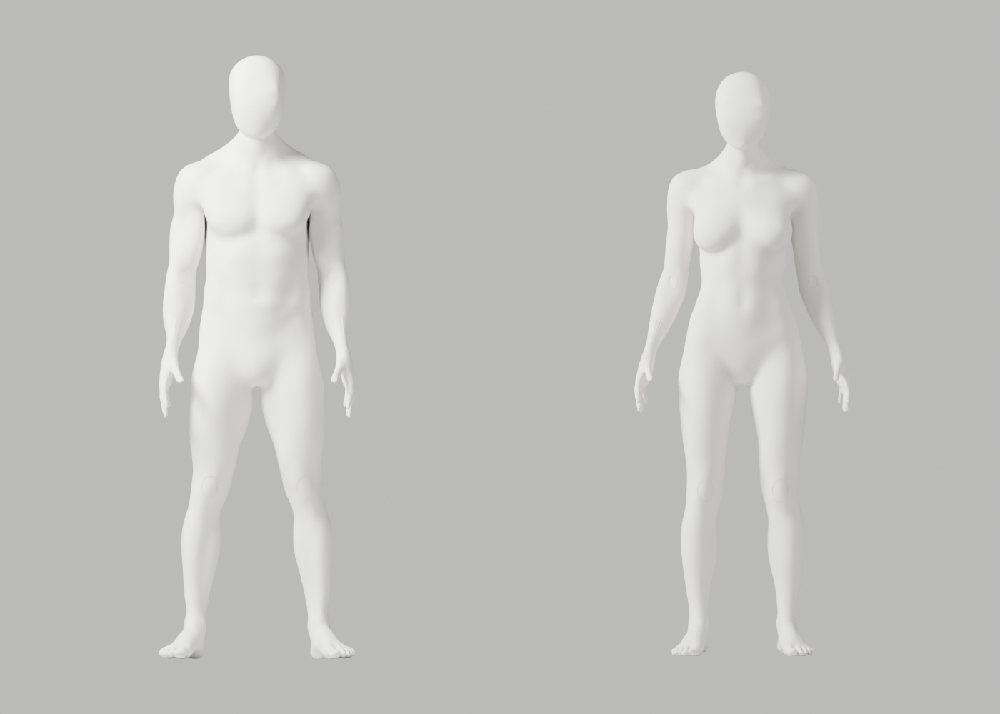
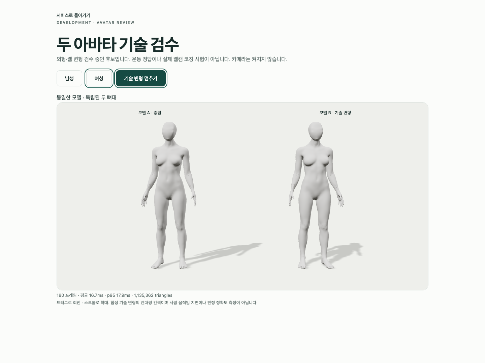
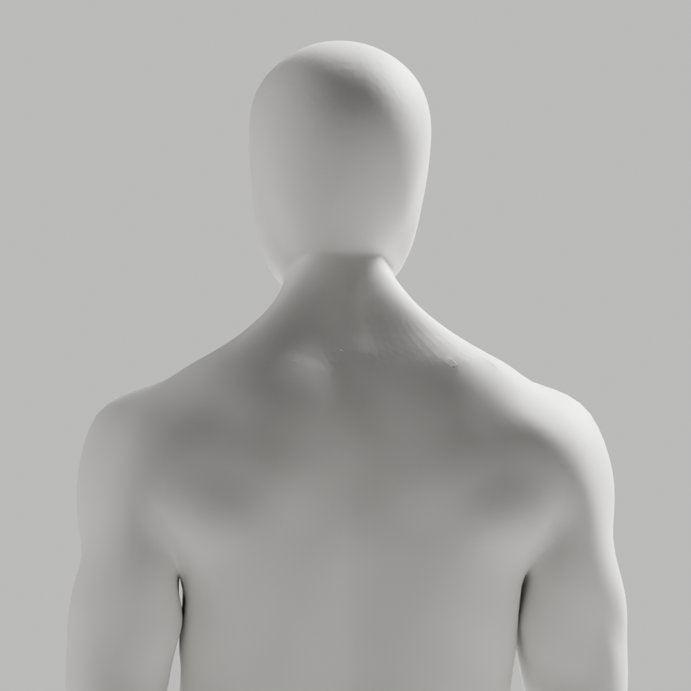

# A94 — 뒤 목 인접 edge 일괄 건너뜀 수정

**외형 미통과·미채택**이다. 최신 참조의 얼굴·머리·앞목과 남녀 공통 백색 표면은 유지했지만 뒤 목의 거친 면, 전완·손목·웹 마감 P2는 남는다. 개발 A37·이전 원본/증거·Draft PR #9 미병합·전체1~6단계 완료/승인 기준은 그대로다.

## 수정과 실제 검증

[A93](../candidate-a93-review/README.md)의 같은47개 edge를 Blender native bulk/single로 메모리 대조했다. 인접 면을 공유하는 bulk는 남2/여0개만 회전했고 single은 각45개였다. 이를 별도 저장 원본에 한 번 반영했다. 국소 긴 접힘48→26/47→24는 **연결 진단**이지 외형/임상/해부학 개선율이 아니다. 머리 교체·새 body·좌표 smoothing/투영/복구·가중치/guard 변경은 없다.

저장 재열기 독립 검사에서 모든 좌표·named skin·손·각163개 숫자 rest bones/행렬·정점/edge/face 수·영역 밖 연결/winding 정확 보존, 이동0을 확인했다. 남77/여79개 국소 면만 교체했으며 전체 위상 동일은 아니다.

| 실제 검사 | 결과 |
|---|---|
| 원본 전체 QA | 121행/118변형·실패0·34PNG·최악 ratio2.943930 |
| GLB 재수입 전체 QA | 121행/118변형·실패0·34PNG·최악 ratio2.947680 |
| 구조 | 각163관절·연결 성분1·nonmanifold0·정규화 오류0·무의상 통일 백색 |
| 실제 Chrome | 3개 통과·42.013291초·skipped/unexpected/flaky0 |
| 보존 | 89사본/4gzip·실제74PNG·기존 증거 변경0·byte/SHA 대조 |
| 직접 열람 | 초회4+원본10+재수입10+Chrome2=26. 나머지48 QA PNG는 생성·보존했으나 직접 열람하지 않음 |

macOS15.6/24G84, Mac16,12/M4/16GiB, Chrome154.0.8037.93, headless1440×1080(default DPR1). 독립 두 복제본·8가중치 메시2개·외부 연결 차단·WebGL loss/retry를 실제 검사했다. 180 RAF 남mean16.664ms/p9518.100ms·여mean16.663ms/p9517.900ms다. **GPU 처리시간·실제 웹캠 통합 지연이 아니다.** 목20° 등 스트레스는 올바른 운동 예시/임상 검증이 아니다.

웹 파생 fin repair 남6/여8·weight limiting 남300407/여296607은 실제 실행했다. 원본142087/139882점 보존과 웹142081/139874점·8가중치 파생 처리는 별개다. 기존 ratio1·1µm/3mm/.1mm·변형ratio3 기준은 낮추지 않았다. 필요한 구조를 삭제해 매끈하게 만든 것으로 처리하지 않는다.

Chrome 첫 호출은 proxy bind sandbox 거절(exit1)로 실행 전 중단했고 scoped 재실행에서 통과했다. 최초 Ruff는 공백 경로 executable 인용 누락으로127이며 검사 실행0이다. 수정 호출 Ruff3파일·isolated/default88 format3파일0, copier/auditor 구문0이다. backend/100-column format을 모두 통과했다고 주장하지 않는다. 읽기 전용 browser JSON parser 첫 구문1/수정0도 구분한다. exporter 남성 armature-parent 경고5와 NO_COLOR/FORCE_COLOR·THREE.Clock·의도적 guest401/model503/error boundary/WebGL 정리 경고가 발생했다. 전체 stdout 보존을 주장하지 않는다.

[원본](../../bodyguard_avatar_candidate_a94_rejected.blend): 29751004bytes/SHA256 939b8f55d894fbb5f4d0a2e5023a7eb87a6b5a51c21780f5ffa1c706392acbae.
[남성 GLB](bodyguard-male-candidate.glb): 12656976bytes/SHA256 6bd222341a622f10a68e766f6f5810d78806797367a88fcfe104b842338bfac9.
[여성 GLB](bodyguard-female-candidate.glb): 12462936bytes/SHA256 c0de001ccba534c730f8e1a9870f883222ae5b901d54bb2351959f9f4935bd23.

[bulk/single 진단](bulk-single-diagnosis.json), [native 수정](native-connectivity.json), [저장 보존](saved-preservation.json), [원본 QA](source-deformation.json), [재수입 QA](roundtrip-deformation.json), [왕복](glb-roundtrip.json), [Chrome](browser-report.json), [사본 manifest](copy-manifest.json), [명령/exit/장비/미실행](execution-record.json), [Chrome 실행 전 실패](browser-sandbox-preflight.json)를 보존한다. 최초 native/왕복 JSON pending은 생성 시점 상태이며 이후 실제 QA는 별도 보고서에 있다.

실행 diagnosis/maker·재사용 A91 숫자 동결 checker·copier를 gzip4로 보존했다. 공유 review/export/browser helper5개는 byte 그대로 재사용했다. 진단/maker 입력은 A93 SHAa34bf65ce002306d6a33b16f6c38ce98d0c63a15a59ecdc34c7c27ffc59b0c1c이며 checker는 A93/새 원본/새 JSON 경로를 받는다. 재현은 새 임시 출력에서만 한다. 이미 실행한 일회용 copier는 재실행하지 않는다. 반복 가능한 읽기 전용 검사는 다음과 같다.

```sh
node bodyguard/assets/blender/review/candidate-a94-review/evidence-check.cjs
```

실제 사람·웹캠·pose 수집/저장/업로드0. 실제 운동 시범/user retarget·웹캠 정확도/통합 지연·계정/API/DB/SMTP/OAuth 회귀·Gmail/Google 연결·전문가 검토·시크릿·운영 migration·배포·출시는 이번에 미실행이다. 다음은 남은 뒤 목 연결과 웹 표면 결함을 원인별로 확인하는 작업이다. 동일 head graft·투영 강도 반복·좌표 복구·guard 완화로 통과하지 않는다.

## 실제 미리보기






