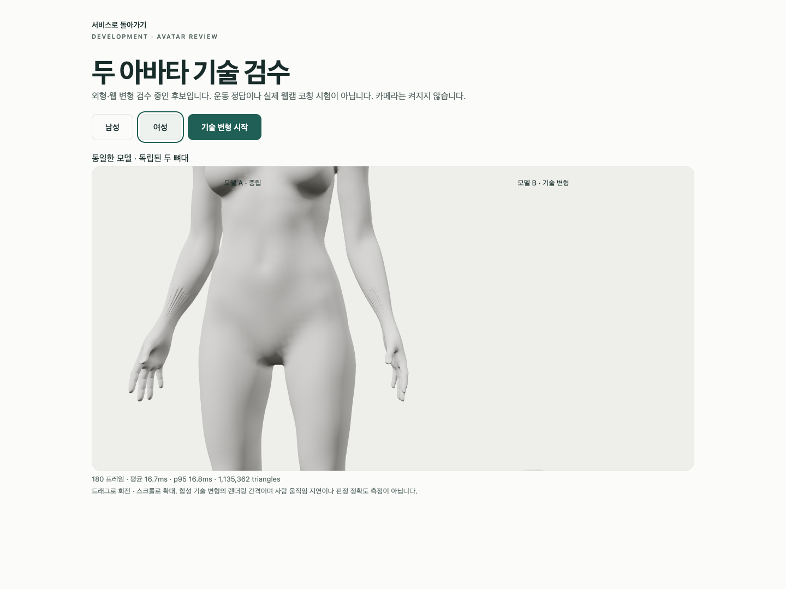

# A95 — 웹 전완 표면 결함 원인 분리

**새 아바타 제작·외형 통과가 아닌 읽기 전용 진단**이다. A94의 줄무늬 결함은 관절 경계 메시를 숨겨도 남았다. 실제 신체 메시의 receiveShadow=false를 확인했으므로 자기 그림자 원인도 배제한다. 경계 삭제·그림자 설정 변경으로 고치지 않는다. 정확한 신체 geometry/내보낸 법선/중립 skin 원인은 아직 확정하지 않았다.

## 실제 실행과 보존

설치 Chrome의 기존 세 검사에 임시 authored-model 비교 하나를 추가해 두 번 실행했다. 남녀 각각 baseline/body-only × 전신/전완 확대를 비교했고 신체 메시2개/경계8개·배열 hash 완전 동일·body-only 가시 메시2개·사용자 카메라 요청0을 실제 검사했다. 확대는 전완/체간 진단 구도이며 얼굴 참조/사용자 촬영 구도를 변경한 것이 아니다. 후보의 모든 경계와 기존 코드는 유지하며 임시 숨김 상태를 채택하지 않았다.

| 실행 | 실제 결과 |
|---|---|
| 첫 Chrome | 4개 통과·52.290908초·errors/skipped/unexpected/flaky0 |
| 타입 수정 후 Chrome | 4개 통과·52.829793초·errors/skipped/unexpected/flaky0 |
| native 원본/재수입 진단 | exit0·입력 SHA 불변·저장/좌표 변경0 |
| 증거 | 30사본/7gzip·20실제PNG·직접열람14/20 |
| 코드 복원 | 임시 client/test 제거 후 원래 3-test spec의 SHA 불변·typecheck exit0 |

첫 진단의 Biome는 formatting으로 exit1→수정/check0이었다. 첫 typecheck는 controls/BufferSource/row 추론의 TypeScript6오류로 exit2였다. 타입만 수정한 뒤 typecheck0와 **새 Chrome4개를 재실행**했다. 실행 전·수정 후 전체 spec/client를 따로 gzip 보존했다. native Ruff와 isolated88 format check는0이었다. JSON 본문 parser의 과다 출력은 진단 데이터 읽기이며 새 검사를 수행한 것이 아니다. Chrome의 의도적 model503/error boundary/WebGL 정리·NO_COLOR/FORCE_COLOR·THREE.Clock 경고는 실패와 구분하며 전체 stdout 보존을 주장하지 않는다.

macOS15.6/24G84·Mac16,12/M4/16GiB·Chrome154.0.8037.93·headless1440×1080/DPR1이다. 두 번째180 RAF 남mean16.667/p9518.300ms·여mean16.663/p9518.300ms는 렌더 간격이지 GPU 시간/실제 웹캠 통합 지연이 아니다. 외부 차단 프록시·설치된 R3F _roots/test 전용 scene 접근을 재사용했고 새 패키지·production UI 변경은 없다.

원본/재수입의 전완 선택은 lowerarm/wrist 가중치 합>0.5의 authored vertices다. 모든 선택 면은 smooth이며 flat0이다. 좁은 면 남217/여220→web471/489, 5mm 초과·1rad 초과 edge 남133/여123→web136/136을 확인했다. 원본 quad와 web triangle 수는 직접 개선율로 비교할 수 없고 기술 geometry 진단 임계값이지 사용자/임상 기준이 아니다. BMesh 계산 법선은 실제 WebGL normal/GPU 동등성 증거가 아니다.

[실행/exit/장비/미실행](execution-record.json), [첫 Chrome](first-browser.json), [수정 후 Chrome](corrected-browser.json), [native 진단](forearm-diagnosis.json), [byte/SHA 사본](copy-manifest.json)을 보존한다. A94 원본·남녀GLB와 공유 helper/spec/config 등8개 SHA는 그대로이며 새로운 blend/GLB/전체118변형 QA는0이다. A94 이전 검증을 이번 실행으로 소급하지 않는다.

원본 진단 스크립트와 실행 전/타입 수정 후 spec/client, 첫 Chrome 보존 및 copier를 gzip7로 보존했다. replay는 새로운 임시 출력에서만 수행하며 일회용 copier는 재실행하지 않는다. 저장소 root에서 반복 가능한 읽기 전용 검사는 다음과 같다.

```sh
node bodyguard/assets/blender/review/candidate-a95-diagnosis/evidence-check.cjs
```

다음은 중립 CPU/GPU skin과 authored 원본/GLB 법선을 대조한 뒤 원인이 확인된 국소 표면만 수정하는 작업이다. 눈대중 smoothing·전체 remesh·overlay 제거·guard 완화·좌표 복구로 완료하지 않는다. 최신 얼굴/목 참조·무의상 남녀 통일 백색·자연 곡선/관절/리깅 정확도·기존 파일/검수 증거·개발 A37은 유지한다.

실제 사람/웹캠/좌표 수집·저장·업로드0, 실제 시범/retarget/임상/통합 지연·계정/API/DB/SMTP/OAuth 회귀·Gmail/Google·전문가 검토·시크릿·운영 migration·배포·출시는 미실행이다. 외형 P2·Draft PR #9 미병합·1~6단계/승인 기준은 유지한다.

## 실제 비교 미리보기



