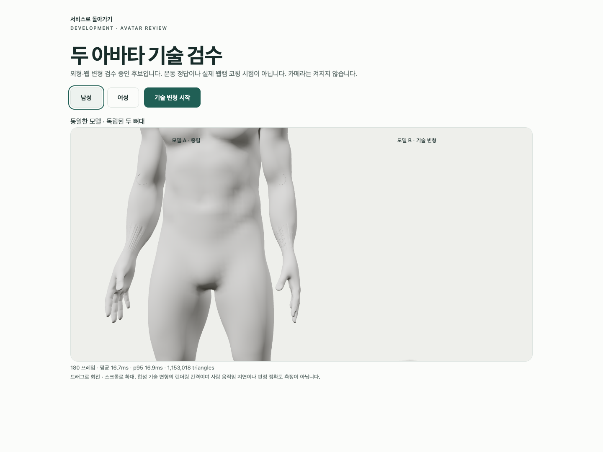

# A96 — 중립 skin과 좌표 공간 대조

**새 아바타/외형 통과가 아닌 원인 분리**다. 같은 A94 GLB를 실제 GPU skin과 같은 geometry/material의 unskinned Mesh로 비교했다. 남녀 전완 줄무늬는 스키닝을 거치지 않아도 남았다. 중립 skin만이 결함의 단독 원인은 아니며, A95의 경계/자기 그림자 배제와 함께 신체 표면 연결을 국소 수정할 근거가 된다. 정확한 손상 연결은 아직 확정하지 않았다.

## 실패와 별도 측정

첫 Chrome은 기존3검사 통과·새 local identity 가정1실패(exit1/47.258613초)였다. 원시 정점과 mesh-local skin 위치가 같다는 예상1e-5m에서 남44.498158mm가 나왔다. 실패 JSON·실행 코드·오류 context를 보존하며 이를 통과로 바꾸지 않았다. 실패한 검사 끝의 카메라 요청0 assertion은 도달하지 않았다. 요청 차단 fixture는 계속 적용됐다.

새 측정 프로토콜은 상한을 높이는 대신 **기존 동일한 asset의 좌표/법선/행렬/실제 화면을 기록**했다. 실제 Chrome4개53.239761초·unexpected/skipped/flaky0·pageerror/console-error0·카메라 요청0을 확인했다. 이 PASS는 측정 실행 성공이지 local identity/외형 PASS가 아니다. 실제8PNG 전부 직접 열람했고, GPU/원시 표면 남녀 대조4컷에도 줄무늬가 남았다. 원시 표면 비교는 배율이 달라 exact-pixel/형상 동등성 증거로 쓰지 않는다.

| 관찰 | 남성 | 여성 |
|---|---|---|
| mesh-local 위치 최대 차이 | 44.498158mm | 47.614698mm |
| normal 방향 최대 차이 | 5.327e-7rad | 5.373e-7rad |
| mesh world uniform scale | 0.974273384 | 1.029914141 |
| world × skin 행렬의 identity 계수 최대 차이 | 1.022e-6 | 1.846e-6 |

위 위치 차이는 **raw/local/world 공간과 리그 배율을 섞어 비교한 진단 가정의 문제**다. world × skin은 배율을 상쇄한다. 행렬 계수 차이는 vertex 위치 오차/GPU readback/실제 사용자 정확도 수치가 아니다. 무조건 bind를 바꾸거나 모델 배율/임계값을 수정하지 않았다.

native Blender5.1.1에서 원본→웹 파생→재수입의 raw/evaluated 위치·배율을 읽기 전용 대조했다(exit0/6행). 각 단계 전체 최대 차이는 3.535/0.360µm, 3.535/0.361µm, 3.835/0.967µm이고 pose constraints0였다. 재수입의 pose basis163개는 importer 좌표 표현이며 인체 오류로 해석하지 않는다. 입력3개 SHA 불변·저장/좌표 변경0이다.

처음 typecheck는 동적 import/row 추론2오류·exit2였다. 수정 후 typecheck0, 측정용 변경 후0, 임시 spec/client를 제거해 기존 코드를 복원한 뒤0를 실제 확인했다. 첫 Biome formatting0/정보3개→수정/check0, native Ruff/isolated88 format check0·copier 구문0이다. 읽기 전용 inline JSON parser의 첫 구문1/수정0도 구분한다. 의도적 model503/error boundary/WebGL 정리·NO_COLOR/FORCE_COLOR·THREE.Clock 경고는 남겼으며 전체 stdout 보존을 주장하지 않는다.

설치 Chrome154.0.8037.93·macOS15.6/24G84·Mac16,12/M4/16GiB·headless1440×1080/DPR1·차단 프록시 조건이다. source/GLB/helper/spec8개 SHA와 개발 A37은 그대로다. R3F _roots/기존 Three Mesh/Matrix4를 test 전용으로 사용했고 새 패키지/production UI 변경은 없다. 임시 진단2파일은 복원·제거했으며 두 실행 버전과 native/copier gzip6로 복구/재현할 수 있다.

생성된 실패 context의 trailing whitespace3행으로 첫 staged diff 검사 exit2가 발생했다. 내용을 삭제/정리하지 않고 byte가 같은 원문을 lossless gzip1개로 보존했으며 원래 임시 사본도 유지했다. gzip 생성 뒤 메타데이터 patch 조립의 ReferenceError로 중단됐고 당시 patch는 미실행이었다. 재개 후 압축 내용/SHA를 확인해 기록을 정합화했다. copier나 기존 검사를 재실행한 것으로 표시하지 않는다.

[첫 실패](first-browser.json), [별도 측정](measurement-browser.json), [native](native-neutral.json), [명령/exit/해시/미실행](execution-record.json), [18사본/7gzip·byte/SHA](copy-manifest.json)을 보존한다. 이미 실행한 일회용 copier는 재실행하지 않으며 replay는 새 임시 출력에서만 한다. 반복 가능한 읽기 전용 검사는 다음과 같다.

```sh
node bodyguard/assets/blender/review/candidate-a96-diagnosis/evidence-check.cjs
```

새blend/GLB/전체118변형 QA0, 실제 사람/웹캠/좌표 수집·저장·업로드0, GPU 수치 readback·실제 운동/retarget/임상·통합 지연·계정/API/DB/메일/OAuth 회귀·외부 연결·운영 migration·시크릿·배포·출시는 미실행이다. 최신 얼굴/앞목·무의상 통일 백색·자연 곡선/관절·필요한 구조·리깅 정확도·기존 원본/증거를 보존한다. 뒤 목/전완/손목 외형 P2·Draft PR #9 미병합·1~6단계/승인 기준은 유지한다. 다음은 진단된 전완 연결의 native 국소 대조/수정이며 전체 smoothing/해부 구조 삭제/guard 완화가 아니다.

## 실제 웹 비교



