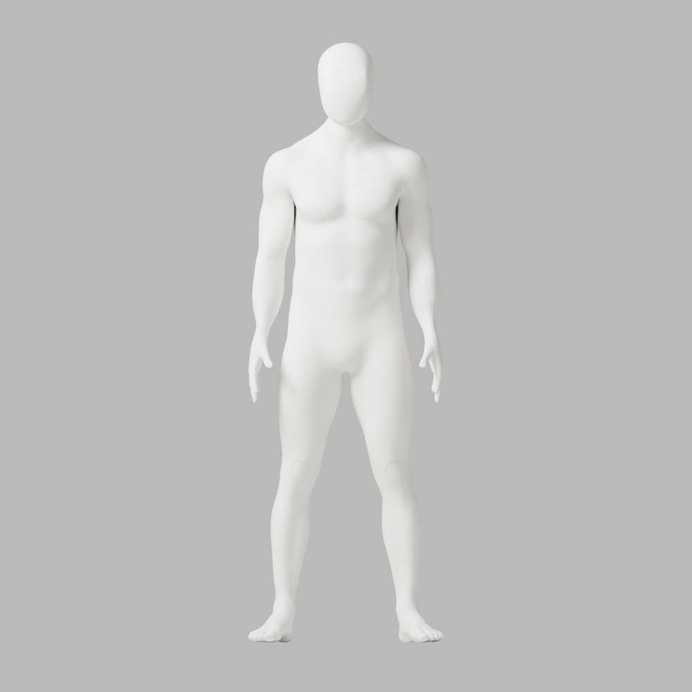
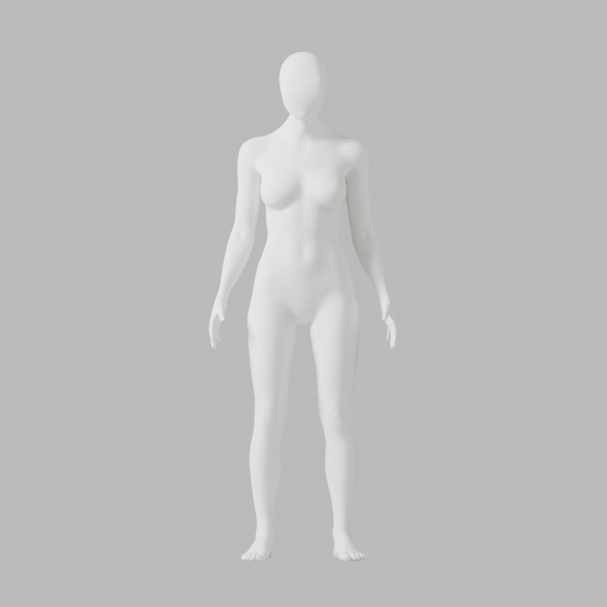
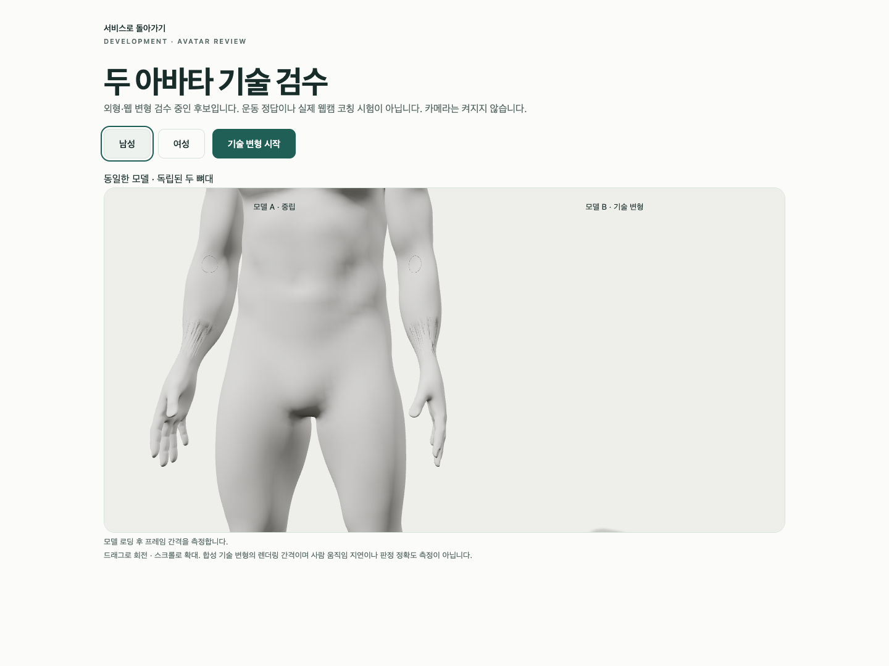
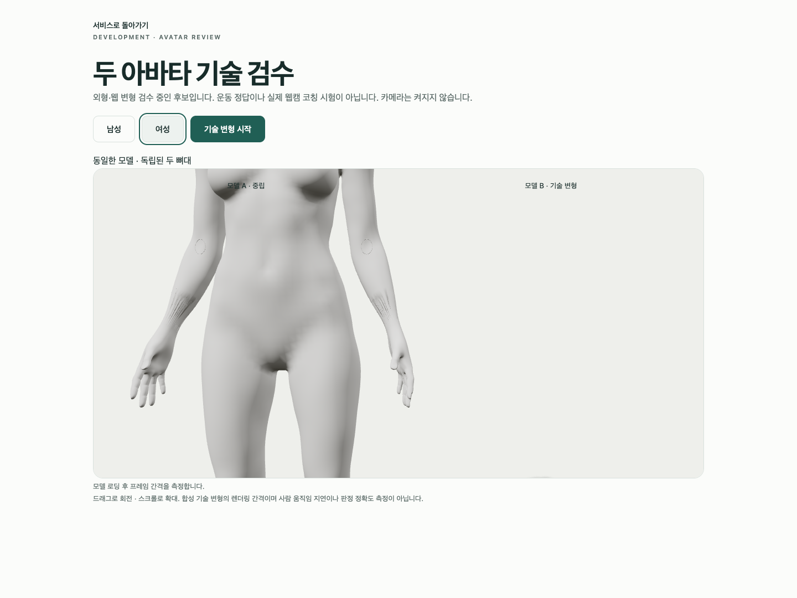

# A97 — 손목 연결 면 국소 정제 / 외형 미승인

2026-10-03 KST. 최신 사진의 매끈한 얼굴–목–어깨, 여성 무의상, 남녀 같은 백색 마감을 유지한 **별도 후보**다. A94의 손목 연결 면만 native 삼각분할·연결 정제했다. 정면은 참조와 대조했지만 손목 잔줄무늬와 뒤 목 마감은 미달이다. **외형 통과·제품 채택·PR #9 병합·1~6단계 완료가 아니다.** 개발 화면은 A37 그대로다.

## 실제 제작·검증

읽기 전용 조사에서 긴 접힘/좁은 면이 기존 wrist bridge[-80,+9]mm 안에 있고 보호 손에 닿지 않음을 확인했다. native `triangulate(BEAUTY)`·내부 삼각형 `beautify_fill(AREA)`만 대조·적용했다. 전체 smoothing/remesh·신체 좌표 이동·가중치/뼈 변경·overlay 숨김·새 패키지는 없다. 이전/새 저장 파일을 독립 재열기해 모든 좌표·named skin·손·각163개 숫자 rest bones/행렬·영역 밖 면/winding이 정확히 같음을 확인했다.

| 실제 검사 | 결과 |
|---|---|
| 독립 저장 대조 | 남142087/여139882점, 이동0, 보호 구조 정확 보존 |
| 국소 연결 변경 | 남1656/여1632 edge·face 추가. 전체 위상 동일 아님 |
| 국소 긴 접힘 수 | 남133→80, 여123→47. 연결이 바뀐 진단값이며 고정 edge/인체 정확도/외형 통과 아님 |
| 원본 전체 변형 | 118개·121행 / 실패0, 실제34PNG, 최대 비율2.943930 |
| GLB 재수입 전체 변형 | 118개·121행 / 실패0, 실제34PNG, 최대 비율2.947680 |
| 실제 설치 Chrome | 4통과 / 46.324818초, 실패·skip·flaky0, 웹캠 요청0 assertion |
| 보존 | 이전8파일 SHA 불변, 새blend1/GLB2, 93사본/7gzip·76PNG / 직접열람20 |

원본/재수입 남녀 연결 성분1·non-manifold0·가중치 오류0·무의상/통일 마감, 기존 비율3 guard/검사 helper 불변이다. 국소 triangulate 때 좁은 면 남467/여488→beautify 뒤212/231이지만 이전 quad217/220과 같은 면 집합이 아니므로 이를 외형 개선률로 쓰지 않는다. 정확한 bridge 경계 대응/근접 점의 결함 발생 원인은 아직 확정하지 않았다.

GLB 각각5mesh/163bones·8영향점 skin, animation/image0이다. exporter의 historical `geometry_deformation_pending:true`는 그 시점 기록이며 뒤의 별도118개 실제 QA가 이를 검증했다. 원본·GLB를 이전 파일에 덮어쓰지 않았다.

Chrome154.0.8037.93·macOS15.6/24G84·headless1440×1080/DPR1·차단 프록시다. Mac16,12/M4/16GiB는 A94 실제 측정을 재사용했다. 기존 독립 아바타/기술 회전·오류 복구3검사와 임시 camera-only 확대1검사를 실행했다. 확대에서 기존10 SkinnedMesh 전부를 표시하고 geometry/material/skin/overlay는 바꾸지 않았다. 기존 성능 표본 각180 RAF/남p95 17.5ms·여17ms는 GPU 시간이나 실제 웹캠 통합 지연이 아니다. 확대 화면의 “측정 중”은 180표본 측정 완료가 아니다.

## 실패·복원·미실행

첫 localization Ruff는 E501 6건/exit1→format/검사0였다. memory-only 진단의 B023 1건/exit1은 역사 코드에 보존한다. 후보 producer는 loop binding을 명시했고 producer/독립 검사/localization3개 Ruff·isolated88 format0을 실제 확인했다. patch builder의 `script.index` TypeError는 apply_patch 전에 발생했으며 수정 뒤 생성했다. 잘못된 cwd의 읽기/해시 exit1·Ruff 경로127은 검사 미실행이며 올바른 위치의 실제 검사0과 구분한다.

임시 spec/client는 Biome0·typecheck0 이후 Chrome을 실행했다. listener 추가 후 typecheck0, 아카이브 후 임시34행/client를 복원·제거한 뒤 typecheck0(session36518)을 실제 확인했다. 기존 spec SHA는 정확히 같다. 첫 evidence-check는 README 작성 전 마지막 링크 확인의 ENOENT/exit1이었다. 메타데이터의 불완전 재현 명령 args를 보완했고 중복 delete/add patch는 쓰기 전에 거절됐다. 후보 변형/Chrome 실패를 통과로 바꾼 것이 아니다. 의도적 model503/error boundary/WebGL 정리·NO_COLOR/FORCE_COLOR·THREE.Clock·native armature-parent 경고는 보존하며 전체 stdout 아카이브를 주장하지 않는다.

실제 사람 촬영/좌표 수집·저장·업로드0. 실제 시범/리타게팅/임상/웹캠 통합 정확도·지연·GPU timer·계정/API/DB/메일/OAuth 회귀·외부 계정/시크릿/운영 migration/배포/출시는 미실행이다. 76PNG 모두를 직접 열람했다고 표시하지 않는다. 다음은 bridge 경계 대응·근접 점/좁은 면의 원인 조사 후 국소 수정이며 맹목적 smoothing/강도 반복이 아니다. 필요한 신체 구조·관절·리깅 정확도, 이전 파일/증거, A-02/A-08 외형 P2·Draft PR #9 미병합·전체1~6단계/승인 기준을 유지한다.

[별도 원본](../../bodyguard_avatar_candidate_a97_unapproved.blend), [독립 보존](saved-preservation.json), [국소 진단](localization.json), [실제 연결 정제](native-connectivity.json), [원본118개](source-deformation.json), [재수입118개](roundtrip-deformation.json), [실제 Chrome](browser-report.json), [명령/exit/해시/미실행](execution-record.json), [93사본/byte/SHA](copy-manifest.json)을 보존했다. exclusive copier는 재실행하지 않으며 새 임시 출력에서만 replay한다.

```sh
node bodyguard/assets/blender/review/candidate-a97-review/evidence-check.cjs
```

## 실제 미리보기 — 완성품 아님








