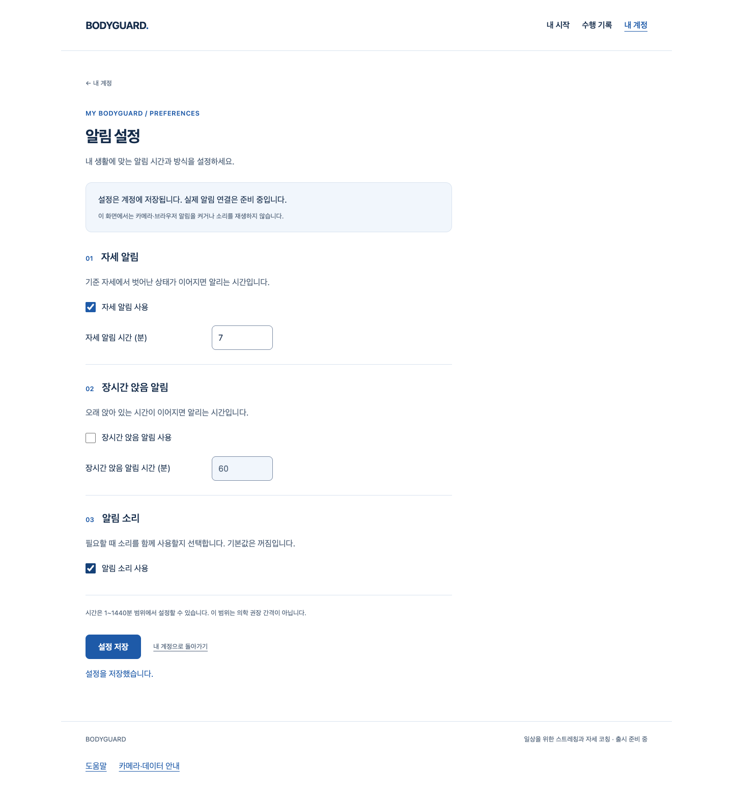

# 본인 기준선 API — S4.13 검증 기록

현재 기준선 저장·교체와 본인 과거 조회가 동작한다. 새 보정은 이전 기준선을 삭제하지 않고, 같은 과거 요청을 재전송해도 현재 기준선으로 되돌리지 않는다. 기준선이 없으면 null이며 서버가 신체 상태나 기본값을 추측하지 않는다. 값은 client-reported이다.

## 실제 실행과 한계

실제 FastAPI/ASGI·소유 PostgreSQL18·인증 쿠키/CSRF·독립 SQL 잠금·migration을 실행한다. 계정·메일·시각·기준선 값은 합성이다. HTTP TestClient의 HTTPS base URL은 실제 TLS/배포 증거가 아니다. native backup 시험은 새 소유 source/target DB의 실제 API 저장·pg_dump/pg_restore·현재/과거 기준선 조회·타인404·제약 보존·실패 시 정리를 확인한다. 기존 snapshot 이후 삭제·로그아웃·비밀번호 변경이 restore로 재생되는 위험은 그대로 관찰됐고 운영 복구 승인은 false다.

웹은 기존 화이트·블루 디자인/라우트를 바꾸지 않는다. 공개 웹 Chrome 회귀의 가입/탐색 상태와 합성 RAF 시험은 실제 카메라·사람의 정자세·보정 정확성·아바타 검증이 아니다. 이번 API 저장을 공개 측정 기능의 완성으로 표시하지 않는다. 지정 web-design-studio의 기존 계약을 유지하고 새 UI/Figma/axe 또는 디자인 개편을 주장하지 않는다.

## 실패·리뷰 이력

- 최초 B01은 미구현 `/baselines/active`의 실제404로 실패했다. collection-only 실패가 아니다.
- 초기 기준선36·경쟁8/독립 backup5 및 전체365 API, frontend558·공개8 회귀가 통과했다.
- 독립 읽기 전용 리뷰에서 상세404/재시도200/충돌409가 OpenAPI에서 빠진 P2를 발견했다. 별도 red는 실제 schema의200 KeyError였고 새 route 응답 모델·타입 재생성으로 보완한다. 기존 기록 route는 범위 밖으로 보존한다.
- 설치 offline cache 부족·초기 lint/format·기계적 patch 오류는 성공으로 바꾸지 않는다. 원본 결과와 후속 보완 결과를 구분한다. 제품 테스트의 실패와 도구/환경 실패도 구분한다.

최종 기준선/경쟁48건·전체369 API(107.87초), frontend558·공개8·타입/Biome/Ruff/format/mypy/build를 통과했다. 별도 실제 native 복구의 aggregate도 baseline_history_and_owner_restored·owned_servers_stopped=true이며 운영 restore 승인=false/기존 replay 위험 관찰=true다. 보완 과정의 test 함수 배치 오류는1실패/368통과였으며 원본을 보존하고 수정 후 다시 전체를 검증했다. [artifacts.json](artifacts.json)은 실제 소스18개/출력36개를 SHA로 연결한다. 수집기 재실행2회는 원본 동일성을 검사하고 덮어쓰지 않았다.

독립 리뷰는 **읽기 전용 소스 검토**이며 테스트 실행0이다. OpenAPI P2/실제 timeout 증거 공백 보완 후 미해결 scoped P1/P2 없음. 작성자도 owner/CSRF·대기 재확인·교체 불변성/rollback·DB 제약·native restore·OpenAPI/생성 타입을 재검토했다. 최신 main 통합과 PR46 조건부 병합은 아래 실제 결과로 확인했다. 체크 없음은 CI 통과로 표시하지 않는다.

## 최신 main 통합 / 실제 웹 흐름

PR45의 알림 설정 웹이maincc9870b에 병합돼 로컬 merge87b8966으로 통합했다(원본커밋7b32108 보존). baseline/API/생성 타입 source18은 기존 SHA와 동일하다. 통합본에서 전체369 API(108.72초)·590 frontend·타입/정적/build/guard·공개8·알림 설정 production Chrome4(11.1초)를 실제 재실행했다. 본인 설정 저장·새로고침, 수락 뒤 응답 단절/명시 재조회, A 폼에서 B 쿠키의 old-proof403·A 값 보존, loading/입력 오류/키보드·920px·CSS확대가 통과했다. 실제 알림/소리/운동·카메라·SMTP/TLS 검증은 아니다.

[통합 manifest](artifacts-v2.json)는 추가15개 실제 출력/PNG·source18 SHA를 연결한다. 수집기 재실행도 동일했다. UI는 PR45의 기여이며 이번 기준선 API가 새 화면을 만들거나 디자인을 바꾸었다고 주장하지 않는다. 기준선 화면은 아직 연결하지 않았다. 기존 white/blue 디자인·입력/오류/저장 흐름을 실제 브라우저로 확인한 결과다. Figma/axe/추가 외부 디자인 감사는 없다.

## 실제 병합 / 소스 보존

[PR46](https://github.com/HSU-OAS/bodyguard/pull/46) · source8df7c8e8bbe9b4094d5e0e4738a276d2ee4b1fcd · merge4b1c8f2652166de5daab3be183b145952380fc1c · 2026-10-05T18:59:15Z. 실제 merge 부모는cc9870b2ea5cf0b4fba4203cccebd682cad87dc3/8df7c8e8bbe9b4094d5e0e4738a276d2ee4b1fcd다. 원격main 포함·기존 브랜치 보존·clean을 확인했다.

병합 직전 최신 main/HEAD·CLEAN/MERGEABLE·체크 없음·GitHub 외부 리뷰0을 다시 읽었다. 변경75파일의 원격 old/new Git blob과 로컬 diff 본문/좌표, source18·초기36/통합15 증거 SHA와 git diff --check가 일치했다. index 표시용 약어/hunk 함수 라벨만 정규화하고 전체 blob은 별도 확인했다. [검토 기록](https://github.com/HSU-OAS/bodyguard/pull/46#issuecomment-6001085382)은 작성자 기록이며 외부 전문가 승인으로 표시하지 않는다.

병합 결과 문서 정리는 제품 코드·기존 manifest·실패/통과 원본·PNG를 변경하지 않는다. 이 문서 정리에서 API/웹/카메라 시험을 새로 실행했다고 세지 않는다. 실제 보정·신체 정확성·아바타·전체 출시 게이트 및 운영 승인 경계는 그대로다.

## 남은 일

실제 3초 보정/지표·classifier·public producer, 두 아바타/단계2 이월, 1분 요약 업로드·대시보드/알림·PDF/LLM/변화 탐지, 실제 참여자/노트북 실측·SDK 개인정보 P2·공급자/운영/라이선스/법무·전체1–6 완료 기준은 그대로 남아 있다. 이번 원본/이력 보존은 새로운 보관 정책이나 공개 출시 승인이 아니다.

[Story](../../stories/account-baselines-api.md) · [재현 가능한 실제 결과 수집기](collect-proof.mjs)
