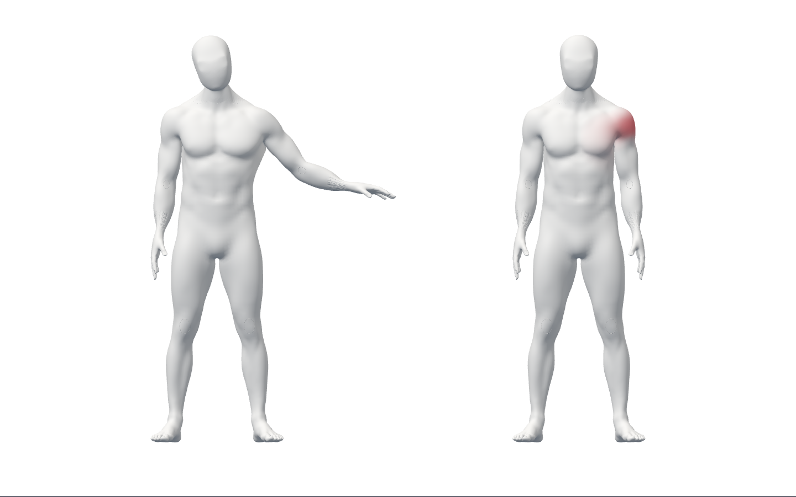
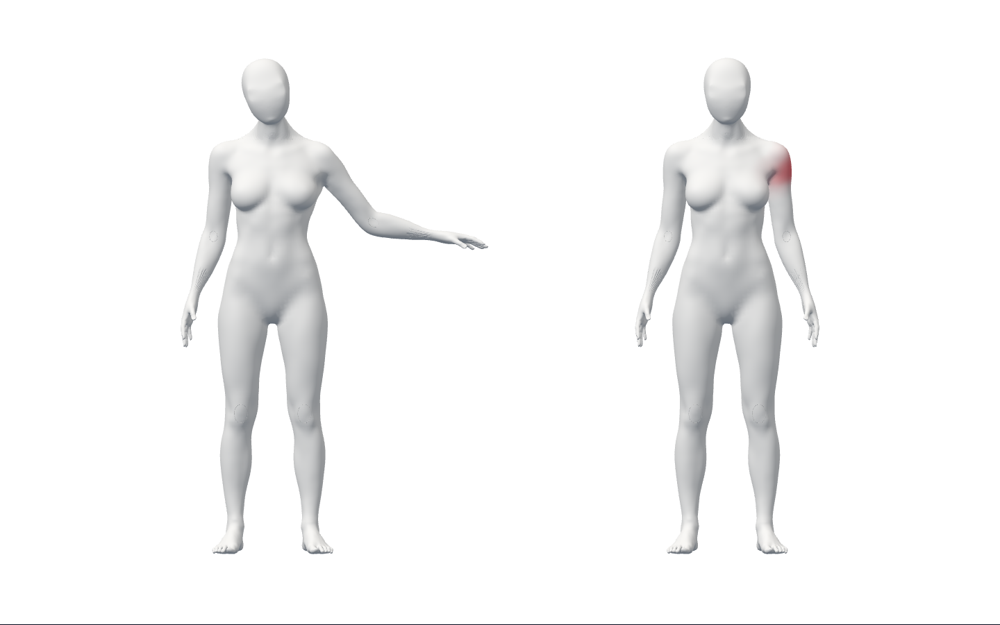

# S2.T21 — 현재 오류에 대응하는 시범 전환

같은 부위라도 오류 코드가 다르면 저작된 다른 시범을 선택한다. 현재 관찰의
원래 시각·세대·수행 단계에 묶이며 가림/만료에는 이전 안내를 중단한다.
**비공개 기술 연결이며 실제 자세 판정·올바른 스트레칭·최종 외형/웹의 승인이 아니다.**

## 실제 화면과 흐름

runtime **3c8ce1a8b0a78276d81b6d56ae0307892fafe001**의 실제 Chrome/WebGL이다.
왼쪽은 기존 Blender 메모리 제작 clip fixture, 오른쪽은 합성 관찰/오류다.
실제 SDK는 가짜 카메라에서 body/face/hand 양성0이었다. 양성 시험에서만
REST bone 기반 생성 body 배열과 오류 코드를 JS 반환에 주입했다.
A37의 얼굴/목·전완·표면·변형은 미완성이고 공개 UI/최종 외형이 아니다.

- 실제 로그인/API/새 격리 SQL→native 준비→두 모델→동일 부위 첫 오류의 중립
  시범→다른 코드의 팔 동작 시범→가림 해제→pause/모델0·track 종료를 확인했다.
  [첫 코드 남성](preview/male-raised.png)·[첫 코드 여성](preview/female-raised.png).
- fixture의 intended id는 실제 driver 선택의 증거가 아니다. 실제 시범 bone과
  목표 clip 끝 quaternion 오차를 별도로 검사했다. 두 코드 모두 남녀 <2e-6
  radians이며 현재 오류 강조가 유지됐다. 가림 후 강조false·verifiedMs0,
  pause 후 모델0·native 결과/VideoFrame 전부 반환·SDK/카메라 종료다.
  [실제 scalar 흐름](evidence/flow.json). 이 수치는 자세/의학 정확도 지표가 아니다.
- 같은 clip은 매 관찰/RAF마다 다시 시작하지 않는다. 교체/해제는 현재 자세에서
  부드럽게 이어지고 자동 반복·정답 보정·성공/기록 진척을 생성하지 않는다.
- Chrome18흐름은 위 남녀 전환과 기존 phase/pause/새 세대·중단/본인 기록·
  refresh/logout401/pagehide/unmount 경계를 포함한다. 지연 반환은 fixture async
  경계이며 실제 SDK latency/물리 webcam/참여자 검증이 아니다.
- 최종 커밋 FE1169(실패/skip0), type·Biome248(경고/info0)·assets·Vite·공개 guard가
  통과했다. 명령 전후 소스 SHA는 동일하다. 공개 JS355151/CSS31199 bytes는
  PR83 main 보존 파일과 byte 동일하다. API 변경/전체 API 회귀는 없다.
- 남녀 GLB·5 SDK 모델·기존 Blender-memory JSON을 그대로 재사용했다.
  Blender 재열기/저장·새 조형/GLB0. 자체 시험 DB만 정상 종료해 데이터/로그를
  보존했다. 운영/시크릿/SDK 제품 통신 정책·미승인 공개 디자인 변경0이다.

## 실패와 리뷰 보완

1. 초기 테스트 문법 오류는 실행0이다. 문법 수정 후 구현 전 reference14/native4
   계약 실패를 기록했다. 구현 후 타입/readonly fixture 문제와 null 판단 테스트
   기대값을 보완했다. suspend는 새 cue를 제조하지 않는다.
2. 오래된 state/getter 재진입이 새 안내를 중단하는 문제를2실패로 재현했다.
   현재 관찰 identity와 update token을 확인해 오래된 응답/예외를 차단했다.
3. 리뷰의 중복 cause/region/phase 매핑과 reference cue getter 문제는2실패였다.
   매핑을 거부하고 최신 update만 적용한다. 보완 중 선언 순서 오류16실패와
   정적 오류도 보존했고 수정 후 대상133·전체1169와 Chrome18을 재실행했다.
4. 첫 FE report와 receipt 파일명이 겹쳐 기록 helper가 EEXIST로 종료했다.
   실제 Vitest report는 보존했지만 완전한 paired receipt로 세지 않는다.
   별도 파일명을 강제하고 후속 전체 검증을 정상 완료했다. 초기 DB 생성의
   sandbox 공유 메모리 거부는 실패이며 명시 권한의 새 격리 DB 생성과 구분한다.
5. 첫 Chrome18/최종 커밋18은 통과했다. 이전 Story의 간헐적 시작 원인/출시 P2를
   해결한 것은 아니다. timeout5000/60000ms·assert·제품 판정 기준은 낮추지 않았다.
6. 증거 스테이징의 diff 검사는 도구 원문 로그의 공백/마지막 빈 줄로 실패했다.
   공백을 지우지 않고 새로 수집한 로그71개를 무손실 gzip으로 보존했다.
   원래 bytes/SHA와 원본 경로를 남기고 압축/소스/링크 및 diff를 다시 검사한다.

author-only 리뷰로 권한/개인정보·current observation·capture 수명·재진입·매핑/clip
복사·시범/사용자 독립·가림/retained handle/cleanup·실제 화면을 점검했다.
이 연결 diff의 미해결 P1/P2는0이며 독립 리뷰/전문가 승인이나 기존 출시 P2
해결을 뜻하지 않는다. Graphify code-only 조회는 연결 경로 확인용으로만 썼다.

## 증거와 미완료 조건

[manifest](summary.json)는212파일/1,528,738 bytes를 runtime source9·원문/압축
receipt·실패·브라우저 scalar/실제 아바타 전용 PNG와 연결한다. bytes/SHA 및
압축 원문을 검증한다. 큰 JSON 증거111개도 원문을 고치지 않고 gzip으로 보존한다.
생성된 probe bundle/SDK 모델/GLB/Blender 파일은 중복
커밋하지 않으며 원래 로컬 경로와 기존 Git 증거를 보존한다.
나중 README/상태/PR/commit/merge 기록은 manifest에 있다고 주장하지 않는다.
모든 중간 소스/도구 출력이 있는 것은 아니며 실제 사람 영상/좌표/쿠키는 없다.

실제 오류 classifier·동작별 수행법/교정 시범 콘텐츠·관찰/판정 정확도는
D2-M/T 실측과 동작 근거에 의존한다. 출시 적격 동작0이다.
남녀 최종 얼굴/목/표면·변형/권리·동일인/깊이/목/체간/손·물리 webcam/참여자/
다장치/성능·승인 공개 구조/디자인·SDK 정책·외부 계정·HTTPS/운영·시작 P2와
전체1~6 완료 조건은 그대로 남는다.

최소 텍스트·아바타/미리보기 중심을 유지하되 안전/권한/개인정보 안내를 삭제하지
않는다. 다음은 실제 동작 기준/오류 분류·실측 준비와 독립 구현을 구분해 진행한다.
같은 부위 추가 조형 보류·기존 파일/실패 보존·별도 승인 경계는 유지한다.
