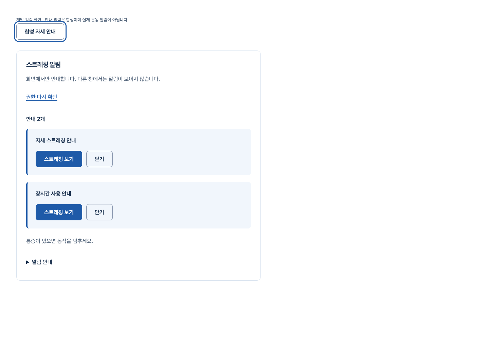

# 비공개 웹 알림 전달

[S4.N3](../../stories/stage4-alert-delivery.md) · [실제 집계·원본 SHA](summary.json)

권한을 거부해도 화면 안내를 유지하며, 종류별1개/전체2개 안내의 살펴보기·닫기·교체·끄기·수명 종료를 처리한다. 실제 판정/스케줄러/공개 측정 연결은 아니다. 새 디자인 구조나 최종 아바타 화면은 확장하지 않았다.

## 실제 확인한 흐름

최신 main db0b53a(PR #59 실제 merge commit)+동일 구현 소스에서 production React/격리 Chrome의 native 권한 거부·안내 도착·초점 유지·선택 callback·닫기·920px/200% CSS 확대·reduced motion·실제 문서 이탈을 통과했다. 실제 이탈은 폐기 뒤 closed/안내0을 관측한 경우에만 전용 루프백 수신기로 빈 GET 하나를 보낸다. 쿠키/Authorization/body/영상/좌표가 없으며 공개 엔드포인트가 아니다. 직접 pagehide를 호출한 합성 시험과 실제 탐색을 구분했다.

기존 가입→기록 상세/취소/삭제→계정→로그아웃→새 보호 주소도 실제 Chrome/HTTP/SQL 통합2를 통과했다. 메일과 기록 입력은 합성이다. 최신 main에서 전체 frontend729·타입/Biome/build/guard를 확인했고, 앞선 동일 API/SQL 소스의466 회귀와 Ruff/mypy를 통과했다. API466을 이후 증거 커밋에서 재실행한 것으로 표시하지 않는다. 기존 선택/공개 Chrome8은 계정 응답이 mock이며 실제 인증/촬영 검증이 아니다.

권한 허용/OS 생성·클릭·오류는 합성 포트/DOM 시험이다. 실제 OS 표시·소리·사용자 촬영·올바른 자세·출시 성능은 미검증이다. 공개 App/import/route·계정 화면/정책·API 스키마·SDK/CSP·아바타·패키지/lock·기존 migration·CI·운영 변경0이다. production JS에서 미완성 전달/주입 문자열0과 공개 화면의 부품 부재를 확인했다. Tailwind 소스 스캔 때문에 CSS 출력까지 main과 byte 동일하다고 주장하지 않는다.

## 실패와 보완

- 이전 미커밋 원본11개는 byte 동일하게 보존했다. 현재13개 구현/하네스 소스 SHA는 검증 전후 동일하다. 실패 로그/XML/Chrome report도 보존하고 SHA를 남겼다.
- 추가 작성자 리뷰의 실제 RED4는 폐기 중 권한 요청 시작·재진입 선택 중복·키보드 닫기 초점2건이다. 선택 후 같은 페이지에서 초점 소실1건도 RED로 확인해 보완했다. 실패한 선택 뒤 새 도착은 초점을 빼앗지 않는다. 최종 부품36은 controller20/native 합성5/React DOM11이다.
- Promise 타입·fieldset 의미·pending accessible name/details 그룹 fixture·오래된 브랜드 matcher를 보완했다. CDP 기본 context/너무 이른 detach로 denied가 default로 돌아가는 시험 오류도 보존했다. native 대조는 attached=denied/detached=default를 관측했으며 제품 권한 코드는 바꾸지 않았다.
- 실제 이탈 때 binding/console/CDP 관측이 도착하지 않는 실패를 보존했다. native 대조에서 keepalive GET은 수신됐으나 이전 관측은 없었다. 제품 pagehide 미실행으로 단정하지 않고 폐기 후 전용 빈 신호를 관측하도록 시험만 보완했다.
- 보충 통합의 로그아웃 완료 전 문서 이동 실패는 별도 [PR #59](https://github.com/HSU-OAS/bodyguard/pull/59)로 보완했다. 원본 순서 재실행 통과도 남기며 제품 로그아웃/시작 지연 원인 수정으로 주장하지 않는다.
- 초기 import 경로·sandbox uv cache/루프백 bind 실패는 환경 실패로 구분했다. 잠긴 기존 환경의 직접 실행/허용된 전용 loopback에서 재검증했으며 실패를 통과로 환산하지 않는다.

## 디자인·작성자 리뷰

지정 web-design-studio 흐름의 기존 화이트·블루 토큰과 버튼을 재사용했다. 문구는 짧게, 반복 설명은 기본 접힌 “알림 안내”로 이동하고 통증 중단 안내는 유지했다. 실제1440/920px·200% CSS 확대 이미지에서 여백/정렬/줄바꿈을 확인했다.48px 버튼/8px radius·대비≥4.5·초점3px/reduced motion을 실제 Chrome에서 검사했다. Figma·axe·새 패키지/시스템/hook·외부 폰트/장식 효과는 실행/추가하지 않았다.

보안(현재 수명·고정 OS 내용·원시 데이터/로그0),성능(최대2개·handle/listener 회수),정확성(늦은 응답·동기 오류·재진입·초점),유지보수(포트/controller/표시 분리)를 작성자가 재검토했다. 이 비공개 전달 범위의 미해결 P1/P2는 없다. 독립 에이전트 리뷰나 사람의 디자인 승인은 아니다.

## 남은 의존성

실제 로그인/코칭 수명 연결·검증된 classifier/기준선/동작·알림 정책 Q-07/08/21·소리/반응 기록은 후속 필수다. 공개 producer0/출시 검증 동작0이며 최종 아바타·SDK privacy·실측/참여자·디자인 구조/적용·Docker/TLS/운영/법무·Q32 나머지·1~6단계 기준은 미충족이다. 같은 아바타 부위 새 제작 사이클은 시작하지 않았다. 별도 승인 경계와 원본/이월은 유지한다.

PR 병합은 최신 diff/HEAD/CLEAN/체크를 실제 확인한 뒤 진행한다. merge commit/main 포함·브랜치 보존 결과는 PR과 다음 진행 기록으로 남기며 미래 병합을 미리 완료로 표시하지 않는다.
