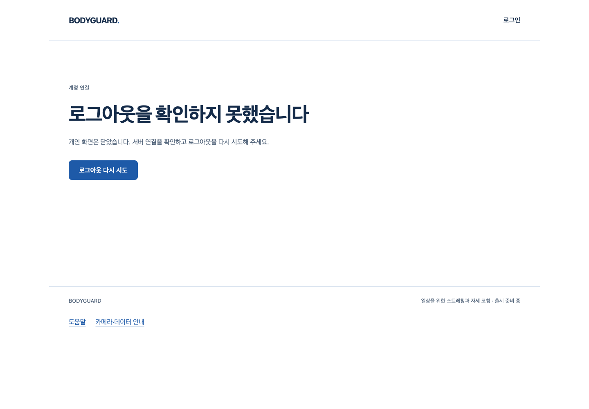

# S6.22 계정 작업 중 실제 캐시 복원

2026-10-10 · [사전 명세](../../stories/auth-page-restore.md) · 시작 main `e51ab4b39d5ca14f300248323240d4fded68518b` (PR113 병합).

## 달라진 사용자 흐름

로그아웃 확인 실패 후 도움말로 떠났다가 실제 브라우저 Back으로 돌아와도 개인 계정 화면을 자동 재개하지 않는다. 기존 오류 화면에서 명시적으로 다시 시도하고 **실제 서버204 뒤** 로그인 화면으로 이동하며 이전 세션은401이다. 정상 계정 화면은 캐시 복원 시 여전히 새 서버 권한을 확인한다. 진행 중 로그인·로그아웃을 캐시 이벤트가 취소하지 않는 것도 상태 전이 시험으로 확인했다.

1440×1000 로컬 production Chrome의 기존 화면이며 새 디자인/배포본이 아니다. 제품 수정은 AuthProvider의 pageshow에 기존 auth/logout 보호 조건2줄을 추가한 것뿐이다. 화면 구성·CSS·문구·서버 endpoint/schema/migration·보관/수집 정책은 바꾸지 않았다.

## 실제 실행과 원본 실패

| 실행 | 결과 | 구분·한계 |
| --- | --- | --- |
| 최초 DOM RED | 6실패/1통과, 총7 | 제품5실패와 설치되지 않은 matcher1실패. 실패 source/JSON 보존 |
| matcher 수정 후 DOM RED | 5실패/2통과 | happy-dom/fetch 합성. 실패 logout200/202/503·pending auth/logout. 정상 refresh/ordinary pageshow 대조군 통과 |
| 최초 native RED | 0통과/3실패 | Playwright goBack의 load 대기 시간 초과. 그 뒤 문서ID/persisted/재시도 검증은 미실행. 이를 실제 bfcache 판정 실패로 세지 않음 |
| CDP 관측 native RED | 1통과/2실패 | 실제 동일 문서/native persisted1, injected logout200/503 뒤 account-email 재등장·관측 leaks2. 정상 권한 재확인 대조군 통과. 실패2건의 재시도는 미실행 |
| 제품 보완 후 상태 전이 | 49통과 | 새7+기존 auth/logout/AppFocus. pending operation signal 유지·late 응답 권위·명시 retry·old refresh 취소 |
| 최종 전체frontend | 1504통과, pending0 | Vitest 전체. 실제 사람/카메라/의학 정확도 검증 아님 |
| 최종 native 캐시 | 3통과, retry0 | 같은 문서/native persisted1·500ms 관측 leaks0·emailVisible false·명시 retry204→login·old-cookie401. 정상 ready의 실제 서버 폐기/변경 없는 브라우저 쿠키→fresh401 유지 |
| 기존 native 계정/통합/비밀번호/기록 | 각각11/2/5/11통과 | 실제60초 재발송·가입/로그인·두 탭·복구/옛 자격증명 폐기·기록 상세/취소/삭제·기간/페이지·로그아웃. 메일·기록 fixture는 합성 |
| 관련 backend SQL | 64통과 | 새 소유 DB의 tests/test_auth.py. 전체backend 재실행은 아님 |
| 정적·최종 빌드 | 통과 | frontend tsc/Biome301파일(기존 info15), backend Ruff/format48·mypy app11. production guard JS1개/private 후보 문자열0 |

Chrome `155.0.8059.40`·실제 로컬 FastAPI/production Vite/PostgreSQL18.6이다. 잘못된 logout 응답은 route 주입이고 해당 backend POST는 실행되지 않았다. 따라서 실패 직후 DB 세션의200은 실제이며 서버가 잘못된 상태를 반환했다는 발견이 아니다. native 캐시3건의 cameraCalls0·외부/GLB/task/WASM/SDK 요청0·주 페이지 pageerror0·종료 storage `[0,0]`을 확인했다. 카메라·SDK 추론·아바타/WebGL·실제 공급자/HTTPS·실사용자/다장치 시험0이다. 빌드는 기존 준비 스크립트로 자산을 복사하므로 자산 파일이 아예 없다고 주장하지 않는다.

500ms의 DOM 관측과 이후 명시 재시도까지의 시험이며 무한 시간·모든 브라우저·정상 ready의 캐시 표시 전 순간까지 개인 내용 노출0을 입증한 것은 아니다. pending 로그인/로그아웃은 합성 상태 시험이며 미완료 HTTP 작업의 실제 캐시 복원 시험으로 표현하지 않는다.

## 하네스와 입력 보존

[Playwright 공식 goBack 경고](https://playwright.dev/docs/api/class-page#page-go-back)의 bfcache 탐색 지원 제한을 확인한 뒤 캐시 복원 이후 탐색/조회/스크린샷/재시도는 raw Chrome CDP로 수행했다. 같은 문서의 임의 ID와 native pageshow 카운터를 확인하고 원본 heap을 복원했다. 합성 pageshow·SPA 전환을 실제 캐시로 대체하지 않는다. 시험 전용 launch에서만 `--disable-back-forward-cache` 기본 인자를 제외한다. 다른 suite와 제품 실행 옵션은 유지한다.

- 최초 native `restore-20261010T095531208245Z`, 관측 `restore-20261010T100623436202Z`, 최종 `restore-20261010T100849849142Z`. 세 폴더의 report/실패 문맥/PNG를 보존한다. 최초 native 명령의 pipeline exit0은 tee 상태였으며 실제3실패가 결과다. 후속은 pipefail을 사용했다.
- `native-red-source/`5개는 최초 native 실행 전 입력이다. `native-observed-source/`는 raw CDP 최초 구성, `native-observed-final-source/`5개는 detach/최종 receipt 보완 뒤 실제 관측 RED 실행 전 입력이다. 제품 source는 세 폴더 모두 보완 전이다.
- `unit-first-source.tsx`는 최초 DOM 실행 뒤·matcher 수정 전 같은 입력 복사본, `unit-red-source.tsx`와 `base-auth.tsx`는 수정 RED 실행 전 입력이다. 수정 RED 전체 stdout 파일은 없으며 JSON/대화 출력으로 확인한다.
- `source-final/`19개는 제품 수정과49건 부품 시험 **뒤**, 최종 전체/native/회귀 실행 **전** 입력이다. collector는 RED 실행 뒤 작성했으며 RED runtime 도구라고 하지 않는다. 해당19개가 시험 관련 모든 파일이라는 주장도 아니다.
- 별도 샌드박스 native 명령은 loopback bind 권한 오류로 브라우저 실행 전 실패했다(`native-observed-red.log`). 승인된 로컬 실행은 별도 로그를 유지했다. 하네스 오류/NO_COLOR 경고·초기 실패를 지우거나 통과로 세지 않는다.

`node bodyguard/docs/review/auth-page-restore/collect.mjs --check`는 [manifest.json](manifest.json)의120개 압축/원본 SHA와 실제 실행 source19개·불변 제품/설정187개를 확인하는 도구다. 시험 재실행이 아니다. backend README의 새 소유 DB/환경을 준비한 뒤 `python -m tests.run_browser restore`로 실제 Chrome 캐시 시험을 재실행한다. 운영 URL을 넣지 않는다. 메일 IPC·쿠키·PG 내부 데이터·영상/좌표는 증거로 복사하지 않는다. 비밀번호 회귀는 list reporter/PNG 원본이며 JSON이 있다고 하지 않는다.

이번 `/private/tmp/bodyguard-auth-test.9yh0yYmN`·data/socket은 UID501/0700이고 역할/DB는 bodyguard_test다. 시험 종료 뒤 실제 data_directory·PostgreSQL18.6·빈 listen_addresses와 UID501/PID59177/명령을 조회했고 해당 DB만 정상 중단했다. 기존 서버/파일을 삭제하지 않았으며 DB/실패 원본을 보존한다. owned-stop.log는 중단 출력이고 소유 확인 조회 출력이 담긴 로그라고 하지 않는다. 처음 샌드박스 ps 읽기가 제한된 뒤 승인된 읽기에서 소유를 확인했다.

## 작성자 리뷰

engineering:code-review로 실제 source/diff·계약·실행 실패/입력·증거를 검토했다. 별도 에이전트/전문가 리뷰는 아니다.

- 기존 refresh/focus/BroadcastChannel와 같은 작업 보호 조건이다. logout-error는 기존 logout operation을 유지하므로 Back이 권위 있는 재시도를 없애지 않는다. auth 작업은 자체 응답/취소가 끝내고 일반 refresh만 기존 방식으로 재시작한다. 서버 폐기·쿠키 정책이나 새 자동 재로그인 규칙은 없다.
- 상태 전이7건의 pending·late·비캐시 대조군과 실제 캐시3건의 권한 재확인/실제 retry를 함께 유지했다. 기존 시험 body/timeout/retry를 바꾸지 않았다. scoped 제품 P1/P2는 남지 않았으며 원격 diff/HEAD/main/CLEAN/체크는 병합 직전에 별도 확인한다.
- native CDP helper는 실패/성공 모두 세션을 detach한다. per-case document ID·같은 문서/persisted 관측·고정 selector count·HTTP status bool만 receipt로 저장하며 계정/쿠키/token payload를 첨부하지 않는다. storage 종료 검사와 egress/camera/pageerror guard를 유지했다.
- runner는 suite/고유 결과/JSON/시험 launch flag만 추가한다. collector는 symlink·overwrite를 거부하고 실행 입력/압축·원본 SHA와 변경하지 않은 제품을 확인한다. 운영/외부/계정/비용 작업0이다.

## 아직 미완료

아바타 보류·원본/실패 보존을 유지한다. 전체1~6·출시 후보판·D2는 미완료다. 최종 아바타/시범·실측/참여자·출시 적격 동작0·추천/판정 정확도·노트북 성능·승인 코칭 구조/SDK 정책·기존 시작P2/타입 문제·실제 공급자/HTTPS/Docker·권리/법무·안전한 백업/복원·Q13/27/32를 이 Story에서 닫지 않는다. 중요한 범위·안전·개인정보·비용/계정/시크릿·운영DBmigration·배포·출시는 별도 승인이다.
