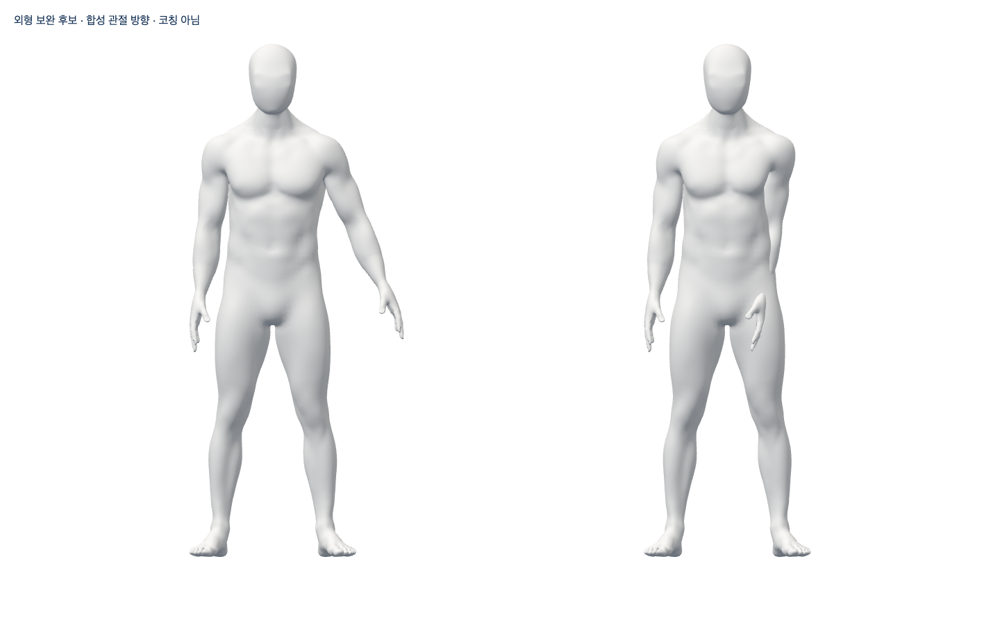

# 아바타 제작 재개 — 실제 후보와 남은 외형 문제

2026-10-12 · `codex/avatar-final-refinement` · main285e289에서 시작 · **Draft/미채택**

2026-10-14: [목·어깨 실제 편집 범위/보호 경계와 검수 조회 보완](continuous-20261014/README.md)을 같은 Story에서 진행했다. 새 원본/GLB/변형/실제 Chrome와 실패를 별도로 보존하며 아래10월12일 모델은 덮어쓰지 않는다. 여성 뒤 목·어깨 외형과 초기 프레임 지연 P2는 미해결, Draft/병합·제품 적용0이다.

CEO가 “해제하세요.”라고 승인해 보류를 해제했다. 기존 Draft108·원본·모든 반려 증거는 읽기만 하고 별도 후보를 만들었다. Blender MCP 연결은 실패했으나 설치 Blender5.1.1 b70da489d7f4의 factory/disable-autoexec 실행으로 실제 제작·검증했다. 추가 비용/에셋/계정/시크릿/운영/배포0. 참여자 시험은 이월한다.

## 실제 변화와 외형 판정

이전 원본 `be038c04`의 국소 접힘은 남성14/여성6이었다. 실제 core만 native dissolve→새 면 식별→explicit triangulation으로 재연결해 **남성28/여성12 정점**을 제거했다. 생존 정점의 좌표/skin·얼굴 앞면의 실제 면·손/발·163 bones/139 groups·바깥 면/PBR은 보존했다. native 접힘0·닫힘/방향0·degenerate 증가0을 확인했고 새 편집 원본 `e9c47f05`를 저장했다. 원래 인체를 primitive로 재생성한 것이 아니다.

뒤 목/어깨 표면에는 여전히 마감 P2가 있다. 단순 Y축 마감은 기술 검사/GLB/Chrome를 통과했지만 실제 렌더에 새 주름이 보여 **외형 반려**했다. 길이 가중 후보661a5ef5는 앞면/skin/rig/6mm 국소 한계를 보존했지만 뒤 목·어깨의 질감은 아직 참조 품질로 채택하지 않는다. **숫자/기술 포즈 통과는 외형 합격이 아니다.** 같은 단순 smooth 수치 sweep을 반복하지 않고 불균일 접합 구간의 면 밀도/곡률 연결을 다음 보완 대상으로 둔다.

[여성](preview/length-finish-female-after.png), [현재 남성 뒤 목](preview/male-back.png)·[여성 뒤 목](preview/female-back.png), [반려된 단순 마감](preview/rejected-depth-male-back.png)을 구분한다. 실제 렌더/브라우저 픽셀이며 AI 이미지/흐림 편집이 아니다. 원본 이미지 전부를 직접 열람했다고 주장하지 않는다.

## 재현한 실패와 보완

- 이전 준비된 native Laplacian transport를 실제 실행했으나 원래 경계 오차281m/접힘 증가로 **저장 전 반려**했다. solver/default/6mm/앞면 보호 기준을 느슨하게 바꾸지 않았다.
- bounded core 복원도 접힘11로 반려했다. 이 실행의 before geometry 필드는 편집 후 계산하는 하네스 오류가 있었고 수정했다. 그 파일을 before/after 개선 증거로 쓰지 않는다.
- native BMesh에 custom-data layer를 추가하면 이전 wrapper가 무효화됐다. 참조를 현재 ledger로 다시 읽었다. 이어 native가 외곽 rim에 만든 새 면11개를 vertex-membership만으로 오분류한 것을 확인했다. 실제 새 oriented face 식별과 국소 halo 제한·앞면 면/바깥 면 불변으로 보완했고 최종 native 원문에서 바깥 면 변화0을 확인했다.
- depth 마감의 첫 실행에는 가시성 계산 N+1이 있어 정확히 소유한 PID54459만 종료(exit143)했다. 후보0/원본 불변이고 실행 소스를 보존했다. 한 번만 계산하도록 고쳤다. modifier 적용 후 group 참조 무효화/skin 이후 적용 순서를 고쳤다. 새 접힘1은 반려했고 실제 unsafe4점은 원래 형상을 보존해 기술0을 확인했지만, 실제 새 주름 때문에 해당 후보는 **미채택**이다.
- 기존 A37 script의 새 후보 옵션 첫 archive 호출은 잘못된 작업 디렉터리로 실행 전 실패했다. root의 immutable Git blob에서 재실행한 기본 A37/retopology/depth/length Chrome는 각각 남녀2흐름 통과했다. 잘못된 GLB SHA는 의도대로 exit1/브라우저 보고서 생성0으로 거부했다.
- 일부 초기 경로/포맷 오류는 도구 출력에만 남았다. 별도 raw 파일이 없는데 파일 원문을 보존했다고 표시하지 않는다. 재사용 helper 포맷 전의 실제 실행 소스도 별도로 보존하며 의미 변경 없는 formatter 결과와 구분한다.

## 검증과 아직 미실행인 것

- 순수 source/GLB 원본 재열기·무의상 남녀 공통 재질·원래 전체 기술 변형은 실제 실행했다. 기술값은 운동 처방이 아니다. 각 후보/원본을 섞지 않고 아래 원문 report를 따른다.
- 최신 length source/GLB 왕복의 full pose render는 각각 실제 terminal exit0·passed=true·121행·34PNG로 확인했다. [원본](source-poses/)·[왕복](roundtrip-poses/)과 `proof/source-full.json`, `proof/roundtrip-full.json`에 기록했다. 최신 shader/형상은 직접 확인한 일부 이미지와 나머지 생성 증거를 구분한다. 이 기술 성공에도 외형 P2는 유지한다.
- 실제 Chrome/Three/GLTFLoader/WebGL 두 독립 skeleton·8 influences·서로 다른 합성 사지 방향·전신 발끝·source 불변·종료: 최신 length 남녀2흐름 통과. camera0/관찰 페이지 외부0/pageerror0. 전체 renderer cache/GPU GC·실제 webcam·전신/목/손/축 비틀림 정확도·시범/교정·노트북 목표 FPS 검증의 완료가 아니다.
- frontend1931/107파일·타입/Biome(기존16 info)/원래 notice build/production guard·diff 통과. 재사용 Blender helper와 새 제작 코드의 Ruff E,F(E402는 CLI module path 설명)·format 통과. API/DB·공급자·Docker/HTTPS·운영·실제 참여자 시험은 이번에 실행하지 않았다.
- `testing-strategy`와 `code-review` 기준으로 실제 모델 저작/재열기/왕복·합성 움직임·의도된 음성 시험/외형 평가를 분리했다. 작성자 검토이며 독립 전문가 리뷰를 했다는 뜻이 아니다. **외형 P2가 남아 Draft, 병합 금지**다.

## 원본과 재현

[수정 가능한 미승인 원본](models/candidate-length-unapproved.blend), [남성 GLB](models/bodyguard-male-candidate.glb), [여성 GLB](models/bodyguard-female-candidate.glb), [실제 보고서](proof/). 기존 입력은 PR108/c47fac83의 `lower-attempt/candidate-neck-center.blend` SHA be038c042c8b29acf53e0877adc085fec92608e230a563b6860914a01f58e068이다. 전문 A318 출처는 PR9/25a9bd6의 artist-candidate.blend SHA2eb274cfce046848eced56c12646869908259b2e6a04c6e188597959f7c48fff이다. 기존 CC0 body/head·MPFB core rig [출처](../../../assets/blender/README.md)를 유지하며 최신 참조는 모델링만, 제품/마케팅 재사용 승인이 아니다.

현재 렌더·원본·실패 원문/중간 후보는 `/private/tmp/bodyguard-avatar-final.LN5RnC`, Chrome 원문은 `/private/tmp/bodyguard-rig-proof.RIGB6J`에 보존했다. 소스 `assets/blender/final-refinement`에서 실행하며 기존 입력/후보가 있는 출력에는 쓰지 않는다. 재사용 GLB script의 추가 인수는 `scratch label candidateDirectory maleSHA femaleSHA`이고 기본 두 인수는 기존 A37 경로 그대로다. 모델/SHA는 caller가 고른 로컬 후보이며 출시 신뢰 앵커가 아니다.

전체1~6·전문가만 남은 상태·공개 아바타/코칭·실제 추천/판정·운영/배포/출시는 아직 완료가 아니다. 보류 해제는 새 제작을 허용한 것이지 품질 합격 선언이 아니다.
