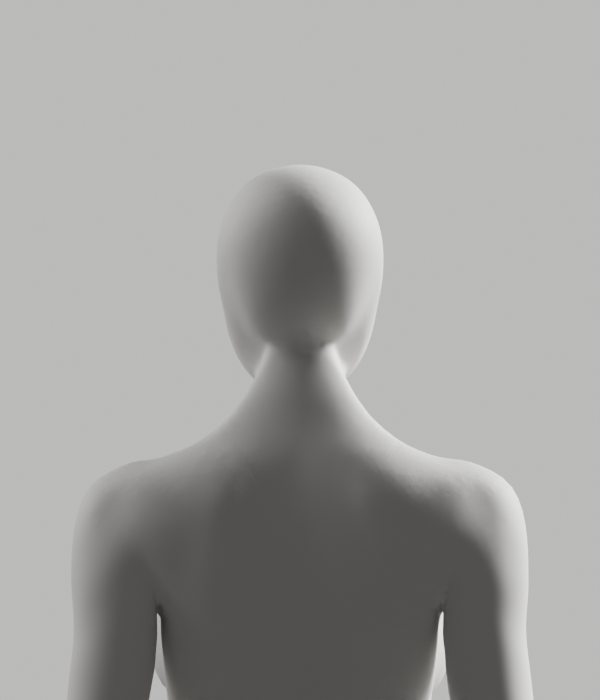

# 목·어깨 편집 영역과 검수 조회 보완

2026-10-14 · PR150 동일 Story · **미승인 후보/Draft, 제품 적용0**

남녀 목·어깨의 실제 편집 원본과 GLB를 새로 제작했다. 원본661a5ef5와 과거 파일을 덮어쓰지 않았다. 새 원본은71c369c9, 남성 GLB8c3d34b9/여성a9bca83c다. 실제 고정 렌더에서 어깨 요철은 줄었으나 **여성 뒤 목·어깨의 잔여 요철과 초기 프레임 지연은 미해결 P2**로 유지한다. 전체1~6 완료나 출시 아바타가 아니다.

## 실제 변화

기존 목·어깨 선택은 MPFB의 `spine05`를 상부 몸통으로 잘못 해석하고 쇄골 끝에서 편집을 줄였다. 실제 원본의 뼈 위치를 읽어 어깨·목 연결 범위를 다시 잡았다. 전문 원본 복제의 균일 voxel 표면→native Smooth→Catmull-Clark 곡률→Shrinkwrap의 깊이 성분을 해당 부위에만 적용했다. 임시 target은 제거하며 전신 remesh로 모델을 대체하지 않는다.

남성10128/여성10298 정점의 깊이가 최대0.687/0.904mm 바뀌었다. 얼굴 앞면·손발·나머지 위치와 전신 X/Z, 모든 원래 skin·rest/pose rig·163뼈/139그룹·위상·재질·기록 속성은 exact 보호했다. 기존6mm 제작 한계와 닫힘/접힘0 기준을 낮추지 않았다. 이는 인체 관측/운동 임계값이 아닌 조형 검사다.

[남성 뒤 목](preview/male-back.png), [여성 정면](preview/female-front.png), [실제 기술적 목 기울임](source-poses/faceless-neck-female-left.png), [팔 변형](source-poses/technical-male-upperarm01.png). 원래 재질·조명·고정 카메라로 렌더했으며 AI 정적 시안/이미지 편집이 아니다. 생성한34개 기술 포즈 PNG 전부를 직접 검수했다고 주장하지 않는다.

## 실패와 보완

- sandbox Blender는 Python/modeling 전에 Metal 장치 초기화에서 crash139였다. crash와 로그를 보존했다. 이후 격리 background 실행은 정상 동작했으며 live Blender는 수정하지 않았다.
- 좁은 영역/가중치의 균일 표면 후보는 기술 검사를 통과했지만 외형 개선이 충분하지 않았다. 실제 어깨 뼈 위치에서 편집 영역 누락을 확인했다. source의 커스텀 노멀은 없어, 노멀 삭제로 해결된다고 가정하지 않았다.
- 양방향 Y 광선 투영은 X/Z roundoff1.19e-7m로 exact 검사에 실패했다. 원래 X/Z를 복원해도 접힘150개로 다시 실패했다. 후보 저장 전에 거부했으며 허용 오차·접힘 기준을 완화하지 않았다.
- 실제 메시 거리의 보호 경계 전이와 가까운 곡면의 깊이 성분만 적용한 최종 후보는 남녀 접힘0/외부 좌표·skin·rig 불변을 통과했다. 입력·출력과 실행 소스를 섞지 않고 `proof/`, `executed/`에 보존했다.
- Chrome 최초/단독 시험은 동일10초 조건의60프레임 대기에서 실패했다. 진단에서도 male55회로 실패했고 update/render보다 프레임 간격이 컸다. 진행 조회가 매 RAF마다52만여 정점의 정확한 CPU skin bounds를 다시 계산했다. **진행 조회만** 저비용 계수로 분리한 후 같은 후보/같은10초 기준의 남녀2흐름과 원래 immutable A37 남녀2흐름이 통과했다. 처음/움직임 후 전신의 정확한 정점 투영·독립 리그·방향/원본 불변·종료 검사는 유지한다.
- 비용은0, 실제 카메라/관찰 페이지 외부 요청/pageerror0이었다. 전체 Chrome 프로세스의 통신이나 GPU 캐시 회수 완료로 확대하지 않는다. 진단은 개발자 로컬 환경의 합성 아바타뿐이며 제품의 사용자 하드웨어 수집을 추가하지 않는다.

## 실제 검증 범위와 미완료

원본 full 검수는121행·34PNG/exit0, GLB 재수입은121행/exit0·렌더 미실행이다. 같은8가중치·전체 전신·남녀 공통 백색 무의상 표면을 확인했다. 내보내기 경고도 `proof/export.log.gz`에 그대로 남기며 경고0으로 표시하지 않는다. GLB에는 운동 애니메이션·참조 이미지·카메라/조명이 없다.

Chrome155/Apple M4의 짧은 합성 재생에서 male 프레임 간격 p95는300.1ms, 최대1583.3ms; female은33.3ms/233.4ms였다. **움직임 전달/구도 검사의 통과가 부드러움·시작 성능 합격은 아니다.** 첫 프레임/긴 지연을 감추거나 warm 구간만으로 전체 성능을 선언하지 않는다. 원래 시작P2도 유지한다.

frontend1931/107파일·타입·해당 Biome·원래 준비/build/production guard와 새 native 소스의 Ruff E,F(E402 제외)/format을 실행했다. 마지막 전체 회귀 한 번은 기존 `RecordsPage`의 계정 재확인 heading 초점으로1930통과/1실패였고 후속 build는 실행되지 않았다. 해당 화면/테스트는 main과 동일함을 확인했으며 단독16개와 변경 없는 전체1931개를 다시 실행해 통과했다. 원인 해결이나 실패 부재를 주장하지 않고 처음 실패와 재실행을 모두 보존한다. 이후 실제 build/guard도 통과했다. 기존 출력 거부는 의도된 exit1/덮어쓰기0으로 확인했다. API/DB/메일/OAuth/Docker/HTTPS/실제 사람/운동 정답·실측 정확도는 이번에 실행하지 않았다. 여성 외형과 초기 지연의 P2 때문에 병합 금지다.

## 재현과 보존

`assets/blender/final-refinement/project_uniform_posterior.py`에 보존 입력661a5ef5, **새 후보 경로**, **새 report 경로**를 전달한다. Blender5.1.1 `--factory-startup --disable-autoexec -b ... --python-exit-code 1 --python ... -- ...`을 사용하며 기존 경로는 거부한다. source/GLB에는 원래 `review_avatar.py --candidate --mannequin`, GLB 왕복에는 `export_avatar_candidate.py`를 사용한다.

Chrome는 `e2e/fixtures/avatarRig.vite.ts`의 새 `bodyguard-rig-proof.<id>/probe` bundle과 `test-avatar-rig-browser.mjs <scratch> <label> <candidateDirectory> <maleSHA> <femaleSHA>`로 재현한다. 원래 두 인수의 A37 경로도 실제 재검증했다. 공개 route·웹캠·API를 추가하지 않는다. 후보 directory는 기존 allowlist 형식의 독립 `/private/tmp/bodyguard-avatar-final.<id>/glb-continuous`였다.

작성자 `code-review` 검토는 출력/입력 불변·유한 처리·국소 범위/보호 경계·전신/가중치·자원 회수·관찰 비용과 검증 주장 범위를 확인했다. 독립 전문가 리뷰나 전체 출시 승인이 아니다. 이전 모델/실패는 유지하고 안전한 다음 보완은 잔여 곡률 연결과 초기 갱신 지연의 원인 분리다.

전문 원본 입력·최종 후보/GLB·직접 만든 중간 후보의 파일은 삭제하지 않았다. 기존 임시 경로는 운영체제 정리로 없어질 수 있으므로, 이번 중간 uniform/shoulder 후보와 실제 web/왕복 `.blend`는 작업 공간의 별도 `BODYGUARD-avatar-evidence-20261014.KrDyS0`에 추가로 보존하고 SHA 목록을 `proof/local-preserved.json`에 기록했다. 최종 수정 가능한 원본/GLB/포즈·실패/실행 소스는 이 저장소 폴더에도 보존했다. 이전 임시 폴더가 현재 없는데 이전 모든 임시 파일을 보존했다고 주장하지 않는다.
