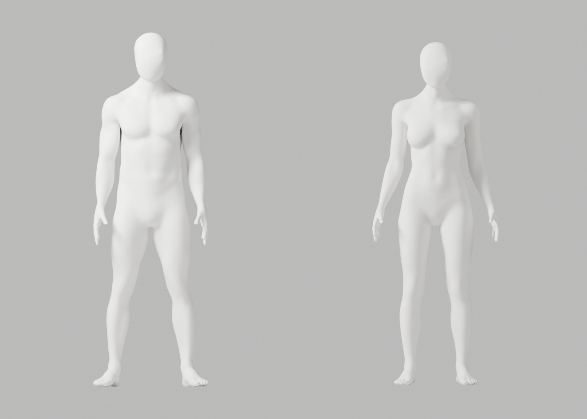

# 얼굴–목 통합 후보: 기술 검증 성공, 외형 미채택

2026-10-10 · [Story](../../stories/avatar-neck-integration.md) · 시작 main a466528 · 출시 아바타/실제 사람 코칭 아님

새 Blender 후보를 실제 제작·저장했고 원본 보호·독립 재열기·GLB 왕복·전체 기술 변형·Chrome 두 아바타 재생을 실행했다. 그러나 **뒤 목–어깨의 패치 같은 마감과 일부 관절 마감이 남아 외형 P2 미해결**이다. 새 후보는 미채택·Draft PR만 허용하며 기존 Draft #9/A37/공개 제품은 변경하지 않는다. D2-A 및 전체1~6 통과가 아니다.

## 실제 미리보기



[남성 뒤 목 전](before-render/male-back.png)·[후](after-render/male-back.png), [여성 뒤 목 전](before-render/female-back.png)·[후](after-render/female-back.png), [남성 실제 Chrome 두 rig](browser/reviewed-male-after.png)·[여성](browser/reviewed-female-after.png)를 비교한다. 같은 조명/재질/카메라의 전후8컷씩이며 흐림·이미지 편집·AI 생성으로 수정하지 않았다. 앞 목은 보존했고 뒤 접합의 국소 개선은 최종 마감에 미달한다.

## 실제 수행과 미실행

| 실행 | 실제 결과 |
|---|---|
| 변경 없는 원본 대조 | exit1·passed=false. 수정0을 개선 통과로 인정하지 않는 의도된 음성 시험. 이전 모델의 품질 실패를 새 개선 성공으로 바꾸지 않음 |
| Blender native 국소 제작 | exit0. 남성131645/여성130548점·raw139 groups·각163 bones 보존. 선택13266/12767·실제 변경13107/12702, 최대3.769/4.163mm. 앞면/마스크 밖 좌표·skin/rest/pose/world·PBR·속성·위상 exact. 연결/닫힘/작은 면 수 불변 |
| 새 원본 독립 재열기 | exit0. 새 파일을 읽은 별도 Blender 프로세스에서 입력과 위 보호 조건 재검증 |
| 기존 후보 덮어쓰기 시도 | exit1·passed=false. 변경 전 거부. 입력/후보 SHA 불변 |
| 원본 전체 기술 변형 | qc-only exit0·121행/neutral+118 기술 pose·PNG0. 이후 **새 full render 실행 exit0·121행·34PNG** |
| 실제 GLB 내보내기/재수입 | exit0·최대8 influences·독립 남녀 skin. GLB11,638,276/11,541,880 bytes. exporter의 geometry_deformation_pending=true는 그대로 보존, 후속 왕복 결과와 구분 |
| GLB 왕복본 전체 기술 변형 | qc-only exit0·121행/118 기술 pose·PNG0. 이후 **새 full render 실행 exit0·121행·34PNG** |
| 동일 조건 전후 외형 | 각각 native exit0·8PNG. 직접 본 뒤 목/측면에서 미달 확인, **외형 반려/미채택** |
| 실제 Chrome/WebGL | 최초2·작성자 검토 후2 성공. 남녀 각각 두 독립 skeleton/8 influences·다른 합성 사지 방향·전신 발끝·원본 불변·종료 확인. 카메라0/관찰한 페이지 외부 요청0/pageerror0. 운영·실제 웹캠·운동 정확도 시험이 아님 |
| 공개 웹 경계 | 실제 assets/TypeScript/Vite build·DEV guard 성공. JS/CSS SHA는 기존 main과 동일, 새 GLB/제작 코드/UI/문구가 공개 build에 포함되지 않음 |
| 정적 검사 | 신규 author/render Ruff·format, browser/collector Biome 통과(collector 기존 style info1 유지). 복사 helper의 기본 Ruff SIM118 실패 보존, Blender ID의 keys API를 dict 반복으로 바꾸지 않고 기존 exact source/E,F 검사 통과만 표시 |

공개 JS SHA256 `434efb6661a704895d6746ff6a40779c11806d53af276e9244fb4e2ade6e6945`, CSS `043cb9bdb5d82a3baa9a8463c7a641cbe92ace213303f20c6c7f91e9a14ac82e`다. 기존 API/SQL·1479 DOM 전체 재실행·실제 참여자/목표 노트북/카메라 권한/시범/임상 판정·공급자·배포 검증은 이번에 **미실행**이다. 과거 결과를 이번 통과로 복사하지 않는다.

Blender5.1.1 b70da489d7f4와 고정 프로젝트 Node/Three/Playwright runtime을 사용했다. 새 의존·계정·비용·시크릿·운영 DB·배포0다. 최신 manual 직접 열기는402로 실패했으며 공식4.2 manual 검색의 국소 vertex group/길이 가중 설명과 실제 설치 API 실행을 구별한다. [공식 문서](https://docs.blender.org/manual/en/4.2/modeling/modifiers/deform/corrective_smooth.html)는 제작 API 설명이지 의료/품질 인증이 아니다.

## 원본과 보존

[새 편집 원본](candidate-unapproved.blend), [웹 원본](web-unapproved.blend), [GLB 왕복 원본](web-roundtrip-unapproved.blend), [남성 GLB](glb/bodyguard-male-candidate.glb)·[여성 GLB](glb/bodyguard-female-candidate.glb)를 **미승인 후보**로 보존한다. 137개 exact artifact(92PNG 포함)의 raw/archive SHA는 [manifest](manifest.json)에 있다. 아래 checker는 저장 바이트·이미 실행된 보고서를 점검할 뿐 Blender/브라우저를 다시 실행하는 도구가 아니다.

```bash
node bodyguard/assets/blender/integration-neck/check-evidence.mjs
```

입력은 보존 Draft #9 source25a9bd6의 `bodyguard/assets/blender/review/candidate-a316-a322-review/native/artist-candidate.blend`, SHA256 `2eb274cfce046848eced56c12646869908259b2e6a04c6e188597959f7c48fff`다. 전후 실제 같은 SHA를 확인했다. 기존 Draft 작업트리의1959개 추적 변경/삭제·HEAD는 그대로이며 복구/삭제하지 않았다. 새 원본 SHA `ce8887d0421653774c05baf4ef3ed8d222250020cc770f63d398f6fc2c10343b`. 참조 SHA `45b313912dee5ae2218b1fe76086abb35a9b948fab9e877f1a9d2b05f832de62`는 최신 CEO 사진과 같다.

제작은 전문 Blender Foundation CC0 몸/머리와 MPFB core CC0 rig 기반의 기존 원본을 수정한 것이다. 새 primitive 인체·외부 에셋/의상/플러그인 코드0. 기존 [출처/권리](../../../assets/blender/README.md)를 유지한다. 참조는 모델링만, 제품/마케팅 재사용 승인으로 간주하지 않는다.

제작 첫 실행은 formatter 전 source다. exact 사본 `executed/author-before-format.py.gz`를 보존하고, 의미 변경 없는 formatter 뒤 독립 재열기/비교를 수행했다. 새 author 초기 format 실패는 도구 transcript에만 관측됐고 별도 원시 파일을 저장하지 못했다. 복사 helper의 Ruff 실패·collector 첫 format/import 실패, 의도된 음성 실패 원본은 따로 보존했다. 모든 과거1264개 파일을 다시 hash했다는 주장은 하지 않는다.

직접 열람한 새 검수 이미지는15개다: 전후 남녀 back4, after 남녀 side2, 원본 남녀 neck-left/right4, 원본 front1, 왕복 female-neck-left/male-side2, 최초 Chrome 남녀 after2. 생성92개를 모두 직접 봤다고 쓰지 않는다.

## 작성자 리뷰와 다음 조건

code-review로 보호 비교·덮어쓰기·source SHA·native script 실행/원본 보존·웹 자산 차단·실제/합성 경계를 확인했다. collector의 경로 계산은 실행 전에 개발 폴더로 고쳤고 밖의 과목 문서에 쓰지 않았다. browser source accounting에 snapshot/render helper를 추가하고 실제 두 case를 다시 실행했다.

**P2: 후두부–목–어깨 접합과 전체 관절 마감/참조 품질 미달.** 작은 smooth 반복만으로 해결됐다고 보지 않는다. 다음 국소 보완은 남은 실제 접합/변형 결함을 대상으로 전문 메시 연결과 표면을 다시 설계해야 한다. 모양을 숨기는 조명/blur·해부학 구조 제거·리깅 축소·판정 보간 우회는 금지다.

따라서 이번 Story·PR는 완료/병합하지 않는다. 최종 통합은 계속 진행하되 임계값/올바른 시범은 실제 수행/독립 관찰 조건을 충족해야 하고, 공개 UI/SDK·실제 공급자/HTTPS·비용/계정/시크릿/운영 DB/배포/출시 승인은 별개다. 전문가 검토만 남은 상태가 아니다.
